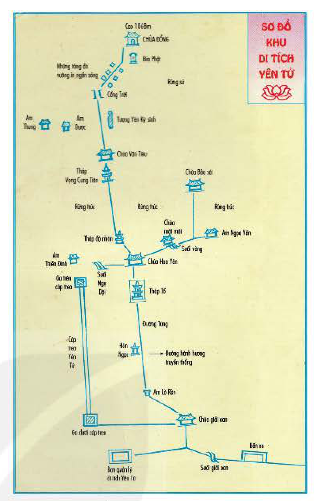
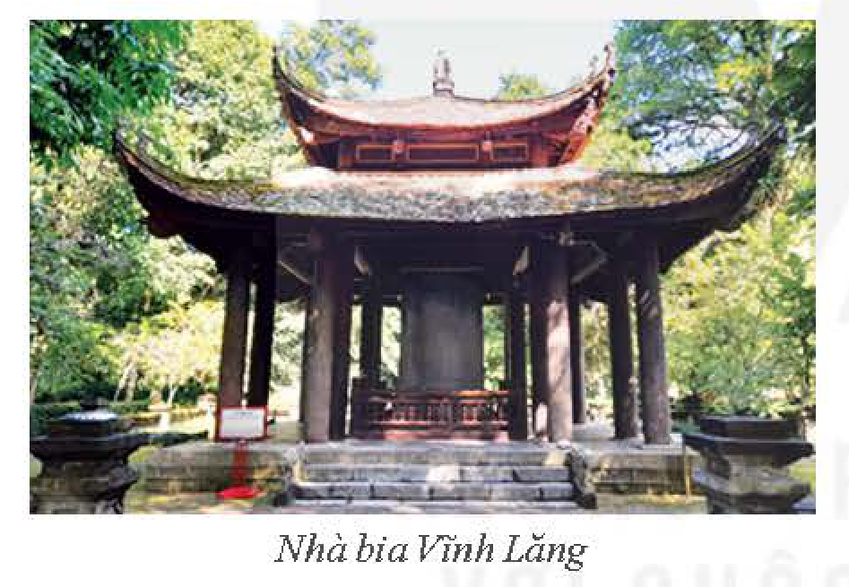

<!-- pdf:91 -->

# BÀI 9: ĐI VÀ SUY NGẪM

*Du lịch – ban đầu nó khiến bạn không thốt nên lời, sau đó biến bạn thành một người kể chuyện.*
<!-- ocr-ok: câu đề từ chữ kiểu trên nền xanh bị OCR đọc nhầm ("ấầu", "khiêm", "niột", "chuuệm"), đã đối chiếu trực tiếp ảnh trang PDF 91 -->

I-bơ-nơ Bát-tu-ta (Ibn Battuta)
<!-- ocr-ok: tên tác giả câu đề từ trên nền xanh bị OCR đọc nhầm ("I-bd-ng Bái-Tù-†a {lbn Baffula)"), đã đối chiếu trực tiếp ảnh trang PDF 91 -->

## Giới thiệu bài học

- Đi trên đất nước Việt Nam, mỗi bước đều có thể dẫn ta đến những cảnh trí diễm lệ của thiên nhiên, những câu chuyện bất tận về lịch sử vừa gian khó vừa hào hùng của dân tộc. Đi – thưởng ngoạn – quan sát – học hỏi và suy ngẫm, đó thực sự là một cơ hội tích luỹ năng lượng sống tuyệt vời mà mỗi người cần đón nhận bằng thái độ tích cực.

- Qua tìm hiểu hai văn bản thông tin – loại văn bản đọc chính của bài học – và một bài thơ có sự gần gũi về chủ đề, em sẽ thấu hiểu sự cần thiết của việc chuyển hoá điều mình đã quan sát, thu nhận từ các chuyến đi, các hoạt động trải nghiệm thành những sản phẩm ngôn từ mang tính chất giới thiệu, quảng bá về đất nước và lịch sử dân tộc. Điều này rất có ý nghĩa đối với em trong việc rèn luyện một số kĩ năng thiết yếu và hình thành thái độ trách nhiệm trước bao món quà vô giá do thiên nhiên ban tặng, trước những công trình có giá trị lịch sử, văn hoá vốn thấm đẫm mồ hôi, xương máu của tiền nhân.

## 🎯 Yêu cầu cần đạt

- Nhận biết và phân tích được đặc điểm của văn bản giới thiệu một danh lam thắng cảnh hoặc di tích lịch sử, tác dụng của cách trình bày thông tin trong văn bản (trật tự thời gian, quan hệ nhân quả, các đối tượng phân loại, so sánh và đối chiếu,...).
- Phân tích được thông tin cơ bản của văn bản; biết giải thích ý nghĩa của nhan đề và đánh giá vai trò của các chi tiết quan trọng trong văn bản.
- Nhận biết và phân tích được quan hệ giữa phương tiện ngôn ngữ và phương tiện phi ngôn ngữ dùng để biểu đạt thông tin trong văn bản.
- Hiểu được các hình thức làm biến đổi, mở rộng cấu trúc câu và ý nghĩa của chúng để vận dụng vào hoạt động tạo lập văn bản.
- Viết được bài thuyết minh về một danh lam thắng cảnh hay một di tích lịch sử, có sử dụng các sơ đồ, bảng biểu, hình ảnh minh hoạ.

<!-- pdf:92 -->

- Thuyết minh được (dưới hình thức nói) về một danh lam thắng cảnh hay một di tích lịch sử, có sử dụng các sơ đồ, bảng biểu, hình ảnh minh hoạ.
- Tự hào về vẻ đẹp muôn màu của đất nước và truyền thống lịch sử anh hùng của dân tộc; có ý thức gìn giữ những di sản quý báu do ông cha để lại và bảo vệ sự toàn vẹn lãnh thổ của Việt Nam.

## Đọc

### TRI THỨC NGỮ VĂN

**Văn bản giới thiệu một danh lam thắng cảnh**

<!-- term: văn bản thuyết minh giới thiệu một danh lam thắng cảnh -->
- Văn bản giới thiệu một danh lam thắng cảnh thuộc loại văn bản thuyết minh, được viết ra nhằm đưa đến cho người đọc những thông tin khái quát về một cảnh quan đáng du ngoạn, thưởng lãm. Cảnh quan được đề cập thường có sự kết hợp hài hoà giữa vẻ đẹp vốn có của thiên nhiên (thắng cảnh) và vẻ đẹp của các công trình nhân tạo, trong đó phổ biến là loại công trình phục vụ cho hoạt động tín ngưỡng (danh lam).
- Văn bản giới thiệu một danh lam thắng cảnh có thể được triển khai theo nhiều cách khác nhau. Tuy vậy, việc tạo lập mọi văn bản thuộc kiểu này đều phải đảm bảo các yêu cầu chính: nêu được vị trí không gian và quá trình hình thành cảnh quan; miêu tả được cấu trúc và vẻ đẹp của cảnh quan; đánh giá được ý nghĩa của cảnh quan đối với đời sống con người; phối hợp hiệu quả phương tiện ngôn ngữ và phi ngôn ngữ khi thể hiện tất cả nội dung trên.

**Văn bản giới thiệu một di tích lịch sử**

<!-- term: văn bản thuyết minh giới thiệu một di tích lịch sử -->
Văn bản giới thiệu một di tích lịch sử thuộc loại văn bản thuyết minh. Nội dung của nó nói về những địa điểm, công trình (bao gồm cả di vật, cổ vật tồn tại trong đó) còn ghi dấu các sự kiện đáng nhớ của lịch sử đất nước, dân tộc, nhân loại. Thông qua việc kết nối quá khứ với hiện tại, văn bản khơi dậy ý thức trân trọng lịch sử, vun đắp thái độ yêu quý, giữ gìn những “trang sử sống” có thể gửi đến tương lai nhiều bài học có ý nghĩa. Trong nhiều trường hợp, di tích lịch sử là một bộ phận hữu cơ của danh lam thắng cảnh. Vì vậy, giữa văn bản giới thiệu về di tích lịch sử với văn bản giới thiệu về danh lam thắng cảnh có một số điểm tương đồng trên cả hai phương diện nội dung và hình thức.

**Cách trình bày thông tin trong văn bản thông tin**

<!-- term: cách triển khai thông tin trong văn bản thông tin -->
- Tuỳ vào mục đích và nội dung thông tin mà người viết sẽ chọn những cách triển khai văn bản linh hoạt, phù hợp.
- Kiểu văn bản giới thiệu về một danh lam thắng cảnh hoặc di tích lịch sử thường được triển khai theo cách riêng: đi từ cái nhìn tổng quan đến miêu tả cụ thể các bộ phận hợp thành của đối tượng; trình bày xen kẽ tình trạng thực tế và lịch sử hình thành của đối tượng; chú ý đặt đối tượng giới thiệu vào đúng loại của nó để thực hiện những so sánh, đánh giá cần thiết.

<!-- pdf:93 -->

**Biến đổi và mở rộng cấu trúc câu**

<!-- term: các hình thức biến đổi cấu trúc câu -->
Khi tạo lập văn bản, để đạt được hiệu quả tối đa trong việc truyền đạt thông tin (thông tin khách quan hay thông tin tình thái, thông tin thẩm mĩ), người ta thường điều chỉnh những câu định viết hoặc đã viết bằng cách làm biến đổi cấu trúc hoặc mở rộng cấu trúc của chúng. Trong việc làm biến đổi cấu trúc câu, vấn đề thay đổi trật tự các từ ngữ, chuyển cụm chủ ngữ – vị ngữ thành cụm danh từ, chuyển kiểu câu chủ động thành câu bị động hoặc ngược lại thường được đặc biệt chú ý. Trong việc mở rộng cấu trúc câu, vấn đề bổ sung hay mở rộng một thành phần câu nào đó lại là những điều thường được quan tâm đầu tiên.

### VĂN BẢN ĐỌC

- **VĂN BẢN 1.** *Yên Tử, núi thiêng*, Thi Sảnh
- **VĂN BẢN 2.** *Văn hoá hoa – cây cảnh*, Trần Quốc Vượng
- **VĂN BẢN 3.** *Tình sông núi*, Trần Mai Ninh

### VĂN BẢN 1: YÊN TỬ, NÚI THIÊNG

**Trước khi đọc**

1. Khi đi tham quan hay du lịch, em có thường tìm hiểu trước về nơi sắp đến không? Nếu có, loại tài liệu em quan tâm tìm đọc, xem, nghe là gì?

2. Kể tên một số danh lam thắng cảnh có di tích lịch sử mà em đã đến hoặc đã biết.

**Đọc văn bản**

**Yên Tử, núi thiêng**

**THI SẢNH(1)**

Giữa những cánh cung núi trùng điệp của khu Đông Bắc mênh mông, Yên Tử cao 1 068 m, vút lên chon von tựa một vọng gác. Từ xưa cảnh núi rừng Yên Tử đã nổi tiếng là một nơi ngoạn mục. Các triều đại phong kiến ở nước ta đều liệt Yên Tử

> **THEO DÕI:** Tác giả nêu cảm nhận và đánh giá khái quát về đối tượng được giới thiệu như thế nào?

> (1) Thi Sảnh (1941 – 2020) quê ở Quảng Trị, là nhà thơ, nhà văn, nhà nghiên cứu lịch sử – văn hoá, đã viết nhiều tác phẩm, công trình về lịch sử, thắng cảnh, di tích của vùng đất mỏ Quảng Ninh – nơi ông có quá trình công tác và gắn bó lâu dài. Tác phẩm chính: *Lịch sử phong trào công nhân Quảng Ninh* (tập 1, 1974; tập 2, 1984); *Cõi thiêng Yên Tử* (2002); *Thức với dòng sông* (2004); *Quảng Ninh, miền đất những kì tích* (2004); *Hình bóng xưa* (2005); *Vịnh Hạ Long – hành trình một kì quan* (2012).

<!-- pdf:94 -->

vào loại “danh sơn” (núi đẹp). Sau khi Thiền phái Trúc Lâm ra đời và đi liền với nó, hệ thống chùa tháp uy nghi mọc lên chi chít, thì Yên Tử càng thêm quyến rũ du khách bốn phương.

Yên Tử ngày nay thuộc thành phố Uông Bí, cách trung tâm thành phố 14 km về phía tây bắc. Từ Hòn Gai, ngược trục đường 18A 40 km, ta sẽ đến Uông Bí. Tại đây ta nghỉ ngơi chốc lát, chuẩn bị thêm lương thực, thực phẩm cho chuyến hành hương tới “Núi vua hoá Phật” và ngắm cảnh vật thành phố.

> **THEO DÕI:** Người viết cho biết điều gì về toạ độ không gian của núi thiêng Yên Tử?

Từ cổng nhà máy điện Uông Bí, ta theo đường vào mỏ Vàng Danh đến Lán Tháp, đến đây ta rẽ phía tây theo con đường qua xã Thượng Yên Công và đi tiếp 4 km nữa thì đến Yên Tử. Đoạn đường từ Lán Tháp vào Yên Tử dài 9 km, đi giữa lòng thung lũng dài và hẹp, giới hạn bởi dãy núi Cánh Gà ở phía nam, Bảo Đài ở phía bắc, thoạt trông như những thành quách cổ xưa. Những khu vườn xum xuê cây ăn quả: vải, nhãn, mận, đào, mùa nào thức ấy, những mảnh ruộng mía thân tím thẳng tắp, nối tiếp hai bên đường. Suối Giải Oan trong veo, chảy ngoằn ngoèo trong thung lũng, trên nền đá cuội và sỏi trắng, cắt con đường từ Lán Tháp vào Yên Tử 9 đoạn, khiến du khách ngỡ là 9 con suối khác nhau. Hai bên bờ suối, hoa dành và hoa bướm vàng rộm. Đây đó có những khóm hoa hải đường chen với hoa thuỷ tiên đang nở bung những cánh mỏng phớt tím.

> **HÌNH DUNG:** Vẻ đẹp của lối vào Yên Tử đã được miêu tả bằng những chi tiết, hình ảnh nào?
<!-- ocr-ok: thẻ Hình dung bên lề bị OCR đọc lỗi ("Về đẹp", "iảu tá bằng những ơi Bối, hình grnh na0"), đã đối chiếu trực tiếp ảnh trang PDF 94 -->

Vào mùa xuân, sau Tết âm lịch, khi tiết trời dịu mát, rừng Yên Tử nở lộc đơm hoa. Khách thập phương rộn ràng đổ về Yên Tử trẩy hội. Khách tham quan thuộc nhiều lứa tuổi, nhiều nghề nghiệp, kể cả trong nước và ngoài nước, hăm hở, nhằm đỉnh núi mờ sương bước vội, mong chóng đến nơi mà mình mơ ước.

Tên xa xưa của Yên Tử là Núi Voi, bởi dáng núi giống hình con voi quay đầu về phía biển. Trong sử sách, Yên Tử còn có tên là Bạch Vân Sơn (núi mây trắng), bởi quanh năm đỉnh núi chìm trong mây trắng. Từ xưa, nhiều tín đồ đạo Phật ở nước ta đã say đắm cảnh vật Yên Tử “Lối đi có trúc, khe suối có hoa” (thơ Phạm Sư Mạnh), cũng là nơi thâm nghiêm, u tịch. Họ đã đến dựng chùa mái tranh vách nứa dưới chân núi Yên Tử, ngày ngày cầu kinh niệm Phật. Theo *Hải Dương phong vật chí*, từ xưa Yên Tử đã nổi danh là “Phúc địa thứ tư của Giao Châu”, là ngọn núi thiêng, chốn tu hành tuyệt đỉnh của những người mộ đạo như dân gian truyền tụng:

<!-- pdf:95 -->

*Nào ai quyết chí tu hành*
*Có về Yên Tử mới đành lòng tu.*

Theo *Hán thư*, vào đầu Công nguyên, một người nước Tề là An Kỳ Sinh đã lặn lội tìm đường đến Yên Tử tu tiên luyện đan để tìm ra thuốc trường sinh bất tử cho vua nhà Hán. An Kỳ Sinh từng là bạn thân của Khoái Thông, người bày mưu tính kế cho Hạng Vũ. Đến Yên Tử, An Kỳ Sinh ở hẳn trong núi, vừa tu đạo, vừa luyện thuốc. Ông lập ra Am Dược, Am Hoa, Am Thung, sắm cối và chày giã thuốc bằng đá. Thuốc trường sinh chắc chắn ông không tìm thấy nhưng tục truyền, ông đã tu hành đắc đạo ở Yên Tử. Ông đã hoá Phật vào ngọn núi và ngọn núi mang hình hài ông được người đời sau gọi là tượng An Kỳ Sinh. Sau khi An Kỳ Sinh đắc đạo, chư tăng của An Kỳ Sinh gọi ngôi chùa ông đã tu hành và đắc đạo là “chùa ông Yên”, tên chữ là Yên Tự (*tự* là chùa), về sau gọi chệch thành Yên Tử như ngày nay.

> **LIÊN HỆ:** Trong một văn bản giới thiệu về danh lam thắng cảnh, việc cung cấp những thông tin về lịch sử có ý nghĩa gì?
<!-- ocr-ok: thẻ Liên hệ bên lề bị OCR đọc lỗi ("Trong: mới vn cm giới hiền - danh lam thăng cánh"), đã đối chiếu trực tiếp ảnh trang PDF 95 -->

Đạo Phật phát triển cực thịnh trong thời Lý. Ngôi chùa sớm nhất dựng trong thời kì này ở Yên Tử là chùa Phù Vân. Theo sách *Thiền uyển tập anh*, Thông Thiền cư sĩ, đệ tử của Thường Chiếu thuộc thế hệ 13 của dòng Thiền Vô Ngôn Thông đã tu hành ở chùa này vào cuối thời Lý. Ông mất ở đây năm 1228. Đến thời Trần, vị cao tăng trụ trì ở Yên Tử có uy tín lớn thời bấy giờ, được Trần Thái Tông khi lên ngôi vua, phong tặng là Phù Vân quốc sư.

Năm Bính Thân (tức năm 1236), ngày 3 tháng 4, vào lúc 10 giờ đêm, mang nỗi u uất trong lòng không giãi bày được cùng ai, vua Trần Thái Tông đã vượt thành, trốn khỏi Thăng Long, ruổi ngựa theo hướng núi Yên Tử. Đến 2 giờ chiều ngày 5 tháng 4, Thái Tông đến chân núi. Sáng ngày 6, ông trèo lên núi, gặp nhà sư Phù Vân, một người bạn cũ, để đưa một lời thỉnh cầu. [...] Nhà sư Phù Vân trả lời: “Núi vốn không có Phật. Phật ở trong tâm. Tâm lặng lẽ mà biết, ấy là chân Phật. Nay bệ hạ giác ngộ được cái tâm ấy, thì lập tức thành Phật. Không phải khốn khổ đi tìm ở bên ngoài”.

> **SUY LUẬN:** Những thông tin mở rộng về đạo Phật và các vị chân tu cần thiết như thế nào đối với một văn bản giới thiệu núi thiêng Yên Tử?

Câu trả lời của Phù Vân quốc sư thể hiện một quan điểm mới về Thiền. Chính Thái Tông khi nhắc lại câu nói của Phù Vân quốc sư, đã gọi ông là Trúc Lâm đạo sĩ.

<!-- pdf:96 -->

Phải chăng người đặt nền móng cho phái Thiền Trúc Lâm, một Thiền phái Phật giáo đặc trưng Việt Nam [...], mà sau này Trần Nhân Tông là ông tổ thứ nhất, chính là Phù Vân quốc sư?

Nhưng Yên Tử thật sự trở thành nơi trung tâm náo nhiệt của Phật giáo Trúc Lâm chỉ từ khi vua Trần Nhân Tông đến Yên Tử tu hành. Từ đó, cảnh sắc thiên nhiên ngoạn mục hoà quyện với chùa, am, tháp cổ kính của Yên Tử, vừa như chốn thần tiên, vừa lại gần gũi, gắn bó với con người. [...]

(*Theo* Thi Sảnh, *Cõi thiêng Yên Tử*, Sở Văn hoá – Thông tin Quảng Ninh, 2002, tr. 11 – 15)

Sơ đồ khu di tích Yên Tử, in trong *Cõi thiêng Yên Tử*
<!-- ocr-ok: các chữ nhỏ trên sơ đồ khu di tích đã cắt thành hình H9-ngu_van-b09-01 và chú thích sơ đồ bị OCR đọc nhầm ("1n trong Cối thiêng Tên Từ"), đã đối chiếu trực tiếp ảnh trang PDF 96 -->

**Sau khi đọc**

**Trả lời câu hỏi**

1. *Yên Tử, núi thiêng* thuộc loại văn bản gì? Em căn cứ vào đâu để xác định như vậy?

2. Văn bản có bố cục như thế nào? Nêu nội dung cụ thể của từng phần trong bố cục và chỉ ra mạch kết nối các nội dung đó.

3. Căn cứ vào nội dung văn bản, cho biết những lí do chính khiến Yên Tử được nhìn nhận là “núi thiêng”.

4. Nhận xét về tỉ lệ của các đoạn miêu tả và dẫn tư liệu lịch sử trong văn bản (tỉ lệ như thế nào, có hợp lí không và thể hiện ý tưởng gì của tác giả).

5. Liệt kê những chi tiết thể hiện cách giải thích tên gọi của một số vị trí và di tích trong quần thể du lịch tâm linh Yên Tử. Việc giải thích đó đáp ứng yêu cầu gì của loại văn bản giới thiệu một cảnh quan?

6. Yếu tố biểu cảm đã được tác giả sử dụng như thế nào? Yếu tố đó đóng vai trò gì trong việc làm tăng tính hấp dẫn của văn bản?

7. Nêu tác dụng của việc đưa sơ đồ khu di tích Yên Tử vào văn bản. Theo em, vì sao những sơ đồ thuộc loại này thường được hiệu chỉnh qua các lần công bố khác nhau?

<!-- pdf:97 -->

#### Viết kết nối với đọc
<!-- ocr-ok: tiêu đề mục màu cam bị OCR đọc nhầm ("VIẾT KẾT NũI VI BDD"), đã đối chiếu trực tiếp ảnh trang PDF 97 -->

Viết đoạn văn (khoảng 7 – 9 câu) đánh giá về khả năng gợi lên niềm đam mê khám phá thắng cảnh, di tích Yên Tử của văn bản *Yên Tử, núi thiêng*.

### Thực hành tiếng Việt

**BIẾN ĐỔI CẤU TRÚC CÂU**

<!-- term: các hình thức biến đổi cấu trúc câu -->
> **Nhận biết một số hình thức biến đổi cấu trúc câu**
> Việc biến đổi cấu trúc câu thường được thực hiện theo những hình thức sau:
> - Thay đổi trật tự của các từ ngữ trong câu. So sánh hai câu sau:
> (1) *Xin cảm ơn quý vị đã ủng hộ chúng tôi trong việc triển khai dự án này.*
> (2) *Xin cảm ơn quý vị đã ủng hộ việc triển khai dự án này của chúng tôi.*
> Câu (1) thể hiện sự ủng hộ hướng vào chủ thể (*chúng tôi* – người thực hiện dự án), còn câu (2) thể hiện sự ủng hộ hướng vào đối tượng (*dự án*).
> - Chuyển cụm chủ ngữ – vị ngữ thành cụm danh từ. So sánh hai câu sau:
> (1) *Chúng tôi tiến bộ về kĩ năng viết nhờ luyện viết thường xuyên.*
> (2) *Sự tiến bộ về kĩ năng viết của chúng tôi là kết quả của việc luyện viết thường xuyên.*
> Câu (1), do chú ý đưa thông tin đơn giản về chủ thể (*chúng tôi*) và hoạt động hay thành tích của chủ thể (*tiến bộ về kĩ năng viết*) nên đã sử dụng một cách hợp lí cụm chủ ngữ – vị ngữ làm chủ ngữ. Câu (2), vì muốn nhấn mạnh kết quả của hoạt động do chủ thể thực hiện mà không cần nói về quá trình thực hiện hoạt động đó nên đã dùng cụm danh từ để “gói” lại cụm chủ ngữ – vị ngữ, theo đó, làm nổi bật hơn ý muốn biểu đạt ở sau.
> - Chuyển câu chủ động (có chủ ngữ thể hiện chủ thể của hoạt động) thành câu bị động (có chủ ngữ thể hiện đối tượng của hoạt động) hoặc ngược lại nhằm thể hiện ý: Câu tập trung vào chủ thể của hoạt động (câu chủ động) hay đối tượng của hoạt động (câu bị động). Việc chuyển đổi câu chủ động thành câu bị động hoặc ngược lại nhằm đảm bảo tính mạch lạc, liên kết giữa các câu, các đoạn trong văn bản. Quan sát hai câu sau đây:
> (1) Câu chủ động: *Tác giả đã thể hiện một cách đầy ấn tượng vẻ đẹp thân thương, diễm lệ của đất nước trong bài thơ.*
> (2) Câu bị động: *Vẻ đẹp thân thương và diễm lệ của đất nước đã được tác giả thể hiện đầy ấn tượng trong bài thơ.*
> Câu (1) nói về “tác giả”, còn câu (2) nói về “vẻ đẹp thân thương và diễm lệ của đất nước”. Cần dựa vào lô-gíc của mạch viết, sự liên kết với câu trước đó mới biết câu nào nên được lựa chọn.

1. Xếp đặt các từ ngữ theo trật tự khác hoặc chuyển cụm chủ ngữ – vị ngữ thành cụm danh từ trong những câu dưới đây và nhận xét về sự biến đổi nghĩa có thể có ở từng câu sau việc làm đó.

a. *Các bạn tán thưởng bài thuyết minh của em về danh lam thắng cảnh.*

b. *Con người đã phá vỡ sự toàn vẹn của cảnh quan vì tiến hành một số hoạt động vô ý thức.*

c. *Tác phẩm ấy ra đời đã đánh dấu một thành tựu mới của truyện ngắn Việt Nam hiện đại.*

2. Xác định cấu trúc bị động trong câu sau, biến đổi cấu trúc đó thành cấu trúc chủ động và cho biết nghĩa của câu đã thay đổi như thế nào sau sự biến đổi này.

*Ông đã hoá Phật vào ngọn núi và ngọn núi mang hình hài ông được người đời sau gọi là tượng An Kỳ Sinh.*

(*Theo* Thi Sảnh, *Yên Tử, núi thiêng*)

3. Đọc câu sau và thực hiện các yêu cầu nêu ở dưới:

*Sau khi An Kỳ Sinh đắc đạo, chư tăng của An Kỳ Sinh gọi ngôi chùa ông đã tu hành và đắc đạo là “chùa ông Yên”.*

(*Theo* Thi Sảnh, *Yên Tử, núi thiêng*)

a. Xác định căn cứ để xếp câu trên vào kiểu câu chủ động.

<!-- pdf:98 -->

b. Biến đổi cấu trúc của câu từ chủ động thành bị động theo hai hướng:

– Hoán đổi vị trí của các cụm từ chỉ đối tượng của hoạt động và chủ thể của hoạt động, có sử dụng từ *được*.

– Sử dụng từ *được* nhưng lược bỏ cụm từ chỉ chủ thể của hoạt động.

4. Chuyển đổi mỗi câu chủ động dưới đây thành một câu bị động theo cách làm tương tự đã thực hiện ở bài tập 3:

a. *Hậu thế đánh giá bia Vĩnh Lăng là một trong những tấm bia đẹp nhất Việt Nam về mặt mĩ thuật và kĩ thuật.*

b. *Nhiều du khách nước ngoài gọi Việt Nam là “thiên đường của ẩm thực đường phố”.*

### VĂN BẢN 2: VĂN HOÁ HOA – CÂY CẢNH

**Trước khi đọc**

1. Yêu thiên nhiên là một tình cảm tự nhiên và đặc biệt của con người. Theo em, tình yêu đó có những biểu hiện nổi bật nào?

2. Trong bối cảnh đời sống hiện đại, việc tạo ra một không gian cư trú gần gũi, thân thiện với thiên nhiên có thể gặp phải những thách thức gì?

**Đọc văn bản**

**Văn hoá hoa – cây cảnh**

**TRẦN QUỐC VƯỢNG(1)**

Thiên nhiên, về bản chất là phong phú và đa dạng, mãi mãi còn tiềm ẩn nhiều kì thú và kì vĩ, kì bí,... không hẳn là “bất khả tri(2)” nhưng cho dù con người, qua lịch sử, đã thu thập được một kho

> **THEO DÕI:** Tác giả đang khơi gợi sự chú ý về vấn đề gì?

> (1) Trần Quốc Vượng (1934 – 2005) quê ở Hà Nam, là học giả có những đóng góp quan trọng trong việc xây dựng và phát triển một số ngành nghiên cứu về lịch sử, khảo cổ, văn hoá ở Việt Nam, đi đầu trong việc thực hiện lối tiếp cận liên ngành trong nghiên cứu khoa học. Các tác phẩm chính của ông: *Sơ yếu khảo cổ học nguyên thuỷ ở Việt Nam* (1960), *Theo dòng lịch sử* (1996), *Cơ sở văn hoá Việt Nam* (1996), *Việt Nam – cái nhìn địa văn hoá* (1998), *Văn hoá Việt Nam – Tìm tòi và suy ngẫm* (2000),...
> (2) *Bất khả tri*: không thể biết.

<!-- pdf:99 -->

tri thức về tự nhiên song chưa bao giờ đã hiểu biết hết tự nhiên. Luôn luôn, tự nhiên, cũng như người đàn bà xinh đẹp, duyên dáng, đằm thắm và sâu sắc, lưu giữ một chất “huyền” nào đó, vẫy gọi, kích thích con người tiếp cận... nhưng bao giờ cũng là cảnh tình “tuy xa mà gần, tuy gần mà xa...”.

Thiên nhiên Đông Nam Á và Việt Nam – xứ sở châu Á gió mùa nhiệt ẩm – lại càng phong phú và đa dạng hơn bất cứ nơi đâu, vừa gắn với đại lục, vừa thông với đại dương, đủ dạng địa hình, hệ thực vật có trên 7 000 loài có hạt, xếp vào 267 họ, xấp xỉ 2 000 chi... Nhà bác học Lê Quý Đôn của xứ Sơn Nam Hạ(1) nói giản dị: Cây cỏ miền nhiệt đới *hương* nồng thắm hơn, *sắc* nhiều màu hơn cây cỏ xứ lạnh...

Con người – loài người là một *sản phẩm của tự nhiên* trên diễn trình(2) lịch sử vũ trụ và là một *thành phần của tự nhiên* từ hàng triệu năm về trước đến ngày nay. Thoạt kì thuỷ(3), con người lệ thuộc gần như hoàn toàn và nặng nề vào môi sinh tự nhiên, các hệ sinh thái tự nhiên; nhưng về bản thể(4), con người là một sinh vật có tư duy, có ý thức, có mô hình hành động được lựa chọn và chịu trách nhiệm về sự lựa chọn của mình, do vậy mà con người không thích nghi thụ động với hoàn cảnh tự nhiên, mà là ứng biến – thích ứng và biến đổi nó – xây dựng các hệ sinh thái – nhân văn mà nhiều người gọi là *thiên nhiên thứ hai*, xây dựng các nền *văn hoá* với những ứng xử khác nhau, với tự nhiên, với xã hội và với bản thân mình... [...]

> **CHÚ Ý:** Đâu là điều kiện then chốt dẫn đến sự xuất hiện của “thiên nhiên thứ hai”?
<!-- ocr-ok: thẻ Chú ý bên lề bị OCR đọc lỗi ("Đầu là điều kiện tien chối dẫn R i Ñ ñ"), đã đối chiếu trực tiếp ảnh trang PDF 99 -->

Phương Đông – trong đó có Việt Nam – trên đại thể có truyền thống sống hài hoà với tự nhiên. Người Việt Nam dựa vào tự nhiên mà làm ăn và đánh giặc. “Trông trời, trông đất, trông mây/ Trông mưa, trông gió, trông ngày, trông đêm...”. Theo thuyết tính linh(5), vạn vật đều có hồn: Hồ Gươm – Hồ Tây, núi Nùng, sông Nhị, nơi “lắng hồn núi sông ngàn năm” (Nguyễn Đình Thi); “Người buồn cảnh có vui đâu bao giờ” (Nguyễn Du); vui “tình cá nước”, “hoa cười”, cây “ngả nghiêng chào”; ứng xử tế nhị “nâng như nâng trứng, hứng như hứng hoa”; thậm chí tín mê “thần cây đa, ma cây gạo...” với tục thờ cây cối... [...]

> **THEO DÕI:** Thông tin về “truyền thống sống hài hoà với tự nhiên” của người Việt Nam đáng tin cậy như thế nào?

Văn minh lớn Trung Hoa, đến thời Hán, vài thế kỉ trước sau Công nguyên thì nghề xây dựng hoa viên, trồng hoa, cây cảnh đã trở thành một ngành nghệ thuật lớn và tinh tế, một nghệ thuật cung đình và quý tộc, tất nhiên: thượng uyển, thượng lâm...

> (1) *Sơn Nam Hạ*: tên gọi của một lộ (đơn vị hành chính có từ thời Hậu Lê) bao gồm các tỉnh Nam Định, Thái Bình và một phần của tỉnh Ninh Bình ngày nay.
> (2) *Diễn trình*: quá trình diễn biến.
> (3) *Thoạt kì thuỷ*: như *thoạt tiên* hay *thoạt đầu*, chỉ tình trạng lúc ban đầu của một đối tượng, sự việc nào đó.
> (4) *Bản thể*: bản chất (theo cái nhìn của triết học).
> (5) *Thuyết tính linh*: một lí thuyết về sáng tạo văn học đề cao yếu tố thiên bẩm và sự tự nhiên, chân tình của cảm xúc, cho rằng giữa con người với vạn vật có mối liên hệ bí ẩn.

<!-- pdf:100 -->

*Bon-sai* (nguyên nghĩa: cây trồng trong chậu cạn), với thế kỉ XII, gắn liền với *Zen* (Thiền) và *Sin-tô* (Thần đạo), đã trở thành một nghệ thuật tuyệt vời của người Nhật Bản: Như tự nhiên ư? Vậy mà không phải vậy...

Văn học Trung Hoa Đường – Tống có tư duy *duy mĩ* với thiên nhiên:

*Cổ thi thiên ái thiên nhiên mĩ.*
(Thơ xưa nghiêng chuộng thiên nhiên đẹp.)
(Hồ Chí Minh)

Người Việt Nam mang chở “tính người” phổ quát, biết ngưỡng mộ cái Đẹp của *thiên nhiên thứ nhất*, [...] biết chọn non nước “sơn thuỷ hữu tình” (Dục Thuý Sơn – Ninh Bình, Ngũ Hành Sơn – Đà Nẵng, Hương Sơn – Hà Tĩnh, Hà Tây,...) mà dựng xây đền – chùa – tháp – miếu...

Từ nơi dân dã: “cây gạo đầu làng”, “cây đa bến nước”... đến chốn thị thành:

*Khen ai khéo vẽ dư đồ*
*Trước sông Nhị Thuỷ, sau hồ Hoàn Gươm.*
(Ca dao Hà Nội cổ)

Mà người Việt Nam cũng biết tạo dựng một *thiên nhiên thứ hai hài hoà với thiên nhiên thứ nhất*, từ làng quê với “Ao thu lạnh lẽo nước trong veo” với “Trúc xinh trúc mọc bờ ao”, với “ngõ trúc quanh co” (Yên Đổ), với “bóng cau với con thuyền một dòng sông” (Văn Cao)... đến cửa nhà quan:

*Hé cửa đêm chờ hương quế lọt*
*Quét hiên ngày lệ bóng hoa tan.*
(Nguyễn Trãi)

đến nơi ở của Chủ tịch nước:

*Trăng lồng cổ thụ bóng lồng hoa...*
(Hồ Chí Minh)
<!-- ocr-ok: câu thơ trích dẫn bị OCR đọc thiếu dấu ("Trăng lông cô thụ bóng lông hoa"), đã đối chiếu trực tiếp ảnh trang PDF 100 -->

Nếu nước Việt phương Nam truyền thống là “tổng” của các làng, thì có làng ruộng, làng vườn, làng nghề, làng buôn... mà cũng có làng hoa: “đất Ngọc Hà, hoa Hữu Tiệp”, làng đào Nhật Tân, “đồng Bông” làng quất Nghi Tàm của Kẻ Chợ – Thăng Long, Vị Khê, Trình Xuyên, Phụ Long của Nam Định, Kim Long của Huế, làng hoa Đà Lạt của Lâm Đồng...

> **SUY LUẬN:** Bề rộng của những thông tin được trình bày trong văn bản có mối liên hệ như thế nào với khái niệm “văn hoá” xuất hiện ở nhan đề?

<!-- pdf:101 -->

Thăng Long Lý – Trần – Lê, ngoài Hoàng thành và Tử Cấm thành, có 36 phố phường buôn bán – thủ công, có thập tam trại(1) rau – hoa – quả, trong đó có trại Hàng Hoa và chợ Hoàng Hoa, được sử biên niên ghi lại từ đầu thế kỉ XVI:

– *Con gái ở trại Hàng Hoa*
*Ăn cơm nửa bữa, ngủ nhà nửa đêm...*
– *Đất Ngọc Hà tốt tươi phong cảnh*
*Gái Ngọc Hà vừa đảm vừa xinh.*

[...] Ở xứ Bắc(2), thời Lý có Hoa Lâm (rừng hoa) bên bờ sông Thiên Đức (Đuống). Ở Thành Nam(3), quê hương Tức Mặc nhà Trần, với hành cung Thiên Trường rồi với biệt cung Trùng Quang của các vua Trần Thánh Tông, Trần Nhân Tông thì cũng mọc dựng những Hoa Nha, Liễu Nha... vườn Hoa, bến Liễu, rặng Quất vàng! [...]

Đến thăm quê cũ nhà Trần, ngoài tháp chùa Phổ Minh, đền Trần, đền Bảo Lộc,... ta còn bắt gặp các địa danh Hoa Nha, Liễu Nha vang bóng một thời “hào khí Đông A”. Song nơi đó giờ đây không còn bến liễu, vườn hoa... và dòng sông xưa nay đã hoá nên đồng. Song văn hoá hoa – cây cảnh vẫn được bảo tồn ở Vị Khê – Nam Điền, ở Trình Xuyên (vốn là Trần Xuyên – dòng sông nhà Trần), ở Phụ Long bên bờ Đại Hoàng giang nay mang tên chung sông Cái – Nhị Hà – Hồng Hà. Đấy là những làng vườn hoa – cây cảnh cổ truyền nay được phục hồi một phần ở đầu xóm thôn Tức Mặc, vừa mang giá trị cổ truyền, vừa mang bản sắc mới văn hoá kinh doanh trong cơ chế thị trường...

\* \* \*

Thú chơi hoa – cây cảnh cần có sự *thung dung* thong dong của con người không vướng bụi trần [...]. Cần ngày càng nhiều lên một tầng lớp trung lưu, với mức sống có “bát ăn bát để”, nếp sống trung lưu và lối sống đan xen lao động căng tràn và thư giãn buông xả...

> **KẾT NỐI:** Vấn đề “mức sống” được đề cập ở đây gợi cho em nghĩ tới thực tế nào?

Ngày xưa, những nếp nhà ở Kẻ Chợ – Thăng Long, ở phố Hiến Nam, ở Vị Xuyên – Vị Hoàng... có hình ống: Nhà thị thành là kết quả xoay dọc đầu hồi ra ngoài đường phố của các nếp nhà thôn dã. Lớp nhà trên cách nếp nhà dưới một khoảng sân con. Ở đó, trong ngôi nhà trung lưu nho nhã thường có non bộ, một vài chậu cây cảnh, một gốc đinh lăng, một khóm sói, khóm hồng hay một gốc chi mai... Nhà ông nội, ông ngoại tôi – những cụ tú, cụ cử quê gốc xứ Nam – thường là vậy: Một ngôi nhà 3 – 5 gian, hàng hiên có tường hoa đặt vài chậu địa lan, trước cửa giữa nhà là đôi sấu, bên cạnh đó là gốc ngâu, gốc mộc. Sân vây “tường hoa”, quanh sân đào các hốc trồng đào, mai, tường vi, lửa lựu... và xếp nhiều chậu bồn cây cảnh đỗ quyên, quất, hồng,... vườn hoa nhỏ trước sân là vạn tuế, tùng, bách, mẫu đơn, trạng nguyên, quân tử,...

> (1) *Thập tam trại*: mười ba trại.
> (2) *Xứ Bắc*: vùng Kinh Bắc thuộc Bắc Kì (nghĩa trong văn bản).
> (3) *Thành Nam*: tức Nam Định ngày nay.

<!-- pdf:102 -->

Nay thì cây cảnh – cây hoa phả vào bao lơn(1) các nhà tầng và ngự trị cả ở phòng khách cơ quan cùng vài góc phòng văn của nhà văn hoá...

(Trần Quốc Vượng, *Văn hoá Việt Nam – Tìm tòi và suy ngẫm*, NXB Văn hoá Dân tộc – tạp chí *Văn hoá Nghệ thuật*, Hà Nội, 2000, tr. 578 – 584)

**Sau khi đọc**

**Trả lời câu hỏi**

1. Nêu nhận xét về việc sách giáo khoa đặt văn bản *Văn hoá hoa – cây cảnh* bên cạnh văn bản *Yên Tử, núi thiêng*.

2. Tìm hiểu bố cục của văn bản, qua đó, đánh giá cách tác giả triển khai ý tưởng và trình bày thông tin.

3. Xác định tính đa dạng của các thông tin được tác giả nêu lên xoay quanh việc làm sáng tỏ vấn đề: Người Việt thực sự có một văn hoá ứng xử riêng với thiên nhiên.

4. Tại sao nói về một vấn đề của văn hoá, tác giả lại hết sức quan tâm tìm hiểu, tập hợp các cứ liệu văn học và ngôn ngữ?

5. Nêu nhận xét của em về mạch liên kết giữa các thông tin trong văn bản.

6. Việc tác giả huy động kiến thức đa lĩnh vực (văn hoá, văn học, ngôn ngữ, lịch sử, địa lí) khi đưa thông tin về vấn đề đã tạo nên đặc điểm gì của văn bản?

#### Viết kết nối với đọc
<!-- ocr-ok: tiêu đề mục màu cam bị OCR đọc nhầm ("VIẾT KẾT NốI VŨI ĐỤD"), đã đối chiếu trực tiếp ảnh trang PDF 102 -->

Từ những điều được văn bản *Văn hoá hoa – cây cảnh* gợi lên, viết đoạn văn (khoảng 7 – 9 câu) nêu ấn tượng, suy nghĩ của em về hiện tượng “đưa thiên nhiên vào nhà” rất phổ biến trong đời sống hiện nay.

### Thực hành tiếng Việt

**MỞ RỘNG CẤU TRÚC CÂU**

<!-- term: các hình thức mở rộng cấu trúc câu -->
> **Nhận biết một số hình thức mở rộng cấu trúc câu**
> Mở rộng cấu trúc câu là bổ sung hoặc mở rộng một thành phần câu nhằm tăng lượng thông tin cho câu. Việc mở rộng cấu trúc câu thường được thể hiện qua một số hình thức sau:
> - Bổ sung thành phần câu, thường là trạng ngữ hoặc thành phần biệt lập. Ví dụ:
> (1) Từ câu “*Đã đến lúc Việt Nam cần thay đổi về tư duy đối với vùng đất quan trọng này, từ “sống chung với lũ” mang nặng hàm ý chấp nhận và chịu đựng sang “chào đón” lũ.*” (Lê Anh Tuấn, *Miền châu thổ sông Cửu Long cần chuyển đổi từ sống chung sang chào đón lũ*) có thể mở rộng thành câu: “***Trong bối cảnh biến đổi khí hậu đang diễn biến phức tạp,*** *đã đến lúc Việt Nam cần thay đổi về tư duy đối với vùng đất quan trọng này, từ “sống chung với lũ” mang nặng hàm ý chấp nhận và chịu đựng sang “chào đón” lũ*”.
> Câu mở rộng đã bổ sung thành phần trạng ngữ vào câu gốc để làm rõ hơn lí do cần phải “thay đổi về tư duy” đối với vấn đề.
> (2) Từ câu “*Để viết được một truyện như vậy, ngoài tình cảm yêu mến dành cho các bạn trẻ, tác giả còn phải thực sự am hiểu tâm lí tuổi mới lớn.*” có thể mở rộng thành câu: “*Để viết được một truyện như vậy, ngoài tình cảm yêu mến dành cho các bạn trẻ, tác giả còn phải thực sự am hiểu tâm lí tuổi mới lớn –* ***lứa tuổi đã bắt đầu bớt hồn nhiên bởi sự xuất hiện những rắc rối rất cần được quan tâm giải quyết***”.
> Câu mở rộng đã bổ sung thành phần biệt lập (phụ chú) để làm rõ thêm “tâm lí tuổi mới lớn”.
> - Mở rộng thành phần câu
> Ngoài những hình thức mở rộng thành phần câu bằng cụm từ chính phụ (cụm danh từ, cụm động từ, cụm tính từ) đã được thực hành ở lớp 7, thành phần câu có thể được mở rộng bằng cụm chủ ngữ – vị ngữ. So sánh các câu trong mỗi cặp câu sau:
> (1) a. *Cuốn sách rất hay.*
> b. *Cuốn sách mà anh cho tôi mượn rất hay.*
> (2) a. *Hôm qua, tôi rất vui vì được gặp lại một người bạn cũ.*
> b. *Hôm qua, tôi rất vui vì được gặp lại một người bạn cũ mà tôi đã có nhiều năm gắn bó.*
> Câu (b) trong ví dụ (1) có chủ ngữ (*cuốn sách*) được mở rộng bằng cụm chủ ngữ – vị ngữ (*anh cho tôi mượn*), còn câu (b) trong ví dụ (2) có bổ ngữ (*một người bạn cũ*) được mở rộng bằng cụm chủ ngữ – vị ngữ (*tôi đã có nhiều năm gắn bó*). Việc mở rộng thành phần câu như vậy giúp câu cung cấp được thông tin cụ thể hơn. Câu (b) trong ví dụ (1) cho biết cuốn sách nào được nói đến. Câu (b) trong ví dụ (2) cho biết người bạn cũ đó có mối quan hệ đặc biệt như thế nào đối với nhân vật “tôi”.

1. Cho biết tác dụng của việc dùng trạng ngữ trong những câu sau:

a. *Giữa những cánh cung núi trùng điệp của khu Đông Bắc mênh mông, Yên Tử cao 1 068 m, vút lên chon von tựa một vọng gác.*

(*Theo* Thi Sảnh, *Yên Tử, núi thiêng*)

b. *Sau khi Thiền phái Trúc Lâm ra đời và đi liền với nó, hệ thống chùa tháp*

> (1) *Bao lơn*: phần nhô ra ngoài hiên hoặc ngoài sàn gác, xung quanh có lan can.
<!-- ocr-ok: cước chú chân trang chữ nhỏ bị OCR đọc nhầm dấu ("phân nhõ ra ngoài hiển hoặc ngoài sản gác"), đã đối chiếu trực tiếp ảnh trang PDF 102 -->

<!-- pdf:103 -->

*uy nghi mọc lên chi chít, thì Yên Tử càng thêm quyến rũ du khách bốn phương.*
<!-- ocr-ok: phần tiếp câu 1b đầu trang bị OCR đọc nhầm ("uy nghị mọc lên chỉ chí, thì Vên Tử"), đã đối chiếu trực tiếp ảnh trang PDF 103 -->

(*Theo* Thi Sảnh, *Yên Tử, núi thiêng*)

2. So sánh hai câu sau và cho biết câu b (câu mở rộng thành phần) được bổ sung thông tin gì so với câu a:

a. *Sáng tác của ông, dù được viết theo thể loại nào, cũng đều giàu chất suy tưởng, trí tuệ.*

b. *Sáng tác của ông, dù là thơ cách luật (lục bát, bảy chữ, năm chữ, tứ tuyệt,...) hay thơ tự do, tất cả đều giàu chất suy tưởng, trí tuệ.*

3. Mở rộng cấu trúc các câu sau bằng trạng ngữ hoặc thành phần biệt lập phù hợp và cho biết tác dụng của việc mở rộng này:

a. *Yên Tử thật sự trở thành nơi trung tâm náo nhiệt của Phật giáo Trúc Lâm chỉ từ khi vua Trần Nhân Tông đến Yên Tử tu hành.*

(*Theo* Thi Sảnh, *Yên Tử, núi thiêng*)

b. *Nhiều ngôn ngữ trên thế giới có nguy cơ biến mất.*

c. *Các nền giáo dục trên thế giới cần phải thay đổi nội dung và phương pháp giáo dục.*

4. Dùng cụm chủ ngữ – vị ngữ để mở rộng một thành phần câu trong mỗi câu sau:

a. *Cuốn truyện trinh thám có nhiều tình huống nghẹt thở.*

b. *Tương truyền, dãy Hồng Lĩnh có 99 ngọn núi.*

c. *Nhiều người mong ước được một lần đến thăm Yên Tử.*

<!-- pdf:104 -->

### VĂN BẢN 3: TÌNH SÔNG NÚI

**Đọc văn bản**

**Tình sông núi**

**TRẦN MAI NINH(1)**

Trăng nghiêng trên sông Trà Khúc...
Mây lồng và nước reo
Nắng bột chen dừa Tam Quan
Gió buồn uốn éo
Bồng Sơn dìu dịu như bài thơ
Mờ soi Bình Định trăng mờ
Phú Phong rộng
Phù Cát lì
An Khê cao vun vút,
Gió lạnh – rừng buồn,
Mượn ai kín hộ nước nguồn về đây
Gặp sông Cầu khó rời tay!
Sông Cầu của đất, nước này là duyên.
Vũng Lấm dăm lá thuyền;
Nhiều dừa che ít mái tranh
Vừa đẹp – vừa lành,
Hỏi ai tới đó sao đành lòng đi?
Tuy Hoà ngay dọc ngõ
Dậy sáng, – dịu màu tươi
Nha Trang cười
Nha Trang đẹp
Diên Khánh xanh um.

... Tôi lim dim cặp mắt
Không thấy nơi nào không đẹp
Không giàu

> (1) Trần Mai Ninh (1917 – 1948) quê ở Hà Nội nhưng lớn lên ở Thanh Hoá. Thời kì đầu của cuộc kháng chiến chống thực dân Pháp, ông đã viết những bài thơ tự do giàu tính cách tân, nóng bỏng tinh thần chiến đấu, tràn đầy niềm tin vào cách mạng và tương lai tươi sáng của đất nước, dân tộc. Tác phẩm chính: *Thơ văn Trần Mai Ninh* (1980).

<!-- pdf:105 -->

Lúa xanh như biển rộng
Mì vươn cao khắp các sườn đèo
Rẫy đè lên rẫy
Bắp và khoai tiếp bắp và khoai...
Mấy sông là mấy vạn chài
Ngựa xe rào rạt đổ người sang ngang
Gầu nước gieo vàng
Tiếng thoi nghe dội rộn ràng vách nghiêng
Dân tộc rớt mồ hôi thấm đất
Bắp căng như đồng
Tay ghì cán cuốc
Tay ghì tay xe
Nhìn quanh là cả bốn bề cần lao...
Có mối tình nào hơn thế nữa?
Ăn sâu lòng đất, thấm lòng người
Đượm lều tranh, thơm dậy ngàn khơi
Khi vui non nước cùng cười
Khi căm non nước với người đứng lên!
Có mối tình nào hơn thế nữa,
Nói bằng súng, bằng gươm sáng rền
Có mối tình nào hơn thế nữa
Trộn hoà lao động với giang sơn
Có mối tình nào hơn
Tổ quốc?

(*Thơ Việt Nam 1945 – 1975*, NXB Tác phẩm mới, Hà Nội, 1976, tr. 264 – 265)

**Sau khi đọc**

**Trả lời câu hỏi**

1. Nhan đề *Tình sông núi* có thể cho biết điều gì về cảm hứng sáng tác bài thơ của tác giả Trần Mai Ninh?

2. Nêu nội dung cụ thể của từng đoạn trong bài thơ và khái quát mạch cảm xúc xuyên suốt tác phẩm.

<!-- pdf:106 -->

3. Các địa danh xuất hiện ở đoạn đầu bài thơ gắn với vùng miền nào của đất nước? Phát biểu suy nghĩ của em về mối quan hệ giữa tình yêu dành cho một miền đất cụ thể với tình yêu Tổ quốc nói chung qua những gì được bài thơ gợi lên.

4. Trong bài thơ, tác giả đã chú ý làm nổi bật những đặc điểm gì của sông núi quê hương? Những đặc điểm đó được phát hiện từ góc nhìn nào?

5. Phân tích cách tác giả tự bộc lộ mình trong bài thơ. Tác giả đã xác lập chỗ đứng của mình như thế nào giữa cộng đồng dân tộc?

6. Khi nói về những người con của đất nước, đối tượng nào được tác giả đặt vào vị trí trung tâm? Điều này có ý nghĩa gì?

7. Phân tích những nét độc đáo của bài thơ trên phương diện nghệ thuật (chú ý nhịp điệu, cách sử dụng động từ, sự phối hợp giữa miêu tả cụ thể và nêu mệnh đề khái quát, sự xuất hiện của những câu hỏi tu từ,...).

## Viết

**Viết bài thuyết minh về một danh lam thắng cảnh hay một di tích lịch sử**

Khi đặt mình vào vị trí của một người có trách nhiệm làm lan toả đến cộng đồng những ấn tượng, tình cảm tốt đẹp về các địa chỉ đáng tự hào trên quê hương, đất nước chúng ta, có rất nhiều việc em cần phải làm. Trong điều kiện học tập của em, việc tập viết bài thuyết minh về một danh lam thắng cảnh hay một di tích lịch sử có ý nghĩa rất thiết thực. Với kiểu bài này, em sẽ có điều kiện bộc lộ năng lực của mình khi đóng vai cầu nối giữa các cảnh quan, địa điểm đáng đến thăm với con người thời hiện đại, để qua đó, thắt chặt mối liên hệ giữa từng cá nhân với thiên nhiên, lịch sử và văn hoá của đất nước.

*Yêu cầu:*

<!-- term: bài thuyết minh về một danh lam thắng cảnh hay một di tích lịch sử -->
- Xác định rõ đối tượng thuyết minh (danh lam thắng cảnh hay di tích lịch sử nào, ở đâu).
- Giới thiệu tổng quan về đối tượng thuyết minh (quá trình hình thành, cấu trúc, quy mô, tầm vóc và giá trị của đối tượng trên các phương diện khác nhau,...).
- Trình bày được nét đặc sắc, độc đáo nhất của đối tượng với những miêu tả chi tiết và việc huy động các nguồn tài liệu đáng tin cậy (có thể thực hiện một số so sánh, đối chiếu cần thiết).
- Thể hiện được thái độ trân trọng, yêu quý của người viết đối với đối tượng thuyết minh.
- Kết hợp các phương tiện ngôn ngữ và phi ngôn ngữ một cách hiệu quả.

<!-- pdf:107 -->

#### Phân tích bài viết tham khảo
<!-- ocr-ok: tiêu đề hộp chữ trắng trên nền xanh lá "Phân tích bài viết tham khảo" bị OCR bỏ sót hoàn toàn, đã đối chiếu trực tiếp ảnh trang PDF 107 -->

**Bia Vĩnh Lăng(1)**

Bia Vĩnh Lăng được dựng vào năm 1433. Trên một gò đất rộng, cao thoai thoải, mặt tiền của bia nhìn về hướng nam. Bia được làm bằng đá trầm tích nguyên khối, cao 2,79 m, rộng 1,94 m, dày 27 cm, đặt trên lưng một con rùa cỡ lớn cùng chất liệu đá. Rùa có chiều dài 3,46 m, rộng 1,94 m, cao 90 cm kể cả đế. Rùa và bia có trọng lượng ước tính trên dưới 18 tấn. Bia Vĩnh Lăng là một trong những tấm bia đẹp nhất Việt Nam về mặt mĩ thuật và kĩ thuật. Trước kia có nhà che bia, do thời gian và biến cố lịch sử chỉ còn lại nền móng và chân tảng.

> Nêu các thông tin cơ bản về thời điểm xuất hiện và toạ độ không gian của di tích.
<!-- ocr-ok: thẻ chỉ dẫn bên phải bị OCR tách rời và bỏ sót dòng ("bản về thời điểm xuất"), đã đối chiếu trực tiếp ảnh trang PDF 107 -->

> Đánh giá chung về giá trị và tình trạng hiện tại của di tích.

Năm 1960 – 1961, nhà bia được nhà nước đầu tư tôn tạo lại. Nền nhà hình vuông, có cạnh là 8,8 m. Nhà bia hai tầng mái cong, lợp ngói mũi hài, dưới được đỡ bằng 16 cột, mỗi góc 4 cột theo kiểu kiến trúc thời Lê trung hưng.

*Nhà bia Vĩnh Lăng*

> Chọn hình ảnh tiêu biểu để minh hoạ cho di tích được đề cập.

Bia Vĩnh Lăng ghi lại thân thế, sự nghiệp, công trạng vua Lê Thái Tổ. Nội dung văn bia do quan Vinh Lộc Đại phu Nhập nội hành khiển, Tri tam quán sự Nguyễn Trãi phụng soạn, người viết chữ trên bia là quan Hàn lâm viện đãi chế Vũ Văn Phỉ.

> Đưa thông tin về các đặc điểm làm nên giá trị nổi bật của di tích.

Văn bia ngắn gọn, cô đọng, thuật lại đầy đủ về gia tộc, thân thế, sự nghiệp vua Lê Thái Tổ, tóm tắt ngắn gọn về cuộc khởi nghĩa Lam Sơn, đặc biệt nhấn mạnh lòng khoan dung độ lượng của vua đối với quân thù khi chúng bại trận.

Bia Vĩnh Lăng là một công trình điêu khắc đá nghệ thuật có giá trị về nhiều mặt, có ý nghĩa lớn lao trong kho tàng di sản văn hoá Việt Nam thời Lê sơ còn đến ngày nay. Bia Vĩnh Lăng được xếp hạng là Bảo vật Quốc gia ngày 30 – 12 – 2013.

> Khẳng định lại ý nghĩa và giá trị của di tích.

(*Theo* Ban Quản lí di tích Lam Kinh, *Di tích lịch sử Lam Kinh*, NXB Thanh niên, Hà Nội, 2021, tr. 39)

> (1) Bia Vĩnh Lăng nằm trong Khu di tích lịch sử Lam Kinh thuộc địa bàn hai huyện Thọ Xuân và Ngọc Lặc, tỉnh Thanh Hoá, cách thành phố Thanh Hoá hơn 50 km về phía tây bắc.

<!-- pdf:108 -->

#### Thực hành viết theo các bước
<!-- ocr-ok: tiêu đề hộp chữ trắng trên nền xanh lá "Thực hành viết theo các bước" bị OCR bỏ sót hoàn toàn, đã đối chiếu trực tiếp ảnh trang PDF 108 -->

### 1. TRƯỚC KHI VIẾT

> *Mục đích viết*
> Giúp người đọc nắm bắt được những thông tin cơ bản về danh lam thắng cảnh hay di tích lịch sử và có tình cảm yêu mến, trân trọng với đối tượng đó.
>
> *Người đọc*
> Những người quan tâm đến danh lam thắng cảnh hay di tích lịch sử được thuyết minh.

**a. Lựa chọn đề tài**

- Mọi danh lam thắng cảnh hay di tích lịch sử của Việt Nam và thế giới đều có thể trở thành đối tượng thuyết minh trong bài viết của em.
- Danh lam thắng cảnh và di tích lịch sử là các đối tượng khác nhau, có khi tồn tại độc lập nhưng cũng có khi tồn tại như các bộ phận gắn bó hữu cơ trong một chỉnh thể. Tuy nhiên, khi viết bài, em có thể chỉ chọn viết về một đối tượng mà mình hiểu rõ và có tư liệu đầy đủ nhất. Trong trường hợp đó, các đối tượng liên quan sẽ được nhắc đến ở các câu mang tính chất dẫn dắt (bài viết tham khảo ở trên chỉ viết riêng về bia Vĩnh Lăng, mặc dù bia Vĩnh Lăng thuộc về một quần thể di tích rộng lớn gồm nhiều hạng mục và tất cả đều đáng được đề cập).

**b. Tìm ý**

Có thể hình thành ý cho bài viết dựa trên việc trả lời một số câu hỏi như sau:

- Đối tượng (tức danh lam thắng cảnh hay di tích lịch sử) được thuyết minh ở bài viết là gì? Có thể xác định tên cho nó như thế nào? (Việc đặt tên không phải bao giờ cũng dễ dàng, nhất là khi người viết chủ động bóc tách đối tượng ra khỏi một quần thể. Cần tránh dùng một cái tên bao hàm nhiều đối tượng nếu người viết không có ý định thuyết minh đầy đủ về tất cả.)
- Đối tượng được thuyết minh nằm ở vùng nào? Khoảng cách giữa nó với những địa điểm trung tâm mà nhiều người đã biết là gần hay xa? (Nên dùng các trung tâm hành chính của tỉnh hoặc các thành phố lớn làm chuẩn định vị. Lưu ý: Bài viết tham khảo không thể hiện điều này vì đây chỉ là phần viết nhỏ trong một cuốn sách giới thiệu toàn cảnh về di tích lịch sử Lam Kinh.)
- Có thể đưa ra những thông tin chung nào về đối tượng nhằm bước đầu khẳng định vị trí, ý nghĩa, giá trị của nó?
- Đặc điểm nổi bật của đối tượng là gì? So với những đối tượng thường được xếp cùng loại, nó có những điểm khác biệt độc đáo nào? (Tuỳ đối tượng được thuyết minh là danh lam thắng cảnh hay di tích lịch sử mà đặt tiếp những câu hỏi mới về vẻ đẹp, cấu trúc, quá trình hình thành – tạo tác hay về những sự kiện lịch sử có liên quan.)
- Đối tượng đã được các chuyên gia và du khách đến thăm đánh giá ra sao?
- Sự tồn tại của đối tượng đóng vai trò gì trong việc phát triển kinh tế – xã hội – văn hoá của địa phương và đất nước?

<!-- pdf:109 -->

**c. Lập dàn ý**

**Dàn ý**

- *Mở bài:* Nêu tên danh lam thắng cảnh hay di tích lịch sử sẽ thuyết minh và đưa ra những thông tin khái quát nhất về đối tượng.
- *Thân bài:*
  + Trình bày các đặc điểm của danh lam thắng cảnh hay di tích lịch sử theo một trình tự hợp lí.
  + Giải thích các điều kiện tạo nên nét đặc thù của danh lam thắng cảnh hay di tích lịch sử.
  + Nêu các giá trị nổi bật của danh lam thắng cảnh hay di tích lịch sử.
  + Cung cấp thông tin về tình trạng bảo tồn, phát huy giá trị của danh lam thắng cảnh hay di tích lịch sử.
- *Kết bài:* Khái quát ý nghĩa, giá trị của danh lam thắng cảnh hay di tích lịch sử trong chiến lược phát triển kinh tế – xã hội – văn hoá của địa phương và đất nước.

### 2. VIẾT BÀI

- Phát triển các ý đã tìm được thành các câu hoặc đoạn văn hoàn chỉnh.
- Kết hợp linh hoạt việc miêu tả và cung cấp các dữ liệu khách quan dựa trên những tài liệu đáng tin cậy.
- Chọn được các từ ngữ xưng hô phù hợp dựa trên việc hình dung cụ thể về đối tượng đọc bài thuyết minh (*chúng ta, du khách*,...).
- Đưa vào văn bản những hình ảnh, sơ đồ, bản đồ,... phù hợp nhằm làm nổi bật các đặc điểm của danh lam thắng cảnh hay di tích lịch sử được thuyết minh.

### 3. CHỈNH SỬA BÀI VIẾT

Bám sát yêu cầu của kiểu bài và dàn ý đã lập để thực hiện việc chỉnh sửa.

| Nội dung rà soát | Hướng chỉnh sửa |
| --- | --- |
| Các thông tin được đưa vào bài thuyết minh | Chỉnh sửa thông tin sai hoặc bổ sung các thông tin có thể làm nổi bật hơn đặc điểm, giá trị của đối tượng. |
| Bố cục, mạch lạc và liên kết của bài thuyết minh | Sắp xếp lại vị trí của các câu hoặc đoạn văn làm cản trở sự hình dung tổng thể của người đọc về đối tượng; sửa lại những phương tiện liên kết dùng chưa phù hợp; bổ sung những phương tiện liên kết cần thiết. |
| Phương tiện phi ngôn ngữ được sử dụng | Thay thế những hình ảnh, sơ đồ, bản đồ,... chưa tiêu biểu; điều chỉnh vị trí đặt các phương tiện đó, đảm bảo sự tương ứng giữa kênh hình và kênh chữ. |
| Diễn đạt, hình thức trình bày văn bản | Sửa các lỗi chính tả, những từ ngữ dùng chưa hợp lí, các câu sai ngữ pháp; điều chỉnh lại việc in nghiêng, in đậm một số cụm từ để đảm bảo sự nhất quán;... |

<!-- pdf:110 -->

*Lưu ý:* Văn bản được thực hiện có thể là bản viết tay hay bản soạn trên máy vi tính, vì vậy, cần căn cứ vào thực tế này để tiến hành chỉnh sửa theo các gợi ý phù hợp.

## Nói và nghe

**Thuyết minh về một danh lam thắng cảnh hay một di tích lịch sử**

Trong cuộc sống, không ít lần mỗi chúng ta được đặt “vào vai” một người giới thiệu nhiệt thành cho bạn bè hay khách phương xa về những điểm đáng tự hào của quê hương mình, trong đó có những danh lam thắng cảnh hay di tích lịch sử. Làm sao để nội dung giới thiệu luôn đưa lại được niềm hứng thú khám phá cho người nghe, đó là điều em cần đặc biệt quan tâm. Ở bài học này, tập thuyết minh về một danh lam thắng cảnh hay di tích lịch sử cần được xem là một hoạt động bổ ích, giúp em có được những kĩ năng cơ bản để sau này có thể thực hiện thành công việc quảng bá hình ảnh của quê hương, đất nước đến bè bạn gần xa.

### 1. TRƯỚC KHI NÓI

<!-- term: bài nói thuyết minh về một danh lam thắng cảnh hay một di tích lịch sử -->
> *Mục đích nói*
> Cung cấp thông tin, giúp người nghe hiểu rõ sức hấp dẫn và giá trị của danh lam thắng cảnh hay di tích lịch sử được nói tới.
>
> *Người nghe*
> Những người quan tâm đến việc khám phá, tìm hiểu danh lam thắng cảnh hay di tích lịch sử được thuyết minh.

- Đọc lại bài viết đã hoàn thành theo yêu cầu ở phần Viết để nhớ lại và nắm chắc các nội dung cần thuyết minh.
- Đánh dấu những ý cơ bản không thể bỏ qua và những ý có thể triển khai thêm khi thuyết minh (dưới hình thức nói).
- Có thể soạn một bản trình chiếu để xác định dễ dàng hơn các điểm nhấn của bài nói và để chuyển tải các tranh, ảnh, sơ đồ, bản đồ, đoạn phim ngắn,... một cách thuận lợi.

### 2. TRÌNH BÀY BÀI NÓI

<!-- term: bài nói thuyết minh về một danh lam thắng cảnh hay một di tích lịch sử -->
- Dựa vào cấu trúc của bài viết đã có để triển khai nội dung nói. Có thể thực hiện một số điều chỉnh cần thiết, tuỳ vào diễn biến thực tế của hoạt động tương tác giữa nói và nghe.
  + *Mở đầu:* Nêu tên đối tượng sẽ được thuyết minh (có thể đưa ra một bức ảnh hay đoạn nhạc dạo của một ca khúc và cho người nghe nhận diện danh lam thắng cảnh hay di tích lịch sử nào được thể hiện trong bức ảnh, ca khúc đó).
  + *Triển khai:* Lần lượt nêu các đặc điểm, giá trị của danh lam thắng cảnh hay di tích lịch sử dưới hình thức vừa miêu tả, cung cấp các thông tin cụ thể, vừa phân tích, đánh giá. (*Lưu ý:* sự phân tích, đánh giá ở đây mang một tính chất riêng, nhằm “cố định hoá” hình ảnh của một đối tượng cụ thể, trước khi chuyển sang nói tới các đối tượng cụ thể khác trong danh lam thắng cảnh hay di tích lịch sử.)

<!-- pdf:111 -->

  + *Kết thúc:* Khẳng định lại giá trị nổi bật của danh lam thắng cảnh hay di tích lịch sử.
- Trong khi nói, cần thể hiện thái độ yêu quý, trân trọng đối tượng được thuyết minh, tôn trọng người nghe thuyết minh. Mỗi khi chuyển ý, có thể nêu một số câu hỏi gợi vấn đề nhằm thu hút sự theo dõi của người nghe. Cần chú ý thay đổi ngữ điệu một cách linh hoạt, sử dụng các phương tiện hỗ trợ và động tác hình thể phù hợp.

### 3. SAU KHI NÓI

Trao đổi về bài nói theo một số gợi ý sau:

| Người nghe | Người nói |
| --- | --- |
| - Nêu ấn tượng chung về bài nói, nhận xét ưu điểm, nhược điểm của nội dung bài nói và cách người nói thể hiện nội dung đó. - Chỉ ra những sai sót về thông tin trong bài nói (nếu có) và bổ sung một số ý cần thiết. - Có thể đề nghị người nói làm rõ thêm một số thông tin đáng quan tâm nhưng chưa được trình bày nổi bật hay tường tận. | - Lắng nghe các trao đổi, góp ý với thái độ tiếp thu nghiêm túc, chân thành. - Giải thích hay trình bày thêm về những điều mà người nghe muốn có thông tin đầy đủ hơn. |

## Củng cố, mở rộng

1. Nêu những điểm tương đồng và khác biệt giữa các văn bản được đưa vào bài học (kể cả bài viết tham khảo) để nhận thấy tính chất đa dạng của loại văn bản có đề cập các phương diện địa lí, lịch sử, văn hoá của đất nước.

2. Phối hợp với các bạn trong lớp xây dựng một tủ sách gồm những tài liệu viết về các danh lam thắng cảnh và di tích lịch sử trên đất nước Việt Nam. Chú ý lập thư mục cho những tài liệu sưu tầm được.

3. Tạo lập văn bản thuyết minh bằng hình ảnh (có kèm theo các lời dẫn giải cần thiết) về một danh lam thắng cảnh hay di tích lịch sử ở địa phương em.

4. Mô phỏng cách làm của hướng dẫn viên du lịch (dựa vào quan sát thực tế hoặc việc theo dõi một số chương trình trên truyền hình) để giới thiệu với các bạn trong nhóm học tập về một cảnh quan thiên nhiên hay di tích lịch sử nổi tiếng.

<!-- pdf:112 -->

## Thực hành đọc

*Khi đọc văn bản dưới đây, em cần chú ý những vấn đề sau:*

- Đối tượng chính được thuyết minh trong văn bản.
- Cách triển khai văn bản của người viết.
- Khả năng chuyển hoá bài viết thành một bài nói hấp dẫn giới thiệu di tích lịch sử Hoàng thành Thăng Long với du khách hoặc những người quan tâm.

**Khu Trung tâm Hoàng thành Thăng Long – Hà Nội**

Kì họp lần thứ 34 của Uỷ ban Di sản Thế giới họp tại Bra-xin (Brasil) ngày 31 – 7 – 2010 đã công nhận Khu Trung tâm Hoàng thành Thăng Long – Hà Nội là Di sản văn hoá thế giới với tiêu chí (ii): minh chứng cho sự giao lưu giữa các ảnh hưởng đến chủ yếu từ Trung Quốc ở phía bắc và Vương quốc Chăm-pa (Champa) ở phía nam, tiêu chí (iii): minh chứng cho truyền thống văn hoá lâu dài của người dân Việt được thành lập ở Đồng bằng sông Hồng, đó là một trung tâm quyền lực liên tục từ thế kỉ VII cho đến tận ngày nay, và tiêu chí (vi): liên quan trực tiếp tới nhiều sự kiện văn hoá – lịch sử quan trọng.

Khu Trung tâm Hoàng thành Thăng Long – Hà Nội, với diện tích vùng lõi của di sản là 18,395 ha (bao gồm Khu Di tích Thành cổ Hà Nội và Khu Di tích Khảo cổ học 18 Hoàng Diệu) và diện tích vùng đệm là 108 ha. Hai khu vực thuộc vùng lõi di sản là một hệ thống nhất nằm trong Cấm thành Thăng Long và cũng chính là trung tâm của Hoàng thành Thăng Long. Khu Trung tâm Hoàng thành Thăng Long – Hà Nội là bộ phận quan trọng nhất của Kinh thành Thăng Long – kinh đô của quốc gia Đại Việt từ thế kỉ XI đến thế kỉ XVIII.

Thăng Long – Hà Nội là nơi giao thoa các giá trị văn hoá của Đông Á với Đông Nam Á trong một quá trình lịch sử rất lâu dài. Sự giao thoa đó được thể hiện qua rất nhiều hiện vật lịch sử, công trình kiến trúc, cảnh quan đô thị mang bề dày 1 000 năm. Tổng quan mô hình đô thị, kiểu dáng kiến trúc và nghệ thuật của Thăng Long – Hà Nội mang giá trị độc đáo và tiêu biểu cho sự phát triển liên tục của một trung tâm quyền lực chính trị kiểu châu Á. Rất nhiều sự kiện mang tầm vóc quốc tế, bao gồm sự phát triển của các nhà nước độc lập, các hình mẫu nhà nước kiểu châu Á, ảnh hưởng của văn hoá phương Đông, phương Tây, của chủ nghĩa thực dân và các cuộc chiến tranh giải phóng dân tộc sau Chiến tranh thế giới thứ hai đã để lại nhiều dấu ấn sâu đậm và còn có thể nhìn thấy được trong không gian chung của khu di sản.

Nhiều nét văn hoá và mĩ thuật độc đáo được hình thành tại Thăng Long và chính những giá trị đó đã làm cho khu Trung tâm Hoàng thành Thăng Long nổi lên như một trong những di sản văn hoá lớn nhất của dân tộc Việt Nam và mang tầm vóc quốc tế.

<!-- pdf:113 -->

Nhiều dấu tích nền móng cung điện, lầu gác và nhiều loại hình di vật độc đáo của hoàng cung qua các thời kì lịch sử được các nhà khảo cổ học tìm thấy dưới lòng đất thuộc khu vực trung tâm Hoàng thành Thăng Long đã phản ánh sinh động về lịch sử phát triển lâu dài của Kinh đô Thăng Long.

Trải qua thời gian và những biến cố của lịch sử, thành Thăng Long đã có nhiều thay đổi, biến dạng, nhưng đến nay vẫn còn thấy được cả di tích trên mặt đất, dưới lòng đất, di tích lịch sử cách mạng, di tích khảo cổ, di tích kiến trúc nghệ thuật,... tạo thành hệ thống các di tích được đánh giá là quan trọng bậc nhất trong hệ thống các di tích đô thị cổ, trung, cận, hiện đại của nước ta.

**Khu Di tích Thành cổ Hà Nội**: có diện tích rộng 13,865 ha, hiện tại, trong khu vực trung tâm còn lại 5 điểm di tích nổi trên mặt đất phân bố theo trục bắc – nam, còn gọi là “Trục chính tâm”, “Trục ngự đạo”, gồm có: Kì Đài, nền điện Kính Thiên, Đoan Môn, Bắc Môn, Hậu Lâu. Ngoài ra còn có hệ thống tường bao và kiến trúc cổng hành cung thời Nguyễn, di tích nhà và hầm D67, các công trình kiến trúc Pháp...

– Kì Đài: được xây dựng năm 1805 cùng thời gian nhà Nguyễn xây dựng toà thành kiểu Vô-băng (Vauban), được xây trên nền cũ của Tam Môn, cổng phía ngoài của Cấm thành thời Lê. Kì Đài là một trong một những kiến trúc còn sót lại nguyên vẹn từ thời Nguyễn.

– Nền điện Kính Thiên: xây dựng thời Lê sơ (1428) trên nền điện Càn Nguyên (sau đổi tên là điện Thiên An) thời Lý, Trần. Địa điểm này vốn là vị trí của núi Nùng (Long Đỗ – Rốn Rồng), được coi là tâm điểm của Cấm thành và Hoàng thành, nơi chung đúc khí thiêng của non sông đất nước theo quan niệm phong thuỷ cổ truyền, mà di tích hiện còn là nền điện với bậc thềm và lan can đá chạm rồng thế kỉ XV.

– Đoan Môn: cổng phía nam, là lối đi chính để vào bên trong Cấm thành, nơi có điện Kính Thiên và các cung điện khác của vua. Từ thời Lý đã xây cổng ở đây, nhưng cổng Đoan Môn hiện còn là do nhà Lê sơ xây dựng (thế kỉ XV) và được sửa sang, tu bổ dưới thời Nguyễn (thế kỉ XIX).

Giữa Đoan Môn và điện Kính Thiên là khu Long Trì – một không gian mang ý nghĩa chính trị, văn hoá tâm linh rất quan trọng của Cấm thành, là nơi cử hành các nghi lễ chính trị và tôn giáo thiêng liêng, như sự kiện mở hội Nhân Vương, mở hội đèn Quảng Chiếu (năm 1136), duyệt Cấm quân (năm 1351), quốc nhân hội thề (năm 1128),...

– Bắc Môn: là cổng thành phía bắc, một trong 5 cổng thành còn lại của Thành Hà Nội thời Nguyễn, xây dựng năm 1805. Bắc Môn được xây bằng gạch với cổng vòm bằng đá. Năm 1999, các nhà khảo cổ đã phát hiện các phần còn lại của một bức tường xây bằng đá và gạch vồ, nền móng dày 1,2 m và dấu tích của một kiến trúc khác thời Lê tại độ sâu từ 1,66 m đến 2,2 m.

– Hậu Lâu: còn gọi là Tĩnh Bắc Lâu, Lầu Công chúa, hay toà Hậu Điện. Công trình này được xây dựng vào thời Nguyễn (1821), là nơi nghỉ ngơi của các cung tần mĩ nữ trong đoàn tuỳ tùng của nhà vua khi tuần du từ Huế ra Bắc thành. Công trình này đã bị phá huỷ vào khoảng cuối thế kỉ XIX. Phần kiến trúc hiện còn là công trình do người Pháp xây dựng lại.

<!-- pdf:114 -->

**Khu Di tích Khảo cổ tại 18 Hoàng Diệu**: nằm ở phía tây điện Kính Thiên và là một phần cấu thành của Cấm thành từ thời Lý cho đến cuối thời Lê trung hưng. Cấm thành là trung tâm đầu não của các vương triều, nơi diễn ra các nghi lễ quan trọng bậc nhất của đất nước, trung tâm làm việc và nơi ở của vua và hoàng gia qua các triều đại Lý – Trần – Lê. Khu di tích này rộng 4,53 ha, được khai quật từ tháng 12/2002, phân định làm 4 khu, đặt tên là A, B, C, D. Tại đây đã phát hiện rất nhiều dấu tích nền móng của các công trình kiến trúc gỗ có quy mô bề thế và nhiều loại hình di vật có giá trị, bao gồm vật liệu trang trí kiến trúc, đồ gốm sứ, đồ kim loại, đồ gỗ, di cốt động vật,... có niên đại từ thế kỉ VII – IX đến thế kỉ XIX, với hàng trăm kiểu mẫu khác nhau.

Tại di tích khảo cổ học 18 Hoàng Diệu đã tìm thấy những dấu tích cung điện quan trọng. Trải qua 10 thế kỉ với nhiều cuộc chiến tranh, nhiều biến thiên lịch sử và trong điều kiện thiên nhiên khắc nghiệt, nhưng các dấu tích kiến trúc, các loại hình di vật của cung điện xưa vẫn còn được bảo tồn tương đối tốt trong lòng đất. Trong khu di tích còn tìm thấy nhiều đồ dùng, vật dụng của nước ngoài, như các loại đồ sứ của Tây Á, Trung Quốc, Nhật Bản,... phản ánh quan hệ giao lưu văn hoá giữa Thăng Long với thế giới.

Đây là lần đầu tiên ở Hà Nội cũng như lần đầu tiên trong lịch sử khảo cổ học Việt Nam tìm thấy những dấu tích nền móng một quần thể kiến trúc cao cấp, đặc biệt đó là dấu tích kiến trúc của Kinh đô Thăng Long.

Khu Trung tâm Hoàng thành Thăng Long được ghi vào Danh mục Di sản Thế giới là một sự kiện có ý nghĩa cực kì to lớn đối với Việt Nam, thể hiện những bước đi vững chắc của chúng ta trong công cuộc bảo tồn, phát huy giá trị đối với di tích đặc biệt quan trọng này.

*Theo* Trang Thông tin điện tử của Cục Di sản văn hoá, (theo đường link: *http://dsvh.gov.vn/khu-trung-tam-hoang-thanh-thang-long-ha-noi-480*)
<!-- ocr-ok: dòng xuất xứ và đường dẫn URL in nghiêng bị OCR đọc lỗi ("öiÿ2./dsvh goyvrr..."), đã đối chiếu trực tiếp ảnh trang PDF 114 -->

## Đọc mở rộng

1. Tìm đọc một số văn bản nghị luận xã hội viết về những vấn đề có liên quan đến trách nhiệm của con người với cộng đồng, đất nước, nhân loại; một số văn bản thông tin giới thiệu danh lam thắng cảnh hoặc di tích lịch sử. Ghi vào nhật kí đọc sách những thông tin quan trọng mà em thu nhận được từ các văn bản đã đọc.

2. Trao đổi với các bạn về:

– Luận đề, luận điểm, lí lẽ và bằng chứng; vai trò của luận điểm, lí lẽ và bằng chứng trong việc thể hiện luận đề; tính chất đúng và sai của vấn đề đặt ra trong văn bản; mối liên hệ giữa ý tưởng, thông điệp trong văn bản với bối cảnh lịch sử, văn hoá, xã hội; sự phân biệt giữa cách trình bày vấn đề khách quan (chỉ đưa thông tin) và cách trình bày chủ quan (tình cảm, quan điểm của người viết) trong một văn bản nghị luận đã đọc.

– Đặc điểm của văn bản giới thiệu một danh lam thắng cảnh hoặc di tích lịch sử và mối quan hệ giữa đặc điểm văn bản với mục đích của nó; tác dụng của cách trình bày thông tin trong văn bản (trật tự thời gian, quan hệ nhân quả, các đối tượng phân loại, so sánh và đối chiếu,...); thông tin cơ bản của văn bản, ý nghĩa của nhan đề và vai trò của các chi tiết quan trọng trong văn bản em đã đọc.

## 📷 Danh sách hình trong bài

| Mã hình | Trang PDF | Vị trí trong bài | Chú thích gốc |
| --- | --- | --- | --- |
| H9-ngu_van-b09-01 | 96 | Đọc – Văn bản 1: *Yên Tử, núi thiêng* (trang 94) | Sơ đồ khu di tích Yên Tử, in trong *Cõi thiêng Yên Tử* |
| H9-ngu_van-b09-02 | 107 | Viết – Phân tích bài viết tham khảo: *Bia Vĩnh Lăng* (trang 105) | *Nhà bia Vĩnh Lăng* |

