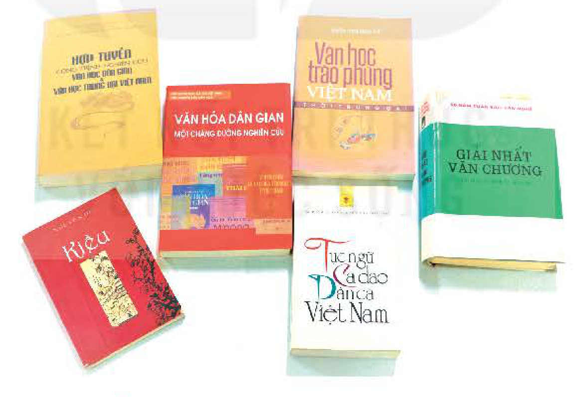
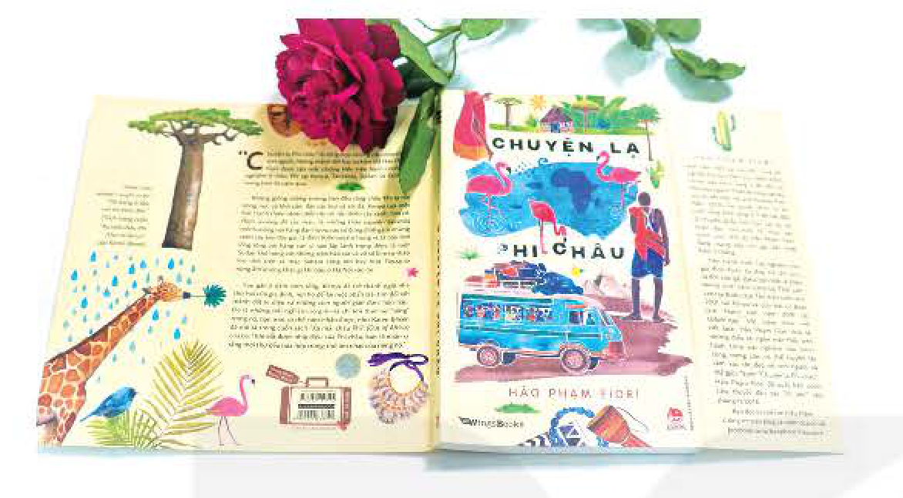

<!-- pdf:115 -->

# BÀI 10: VĂN HỌC – LỊCH SỬ TÂM HỒN

*Văn chương là kí ức sống của một dân tộc.*
<!-- ocr-ok: câu đề từ chữ viết tay trắng trên nền xanh bị OCR đọc nhầm "một" thành "vAột", đã đối chiếu trực tiếp ảnh trang PDF 115 -->

A-lếch-xan-đơ Xôn-gie-nít-xưn (Aleksandr Solzhenitsyn)

## Giới thiệu bài học

- Các bài học ngữ văn đã giúp em hiểu được giá trị cốt lõi trong đời sống của dân tộc và nhân loại: yêu thương, tôn trọng, hạnh phúc, tự do, độc lập, niềm tin, sự hiểu biết,... Văn học không chỉ tái hiện thế giới tâm hồn của nhà văn, nhà thơ mà còn là tấm gương phản ánh đời sống tinh thần của dân tộc. Lịch sử văn học dân tộc, vì thế, cũng là lịch sử tâm hồn của dân tộc sản sinh ra nền văn học đó.
- Việc đọc sách đóng vai trò quyết định trong quá trình học ngữ văn: phát triển năng lực ngôn ngữ (đọc, viết, nói và nghe) và năng lực văn học (cảm nhận và hiểu giá trị nghệ thuật, nội dung của tác phẩm), nâng cao năng lực thẩm mĩ, năng lực sáng tạo của người học. Chọn được những cuốn sách hay để đọc giúp em hiểu sâu hơn lịch sử tâm hồn con người, dân tộc vốn vô cùng phong phú trong văn chương. Đồng thời, trong một thế giới luôn thay đổi và nhiều thách thức như hiện nay, đọc còn là quá trình tự học không ngừng để giúp em có thể phát triển bản thân, ứng dụng những điều thu nhận được từ việc đọc sách để giải quyết các vấn đề trong cuộc sống.

## 🎯 Yêu cầu cần đạt
<!-- ocr-ok: nhãn hộp màu tím "YÊU CẦU CẦN ĐẠT" bị OCR đọc lỗi thành ")451086//00/6//VAE27 Vị", đã đối chiếu trực tiếp ảnh trang PDF 115 -->

- Vận dụng được một số hiểu biết về lịch sử văn học Việt Nam để đọc hiểu văn bản văn học.
- Nhận biết và phân tích được đặc điểm của bài phỏng vấn; chỉ ra được mối quan hệ giữa đặc điểm văn bản với mục đích của nó.
- Liên hệ, vận dụng được những điều đã đọc từ văn bản để giải quyết một vấn đề trong cuộc sống.
- Viết được một quảng cáo hoặc tờ rơi về một sản phẩm hay một hoạt động, sử dụng kết hợp phương tiện ngôn ngữ và phương tiện phi ngôn ngữ.
- Tiến hành được một cuộc phỏng vấn ngắn, xác định được mục đích, nội dung và cách thức phỏng vấn.
- Yêu mến và trân trọng vẻ đẹp, giá trị của nền văn học dân tộc.

<!-- pdf:116 -->

## Đọc

### TRI THỨC NGỮ VĂN

**Sơ giản về lịch sử văn học Việt Nam và vai trò của tri thức về lịch sử văn học trong đọc hiểu văn bản**

***Hai bộ phận của nền văn học: văn học dân gian và văn học viết***

Văn học dân gian và văn học viết là hai bộ phận của nền văn học dân tộc. Văn học dân gian là các sáng tác truyền miệng của nhân dân, ra đời trước khi có văn học viết và còn tồn tại cho đến ngày nay, bao gồm: ca dao, tục ngữ, truyền thuyết, truyện cổ tích, truyện ngụ ngôn, truyện cười,... Văn học viết bao gồm sáng tác của các tác giả cụ thể, ra đời cùng sự xuất hiện và phát triển của chữ viết, tồn tại song song với văn học dân gian trong quá trình phát triển của nền văn học dân tộc. Một số thể loại của văn học viết trong giai đoạn đầu có tính chất ghi chép, mô phỏng, biên soạn lại các sáng tác dân gian. Truyện truyền kì, truyện thơ Nôm,... là những bằng chứng cụ thể. Tuy nhiên, cùng với sự phát triển của nền văn học dân tộc qua các thời kì lịch sử, các thể loại văn học viết càng ngày càng mang tính độc lập và có sự tách biệt rõ rệt với các thể loại văn học dân gian.

Trong nền văn học Việt Nam, văn học viết ra đời khoảng thế kỉ X và có sự phát triển mạnh mẽ từ thế kỉ XV với cả hai bộ phận thơ văn chữ Hán và thơ văn chữ Nôm gắn với các thể loại: thơ Đường luật, thơ song thất lục bát, thơ lục bát, truyện thơ Nôm, truyện truyền kì, truyện lịch sử, truyện kí,...

Từ thế kỉ XX, văn học viết bằng chữ quốc ngữ ngày càng phát triển với các thể loại: thơ hiện đại (thơ bốn chữ, thơ năm chữ, thơ tự do,...), truyện ngắn, tiểu thuyết, kí, kịch,...

Văn học dân gian và văn học viết Việt Nam có mối quan hệ sâu sắc trong suốt quá trình hình thành và phát triển, cùng góp phần tạo nên sự phong phú, đa dạng và bản sắc của nền văn học dân tộc.

***Các thời kì của văn học viết Việt Nam***

Việc phân định thời kì văn học thường căn cứ vào các yếu tố hình thức, nghệ thuật (chữ viết, thể loại) và mối quan hệ giữa sáng tác văn học với các đặc điểm lịch sử, xã hội quan trọng trong quá trình phát triển của cộng đồng dân tộc. Có thể xác định các thời kì của văn học viết Việt Nam như sau:

<!-- term: thời kì trung đại -->
- Thời kì trung đại (từ khoảng thế kỉ X đến cuối thế kỉ XIX): Văn học viết Việt Nam được sáng tác chủ yếu bằng chữ Hán và chữ Nôm với các thể loại có nguồn gốc từ văn học dân gian hoặc ảnh hưởng từ nền văn học Trung Quốc nhưng đã được Việt hoá để thể hiện đời sống và tâm hồn dân tộc. Cùng với sự phát triển của quốc gia phong kiến tự chủ, nền văn học viết Việt Nam thời kì này đạt được những giá trị to lớn về cả nội dung và nghệ thuật, khẳng định được bản sắc con người và truyền thống của dân tộc: tinh thần yêu nước, ý chí tự cường, lòng nhân ái cùng nhiều giá trị nhân văn sâu sắc.

<!-- pdf:117 -->

<!-- term: thời kì hiện đại -->
- Thời kì hiện đại (từ đầu thế kỉ XX đến nay): Văn học viết Việt Nam được sáng tác chủ yếu bằng chữ quốc ngữ với các thể loại ảnh hưởng từ văn học phương Tây nhưng vẫn có sự kế thừa và phát huy vốn văn hoá, văn học dân tộc. Các giai đoạn của văn học thời kì này gắn bó mật thiết với những biến cố lịch sử quan trọng của dân tộc: Cách mạng tháng Tám năm 1945; kháng chiến chống thực dân Pháp kết thúc, đánh dấu bằng chiến thắng lịch sử Điện Biên Phủ năm 1954; cuộc kháng chiến chống đế quốc Mỹ thắng lợi, thống nhất đất nước năm 1975; công cuộc đổi mới để xây dựng đất nước, hội nhập quốc tế từ thập niên 80 – 90 của thế kỉ XX đến nay. Kế thừa và phát huy các giá trị của nền văn học trước đó, văn học viết Việt Nam hiện đại đã đạt được những thành tựu nổi bật nhờ những cách tân nghệ thuật mạnh mẽ, khẳng định được bản sắc dân tộc trong quan hệ với văn học các nước trong khu vực và trên thế giới.

***Vận dụng tri thức về lịch sử văn học trong đọc hiểu văn bản***

Việc đọc hiểu văn bản văn học trước hết cần tập trung vào những yếu tố trong văn bản: ngôn ngữ, bố cục, hình tượng, chi tiết, đề tài, chủ đề,... Tuy nhiên, bên cạnh đó, các tri thức về lịch sử văn học có thể góp phần giúp người đọc hiểu sâu hơn nội dung và đặc điểm nghệ thuật của tác phẩm. Việc hiểu mối quan hệ giữa văn học dân gian và văn học viết giúp cắt nghĩa rõ hơn nguồn gốc của các yếu tố ngôn từ, chi tiết nghệ thuật trong tác phẩm: dấu ấn của ca dao, tục ngữ, truyện dân gian trong một số tác phẩm văn học viết. Xác định được bối cảnh ra đời của tác phẩm và ảnh hưởng của các sự kiện lịch sử, xã hội đến việc lựa chọn đề tài, hình tượng, nhân vật,..., người đọc có thể lí giải sâu hơn về ý nghĩa, giá trị của các chi tiết nghệ thuật và chủ đề của tác phẩm. Tri thức về nguồn gốc thể loại văn học cần thiết đối với việc giải thích những đặc điểm mang tính kế thừa hoặc dấu ấn riêng của tác giả trong các yếu tố nghệ thuật và nội dung của tác phẩm. Những tri thức cơ bản về lịch sử văn học bao gồm: mối quan hệ giữa các bộ phận văn học; các thời kì phát triển của nền văn học; nguồn gốc và sự phát triển của các thể loại; bối cảnh ra đời của tác phẩm; mối quan hệ giữa nhà văn và đời sống lịch sử, xã hội; mối quan hệ giữa các tác giả, tác phẩm tiêu biểu ở từng giai đoạn văn học.

**Bài phỏng vấn**

***Mục đích của việc phỏng vấn***

Trong các lĩnh vực truyền thông – báo chí, chính trị – xã hội hoặc văn học – nghệ thuật,... một cuộc phỏng vấn diễn ra khi người lấy tin và đưa tin (thường là phóng viên, nhà báo hoặc người đại diện một tổ chức, một cộng đồng) cần tìm hiểu và thu thập thông tin về các sự việc, vấn đề đang thu hút sự chú ý hoặc có tầm ảnh hưởng quan trọng. Mục đích của việc phỏng vấn là tạo được đối thoại trực tiếp hoặc gián tiếp với những người tham gia, chứng kiến, có vai trò hoặc liên quan đến sự việc, vấn đề đang được đề cập nhằm cung cấp thông tin mới cho người nghe, người xem một cách khách quan.

***Nội dung và hình thức của bài phỏng vấn***

Bài phỏng vấn thuộc loại văn bản thông tin, có hai hình thức: nói và viết.

<!-- term: cuộc phỏng vấn trực tiếp -->
Cuộc phỏng vấn trực tiếp thường diễn ra theo hình thức nói. Người phỏng vấn nêu câu hỏi liên quan đến các khía cạnh của sự việc, vấn đề nhằm khai thác thông tin; người được phỏng vấn trả lời câu hỏi, qua đó cung cấp thông tin, nêu ý kiến của mình. Bài phỏng vấn trực tiếp được ghi hình, ghi âm để truyền đạt đến người nghe, người xem.

<!-- pdf:118 -->

<!-- term: cuộc phỏng vấn gián tiếp -->
Cuộc phỏng vấn gián tiếp thường diễn ra theo hình thức viết. Người phỏng vấn gửi tới người được phỏng vấn một số câu hỏi quan trọng tập trung vào sự việc, vấn đề cần tìm hiểu, khai thác thông tin. Người trả lời phỏng vấn viết câu trả lời. Bài phỏng vấn gián tiếp được đăng tải hoặc in ấn để truyền đạt đến người đọc.

Bài phỏng vấn dù được truyền đạt dưới hình thức nào cũng có hai thành phần quan trọng: câu hỏi do người phỏng vấn nêu ra và câu trả lời từ phía người được phỏng vấn. Nội dung của câu hỏi và câu trả lời cần có sự liên quan mật thiết đến sự việc, vấn đề cần trao đổi, bàn luận. Đồng thời, trong bài phỏng vấn thường có những yếu tố ngôn ngữ cho biết về quan hệ giao tiếp giữa người phỏng vấn và người được phỏng vấn: lời chào, lời giới thiệu, lời cảm ơn,...

### THÁCH THỨC ĐẦU TIÊN: ĐỌC ĐỂ TRƯỞNG THÀNH

**Trước khi đọc**

1. Em thường tìm sách để đọc từ những nguồn nào? Hãy chia sẻ một vài kinh nghiệm tìm sách để đọc của em.

2. Xây dựng mục tiêu và kế hoạch đọc sách của em trong dự án *Văn học – lịch sử tâm hồn*. Chú ý chọn đọc những tác phẩm tiêu biểu của văn học Việt Nam thuộc các bộ phận và thời kì, giai đoạn theo dòng lịch sử văn học.

<!-- ocr-ok: chữ trên bìa các cuốn sách minh hoạ bị OCR nhận rời rạc, đã cắt thành hình H9-ngu_van-b10-01 -->

**Cùng đọc và suy ngẫm**

**Đọc như một sự hồi tưởng**

Đời sống được tác giả tái hiện trong tác phẩm văn học và được làm sống dậy trong tâm trí các thế hệ người đọc. Vì thế, với độc giả, đọc cũng là quá trình đồng sáng tạo. Thế giới đời sống được tác giả tái hiện trong tác phẩm và dòng hồi tưởng của độc giả tiếp nối, đan xen và giao hoà với nhau trong quá trình đọc. Sức sống, sức hấp dẫn của tác phẩm văn học được bộc lộ qua khả năng tạo nên một quá trình đồng sáng tạo liên tục như vậy.

<!-- pdf:119 -->

Trong quá trình tiếp nhận tác phẩm văn học, các bài nghiên cứu, tổng thuật về lịch sử văn học giúp cho người đọc có một cái nhìn hệ thống về quá trình phát triển các thể loại văn học, mối quan hệ giữa những vấn đề đời sống, lịch sử – xã hội và tác phẩm, sự biến đổi và những thành tựu quan trọng của các thời kì, giai đoạn văn học,... Hãy đọc văn bản dưới đây để hiểu rõ hơn về các thời kì phát triển và các bộ phận của văn học Việt Nam.

**Đọc văn bản**

**Văn học Việt Nam từ khu vực ra thế giới, từ truyền thống đến hiện đại**

**TRẦN ĐÌNH SỬ**

Văn học Việt Nam là một nền văn học vừa cổ xưa vừa non trẻ và đang hội nhập với thế giới hiện đại.

> **THEO DÕI:** Những biểu hiện cho thấy đặc điểm “cổ xưa” và “non trẻ” của văn học Việt Nam.

Nói cổ xưa vì văn học Việt Nam gắn với lịch sử hàng nghìn năm của dân tộc Việt bắt đầu từ thời kì các Vua Hùng, gắn với văn học dân gian truyền miệng vốn có vị trí rất quan trọng, nó lưu giữ tinh thần, trí tuệ, ngôn ngữ và là nền tảng của văn học viết của người Việt qua bao nhiêu biến cố lịch sử truyền lại cho thời hôm nay.

Nói là non trẻ vì khác với các nền văn học như Ấn Độ, Trung Hoa, Hy Lạp,... là nền văn học “già” có từ “thời gian trục” trước Công nguyên, văn học viết Việt Nam mới xuất hiện từ thế kỉ X sau khi giành lại độc lập từ các triều đại Trung Hoa.

> **THEO DÕI:** Quá trình hình thành của văn học viết Việt Nam: thời gian, nguồn gốc và loại chữ viết, số lượng văn bản.

Văn học viết Việt Nam bắt đầu với thứ văn tự ngoại lai là chữ Hán. Sự xâm chiếm của nhà Tần năm 214 trước Công nguyên và sau đó của nhà Hán năm 111 trước Công nguyên làm gián đoạn sự hình thành “văn tự sơ khai không theo hình thức mẫu Hán” của các tộc Choang – Tày – Việt và áp lực chữ Hán khiến người Việt quen với hình thức chữ Hán sau nghìn năm Bắc thuộc, nhưng dưới thời Bắc thuộc người Việt không có văn học viết. Theo sưu tầm của Trần Nghĩa, suốt nghìn năm Bắc thuộc, số bài văn do người Việt viết còn lại vẻn vẹn có 25 văn bản. Phải có một quốc gia độc lập, người Việt trở thành chủ thể thì mới có được văn học của mình. Từ thế kỉ X, khi quốc gia đã giành lại được độc lập, để xây dựng lại nền học vấn, giáo dục, khoa cử và văn học của mình, người Việt đã buộc phải di thực(1) cả một ngôn ngữ, văn tự ngoại lai là chữ Hán, văn ngôn, các thể loại, thậm chí cả phong cách, điển cố, thể thức

> (1) *Di thực*: vay mượn và có chuyển đổi, cải biến các yếu tố được vay mượn đó cho phù hợp với văn hoá bản địa (nghĩa trong văn bản).

<!-- pdf:120 -->

diễn đạt trong văn bản hành chính và sáng tác văn thơ. Sự mô phỏng, vay mượn là không tránh khỏi. Điều quan trọng là người Việt Nam đã vượt qua sự mô phỏng tầm thường để đạt đến tinh hoa như nguyên mẫu và đi sâu biểu đạt tâm hồn dân tộc mình. Văn học chữ Hán thời Lý – Trần có những thành tựu độc đáo, đến thời Hậu Lê thế kỉ XV – XVII văn học chữ Hán đã phồn vinh. Các tác gia văn học chữ Hán của Việt Nam đương thời đã thấy Hán văn của họ “không nhường Hán Đường” (Ngô Thì Nhậm), và nhà văn Trung Quốc hiện đại đã thấy trong văn học chữ Hán ấy có những “đại bút trác việt”. Văn học chữ Hán Việt Nam là một bộ phận của văn học chữ Hán Đông Á có bản sắc riêng, mang đậm tinh thần Việt Nam.

> **THEO DÕI:** Sự ra đời và phát triển của văn học viết bằng chữ Nôm: thời gian, nguồn gốc và thể loại.

Không thể mãi mãi viết bằng chữ Hán, người Việt Nam đã mô phỏng chữ Hán để sáng tạo ra chữ Nôm, thứ chữ thiên về biểu ý và biểu âm, để sáng tác tác phẩm bằng tiếng Việt. Sau những mầm mống từ đầu thế kỉ XII – XIII, đến thế kỉ XV đã có những tác phẩm hoàn chỉnh như *Quốc âm thi tập* của Nguyễn Trãi (1380 – 1442). Tập thơ này đánh dấu sự hình thành văn học dân tộc bằng tiếng dân tộc. Văn học tiếng Việt hình thành hầu như cùng thời với nhiều nền văn học lớn châu Âu như Anh, Đức, Ý. Từ thế kỉ XVI trở đi đã có cả một dòng văn học tiếng Việt phát triển rầm rộ, đạt đến cực thịnh trong thế kỉ XVIII, cơ hồ lấn át thơ văn chữ Hán. Nó đã sáng tạo ra các thể loại văn học độc lập của riêng người Việt, Việt hoá nhiều thể loại văn học chữ Hán, biến thành tài sản của người Việt. Văn học tiếng Việt đã đạt đến mức nghệ thuật cổ điển, kết tinh trong *Truyện Kiều* của đại thi hào Nguyễn Du (1765 – 1820) và nhiều tác gia khác. Văn học chữ Nôm đã giúp cho văn học cổ điển Việt Nam thoát dần các khuôn mẫu Hán, trở về với các truyền thống Đông Nam Á, như các truyện thơ, để trở thành văn học độc lập, biểu hiện sâu sắc tâm hồn Việt Nam. Tuy vậy, chữ Nôm là một thứ chữ rất phức tạp, khó phổ biến cho nhiều người vì người học phải biết chữ Hán trước đã rồi thì mới có thể đọc được và viết được chữ Nôm. Sự lệ thuộc vào chữ Hán của thứ chữ này khiến cho nó có thể gây khó cho người sử dụng. Đó là một điều rất bất tiện, chưa nói đến bất tiện trong phiên âm các từ trong tiếng phương Tây và dạy tiếng Việt cho người nước ngoài.

Văn học Việt Nam đã kết tinh các truyền thống của văn học Đông Á. Văn học Việt Nam chịu ảnh hưởng của Phật giáo, Nho giáo, Đạo giáo lâu đời, đồng thời chịu ảnh hưởng sâu sắc của truyền thống bản địa và khu vực.

> **THEO DÕI:** Sự ra đời và phát triển của văn học viết bằng chữ quốc ngữ: thời gian, nguồn gốc và thể loại.

Tuy nhiên, văn học Việt Nam cũng không ở mãi trong cái khung khu vực. Sự tiếp xúc Đông Tây bắt đầu từ các giáo sĩ phương Tây đã tạo ra thứ chữ kiểu Latinh để ghi âm tiếng Việt, sau này gọi là chữ quốc ngữ. Sự xâm lược của thực dân Pháp, một mặt gây nên những biến động chính trị, xã hội, mặt khác tạo nên sự tiếp xúc của Việt Nam

<!-- pdf:121 -->

với phương Tây, dấy lên phong trào canh tân theo các tư tưởng tư sản Âu Mỹ. Cuối thế kỉ XIX – đầu thế kỉ XX, khi chữ Hán và các kì thi Hán học bị bãi bỏ, chữ quốc ngữ thịnh hành và cùng với nó, một nền văn học hiện đại theo kiểu châu Âu dần dần xuất hiện. Chữ quốc ngữ rất dễ học, chỉ học một thời gian ngắn là người ta có thể thoát nạn mù chữ mà không cần phải biết một thứ chữ nào trước đó làm tiền đề. Chữ quốc ngữ gắn liền với lời ăn tiếng nói hằng ngày, đoạn tuyệt hẳn với truyền thống văn ngôn khiến cho văn xuôi phát triển. Tuy có làm gián đoạn truyền thống nhưng chữ quốc ngữ mở ra viễn cảnh mới rộng lớn, và sẽ được bù đắp lại bằng phiên dịch và phiên âm. Đến lúc này, người Việt lại bắt đầu di thực các thể loại văn học châu Âu như du kí, phóng sự, kịch nói, tiểu thuyết, truyện ngắn, phê bình, khảo luận, luận văn, xã luận, thơ tự do,... Từ mô phỏng đến sáng tạo là con đường tưởng như rất dài nhưng lại rất ngắn. Với chữ quốc ngữ, văn học Việt Nam đã chịu ảnh hưởng nhiều mặt của văn học phương Tây và đã tự thay đổi mình trong cả tư duy và diễn đạt. Ý thức lô-gíc và lí tính gia tăng rõ rệt ngay trong cấu trúc ngôn ngữ. Hơn nửa thế kỉ, từ 1885 đến 1945, văn học Việt Nam (từ một nền văn học trung đại cổ xưa với truyền thống khu vực) đã hoá thân thành một nền văn học hiện đại theo mô hình châu Âu, trở thành một bộ phận của văn học thế giới.

> **THEO DÕI:** Sự thay đổi của chữ viết và đặc điểm văn học.

Vậy là với sự thay đổi ba thứ chữ viết, văn học Việt Nam đã tự thay đổi vận mệnh của mình, từ chỗ phụ thuộc vào các khuôn mẫu cổ xưa của chữ Hán, chuyển sang bắt đầu tự chủ bằng chữ Nôm, rồi hoà nhịp với thế giới đa dạng, tự do với chữ quốc ngữ. Sự thay đổi này đã thể hiện sức sống mạnh mẽ của văn học Việt Nam.

> **THEO DÕI:** Vị trí và đặc điểm của văn học Việt Nam thế kỉ XX.

Trong lịch sử văn học Việt Nam, văn học thế kỉ XX có vị trí và ý nghĩa đặc biệt, đồng thời trải qua con đường quanh co do mấy cuộc chiến tranh tạo nên. Từ đầu thế kỉ XX đến 1945, ở Việt Nam hình thành một nền văn học hiện đại thực thụ và đã chớm có khuynh hướng hiện đại chủ nghĩa. Từ ngày thành lập nước Việt Nam Dân chủ Cộng hoà theo khuynh hướng xã hội chủ nghĩa, văn học thiên về phục vụ công cuộc chiến đấu, bảo vệ Tổ quốc. Sau năm 1954, đất nước chia làm hai miền, văn học miền Bắc vẫn đi vào con đường văn học vô sản, xã hội chủ nghĩa; còn ở miền Nam văn học đi theo ảnh hưởng của văn học Âu Mỹ đương đại. Sau năm 1975, đất nước thống nhất nhưng gặp rất nhiều khó khăn về kinh tế, khó khăn do chiến tranh biên giới phía tây nam và chiến tranh biên giới phía bắc gây ra. Văn học bộc lộ những yếu kém của chính sách văn nghệ, dẫn đến cuộc đổi mới có tính “cởi trói” cuối năm 1986. Cuối những năm chín mươi của thế kỉ XX sang đầu thế kỉ XXI, sự thâm nhập của in-tơ-nét cùng với sự kiện Việt Nam gia nhập WTO (2007), văn học có những đổi thay mới, vừa duy trì chủ nghĩa hiện thực vừa có dấu hiệu hiện đại chủ nghĩa và hậu hiện đại.

<!-- pdf:122 -->

Với vị trí chính trị đặc biệt, Việt Nam đã phải trải qua nhiều cuộc chiến tranh, văn học Việt Nam trước sau đều mang âm hưởng chủ đạo của chủ nghĩa yêu nước và bên cạnh đó là tiếng nói tố cáo sự bất công, oan khuất, chế giễu sự giả dối và tham tàn, thể hiện khát vọng tự do, dân chủ và hạnh phúc. Gần mười thế kỉ, văn học Việt Nam tuy đã có nhiều thành tựu xuất sắc, song hầu như ngưng trệ trong thi pháp trung đại, nhưng từ cuối thế kỉ XIX đến đầu thế kỉ XX thi pháp văn học bắt đầu đổi thay căn bản, hoàn toàn lột xác để trở thành một nền văn học mới, hiện đại, nhanh chóng trải qua hầu hết các trào lưu văn học trên thế giới dưới dạng rút gọn và tiếp tục hội nhập sâu rộng vào quá trình văn học thế giới.

(*Theo* Trần Đình Sử (Chủ biên), *Lược sử văn học Việt Nam*, NXB Đại học Sư phạm, Hà Nội, 2021, tr. 9 – 13)

**Sau khi đọc**

**Trả lời câu hỏi**

1. Vì sao có thể nhận định rằng nền văn học Việt Nam “vừa cổ xưa vừa non trẻ”?

2. Nền văn học viết Việt Nam đã hình thành và phát triển qua những thời kì nào? Nêu rõ nguồn gốc, đặc điểm của chữ viết và thể loại ở từng thời kì.

3. Văn học viết bằng chữ Hán và văn học viết bằng chữ Nôm có quan hệ với nhau như thế nào? Nêu rõ điểm tương đồng và khác biệt của hai bộ phận văn học này trong thời kì trung đại.

4. Những yếu tố lịch sử, xã hội nào có ảnh hưởng quan trọng, tạo nên các đặc điểm nổi bật của văn học Việt Nam thế kỉ XX?

5. Tính truyền thống và hiện đại của nền văn học Việt Nam được biểu hiện rõ nhất qua những đặc điểm nào?

#### Viết kết nối với đọc
<!-- ocr-ok: tiêu đề mục bị OCR đọc nhầm dấu "NỐI" thành "NỔI", đã đối chiếu trực tiếp ảnh trang PDF 122 -->

Viết đoạn văn (khoảng 10 – 15 câu) với câu chủ đề: *“Trong mỗi thời kì, văn học Việt Nam đều có những tác phẩm tiêu biểu, độc đáo về nghệ thuật và chứa đựng giá trị nội dung sâu sắc”*.

**Đọc trong một thế giới đầy biến động**
<!-- ocr-ok: tiêu đề tiểu mục màu tím bị OCR đọc nhầm dấu ("thê giới đầu biên động"), đã đối chiếu trực tiếp ảnh trang PDF 122 -->

Trong thời đại của công nghệ số và các phương tiện nghe – nhìn, văn hoá đọc của chúng ta có gì thay đổi? Khi mà cách sống, cách làm việc, học tập, vui chơi, giải trí của mỗi người biến động không ngừng do sự tác động của công nghệ và truyền thông, nhu cầu đọc sách có còn quan trọng, cần thiết? Người viết, người đọc cần thích ứng như thế nào với tình hình đó? Hãy đọc bài phỏng vấn nhà văn Nguyễn Nhật Ánh của phóng viên tạp chí *Văn học và Tuổi trẻ* để cùng suy nghĩ thêm về vấn đề này.

<!-- pdf:123 -->

**Đọc văn bản**

**Văn hoá đọc với nhà văn và độc giả trong thời đại công nghệ số**

Công nghệ số và các phương tiện nghe – nhìn đang có nhiều ảnh hưởng, tác động, thường bị đánh giá là tiêu cực đối với văn hoá đọc, cụ thể là với việc đọc sách theo cách truyền thống. Đã có nhiều ý kiến xung quanh vấn đề này trên các diễn đàn, trên mạng xã hội. Phóng viên (PV) của tạp chí *Văn học và Tuổi trẻ* đã có cuộc phỏng vấn với một “người đương thời” – người trong cuộc – nhà văn Nguyễn Nhật Ánh (NNA) về vấn đề này.

> **THEO DÕI:** Vấn đề được nêu ra trong cuộc phỏng vấn.

– **PV**: Thưa nhà văn NNA, từ những tác phẩm ban đầu như *Bàn có năm chỗ ngồi* (1987), *Cô gái đến từ hôm qua* (1989), *Chú bé rắc rối* (1989), *Thằng quỷ nhỏ* (1990),... rồi *Kính vạn hoa* (1995) đến *Tôi là Bê-tô* (2007), *Cho tôi xin một vé đi tuổi thơ* (2008), *Tôi thấy hoa vàng trên cỏ xanh* (2010) và gần đây nhất với *Cây chuối non đi giày xanh* (2018), *Ra bờ suối ngắm hoa kèn hồng* (2022),..., rất nhiều tác phẩm của ông đã để lại niềm yêu mến, say mê trong lòng độc giả gần 40 năm qua. Dường như đã hình thành hẳn một “văn hoá đọc” gắn liền với những tác phẩm của NNA. Là nhà văn có sức thu hút đặc biệt với các thế hệ độc giả, đặc biệt là độc giả trẻ, ông có suy nghĩ gì về vấn đề “văn hoá đọc” trong thời đại công nghệ số?

> **THEO DÕI:** Cách mở đầu, dẫn dắt và nêu câu hỏi của người phỏng vấn.

– **NNA**: Trong thời đại công nghệ số, thời gian dành cho việc đọc chắc chắn ít hơn. Một ngày vẫn chỉ có 24 tiếng đồng hồ, nhưng bây giờ chúng ta “chi tiêu” khoảng thời gian đó cho nhiều thứ hơn. Giống như trước đây chúng ta chỉ dành tiền để mua sách, bây giờ phải san sẻ cho nhu cầu mua vé xem phim, xem ca nhạc, học ngoại ngữ, tập thể thao, vào công viên giải trí,...

> **THEO DÕI:** Cách trả lời của người được phỏng vấn.

– **PV**: Thưa nhà văn, vậy thì sự thay đổi của văn hoá đọc có tác động như thế nào tới quá trình sáng tác của ông với vai trò là một nhà văn luôn nuôi dưỡng niềm đam mê đọc sách của các thế hệ độc giả trẻ tuổi?

> **THEO DÕI:** Cách triển khai các luận điểm trong câu hỏi phỏng vấn.

– **NNA**: Tôi nghĩ những thay đổi đó có tác động nhất định đến nghề viết. Nhưng điều này đặt nỗi lo lên vai nhà xuất bản và nhà phát hành nhiều hơn. Vì họ là những đơn vị trực tiếp đối diện với thương trường. Nhà văn ít lo nghĩ hơn, vì nhà văn sáng tác

<!-- pdf:124 -->

dựa vào hứng thú và đam mê. Chính lòng yêu nghề là điểm tựa của nhà văn. Nó là rào chắn tinh thần giúp cảm hứng sáng tác của nhà văn không bị “xuyên thủng” bởi những gì không thuộc về văn chương. Hơn nữa, tôi luôn vững tin rằng dù thời gian dành cho sách ít đi, con người vẫn cần tới sách như một người bạn lớn. Thời đại công nghệ phát triển, có nhiều cánh cửa mở ra thế giới. Chúng ta có thể thu lượm kiến thức bằng nhiều cách và từ nhiều nguồn khác nhau nhưng để làm giàu trí tưởng tượng và tặng cho tâm hồn những cuộc phiêu lưu kì thú, tôi nghĩ chỉ có sách mới làm được.

– **PV**: Là một nhà văn đã có rất nhiều tác phẩm được chuyển thể thành phim và phim được chuyển thể từ tác phẩm văn học của ông cũng tạo nên một sức hút rất lớn, theo ông sức hút của những bộ phim chuyển thể và tác phẩm văn học có điều gì khác biệt?

> **THEO DÕI:** Cách tiếp nối, duy trì và phát triển vấn đề trong câu hỏi phỏng vấn.

– **NNA**: Về khía cạnh hình thức, chắc chắn là có khác. Vì đó là hai loại hình nghệ thuật khác nhau. Đạo diễn kể bằng hình ảnh câu chuyện mà nhà văn kể bằng con chữ. Về mặt thưởng thức, độc giả có thể đọc cuốn sách trong một giờ, một tuần hay một tháng, thậm chí có thể bỏ đi làm một việc gì đó giữa hai trang sách mà không bị ảnh hưởng gì. Khán giả xem phim thì khác. Họ phải tập trung theo dõi câu chuyện trong 90 phút hoặc hơn, không được để mất tập trung nếu không muốn bị mất cảm hứng và “rơi” ra khỏi câu chuyện. Để thu hút và “thao túng” khán giả trong một thời lượng eo hẹp, đạo diễn buộc phải chọn cách kể gọn ghẽ, chưng cất những gì tinh tuý nhất, lược bỏ những yếu tố dàn trải trong tiểu thuyết. Cho dù như vậy, nếu đạo diễn vẫn giữ được hồn cốt của tác phẩm văn học, bảo tồn được thông điệp và tinh thần của cuốn sách thì sự khác biệt giữa hai thể loại sẽ giảm đến mức tối đa. Bởi vì sự cuốn hút của một cuốn sách hay một bộ phim về căn bản vẫn là chạm được vào cảm xúc của người đọc, người xem. Khi chinh phục được trái tim của người thưởng ngoạn, sự hoà điệu sẽ ngân lên, khi đó sự khác biệt giữa tác phẩm văn học và tác phẩm điện ảnh sẽ trở về mức thấp nhất. *Tôi thấy hoa vàng trên cỏ xanh* và *Mắt biếc* phần nào đã làm được điều này.

– **PV**: Ông có điều gì muốn chia sẻ với bạn đọc trẻ về vấn đề văn hoá đọc trong thời đại công nghệ số?

– **NNA**: Bạn đọc trẻ tất nhiên vẫn phải tương thích với công nghệ số ngày càng phát triển, thậm chí chiếm vị trí trung tâm trong sinh hoạt hằng ngày của xã hội. Tóm lại, bạn đọc phải mặc và thích mặc chiếc áo của thời đại mình là điều không thể đảo ngược và không có lí do gì để đảo ngược. Tôi chỉ muốn nói, cho dù công nghệ phát triển đến mức nào thì sách vẫn đóng vai trò quan trọng trong đời sống tinh thần của con người. Bởi sách không chỉ để giải trí mà nó còn bồi đắp tâm thức văn hoá trong cộng đồng và trong mỗi cá nhân.

<!-- pdf:125 -->

– **PV**: Xin phép được hỏi ông một câu nữa: Nếu có cỗ máy thời gian, có bao giờ nhà văn muốn quay trở lại thời kì tác giả là người viết trong một thời đại mà văn tự và sách in là độc tôn?

> **THEO DÕI:** Cách nêu câu hỏi kết thúc cuộc phỏng vấn.

– **NNA**: Chúng ta vẫn nên tuân theo dòng chảy tự nhiên. Tôi không muốn đi ngược lại quy luật phát triển và nhà văn được hưởng những biệt lệ. Tôi không muốn để người khác sống thay thời đại mình. Cạnh tranh với công nghệ giải trí là một thử thách đối với người viết, giúp nhà văn vượt lên chính mình. Điều đó đem lại lợi ích cho người viết và cho chính bạn đọc.

– **PV**: Xin trân trọng cảm ơn nhà văn và kính chúc nhà văn sức khoẻ. Rất mong đợi được tiếp tục đọc những tác phẩm mới, hấp dẫn của ông dành cho các thế hệ độc giả.

> **CHÚ Ý:** Những yếu tố ngôn ngữ thể hiện phép lịch sự và ý thức tôn trọng người được phỏng vấn.
<!-- ocr-ok: thẻ Chú ý ở lề phải bị OCR bỏ sót nhãn và trộn lẫn vào lời thoại, đã đối chiếu trực tiếp ảnh trang PDF 125 -->

(Hà Ngân *thực hiện*, tạp chí *Văn học và Tuổi trẻ*, tháng 5/2023)

**Sau khi đọc**

**Trả lời câu hỏi**

1. Vấn đề mà cuộc phỏng vấn đề cập được trình bày ở phần nào của văn bản?

2. Vấn đề chính của cuộc phỏng vấn được triển khai bằng mấy câu hỏi? Nêu rõ mối quan hệ giữa vấn đề chính và các nội dung được triển khai trong hệ thống câu hỏi phỏng vấn.

3. Câu trả lời của người được phỏng vấn có quan hệ như thế nào với vấn đề được nêu trong câu hỏi?

4. Những yếu tố ngôn ngữ nào thể hiện phép lịch sự và ý thức tôn trọng người được phỏng vấn trong cách đặt vấn đề, triển khai vấn đề và kết thúc cuộc phỏng vấn?

#### Viết kết nối với đọc
<!-- ocr-ok: tiêu đề mục bị OCR đọc nhầm dấu "NỐI" thành "NỔI", đã đối chiếu trực tiếp ảnh trang PDF 125 -->

Nếu được phỏng vấn một nhà văn hoặc nhà thơ về một vấn đề mà em quan tâm, em sẽ chọn vấn đề gì? Nêu 3 – 5 câu hỏi mà em dự định trao đổi với tác giả đó, đồng thời đóng vai tác giả để trả lời các câu hỏi vừa nêu.

**Đọc để tự học và thực hành**
<!-- ocr-ok: tiêu đề tiểu mục màu tím bị OCR đọc nhầm dấu ("Đọc đề tự học vả thực hành"), đã đối chiếu trực tiếp ảnh trang PDF 125 -->

**1. Chọn đọc tác phẩm kinh điển**

Trong thời đại phát triển của công nghệ số và các phương tiện nghe – nhìn, người đọc gặp những thách thức không nhỏ, nhưng cũng có nhiều cơ hội để phát triển năng lực tự học, vận dụng những điều hữu ích thu nhận được từ việc đọc vào cuộc sống.

<!-- pdf:126 -->

Với hiểu biết của em về lịch sử văn học Việt Nam, hãy lên danh mục những tác phẩm tiêu biểu cần đọc trong từng thời kì. Chọn đọc một số tác phẩm mà em yêu thích và ghi chú thông tin vào phiếu đọc theo gợi ý sau:

a. Mối quan hệ giữa tác phẩm và bối cảnh lịch sử, xã hội.

b. Nguồn gốc thể loại, chữ viết, đề tài và hình tượng trong tác phẩm.

c. Đặc điểm nổi bật về nghệ thuật, nội dung của tác phẩm.

d. Dự đoán ảnh hưởng, tác động của môi trường văn học tới những yếu tố trong tác phẩm: mối quan hệ giữa tác phẩm và thời kì, giai đoạn văn học; với các tác phẩm khác,...

e. Những thông điệp, bài học mà bản thân có thể rút ra từ việc đọc tác phẩm.

**2. Gặp gỡ độc giả “đặc biệt”**

Đọc văn bản dưới đây hoặc sưu tầm, tìm đọc một số văn bản có nội dung, cảm xúc tương đồng và ghi chép các thông tin về những vấn đề sau:

a. Mối quan hệ giữa thể loại, đề tài, hình tượng hoặc một số chi tiết nghệ thuật trong văn bản với những văn bản khác (mà em đã đọc, tìm hiểu).

b. Tính chất “đặc biệt” của tác giả – độc giả trong văn bản.

**Bên mộ cụ Nguyễn Du**

VƯƠNG TRỌNG(1)

Tưởng rằng phận bạc Đạm Tiên
Ngờ đâu cụ Nguyễn Tiên Điền nằm đây
Ngửng trời cao, cúi đất dày
Cắn môi, tay nắm bàn tay của mình
Một vùng cồn bãi trống trênh
Cụ cùng thập loại chúng sinh nằm kề.

Hút tầm chẳng cánh hoa lê
Bạch đàn đôi ngọn gió về nỉ non
Xạc xào lá cỏ héo hon
Bàn chân cát bụi, lối mòn nhỏ nhoi
Lặng yên bên nấm mộ rồi
Chưa tin mình đã đến nơi mình tìm!

> (1) Vương Trọng sinh năm 1943, quê ở Hà Tĩnh, là tác giả của nhiều tập thơ về đề tài chiến tranh, tình yêu quê hương, đất nước, gia đình,... Các tác phẩm chính: *Thơ người ra trận* (1972), *Khoảng trời quê hương* (1979), *Những ngày xa* (1986), *Về thôi nàng Vọng phu* (1991),...
<!-- ocr-ok: cước chú chữ nhỏ bị OCR đọc sai các năm xuất bản ("1843", "1872", "1878", "1981") và chữ "quê" thành "nuê", đã đối chiếu trực tiếp ảnh trang PDF 126 -->

<!-- pdf:127 -->

Không cành để gọi tiếng chim
Không hoa cho bướm mang thêm nắng trời
Không vầng cỏ ấm tay người
Nén hương tảo mộ cắm rồi, lại xiêu
Thanh minh trong những câu Kiều
Rưng rưng con đọc với chiều Nghi Xuân.
<!-- ocr-ok: khổ thơ bị OCR đọc nhầm dấu nhiều từ ("cảnh đề", "vâng cỏ âm", "táo mộ", "Kiểu"), đã đối chiếu trực tiếp ảnh trang PDF 127 -->

Cúi đầu tưởng nhớ vĩ nhân
Phong trần còn để phong trần riêng ai
Bao giờ cây súng rời vai
Nung vôi, chở đá tượng đài xây lên
Trái tim lớn giữa thiên nhiên
Tình thương nối nhịp suốt nghìn năm xa...
<!-- ocr-ok: khổ thơ bị OCR đọc nhầm dấu ("tướng nhớ", "đề", "tượng đải", "Trái tím", "nồi nhịp"), đã đối chiếu trực tiếp ảnh trang PDF 127 -->

(*Tuyển tập thơ Vương Trọng*, NXB Hội Nhà văn, Hà Nội, 2011, tr. 6 – 7)

## Viết
<!-- ocr-ok: tiêu đề phần "Viết" chữ hoa văn bị OCR đọc lỗi thành "@.W¬ =—.9", đã đối chiếu trực tiếp ảnh trang PDF 127 -->

### THÁCH THỨC THỨ HAI: QUẢNG BÁ GIÁ TRỊ CỦA SÁCH
<!-- ocr-ok: tiêu đề chặng bị OCR tách rời và đọc lỗi dấu ("Quỏng / bố giớ trị của sóch"), đã đối chiếu trực tiếp ảnh trang PDF 127 -->

Để tiếp nối các hoạt động của dự án đọc sách, với vai trò một độc giả yêu thích sách, em hãy thực hiện hoạt động viết để quảng bá giá trị của sách, chia sẻ những điều bổ ích, thú vị mà em đã thu nhận được từ việc đọc. Hãy vận dụng kĩ năng mà em đã rèn luyện, thực hành từ các dự án đọc sách trước đây để tạo ra các sản phẩm viết có sự kết hợp ngôn ngữ và các phương tiện phi ngôn ngữ (hình ảnh, sơ đồ, mô hình,...) một cách sáng tạo, hiệu quả và có sức thu hút với người đọc.

**Viết bài quảng cáo về sách dưới hình thức văn bản đa phương thức**

*Yêu cầu:*

<!-- term: bài quảng cáo về sách dưới hình thức văn bản đa phương thức -->
- Nêu được thông tin chính xác, cụ thể và đầy đủ về cuốn sách cần được quảng cáo: tên sách, tác giả, nhà xuất bản, đặc điểm nghệ thuật và nội dung.
- Ngôn ngữ ngắn gọn, gây được ấn tượng, trình bày mạch lạc; có sự tương thích giữa ngôn ngữ và yếu tố phi ngôn ngữ (hình ảnh và âm thanh).
- Thu hút được sự chú ý, tạo được niềm tin đối với người đọc về cuốn sách cần được quảng cáo.

<!-- pdf:128 -->

#### Phân tích bài viết tham khảo

***Chuyện lạ Phi châu* – cuốn sách tươi mới về lục địa cổ kính!**

> Đặt nhan đề cho bài quảng cáo.
<!-- ocr-ok: thẻ chỉ dẫn ở cột phải bị OCR bỏ sót chữ "Đặt nhan đề cho bài", đã đối chiếu trực tiếp ảnh trang PDF 128 -->

> Sử dụng hình ảnh minh hoạ.

Những bài tản văn, tuỳ bút, bút kí trong cuốn sách là những điều mắt thấy, tai nghe, tay chạm và đôi chân đằm sâu từng bước của Hảo Phạm Fiori trên những nẻo đường, miền đất già nua, bí ẩn và sôi sục sức nóng, sức sống châu Phi.

> Cung cấp thông tin về bối cảnh, tác giả và đặc điểm nghệ thuật, nội dung của cuốn sách.
<!-- ocr-ok: thẻ chỉ dẫn ở cột phải bị OCR trộn lẫn vào dòng văn bản bên trái, đã đối chiếu trực tiếp ảnh trang PDF 128 -->

Sinh ra và lớn lên trong một gia đình hoạ sĩ ở phố cổ Hà Nội, bản thân cũng là một hoạ sĩ theo học kiến trúc tại Ý, Hảo Phạm Fiori là một người lữ hành đặc biệt trên khắp các nẻo đường thế giới.

Chính vì thế *Chuyện lạ Phi châu* đem đến những trải nghiệm tươi mới, thú vị về một lục địa già, cổ kính nhưng vẫn luôn chứa đựng biết bao điều mới lạ, bí ẩn ở từng góc phố, ngõ hẻm, túp lều và cả trên... từng lọn tóc, nếp khăn áo của những con người châu Phi.

Được ấn hành trên cơ sở sự hợp tác của WingsBook và Nhà xuất bản Kim Đồng, *Chuyện lạ Phi châu* là cuốn sách dành cho những người trẻ tuổi và yêu mến vẻ đẹp tươi trẻ, diễm lệ, khác biệt trong đôi mắt, trái tim con người và những xứ sở xa xôi, bí ẩn, căng tràn sức sống.

> Cung cấp thông tin xuất bản, phát hành và hình ảnh minh hoạ bổ sung.

Du khách và các thổ dân Sam-bu-ru Ke-ni-a (Samburu Kenya) (2013)

*(Nhóm biên soạn)*

<!-- pdf:129 -->

#### Thực hành viết theo các bước
<!-- ocr-ok: nhãn hộp màu trắng trên nền xanh "Thực hành viết theo các bước" bị OCR bỏ sót, đã đối chiếu trực tiếp ảnh trang PDF 129 -->

### 1. TRƯỚC KHI VIẾT

> *Mục đích viết*
> Làm nổi bật được thông tin cơ bản và giá trị của cuốn sách bằng văn bản đa phương thức, khiến người đọc muốn tìm đọc cuốn sách.
>
> *Người đọc*
> Những người có nhu cầu tìm kiếm thông tin về những cuốn sách mới.

**a. Lựa chọn đề tài**

Hãy lựa chọn cuốn sách để viết bài quảng cáo dưới hình thức văn bản đa phương thức. Nên lựa chọn cuốn sách mới xuất bản đang cần thu hút sự chú ý, quan tâm của độc giả. Cũng có thể lựa chọn những tác phẩm kinh điển đã được xuất bản nhiều lần, có giá trị, cần quảng bá tới thế hệ bạn đọc trẻ tuổi. Cần đọc kĩ cuốn sách trước khi viết bài quảng cáo, đồng thời tìm hình ảnh phù hợp để minh hoạ cho phần lời của bài quảng cáo.

**b. Tìm ý**

Nội dung của bài quảng cáo bám sát đặc điểm hình thức và nội dung của cuốn sách nhưng cần ngắn gọn, tập trung. Mỗi ý chỉ nên diễn đạt bằng một câu. Nội dung của bài quảng cáo phải trả lời được những câu hỏi sau:

- Tên cuốn sách là gì? Cuốn sách có những điều gì nổi bật nhất?
- Tác giả cuốn sách là ai? Có điều gì đáng chú ý về tác giả?
- Cuốn sách ra đời trong bối cảnh nào? Có điều gì đặc biệt?
- Những điều gì tạo nên nét độc đáo, sức hấp dẫn về nội dung và nghệ thuật của cuốn sách?
- Cuốn sách được xuất bản khi nào? Có thể liên hệ mua, tìm đọc cuốn sách ở đâu?

**c. Lập dàn ý**

Dàn ý bài viết cần đảm bảo bố cục đặc trưng của văn bản quảng cáo. Bài quảng cáo dưới dạng văn bản đa phương thức có sự kết hợp ngôn ngữ và phương tiện phi ngôn ngữ (hình ảnh minh hoạ và âm nhạc – nếu là đoạn phim quảng cáo).

**Dàn ý**

- Nhan đề bài quảng cáo: nêu rõ tên sách và đặc điểm nổi bật của cuốn sách.
- Hình ảnh minh hoạ và âm thanh phù hợp (nếu có).
- Dòng thông tin miêu tả 1: thông tin về tác giả và những điểm đáng chú ý về bối cảnh ra đời của cuốn sách.
- Dòng thông tin miêu tả 2: thông tin về đặc điểm nghệ thuật và nội dung của cuốn sách, những điểm đặc biệt hấp dẫn đối với người đọc.
- Dòng thông tin miêu tả 3: thông tin xuất bản.
- Thông tin liên hệ mua sách.
- Hình ảnh và âm thanh bổ sung (nếu cần).

<!-- pdf:130 -->

### 2. VIẾT BÀI

Khi thực hành viết bài quảng cáo về sách dưới hình thức văn bản đa phương thức, em cần chú ý bám sát các nội dung đã xác định ở phần tìm ý và dàn ý. Có thể thay đổi trật tự các dòng thông tin miêu tả và điểm nhấn trong bài quảng cáo. Tuy nhiên, cần đảm bảo đầy đủ các yếu tố bắt buộc: nhan đề, hình ảnh minh hoạ, thông tin về tác giả, thông tin xuất bản.

### 3. CHỈNH SỬA BÀI VIẾT

Đọc và kiểm tra lại cách trình bày nội dung bài quảng cáo để chỉnh sửa (nếu cần). Chú ý những vấn đề sau:

- Nhan đề bài quảng cáo đã nêu đúng tên và đặc điểm nổi bật của cuốn sách chưa?
- Các dòng thông tin miêu tả đã nêu bật được thông tin về tác giả, bối cảnh ra đời, đặc điểm nghệ thuật và nội dung của cuốn sách chưa?
- Hình ảnh minh hoạ và âm thanh đã phù hợp chưa?
- Thông tin xuất bản có chính xác không?

## Nói và nghe
<!-- ocr-ok: tiêu đề phần "Nói và nghe" chữ hoa văn bị OCR bỏ sót hoàn toàn, đã đối chiếu trực tiếp ảnh trang PDF 130 -->

### VỀ ĐÍCH: NGÀY HỘI VỚI SÁCH
<!-- ocr-ok: tiêu đề chặng bị OCR cắt mất chữ đầu và sai dấu ("CH: NGÃY HỘI VỚI SÁCH"), đã đối chiếu trực tiếp ảnh trang PDF 130 -->

**Phát triển văn hoá đọc**
<!-- ocr-ok: dòng phụ đề bị OCR đọc nhầm dấu ("Phối triển văn hoó đọc"), đã đối chiếu trực tiếp ảnh trang PDF 130 -->

Em đã thực hiện vai trò của một người đọc có khả năng vận dụng những tri thức về lịch sử văn học để tìm hiểu tác phẩm văn học, một người viết có kĩ năng quảng bá giá trị của sách. Đồng thời, em cũng đã bước đầu đặt mình trong vai trò của một độc giả có thể nêu những vấn đề, những câu hỏi định hướng, có vai trò lí giải rõ hơn về mối quan hệ giữa nhà văn và tác phẩm, nhà văn và thời kì, bối cảnh lịch sử.

Trong hoạt động nói và nghe, cùng với việc triển lãm, giới thiệu các sản phẩm đọc, viết đã chuẩn bị và hoàn thành trong suốt quá trình thực hiện dự án *Văn học – lịch sử tâm hồn*, em hãy cùng các bạn hợp tác để tiến hành một cuộc phỏng vấn. Đề tài phỏng vấn có thể là vai trò của sách, văn hoá đọc, vấn đề gợi ra từ cuốn sách đã đọc hoặc chỉ đơn giản là chia sẻ về những trải nghiệm trong quá trình lựa chọn sách, đọc và xây dựng các sản phẩm đọc, viết của mỗi cá nhân, mỗi nhóm trong thời gian qua. Đó cũng chính là cách để lan toả giá trị của sách, phát triển văn hoá đọc của chính mình và cộng đồng.

<!-- pdf:131 -->

**Tiến hành một cuộc phỏng vấn về sách, văn hoá đọc, vấn đề gợi ra từ cuốn sách và những trải nghiệm đọc, viết trong dự án *Văn học – lịch sử tâm hồn***

### 1. TRƯỚC KHI NÓI: CHUẨN BỊ VẤN ĐỀ VÀ CÂU HỎI PHỎNG VẤN

> **Mục đích phỏng vấn**
> **Người phỏng vấn**: nêu câu hỏi và thu thập các câu trả lời phù hợp có liên quan tới vấn đề cần phỏng vấn.
> **Người được phỏng vấn**: trình bày thông tin, ý kiến liên quan tới vấn đề cần trao đổi trong cuộc phỏng vấn.
>
> **Người nghe**
> Những người quan tâm đến vấn đề sách, văn hoá đọc và trải nghiệm đọc, viết trong dự án *Văn học – lịch sử tâm hồn*.

Để có thể tiến hành một cuộc phỏng vấn có hiệu quả, em cần xác định rõ vấn đề, đối tượng của cuộc phỏng vấn: *Vấn đề cần phỏng vấn là gì? Cần phỏng vấn ai để có thể làm rõ thông tin liên quan đến vấn đề này?*

Sau khi đã lựa chọn và xác định rõ vấn đề, đối tượng phỏng vấn, em cần chuẩn bị bộ câu hỏi phỏng vấn, lưu ý:

<!-- term: tiến hành một cuộc phỏng vấn ngắn -->
- Vấn đề cần được triển khai thành bộ câu hỏi để giải quyết từng nội dung thông tin cụ thể. Các câu hỏi cần có sự liên kết với nhau và tập trung hướng tới việc làm rõ nội dung vấn đề đã được xác định.
- Bộ câu hỏi phỏng vấn tương ứng với các ý cần triển khai để làm rõ thông tin liên quan đến vấn đề, cần sắp xếp theo trình tự phù hợp: từ bao quát đến cụ thể, chi tiết; từ đơn giản đến phức tạp; từ phạm vi hẹp, liên quan trực tiếp đến mở rộng, liên hệ gián tiếp (nếu cần); từ định lượng đến định tính (nếu có),...
- Số lượng câu hỏi phỏng vấn không quá nhiều, nội dung câu hỏi cần rõ ràng để người được phỏng vấn dễ tiếp nhận và phản hồi thông tin.
- Cùng một bộ câu hỏi, có thể tiến hành phỏng vấn một người hoặc nhiều người. Tuy nhiên, cũng có thể phân loại câu hỏi cho từng đối tượng nhất định. Cần xem xét kĩ mục đích và hiệu quả phỏng vấn từng đối tượng.
- Dự đoán một số câu trả lời và dự kiến một số câu hỏi bổ sung trong quá trình phỏng vấn (nếu cần).

### 2. TRÌNH BÀY BÀI NÓI: TIẾN HÀNH PHỎNG VẤN TRỰC TIẾP

<!-- term: tiến hành một cuộc phỏng vấn ngắn -->
Cần lưu ý rằng người phỏng vấn phải giữ vai trò chủ động trong quá trình tìm hiểu, khai thác thông tin về vấn đề được nêu ra. Người phỏng vấn và người được phỏng vấn đồng thời đóng vai trò người nói – người nghe. Tuy nhiên, người phỏng vấn luôn giữ quyền nêu câu hỏi và tạo cơ hội để người được phỏng vấn trả lời đúng vào câu hỏi đã được đưa ra. Chỉ có như vậy thì thông tin mới được khai thác một cách hiệu quả.

Khi tiến hành phỏng vấn trực tiếp, người phỏng vấn cần chú ý:

<!-- term: tiến hành một cuộc phỏng vấn ngắn -->
- Mở đầu cuộc phỏng vấn một cách thân thiện và cởi mở, kết thúc cuộc phỏng vấn một cách lịch sự: nói lời chào hỏi, giới thiệu, cảm ơn khi cần thiết; giữ khoảng cách

<!-- pdf:132 -->

<!-- term: tiến hành một cuộc phỏng vấn ngắn -->
phù hợp trong không gian được chọn để tổ chức phỏng vấn; nói to, rõ ràng để người được phỏng vấn và những người nghe có thể lĩnh hội được thông tin; không ngắt lời người được phỏng vấn khi phần trả lời chưa kết thúc; không hỏi vặn một cách thiếu thiện chí hoặc áp đặt câu trả lời; không ép người được phỏng vấn trả lời khi đã có lời từ chối (nếu xảy ra tình huống không có lợi cho phỏng vấn); không nhận xét về thể diện cá nhân, sở thích hoặc quan điểm riêng của người được phỏng vấn, chỉ tập trung vào vấn đề đã được nêu ra một cách khách quan.
- Sử dụng bộ câu hỏi đã chuẩn bị để đảm bảo vấn đề được nêu ra có thể được tìm hiểu, khai thác thông tin đúng hướng.
- Chú ý lắng nghe khi người được phỏng vấn trả lời các câu hỏi đã nêu và nhanh chóng xác định được tính xác đáng, đầy đủ hay chưa của thông tin để có thể nêu câu hỏi tiếp theo (đã được chuẩn bị) hoặc bổ sung câu hỏi mới.
- Khi cuộc phỏng vấn sắp kết thúc, cần chú ý chuẩn bị để tóm tắt, tổng kết vấn đề một cách hiệu quả.

### 3. SAU KHI NÓI: TRAO ĐỔI, RÚT KINH NGHIỆM VỀ CUỘC PHỎNG VẤN

Sau khi cuộc phỏng vấn đã hoàn thành, cả người phỏng vấn và người được phỏng vấn có thể tiếp tục trao đổi với những người có mặt, chứng kiến để trao đổi, rút kinh nghiệm về những vấn đề sau:

| Người phỏng vấn | Người được phỏng vấn |
| --- | --- |
| - Nghe góp ý về cách nêu câu hỏi và cách điều khiển, duy trì, kết thúc cuộc phỏng vấn. - Nêu ý kiến của bản thân về những điểm có thể rút kinh nghiệm sau khi thực hiện cuộc phỏng vấn. | - Nghe góp ý về cách tương tác, trả lời các câu hỏi được nêu ra trong cuộc phỏng vấn. - Trao đổi lại với người phỏng vấn và những người chứng kiến về nội dung của các câu hỏi, câu trả lời và cách đối thoại trong phỏng vấn. |

## 📷 Danh sách hình trong bài

| Mã hình | Trang PDF | Vị trí trong bài | Chú thích gốc |
| --- | --- | --- | --- |
| H9-ngu_van-b10-01 | 118 | Đọc – Thách thức đầu tiên: Đọc để trưởng thành (trang 116) | Bìa một số cuốn sách gợi ý đọc mở rộng (*Hợp tuyển văn học dân gian các dân tộc thiểu số Việt Nam*, *Văn hóa dân gian – một chặng đường nghiên cứu*, *Văn học trào phúng Việt Nam*, *Kiều*, *Tục ngữ ca dao dân ca Việt Nam*, *Giải Nhất văn chương*) |
| H9-ngu_van-b10-02 | 128 | Viết – Phân tích bài viết tham khảo (trang 126) | Hình ảnh minh hoạ cuốn sách *Chuyện lạ Phi châu* của Hảo Phạm Fiori |
| H9-ngu_van-b10-03 | 128 | Viết – Phân tích bài viết tham khảo (trang 126) | Du khách và các thổ dân Sam-bu-ru Ke-ni-a (Samburu Kenya) (2013) |
