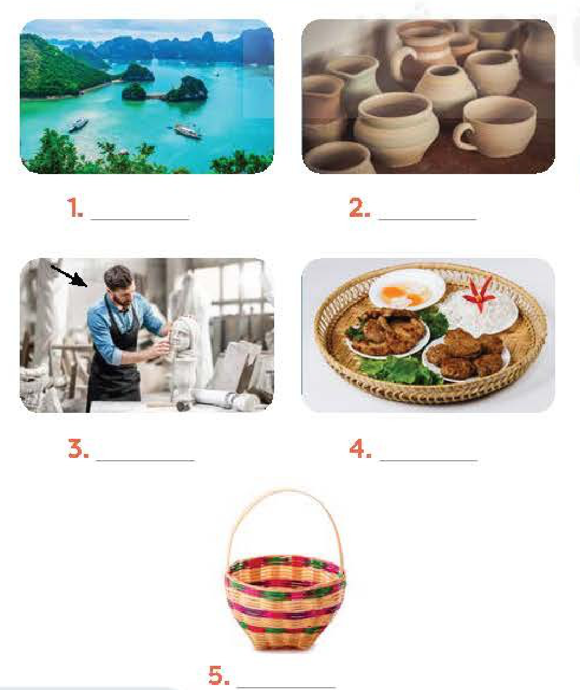
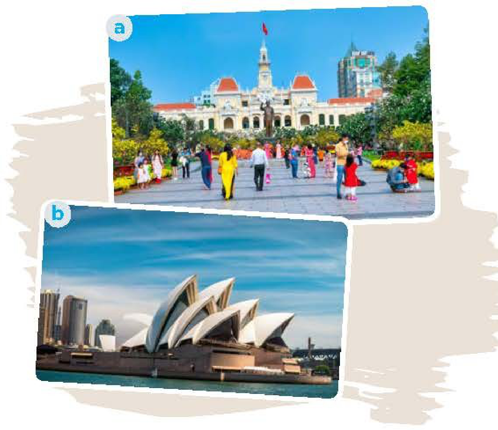
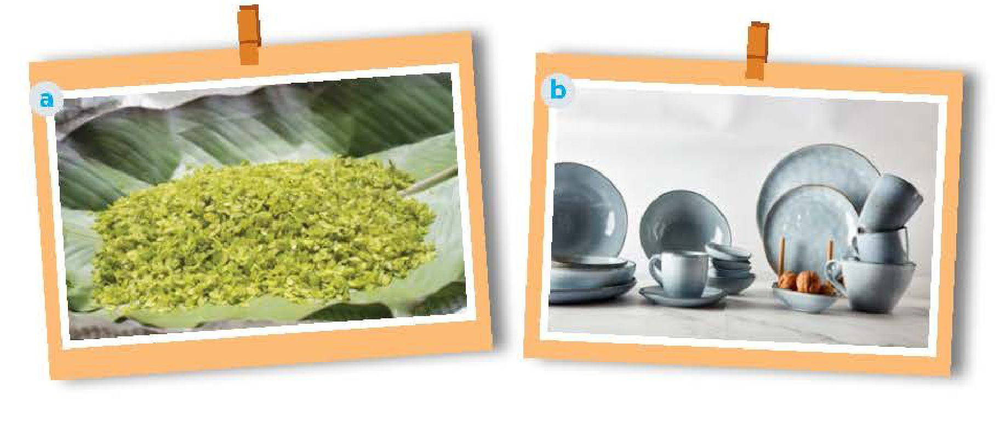
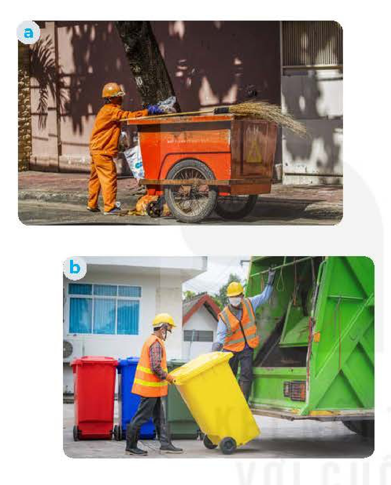

<!-- pdf:7 -->

# UNIT 1: LOCAL COMMUNITY

> **THIS UNIT INCLUDES:**
> - **Vocabulary:**
>   - Community helpers
>   - Traditional handicrafts
> - **Pronunciation:**
>   - Vowel revision: /æ/, /ɑː/, and /e/
> - **Grammar:**
>   - Question words before *to*-infinitives
>   - Phrasal verbs (1)
> - **Skills:**
>   - Reading about special products in some areas
>   - Giving a short presentation about a speciality
>   - Listening about a community helper
>   - Writing a paragraph about a community helper
> - **Everyday English:**
>   - Seeking help and responding

## GETTING STARTED

**I really love where I live now.**
<!-- ocr-ok: đã đối chiếu ảnh trang gốc, OCR đọc nhầm chữ I thành dấu sổ dọc | -->

**1. Listen and read.**

**Ann:** Hi, Mi. Long time no see. How're you doing?

**Mi:** I'm fine, thanks. By the way, we moved to a new house in a suburb last month.

**Ann:** Oh, that's why I haven't seen you in the Reading Club very often.

**Mi:** Yes. We're still busy moving in, you know.

**Ann:** How's your new neighbourhood?

**Mi:** It's much bigger than our old one. The streets are wider, and there are fewer people.

**Ann:** What about the facilities?

**Mi:** It has all the things we need: shopping malls, parks, and hospitals. And there's a craft village near our house.

**Ann:** Great! How're your new neighbours?

**Mi:** They're nice. Last Sunday when I was looking for the way to the bus station, a lady came and showed me the way. I think we will get on with them.
<!-- ocr-ok: đã đối chiếu ảnh trang gốc, OCR đọc nhầm lady thành lacly và them thành therm -->

**Ann:** That reminds me of the time our family moved to Viet Nam. We didn't know where to buy stuff for our house, and the new neighbours in the community gave us useful advice. I guess you like your new place.
<!-- term: remind somebody of -->

**Mi:** Sure. I really love where I live now.
<!-- ocr-ok: đã đối chiếu ảnh trang gốc, OCR đọc nhầm chữ I thành dấu sổ dọc | -->

...

<!-- pdf:8 -->

**2. Read the conversation again. Fill in each blank with no more than TWO words from the conversation.**

1. Mi's family moved to a new house in a suburb \_\_\_\_\_\_\_.
2. Her new neighbourhood is bigger with wider streets and \_\_\_\_\_\_\_.
3. There is a \_\_\_\_\_\_\_ near Mi's house.
4. Mi thinks she will get on with her new \_\_\_\_\_\_\_.
5. People in Ann's community gave her family \_\_\_\_\_\_\_ on where to buy stuff.

**3. Match each word or phrase with its definition.**

| | |
| --- | --- |
| 1. suburb | a. the people living in a particular area; the place where people live |
| 2. facilities | b. to make somebody remember or think about somebody or something |
| 3. community | c. to have a good relationship with somebody |
| 4. get on with | d. an area outside the centre of a city |
| 5. remind sb of | e. the buildings, equipment, and services provided for a particular purpose |
<!-- term: remind somebody of -->
<!-- ocr-ok: đã đối chiếu ảnh trang gốc, bảng nối hai cột bị OCR đọc lệch dòng và nhầm kí tự -->

**4. Complete each sentence with a word or phrase from 3.**

1. They don't live in the city centre but in a \_\_\_\_\_\_\_ of Ha Noi.
2. I love our new neighbourhood because we \_\_\_\_\_\_\_ the people here.
3. There are enough sports \_\_\_\_\_\_\_ for people of all ages in our local park.
4. Souvenirs \_\_\_\_\_\_\_ people \_\_\_\_\_\_\_ a place, an occasion, or a holiday.
5. The local \_\_\_\_\_\_\_ encourages us to protect the environment and keep our neighbourhood clean.

**5. QUIZ: What is the place?**
<!-- ocr-ok: đã đối chiếu ảnh trang gốc, chữ QUIZ in màu trong các ô vuông trang trí -->

**Do the following quiz.**

1. People watch sports such as football there.
2. People go there for health check-ups.
3. Parents take their children there so that they can have fun.
4. Children learn to read and write there.
5. Visitors see objects from the past there.

**What are some other places in a neighbourhood you know?**
<!-- ocr-ok: đã đối chiếu ảnh trang gốc, OCR đọc dính placesin và nhầm neighbourhood thành heighbourhood -->

<!-- pdf:9 -->

## A CLOSER LOOK 1

### Vocabulary

**1. Match the community helpers with their responsibilities.**
<!-- ocr-ok: đã đối chiếu ảnh trang gốc, dòng tiêu đề bài 1 bị OCR đọc trộn với khung từ vựng cột phải -->

| | |
| --- | --- |
| 1. police officer | a. puts in, checks, and repairs electrical wires and equipment |
| 2. garbage collector | b. puts out fires and saves people from dangerous fires |
| 3. electrician | c. protects people and property, makes people obey the law, prevents and solves crimes |
| 4. firefighter | d. delivers goods to people's houses or workplaces |
| 5. delivery person | e. takes people's rubbish away |
<!-- ocr-ok: đã đối chiếu ảnh trang gốc, bảng nối cột trái và cột phải bị OCR đọc lộn xộn với cột bên phải trang -->

**What other community helpers can you add?**

**2. Write a word or phrase in the box under the correct picture.**

| tourist attraction | handicraft | pottery |
| --- | --- | --- |
| speciality food | artisan | |

1. \_\_\_\_\_\_\_
2. \_\_\_\_\_\_\_
3. \_\_\_\_\_\_\_
4. \_\_\_\_\_\_\_
5. \_\_\_\_\_\_\_
<!-- ocr-ok: đã đối chiếu ảnh trang gốc, 5 chỗ trống đánh số 1–5 nằm dưới từng bức ảnh minh hoạ -->

**3. Fill in each blank with a word or phrase from the box.**

| artisans | electrician | handicrafts |
| --- | --- | --- |
| speciality food | garbage collector | |

1. Skilled local \_\_\_\_\_\_\_ made these beautiful flower vases.
2. The electrical wires in our neighbourhood broke down yesterday, so we had to call a(n) \_\_\_\_\_\_\_.
3. *Bun cha*, *pho*, and *hu tieu* are examples of famous Vietnamese \_\_\_\_\_\_\_.
4. The \_\_\_\_\_\_\_ in our street usually comes at 6 p.m. to take the rubbish away.
5. Tourists to Hoi An usually buy traditional \_\_\_\_\_\_\_ such as lanterns as souvenirs.

### Pronunciation

**Vowel revision: /æ/, /ɑː/, and /e/**
<!-- ocr-ok: đã đối chiếu ảnh trang gốc, OCR không nhận diện chính xác kí hiệu phiên âm /æ/, /ɑː/ -->

**4. Listen and number the words you hear. Then listen again and repeat.**

| | |
| --- | --- |
| \_\_\_\_\_\_\_ pack | \_\_\_\_\_\_\_ park |
| \_\_\_\_\_\_\_ kettle | \_\_\_\_\_\_\_ cattle |
| \_\_\_\_\_\_\_ marry | \_\_\_\_\_\_\_ merry |
| \_\_\_\_\_\_\_ chart | \_\_\_\_\_\_\_ chat |
<!-- ocr-ok: đã đối chiếu ảnh trang gốc, OCR bỏ sót gạch trống và đọc nhầm merry thành merty -->

**5. Listen and practise the sentences. Underline the bold words with /æ/, circle the bold words with /ɑː/, and tick the bold words with /e/.**
<!-- ocr-ok: đã đối chiếu ảnh trang gốc, OCR đọc nhầm kí hiệu phiên âm /æ/ và /ɑː/ -->

1. *Thanks* to *garbage* collectors, our streets are clean.
2. My *grandmother* is a well-known *artist*.
3. *That* bakery makes the *best bread* in our neighbourhood.
4. Do you know *where* to buy *bamboo beds*?
5. We sometimes go to the *park* to *relax*.

<!-- pdf:10 -->

## A CLOSER LOOK 2

### Grammar

**Question words before *to*-infinitives**

**Remember!**

- We use a question word such as *who*, *what*, *where*, *when*, or *how* before a *to*-infinitive to express an indirect question about what we should do.
- We often use a verb such as *ask*, *wonder*, *(not) decide*, *(not) tell*, or *(not) know* before the question word + *to*-infinitive.
  *Example:*
  - We don't know *what* to do to help the community.
  - She asked *how* to get to the nearest shopping mall.
<!-- term: Question words before to-infinitives -->

**1. Fill in each blank with a suitable question word.**

1. I don't know \_\_\_\_\_\_\_ to deal with this problem.
2. My sister wondered \_\_\_\_\_\_\_ to buy the best cakes.
3. Could you tell me \_\_\_\_\_\_\_ to do to get on well with my new neighbours?
4. They asked \_\_\_\_\_\_\_ to take out the rubbish, at 5 or 6 p.m.
5. He can't decide \_\_\_\_\_\_\_ to give his books to.

**2. Rewrite the sentences using question words + *to*-infinitives.**

1. I don't know how I can get to the swimming pool.
   \_\_\_\_\_\_\_\_\_\_\_\_\_\_\_\_\_\_\_\_\_\_\_
2. They are wondering where they can buy traditional handicrafts.
   \_\_\_\_\_\_\_\_\_\_\_\_\_\_\_\_\_\_\_\_\_\_\_
3. She asked what she should give to her new neighbour at his house-warming party.
   \_\_\_\_\_\_\_\_\_\_\_\_\_\_\_\_\_\_\_\_\_\_\_
4. I can't decide who I should ask for advice.
   \_\_\_\_\_\_\_\_\_\_\_\_\_\_\_\_\_\_\_\_\_\_\_
5. Could you tell me when I have to pay the water bill?
   \_\_\_\_\_\_\_\_\_\_\_\_\_\_\_\_\_\_\_\_\_\_\_

**Phrasal verbs (1)**

**Remember!**

- A phrasal verb consists of a verb and one or two particles, such as *up*, *down*, *back*, *on*, *round*, ...
- A phrasal verb usually has a special meaning.
  *Example:*
  - go out = leave your house to go to a social event
  - pass down = give or teach something to your children
  - cut down on = reduce the amount or number of something
  - run out of = have no more of
<!-- term: go out -->

<!-- pdf:11 -->

**3. Match each phrasal verb with its meaning.**

| | |
| --- | --- |
| 1. look around | a. to be responsible for somebody / something |
| 2. come back | b. to walk around a place to see what is there |
| 3. hand down | c. to get information about somebody or something |
| 4. find out | d. to return to a place |
| 5. take care of | e. to give something to somebody younger than you |
<!-- term: come back -->
<!-- term: find out -->
<!-- term: take care of -->
<!-- ocr-ok: đã đối chiếu ảnh trang gốc, bảng nối cụm động từ bị OCR đọc lỗi kí tự và tách dòng -->

**4. Complete each sentence using the correct form of a phrasal verb in 3.**

1. We \_\_\_\_\_\_\_ from our home town last Saturday.
2. The artisans in my village usually \_\_\_\_\_\_\_ their skills to their eldest children.
3. If you want to \_\_\_\_\_\_\_ about our community, you can go to the local museum.
4. When we aren't at home, our neighbour \_\_\_\_\_\_\_ our cats.
5. Whenever I go to a new place, I spend time \_\_\_\_\_\_\_.

**5. GAME: Find someone who ...**
<!-- ocr-ok: đã đối chiếu ảnh trang gốc, chữ GAME in màu trong các ô vuông trang trí -->

**Ask as many friends as you can the following questions. Then write their names in the table if they say "yes".**

| | Name |
| --- | --- |
| 1. Do your parents often come back late at night? | |
| 2. Do you get on with all your classmates? | |
| 3. Do you take care of your younger brother or sister? | |
| 4. Do you want to cut down on fast food? | |
| 5. Do you enjoy going out at weekends? | |

## COMMUNICATION

### Everyday English

*Seeking help and responding*

**1. Listen and read the conversations. Pay attention to the questions and answers.**

1. **Mai:** Do you mind carrying this suitcase for me?
   **Tom:** Not at all.
<!-- term: Seeking help and responding -->

2. **Ann:** Could you show me how to open this gate, please?
   **Mr Nam:** Sure.
<!-- term: Seeking help and responding -->

**2. Work in pairs. Ask for help and respond in the following situations.**

1. You want your friend to lend you her pen.
2. You want your neighbour to tell you the name of the new garbage collector.
3. You want to ask your neighbour where to buy the best fruits and vegetables.

**Places of interest**

**3. Do you know the place in each picture?**

<!-- pdf:12 -->

**4. Listen to Binh and Mira talking about a place of interest in their community. Fill in each blank with no more than TWO words and / or a number.**

| | Place | Distance | Frequency | Activities |
| --- | --- | --- | --- | --- |
| Binh Ho Chi Minh City, Viet Nam | Nguyen Hue Pedestrian Street | (1) \_\_\_\_\_\_\_ km | Every (2) \_\_\_\_\_\_\_ | Children: enjoying music, looking for (3) \_\_\_\_\_\_\_ Parents: looking around |
| Mira Sydney, Australia | Sydney Opera House | (4) \_\_\_\_\_\_\_ km | Twice a month | Children: running up and down the stairs, (5) \_\_\_\_\_\_\_ seagulls Parents: having (6) \_\_\_\_\_\_\_, talking |
<!-- ocr-ok: đã đối chiếu ảnh trang gốc, bảng 5 cột bài nghe bị OCR đọc sót chữ Street và lỗi số thứ tự -->

**5. Work in pairs. Ask and answer about your favourite places of interest. Use the questions below.**

- What is your favourite place of interest?
- How far is it from your house?
- How often do you go to that place?
- What do you do there?

**Then tell the class about your partner's favourite place of interest.**

*Example:* Lan's favourite place of interest is Tao Dan Park. It's only one kilometre from her house ...

## SKILLS 1

### Reading

**1. Work in pairs. Answer the questions.**

1. What can you see in each picture?
2. Do you know any place where people make the thing(s) in each picture?

<!-- pdf:13 -->

**2. Read the brochure introducing different places with special products. Match each highlighted word with its definition.**

- *Vong*, a small village in Ha Noi, is famous for a speciality food: *com* (young sticky rice flakes). To make *com*, artisans follow a series of steps. They *preserve* the techniques by passing them down to their sons. In the past, people made *com* by hand, but now they use machines for some steps to *shorten* the process. They wrap the final product in two layers of leaves to preserve its *fragrance* before selling it to consumers. *Com Lang Vong* is well known in Viet Nam as a speciality of Ha Noi autumn.
<!-- term: shorten -->
<!-- ocr-ok: đã đối chiếu ảnh trang gốc, đoạn đầu bài đọc Vong bị ảnh tròn chèn cạnh làm OCR bỏ sót hai dòng đầu -->

- *Denby* is a village in the county of Derbyshire, England. It is the home of the famous Denby Pottery, which is made from the finest local clay. Going around the village, we can see artisans hand-craft pottery collections. They still use some of the *original* techniques passed down through generations. In Denby products, we can see their beauty and *function* which make them world-famous. Today Denby is also a tourist attraction. Visitors can make pottery in workshops or find out about the history of pottery in the museum.

| | |
| --- | --- |
| 1. preserve | a. existing since the beginning |
| 2. shorten | b. to keep something as it is |
| 3. fragrance | c. to make something shorter |
| 4. original | d. a special purpose of a thing |
| 5. function | e. a pleasant smell |
<!-- term: shorten -->

**3. Read the brochure again. Decide which place each detail below belongs to.**

| In which place ...? | Vong | Denby |
| --- | --- | --- |
| 1. people make the speciality from local material | | |
| 2. people make the product from plants | | |
| 3. people make the product with some traditional techniques | | |
| 4. the product is famous worldwide | | |
| 5. the product symbolises a season | | |

### Speaking

**4. Work in pairs. Ask and answer about a speciality in your neighbourhood, your home town, or the area you know. Use the questions below.**

1. What speciality is it?
2. What do people make it from?
3. Do people make it in the traditional way?
4. What can people do with it?
5. Is it well known in only your country or around the world?

**5. Work in groups. Give a short presentation about the speciality you discussed in 4.**

*Example:*
I live in Tay Ho Village, 12 kilometres from Hue City. My village is famous for its conical hats. We make conical hats from *goi* leaves ...

<!-- pdf:14 -->

## SKILLS 2

### Listening

**1. Work in pairs. Discuss the questions.**

1. Who can you see in the pictures?
2. What are they doing?

**2. Listen and fill in each blank with no more than TWO words.**

1. The name of the writing contest is "My Favourite \_\_\_\_\_\_\_".
2. Mr Vinh is a \_\_\_\_\_\_\_.
3. He is tall and \_\_\_\_\_\_\_.
4. He is hard-working, responsible, and \_\_\_\_\_\_\_.

**3. Listen again and tick (✓) T (True) or F (False).**

| | T | F |
| --- | --- | --- |
| 1. Mr Vinh wears an orange uniform. | | |
| 2. He arrives at Mi's neighbourhood at 9 p.m. every day. | | |
| 3. He instructs people to put rubbish in two types of bins. | | |
| 4. He shares information about his work and the importance of sorting rubbish. | | |

### Writing

**4. Work in pairs. Choose a community helper you like and answer the following questions.**

- What is his / her job?
- What does he / she look like?
- What is he / she like?
- What does he / she do for the community?
- How do you feel about him / her?

**5. Write a paragraph (about 100 words) about your favourite community helper. Use the answers to the questions in 4 to help you.**

**Start your paragraph with:**

> *My favourite community helper is* \_\_\_\_\_\_\_\_\_\_\_\_\_\_\_\_\_\_\_\_\_\_\_

<!-- pdf:15 -->

## LOOKING BACK

### Vocabulary

**1. Write a word or phrase for each description below.**

1. This person delivers goods to your house. \_\_\_\_\_\_\_
2. This person stops fires from burning. \_\_\_\_\_\_\_
3. People visit this place for pleasure usually while they are on holiday. \_\_\_\_\_\_\_
4. People make these objects out of clay. \_\_\_\_\_\_\_
5. This person makes things with his / her hands. \_\_\_\_\_\_\_

**2. Circle the correct word or phrase to complete each sentence.**

1. The villagers (*preserve* / *shorten*) their traditional weaving techniques.
2. *Com Lang Vong* has a special (*fragrance* / *function*), so it is very popular.
3. Our (*firefighters* / *police officers*) help keep law and order in our community.
4. Spring rolls are the (*speciality food* / *fast food*) I like best.
5. My home town is famous for (*handicrafts* / *objects*), such as paper fans and lanterns.

### Grammar

**3. Choose the correct answer A, B, C, or D.**

1. You should decide \_\_\_\_\_\_\_ to move to the new house.
   - A. while
   - B. when
   - C. where
   - D. who
2. Do you know \_\_\_\_\_\_\_ to sort rubbish?
   - A. who
   - B. which
   - C. how
   - D. what
3. She didn't tell me \_\_\_\_\_\_\_ to meet, in the library or in the lab.
   - A. how
   - B. when
   - C. what
   - D. where
4. Could you tell me \_\_\_\_\_\_\_ to do in this situation?
   - A. what
   - B. when
   - C. where
   - D. who
5. I wonder \_\_\_\_\_\_\_ to ask for advice, my teacher or my parents.
   - A. where
   - B. when
   - C. who
   - D. what

**4. Rewrite each sentence so that it contains the phrasal verb in brackets. You may have to change the form of the verb.**

1. In some villages, people reduce the number of steps to make the handicraft. (cut down on)
   \_\_\_\_\_\_\_\_\_\_\_\_\_\_\_\_\_\_\_\_\_\_\_
2. My grandparents gave the skills to my parents. (hand down)
   \_\_\_\_\_\_\_\_\_\_\_\_\_\_\_\_\_\_\_\_\_\_\_
3. In their community, the eldest child is usually responsible for his or her parents. (take care of)
   \_\_\_\_\_\_\_\_\_\_\_\_\_\_\_\_\_\_\_\_\_\_\_
4. Before we go to a new place, we always get information about it. (find out)
   \_\_\_\_\_\_\_\_\_\_\_\_\_\_\_\_\_\_\_\_\_\_\_
5. They have a good relationship with all neighbours. (get on with)
   \_\_\_\_\_\_\_\_\_\_\_\_\_\_\_\_\_\_\_\_\_\_\_

<!-- pdf:16 -->

## PROJECT

**What to change in our community**
<!-- ocr-ok: đã đối chiếu ảnh trang gốc, tiêu đề dự án chữ màu đỏ trang trí bị OCR bỏ sót -->

**Work in groups.**

**1. Interview some students from your class or from other classes about the changes they want to make in their community. Use the questions below.**

1. Where do you live?
2. What is good about your community?
3. What is not good about your community?
4. What changes do you want to make to improve your community?

**2. Collect the answers. Use the table below.**

| Student | Question 1 | Question 2 | Question 3 | Question 4 |
| --- | --- | --- | --- | --- |
| | | | | |

**3. Report your group's findings to your class. Use the following questions to guide your report.**

1. How many students did you interview?
2. What is good about their community?
3. What is not good about their community?
4. What changes do they want to make?

### Now I can ...

- use the words related to the topic *Local community*.
- pronounce the vowel sounds /æ/, /ɑː/, and /e/ correctly in words and sentences.
- use question words before *to*-infinitives and some phrasal verbs.
- seek help and respond.
- read about special products in some areas.
- give a short presentation about a speciality.
- listen about a community helper.
- write a paragraph about a community helper.

## 📷 Danh sách hình trong bài

| Mã hình | Trang PDF | Trang sách | Chú thích / Mô tả |
| --- | --- | --- | --- |
| H9-tieng_anh-u01-01 | 9 | 10 | Năm bức ảnh 1–5 thuộc bài tập 2 phần A Closer Look 1 – Vocabulary: (1) điểm du lịch vịnh biển, (2) đồ gốm, (3) nghệ nhân thủ công, (4) món ăn đặc sản trên mẹt tre, (5) giỏ đan thủ công |
| H9-tieng_anh-u01-02 | 11 | 12 | Hai bức ảnh a–b thuộc bài tập 3 phần Communication – Places of interest: (a) phố đi bộ Nguyễn Huệ ở TP. Hồ Chí Minh, (b) Nhà hát Opera Sydney ở Úc |
| H9-tieng_anh-u01-03 | 12 | 13 | Hai bức ảnh a–b thuộc bài tập 1 phần Skills 1 – Reading: (a) cốm xanh gói lá sen, (b) bộ đồ gốm sứ Denby |
| H9-tieng_anh-u01-04 | 14 | 15 | Hai bức ảnh a–b thuộc bài tập 1 phần Skills 2 – Listening: (a) nhân viên vệ sinh đẩy xe thu gom rác trên đường phố, (b) hai nhân viên vệ sinh đổ thùng rác vào xe ép rác |
