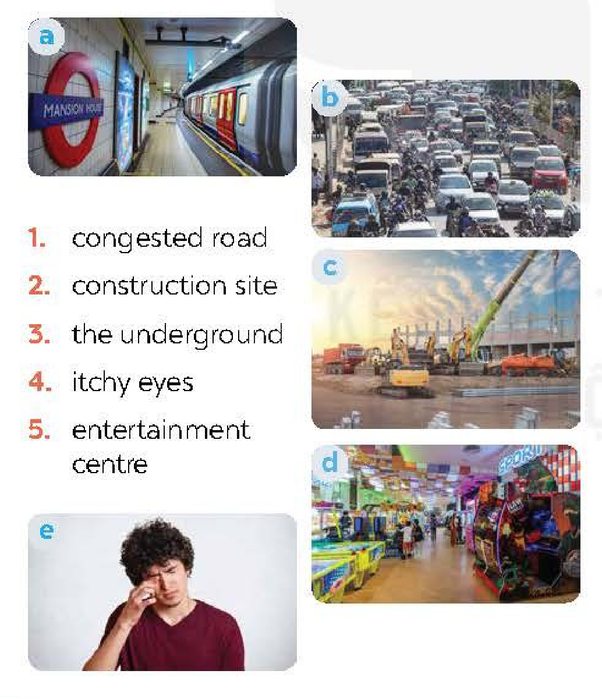
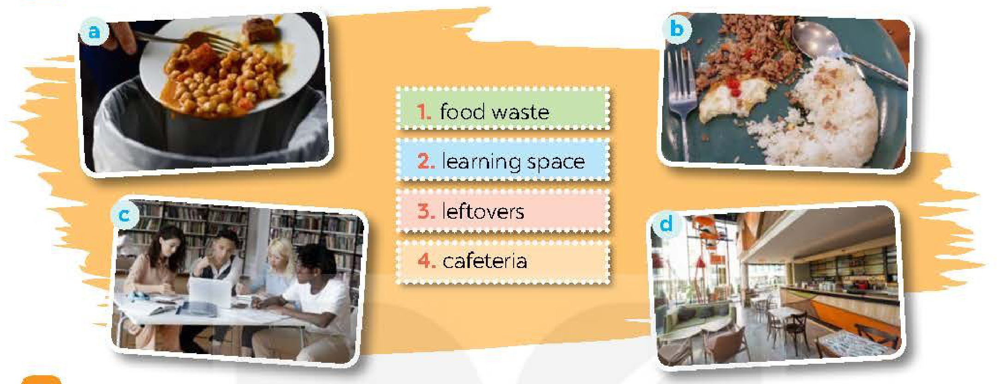

<!-- pdf:17 -->

# UNIT 2: CITY LIFE

> **THIS UNIT INCLUDES:**
> - **Vocabulary:**
>   - City life
> - **Pronunciation:**
>   - Diphthong revision: /aʊ/, /əʊ/, and /eə/
> - **Grammar:**
>   - Double comparatives
>   - Phrasal verbs (2)
> - **Skills:**
>   - Reading an announcement about a competition to find solutions to city problems
>   - Talking about city problems and their solutions
>   - Listening to an interview about life in some cities
>   - Writing a paragraph about what you like or dislike about city life
> - **Everyday English:**
>   - Offering help and responding

## GETTING STARTED

**How is your city?**

**1. Listen and read.**

**Trang:** Hi, Ben. Sorry I couldn't get online earlier. I got stuck in a traffic jam and came home late.
<!-- term: traffic jam -->

**Ben:** No problem, Trang. Did you go by bus?

**Trang:** No. My dad picked me up. I rarely use the bus. It's slow and packed with people.
<!-- term: packed with -->

**Ben:** I mostly get around by underground. It's more reliable than the bus.

**Trang:** That's great.

**Ben:** But traffic congestion is terrible in London. You know, the more crowded the city gets, the more congested the streets are.
<!-- term: traffic congestion -->

**Trang:** Yeah ... and the more polluted they may become. There's a construction site in my neighbourhood. It's dusty, so people easily get itchy eyes.
<!-- term: itchy eyes -->

**Ben:** It must be noisy, too. The noise probably makes people feel stressed sometimes.

**Trang:** That's right. But new buildings make the city look modern and attractive. Do you remember the grand building downtown?

**Ben:** Of course. How's it now? When I left Viet Nam, they nearly finished it.

**Trang:** Well, it's now a shopping mall. Teens like it because it's modern and fun.

**Ben:** Do you often go there?

**Trang:** Sometimes. I watch movies there with my sister. I want to go there more often, but it's a bit pricey.

**Ben:** It's expensive here in London, too ...

<!-- pdf:18 -->

**2. Read the conversation again and decide if the following statements are true (T) or false (F).**

| | T | F |
| --- | --- | --- |
| 1. The bus in Trang's city is slow and crowded. | | |
| 2. The underground system in Ben's city is unreliable. | | |
| 3. There is a dusty and noisy construction site near Trang's house. | | |
| 4. Trang thinks new buildings make the city look ugly. | | |
| 5. Both Trang and Ben find shopping malls expensive. | | |

**3. Match the words / phrases with their pictures.**

1. congested road
2. construction site
3. the underground
4. itchy eyes
5. entertainment centre
<!-- ocr-ok: đã đối chiếu ảnh trang gốc, các cụm từ 1–5 đặt xen kẽ cạnh tranh làm OCR bỏ sót số thứ tự -->

**4. Choose the correct answer A, B, C, or D.**

1. I like getting around by \_\_\_\_\_\_\_. I hate the smell of car exhaust.
   - A. underground
   - B. private car
   - C. taxi
   - D. bus
2. Road dust may badly affect our \_\_\_\_\_\_\_.
   - A. stomach
   - B. back
   - C. eyes
   - D. leg
3. There's a \_\_\_\_\_\_\_ in my neighbourhood. It's noisy and dusty.
   - A. building
   - B. construction site
   - C. hospital
   - D. lake
4. The road is narrow, so \_\_\_\_\_\_\_ often occurs at rush hour.
   - A. traffic light
   - B. traffic flow
   - C. traffic congestion
   - D. traffic safety
5. Many teens fancy spending their weekends in an entertainment \_\_\_\_\_\_\_.
   - A. industry
   - B. value
   - C. business
   - D. centre

**5. QUIZ: A lifestyle survey: City life or village life?**
<!-- ocr-ok: đã đối chiếu ảnh trang gốc, chữ QUIZ in màu trong các ô vuông trang trí -->

**Complete the quiz. Then compare your choices with your friends' and the teacher's explanation. Which suits you more, life in the city or in a village?**

1. What kind of house do you want to live in?
   - A. A small and modern apartment.
   - B. A house with a garden.
2. How do you like to get around?
   - A. By public transport.
   - B. By motorbike or bicycle.
3. Where do you frequently enjoy visiting?
   - A. Shops, restaurants, cinemas, and art galleries.
   - B. Local farmers' markets.
4. How do you describe your favourite neighbourhood?
   - A. Crowded and busy.
   - B. Quiet and green.
5. How do you like to spend time outdoors?
   - A. Going for a walk or running in the park.
   - B. Doing gardening or visiting next-door neighbours.

<!-- pdf:19 -->

## A CLOSER LOOK 1

### Vocabulary

**1. Match the words / phrases with their explanations.**

| | |
| --- | --- |
| 1. downtown | a. an underground train system |
| 2. concrete jungle | b. a city or part of a city with many buildings next to each other |
| 3. sky train | c. the centre of a city, especially its main business area |
| 4. metro | d. things in a neighbourhood that make life more comfortable such as parks and shopping centres |
| 5. public amenities | e. a type of train that runs on a railway high above the ground |
<!-- ocr-ok: đã đối chiếu ảnh trang gốc, bảng nối cột trái và cột phải bị OCR đọc lỗi từ concrete và metro -->

**2. Choose the correct answer A, B, C, or D to complete each sentence.**

1. The sky train is \_\_\_\_\_\_\_ with commuters at rush hour.
   - A. packed
   - B. full
   - C. busy
   - D. interesting
2. The town's public amenities make it a \_\_\_\_\_\_\_ place for its residents.
   - A. crowded
   - B. boring
   - C. liveable
   - D. dull
3. It's not always \_\_\_\_\_\_\_ on the metro. Pickpocketing sometimes takes place.
   - A. careful
   - B. dangerous
   - C. noisy
   - D. safe
4. It is often more \_\_\_\_\_\_\_ to live in the downtown than in the suburbs.
   - A. convenient
   - B. peaceful
   - C. quiet
   - D. silent
5. Hong Kong is like a concrete jungle with so many people in it. It's a \_\_\_\_\_\_\_ city.
   - A. calm
   - B. quiet
   - C. bustling
   - D. high

**3. Complete the texts, using the words and phrase from the box.**

| metro | safe |
| --- | --- |
| liveable | concrete jungles |
| downtown | public amenities |

- **John:** City life is great! People can travel by public transport, like buses and the (1) \_\_\_\_\_\_\_. There are good schools and hospitals, and other (2) \_\_\_\_\_\_\_ such as parks, cinemas, and sports facilities. They make cities (3) \_\_\_\_\_\_\_ places for people.
- **Jenny:** City life is terrible! The (4) \_\_\_\_\_\_\_ area is too crowded. Public transport is always packed with people. Some cities are like (5) \_\_\_\_\_\_\_ with so many buildings. Some cities are not (6) \_\_\_\_\_\_\_ because of high crime rates.

### Pronunciation

**Diphthong revision: /aʊ/, /əʊ/, and /eə/**
<!-- ocr-ok: đã đối chiếu ảnh trang gốc, OCR đọc nhầm kí hiệu phiên âm /aʊ/, /əʊ/, /eə/ -->

**4. Put the words in the correct column. Then listen and check.**

| cr*ow*ded | l*o*cate | squ*are* |
| --- | --- | --- |
| *ou*tdoor | rep*air* | *air*port |
| c*ou*ncil | c*oa*stal | *o*verseas |
<!-- ocr-ok: đã đối chiếu ảnh trang gốc, phần chữ in màu cam của các từ được biểu diễn bằng in nghiêng -->

| /aʊ/ | /əʊ/ | /eə/ |
| --- | --- | --- |
| | | |
<!-- ocr-ok: đã đối chiếu ảnh trang gốc, bảng phân loại ba cột nguyên âm đôi -->

**5. Read the sentences. Circle the words with /aʊ/, underline those with /əʊ/, and put a tick (✓) next to those with /eə/. Then listen, check, and practise the sentences.**
<!-- ocr-ok: đã đối chiếu ảnh trang gốc, OCR không nhận diện được kí hiệu phiên âm IPA -->

1. They go shopping downtown.
2. The chairman comes from a coastal city.
3. Buses in the old days were not as crowded as they are now.
4. She gets around the city easily thanks to the apps on her phone.
5. I hope we will arrive at the city square in time for the fashion show.

<!-- pdf:20 -->

## A CLOSER LOOK 2

### Grammar

*Double comparatives*

**Remember!**

We use *the* with comparative adjectives to show that one thing or situation depends on another.
*Example:*
- *The more developed* the city is, *the more crowded* it becomes.
- *The nearer* we got to the suburb, *the less busy* the road was.
<!-- term: Double comparatives -->

**1. Choose the correct option to complete each sentence.**

1. Lan isn't home yet. The *later* / *more late* it gets, the more worried I get about her.
2. He wants a new house. The larger the house is, the *comfortable* / *more comfortable* he feels.
3. She thinks the bigger the city is, *higher* / *the higher* the cost of living gets.
4. The *famouser* / *more famous* the city is, the higher number of tourists it can attract.
5. The larger population the town has, *more difficult* / *the more difficult* it is to find a job.
<!-- ocr-ok: đã đối chiếu ảnh trang gốc, các từ in màu cam bị nền watermark chèn lên làm OCR đọc biến dạng nhiều từ -->

**2. Find a mistake in the underlined parts in each sentence below and correct it.**

1. I love the *spicy food* (A) in this city. *The hottest* (B) the food is, *the more* (C) I like it.
2. I got *stuck* (A) in a traffic jam yesterday. The more *congested* (B) the road was, the *tired* (C) I became.
3. The *modern* (A) the library is, *the more* (B) attractive it *is* (C) to teenagers.
4. The streets are getting *dirtier* (A). The *more crowded* (B) this city is, *more polluted* (C) it becomes.
5. The *denser* (A) the buildings are, the *more ugly* (B) the city becomes. It'll soon look like a *concrete jungle* (C).
<!-- ocr-ok: đã đối chiếu ảnh trang gốc, các nhãn gạch chân A, B, C nằm dưới dòng làm OCR tách dòng và đọc thiếu chữ -->

**Phrasal verbs (2)**

**3. Match a phrasal verb in column A with a suitable word / phrase in column B.**

| A | B |
| --- | --- |
| 1. get around | a. noise pollution |
| 2. carry out | b. friends |
| 3. come down with | c. a project |
| 4. hang out with | d. the city |
| 5. cut down on | e. the flu |

**4. Complete each sentence with a phrasal verb in 3. You can change the form of the verb when necessary.**

1. I'm \_\_\_\_\_\_\_ a cold. I have a runny nose and a sore throat.
2. We all need to \_\_\_\_\_\_\_ using our cars and ride our bikes more to reduce air pollution.
3. When I was in town, I chose to \_\_\_\_\_\_\_ by bus.
4. Where do teenagers in your neighbourhood often \_\_\_\_\_\_\_ each other?
5. The authority is \_\_\_\_\_\_\_ a plan to solve traffic congestion in the downtown area.

**5. Work in pairs. Tell each other whether you agree or disagree with the following ideas.**

1. The busier the city is, the more unhappy its people are.
2. The older the city becomes, the less attractive it is to immigrants.
3. Your home town should cut down on noise pollution.

<!-- pdf:21 -->

## COMMUNICATION

### Everyday English

*Offering help and responding*

**1. Listen and read the conversations below. Pay attention to the highlighted parts.**

1. **Duong's dad:** *I can* take you to the airport if you like.
   **Duong:** *Thanks*, Dad.
<!-- term: Offering help and responding -->

2. **Minh:** *Would you like me to* give you a ride home?
   **Hoang:** *Thank you*. That's so kind of you.
<!-- term: Offering help and responding -->

**2. Work in pairs. Make similar conversations with the following situations.**

1. Your friend doesn't know how to use the library smart card. You offer to show him / her.
2. A teacher wants to talk to Ms Hoa, but she is not there. You offer to write a note for Ms Hoa.

**Transport in the city**

**3. Work in pairs. Read the descriptions of three teenagers about their favourite means of transport. Then complete the table below.**

- **Hoang:** I live in the suburbs of Ha Noi. I use my bike to get around. It's convenient because I can ride it to places where the bus line doesn't reach. Going by bike might be a bit slow, but I can avoid traffic jams.
- **Cholada:** My favourite means of transport in Bangkok is the sky train. It's crowded at rush hour, but it's always on time. It doesn't get stuck in traffic jams, so I can save time travelling.
- **Kathy:** I love the tram in Melbourne. It offers a discount for students. Sometimes the tram is late, but it always updates its arrival on a smartphone app, so I know in advance and arrange my time easily.
<!-- ocr-ok: đã đối chiếu ảnh trang gốc, ba tờ ghi chú đặt ngang nhau khiến OCR đọc trộn dòng -->

| Name | Favourite means of transport | Advantage(s) | Drawback(s) | Why using it |
| --- | --- | --- | --- | --- |
| Hoang | bike | convenient | slow | avoid (1) \_\_\_\_\_\_\_ |
| Cholada | (2) \_\_\_\_\_\_\_ | on time | (3) \_\_\_\_\_\_\_ at rush hour | save time travelling |
| Kathy | (4) \_\_\_\_\_\_\_ | (5) \_\_\_\_\_\_\_ for students | late | arrange time easily |
<!-- ocr-ok: đã đối chiếu ảnh trang gốc, bảng 5 cột bị OCR đọc lỗi tên Cholada, on time và late -->

**4. Make notes about a means of transport you are using.**

- Name of the means of transport
- Its advantage(s) and drawback(s)
- Why you choose to use it

**5. Work in groups. Talk to your friends about the means of transport that you use. Use your notes in 4.**

<!-- pdf:22 -->

## SKILLS 1

### Reading

**1. Work in pairs. Match the words / phrases with their pictures.**

1. food waste
2. learning space
3. leftovers
4. cafeteria

**2. Read part of an announcement about the Teenovator competition. Match the topics in the competition with their winners. There is one extra topic.**

**List of topics:**
- A. The street-safe city
- B. The teen-friendly city
- C. The food-smart city
- D. The waste-free city

> Teenovator is an annual competition by the City Teen Council. We ask teens to find problems of the city and suggest solutions. Here are this year's winners.
<!-- ocr-ok: đã đối chiếu ảnh trang gốc, dòng chữ trắng trên nền xanh xám bị OCR bỏ sót phần giữa câu -->

- **1. \_\_\_\_\_\_\_: Central School**
  They see that the more developed a city is, the more food people throw away. They suggest carrying out a project which turns food waste into energy. Students would sort their leftovers at school canteens. A nearby farm would come to take the food waste and process it into biogas.
<!-- term: throw away -->
<!-- term: food waste -->

- **2. \_\_\_\_\_\_\_: Bookworm Team**
  This team feels that many public amenities, particularly the city library, are not teen-friendly. They suggest a list of changes so that the library can attract more teens. Some of *them* include designing lively learning spaces for teens and having teen's favourite desserts in the cafeteria.

- **3. \_\_\_\_\_\_\_: Helena Wilson**
  Helena realises that there are too many vehicles around school gates. This is unsafe for children who walk to school. She suggests that the city authorities not allow cars at school gates at drop-off and pick-up times. In addition, they should not let motorbikes park on the pavement near school gates.

<!-- pdf:23 -->

**3. Read the announcement again. Choose the correct answer.**

1. How often does the City Teen Council organise the Teenovator competition?
   - A. Once a year.
   - B. Twice a year.
   - C. Every two years.
   - D. Every three years.
2. Who would partner with Central School in Topic 1?
   - A. The city council.
   - B. The university's canteen.
   - C. A biogas factory.
   - D. A nearby farm.
3. What does the word "*them*" in Topic 2 refer to?
   - A. Teen users.
   - B. Changes.
   - C. Learning spaces.
   - D. Libraries.
4. Which topic has an individual winner?
   - A. Topic 1.
   - B. Topic 2.
   - C. Topic 3.
   - D. All topics.
5. Which of the following is INCORRECT about Helena Wilson?
   - A. She suggests banning bikes at school gates.
   - B. She wants the city authorities to take action.
   - C. She thinks cars moving near school gates can cause accidents to children.
   - D. Her concern is road safety around school for children.

### Speaking

**4. Make a list of city problems and some solutions to them.**

*Example:*

| Problems | Solutions |
| --- | --- |
| - Dirty streets | - Tell people to throw rubbish away properly |
| - Lack of green spaces | - Plant more trees |

**5. Work in pairs. Talk to your friends about the city problems and suggest solutions to them. You can use the ideas in 4.**

**Now report your discussion to the class.**

**You can use the structures below:**

There are several problems in our city. First, ... Second, ... To solve these problems, the city can ... Another solution is ... By doing so, the city can be a more liveable place.

<!-- pdf:24 -->

## SKILLS 2

### Listening

**1. Work in pairs. Tick (✓) the things that you want in your home town. Add more ideas if you have any.**

- [ ] a. Nice parks
- [ ] b. Modern cinemas
- [ ] c. Air-conditioned buses
- [ ] d. Free sports facilities
- [ ] e. Convenient food stalls
- [ ] f. Wide roads

**2. Listen to an interview with three teenagers about life in their cities. Decide if the statements are true (T) or false (F).**

| | T | F |
| --- | --- | --- |
| 1. There are many facilities for public use in Tom's city. | | |
| 2. Elena likes spending her free time in shopping malls. | | |
| 3. Food stalls are not popular in Chi's city. | | |
| 4. In Chi's city, many teens like street food more than food prepared at home. | | |

**3. Listen again. Choose the correct answer A, B, or C.**

1. Where might this interview come from?
   - A. A chat show.
   - B. A documentary.
   - C. The daily news.
2. What is a problem in Tom's city?
   - A. Some buses don't have air-conditioners.
   - B. There are no parks.
   - C. Some roads are too wide.
3. What change does Elena suggest for her city?
   - A. A new shopping mall.
   - B. More free sports facilities.
   - C. More modern sports centres.
4. Chi thinks that \_\_\_\_\_\_\_ should tell teens about the drawbacks of street food.
   - A. parents and the city council
   - B. the city council and schools
   - C. parents and schools

### Writing

**4. Work in pairs. Put the phrases from the box in the correct column.**

| | |
| --- | --- |
| too much noise | easy shopping |
| good health service | air pollution |
| high crime rate | heavy traffic |
| beautiful buildings | green space |

| What I like about city life | What I dislike about city life |
| --- | --- |
| | |
<!-- ocr-ok: đã đối chiếu ảnh trang gốc, tiêu đề bảng hai cột bị OCR bỏ sót chữ I và đọc thành | -->

**5. Write a paragraph (about 100 words) about what you like OR dislike about living in a city. You can use the ideas in 4 or your own ideas.**

**You can use the following outline:**

> *I love / dislike city life. First,* \_\_\_\_\_\_\_\_\_\_\_\_\_\_\_\_\_\_\_\_\_\_\_
>
> *Second,* \_\_\_\_\_\_\_\_\_\_\_\_\_\_\_\_\_\_\_\_\_\_\_
>
> *Third,* \_\_\_\_\_\_\_\_\_\_\_\_\_\_\_\_\_\_\_\_\_\_\_
>
> *In conclusion,* \_\_\_\_\_\_\_\_\_\_\_\_\_\_\_\_\_\_\_\_\_\_\_.

<!-- pdf:25 -->

## LOOKING BACK

### Vocabulary

**1. Choose the correct answer to complete each sentence below.**

1. It takes Jane 30 minutes to travel from her house in the *suburbs* / *downtown* to her office in the city centre.
2. Minh prefers the *metro* / *sky train*. He finds it more comfortable to go underground than above the ground.
3. The city centre is now packed with high buildings. It looks like an ugly *public amenity* / *concrete jungle*.
4. He loves the nightlife of his city. He thinks that it is *lively* / *noisy*.
5. Ho Chi Minh City is a *slow* / *bustling* city. It is always full of activities.

**2. Fill in each gap with a word from the box to complete the passage.**

| congestion | peaceful | safe |
| --- | --- | --- |
| liveable | itchy | |

Mia lives in a small town. In the past, there were not many people living in the town, so it was rather quiet and (1) \_\_\_\_\_\_\_. Nowadays, it is totally different. The more crowded the town is, the less (2) \_\_\_\_\_\_\_ it becomes. Crime rates are increasing quickly. Moreover, many car drivers don't obey traffic rules, so they indirectly cause traffic (3) \_\_\_\_\_\_\_. Construction sites are everywhere in the town. The dust and dirt from these sites have caused many problems for people's health, for example (4) \_\_\_\_\_\_\_ eyes, runny noses, and acne. All these things make Mia feel that her town is not as (5) \_\_\_\_\_\_\_ as before.

### Grammar

**3. Complete the sentences with the particles in the box.**

| out with | down with | out |
| --- | --- | --- |
| down on | away | |

1. People are throwing \_\_\_\_\_\_\_ tons of food each year. This is such a waste!
<!-- term: throw away -->
2. Shopping malls are a popular place for teens to hang \_\_\_\_\_\_\_ one another these days.
3. The city council wants to cut \_\_\_\_\_\_\_ construction noise by 20% in the next five years.
4. The researchers carried \_\_\_\_\_\_\_ a study about people's attitudes towards their cities.
5. Many people come \_\_\_\_\_\_\_ the flu in winter.

**4. Find a grammar mistake in each sentence and correct it.**

1. The dirtier the air gets, more difficult it is for people to breathe.
2. My brother likes to get up the city by bike, but I prefer using public transport.
3. Nearer the school is, the more convenient it is for the students.
4. She came up with a cold after walking in the heavy rain.
5. The more slow the Internet is, the angrier the users get.

<!-- pdf:26 -->

## PROJECT

**A CITY IN THE FUTURE**
<!-- ocr-ok: đã đối chiếu ảnh trang gốc, tiêu đề dự án chữ trang trí màu xanh lá cây -->

**Work in groups.**

**1. Imagine a future city you would like to live in. Complete the table.**

| My future city | |
| --- | --- |
| Population | |
| Types of house | |
| Transportation | |
| School | |
| Entertainment | |

**2. Prepare a poster presentation on your future city. Use the information from your table in 1.**

**3. Present your poster of the future city to your class.**

### Now I can ...

- use the words about city life.
- pronounce the diphthong sounds /aʊ/, /əʊ/, and /eə/ correctly in words and sentences.
- recognise and use double comparatives and some phrasal verbs.
- offer help and respond.
- read an announcement about a competition to find solutions to city problems.
- talk about city problems and their solutions.
- listen to an interview about life in some cities.
- write a paragraph about what I like or dislike about city life.

## 📷 Danh sách hình trong bài

| Mã hình | Trang PDF | Trang sách | Chú thích / Mô tả |
| --- | --- | --- | --- |
| H9-tieng_anh-u02-01 | 18 | 19 | Năm bức ảnh a–e nối với từ vựng 1–5 thuộc bài tập 3 phần Getting Started: (a) tàu điện ngầm, (b) đường phố tắc nghẽn giao thông, (c) công trường xây dựng, (d) trung tâm giải trí, (e) dụi mắt bị ngứa |
| H9-tieng_anh-u02-02 | 22 | 23 | Bốn bức ảnh a–d nối với từ vựng 1–4 thuộc bài tập 1 phần Skills 1 – Reading: (a) rác thải thực phẩm đổ vào thùng rác, (b) thức ăn thừa trên đĩa, (c) không gian học tập nhóm trong thư viện, (d) căng tin / quán ăn tự phục vụ |
