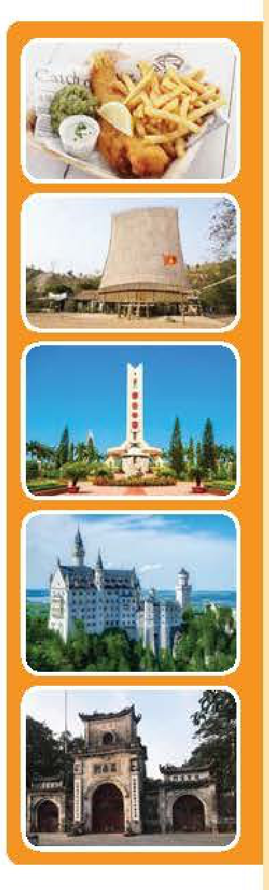
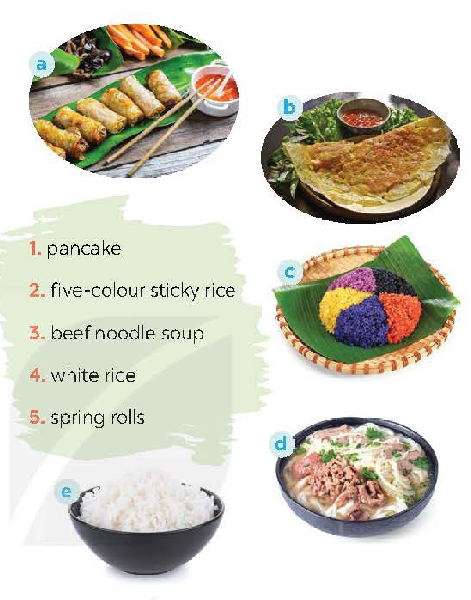
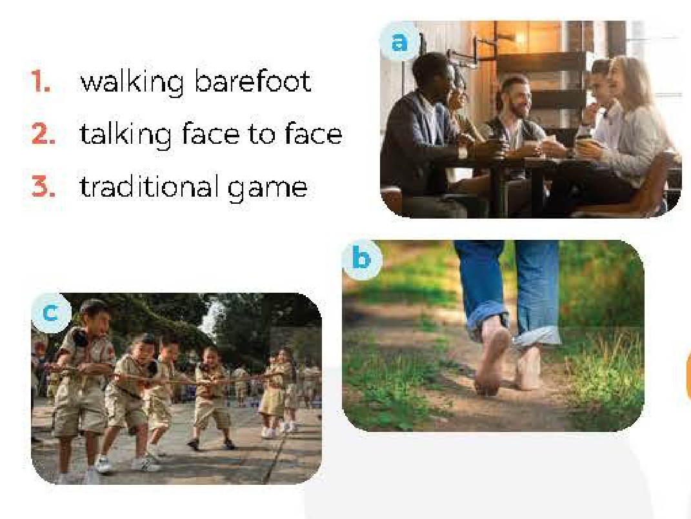

<!-- pdf:39 -->

# UNIT 4: REMEMBERING THE PAST

> **THIS UNIT INCLUDES:**
> - **Vocabulary:**
>   - Life in the past
>   - Preserving values of the past
> - **Pronunciation:**
>   - Sounds: /m/ and /l/
> - **Grammar:**
>   - Past continuous
>   - *Wish* + past simple
> - **Skills:**
>   - Reading about how English people keep their cuisine alive
>   - Talking about a typical traditional Vietnamese dish
>   - Listening about old school days
>   - Writing a paragraph about old school days
> - **Everyday English:**
>   - Thanking and responding

## GETTING STARTED

**At an English lesson**

**1. Listen and read.**

**Teacher:** Now let's look at what you've done on your projects. Group one first, please.

**Mi:** OK. This is Angkor Wat in Cambodia. It's a temple complex, the largest religious monument in the world.

**Teacher:** Fantastic! When did people build it?

**Mi:** They built it in the 12th century. It's a World Heritage Site. Millions of visitors go there every year.

**Teacher:** Thank you. I wish I could go there one day too. And now group two, please.

**Nam:** Our project is about Dinh Bang Communal House in Bac Ninh Province – a national historic site. People were building it for 36 years, and it's about 300 years old!

**Teacher:** Great! It's quite magnificent! Now group three, please.
<!-- term: magnificent -->

**Lan:** Well, this is Windsor Castle in England. It was built about a thousand years ago. It's been the home for about 40 English kings and queens.

**Teacher:** Yeah. It's the oldest and largest occupied castle in the world.

**Mi & Nam:** Amazing! So we need to preserve our heritage for future generations.
<!-- term: heritage -->

**Teacher:** Right. Thanks to preservation efforts, we know a lot about our history and life in the past.
<!-- term: thanks to -->

<!-- pdf:40 -->

**2. Read the conversation again and answer the questions.**

1. How old is Angkor Wat?
2. What is Dinh Bang Communal House like?
3. Where is Windsor Castle?
4. What helps us know about our history and life in the past?

**3. Complete each sentence with a word or a phrase from the box.**

| occupied | magnificent | thanks to |
| --- | --- | --- |
| heritage | well preserved | |
<!-- term: well preserved -->
<!-- ocr-ok: đã đối chiếu ảnh trang gốc, khung từ vựng 2 dòng bị OCR tách rời các từ -->

1. The best way to preserve our cultural \_\_\_\_\_\_\_ is to share it with others.
2. Vietnamese people take great pride in their culture which has been \_\_\_\_\_\_\_ for thousands of years.
3. The foreign tourists gave a \_\_\_\_\_\_\_ performance of the Vietnamese folk songs and dances.
4. \_\_\_\_\_\_\_ your kind contribution, we were able to save the ancient monument.
5. Many beautiful old castles are no longer \_\_\_\_\_\_\_.

**4. Look at the pictures and complete the sentences.**

1. This is a standard serving of \_\_\_\_\_\_\_ with a slice of lemon.
2. The \_\_\_\_\_\_\_ house has a significant meaning in the Bahnar community.
3. In the square, there is a \_\_\_\_\_\_\_ dedicated to the people killed in the war.
4. They have decided to rebuild the \_\_\_\_\_\_\_ which was damaged in the disaster.
5. In Nam Dinh City, there is a complex of three \_\_\_\_\_\_\_ where people worship the Tran Dynasty's Kings and royal family members.

**5. GAME: Remembering past events**
<!-- ocr-ok: đã đối chiếu ảnh trang gốc, chữ GAME in màu trong các ô vuông trang trí -->

**Work in two groups. Give short answers to the following questions. The group with more correct answers wins.**

1. Who decided to move our capital from Hoa Lu to Dai La (Thang Long) in 1010?
2. When did Columbus discover the Americas?
3. When was the United States founded?
4. When did Nguyen Ai Quoc first go abroad?
5. What happened in world history in 1914?
6. Who was the last king of Viet Nam?

<!-- pdf:41 -->

## A CLOSER LOOK 1

### Vocabulary

**1. Complete the following table. There is one example.**

| Verb | Noun |
| --- | --- |
| *protect* | *protection* |
| 1. promote | |
| 2. recognise | |
| 3. contribute | |
| 4. observe | |
| 5. preserve | |
| 6. occupy | |

**2. Complete the following sentences, using the correct forms of the words from 1.**

1. People in these mountainous areas still \_\_\_\_\_\_\_ their local customs and traditions.
2. The invention of the seat belt made a good \_\_\_\_\_\_\_ to road safety.
3. We believe that \_\_\_\_\_\_\_ of these old structures will benefit the community in many ways.
4. The aim of the culture festival is the \_\_\_\_\_\_\_ of friendship and tourism.
5. In 2006, Duong Lam became the first village that was \_\_\_\_\_\_\_ as a national historic and cultural relic.

**3. Complete the following sentences with the words from the box.**

| magnificent | takeaway | heritage |
| --- | --- | --- |
| generations | structures | |

1. Stonehenge, England, one of the oldest stone \_\_\_\_\_\_\_ in the world, is about 5,000 years old.
2. If you are busy, you can get a \_\_\_\_\_\_\_ from one of these restaurants.
3. It's our duty to keep our customs and traditions alive for future \_\_\_\_\_\_\_.
4. Windsor Castle is about a thousand years old but it's absolutely \_\_\_\_\_\_\_.
5. We need a lot of effort to safeguard and preserve our \_\_\_\_\_\_\_.

### Pronunciation

**/m/ and /l/**
<!-- ocr-ok: đã đối chiếu ảnh trang gốc, OCR đọc nhầm kí hiệu /l/ thành /1/ -->

**4. Listen and repeat the words. Pay attention to the sounds /m/ and /l/.**

| /m/ | /l/ |
| --- | --- |
| *m*onu*m*ent | *l*andscape |
| *m*agnificent | ce*l*ebrate |
| progra*mm*e | va*l*ue |
| custo*m* | cu*l*tura*l* |
| grand*m*a | nationa*l* |
<!-- ocr-ok: đã đối chiếu ảnh trang gốc, OCR đọc nhầm tiêu đề cột /l/ thành ¿l7 -->

**Remember!**

There are two types of sound /l/: light /l/ and dark /l/.
- **Light /l/** comes before a vowel sound: light, holiday, ...
- **Dark /l/** appears after a vowel sound or at the end of a word: milk, castle, ...
<!-- ocr-ok: đã đối chiếu ảnh trang gốc, OCR đọc nhầm kí hiệu /l/ thành /1/ -->

**5. Listen and repeat the sentences. Pay attention to the underlined words.**

1. The *collection* includes objects of the *Middle* Ages.
2. You should be *careful* when shopping in this *mall*.
3. This *monument* is small but *magnificent*.
4. They *maintain* these *windmills* as working museums.
5. David *fell* off his bike and hurt his *ankle*.

<!-- pdf:42 -->

## A CLOSER LOOK 2

### Grammar

*The past continuous*

**1. Put the verbs in brackets in the past continuous.**

1. My dad first met my mum when he (visit) \_\_\_\_\_\_\_ Hoi An Ancient Town.
2. Tom had a nightmare while he (sleep) \_\_\_\_\_\_\_ in the camp by the old castle.
3. David hurt his foot while he (go) \_\_\_\_\_\_\_ down the steps of the pagoda.
4. My brother was just sitting while I (look) \_\_\_\_\_\_\_ around the weaving workshop.
5. \_\_\_\_\_\_\_ you (watch) \_\_\_\_\_\_\_ TV at 9 p.m. last night? There was a very good programme on Duong Lam Ancient Village preservation.

**Remember!**

- We use the past continuous to describe an action that was happening at a particular time in the past, or a past action that was happening when another action interrupted it.
- We also use the past continuous to emphasise how long an action took and how much time somebody spent doing it. We usually use adverb phrases that explain the length of time such as:
  - all morning / week / year
  - for hours / days / weeks / months / years
  *Example:*
  We *were cooking* all morning because we had our friends coming for lunch.
<!-- term: The past continuous -->

**2. Complete the sentences, using the past continuous forms of the given verbs.**

| live | make | preserve |
| --- | --- | --- |
| work | build | |

1. People \_\_\_\_\_\_\_ the monument for years because it had great value.
2. When I finished school, my family \_\_\_\_\_\_\_ in the countryside.
3. People \_\_\_\_\_\_\_ the Taj Mahal – a World Heritage Site while Shah Jahan was emperor.
4. "\_\_\_\_\_\_\_ you still \_\_\_\_\_\_\_ on the coffee farm when the war broke out, Grandpa?"
5. I \_\_\_\_\_\_\_ a presentation when the microphone stopped working.

***Wish* + past simple**

**Remember!**

We use *wish* + past form verb when we want something now or in the future to be different.
*Subject + wish + subject + past simple*
*Example:*
- *I wish I had* enough money to travel around the world.
- *I wish (that) my mother didn't have to* work so hard.
<!-- term: Wish + past simple -->

**3. Put the verbs in brackets in the correct forms.**

1. The children wish they (get) \_\_\_\_\_\_\_ more presents every Christmas.
2. I wish I (have) \_\_\_\_\_\_\_ enough money to visit London and Windsor Castle.
3. Do you wish we (have) \_\_\_\_\_\_\_ a swimming pool in our school?

<!-- pdf:43 -->

4. We wish we (can spend) \_\_\_\_\_\_\_ our summer holiday on the seaside.
5. I wish I (can go) \_\_\_\_\_\_\_ back to my grandparents' time.

**4. Read the passage and write down five things that Jenny might wish for. Look at the example.**

> My sister Jane is very untidy. She and I share the same room, but I have to clean it every day. Whenever she's at home, she lies in bed reading or playing computer games. She often puts her dirty clothes on my bed. I'd like to have my own room, but it's impossible now. I hope she can change her way one day.
>
> *Jenny, 14*

*Example:*
Jenny wishes (that) her sister Jane was tidier.
\_\_\_\_\_\_\_\_\_\_\_\_\_\_\_\_\_\_\_\_\_\_\_
\_\_\_\_\_\_\_\_\_\_\_\_\_\_\_\_\_\_\_\_\_\_\_
\_\_\_\_\_\_\_\_\_\_\_\_\_\_\_\_\_\_\_\_\_\_\_
\_\_\_\_\_\_\_\_\_\_\_\_\_\_\_\_\_\_\_\_\_\_\_

**5. Work in pairs. Tell your partner three wishes.**

**You can refer to the following:**
- Your everyday life
- Your study at school
- Your family (family members, relationship, ...)
- Your friends
...

*Example:*
I wish I had a dishwasher to do the washing-up for me every day.

## COMMUNICATION

### Everyday English

*Thanking and responding*

**1. Listen and read the conversations. Pay attention to the highlighted parts.**

1. **Kate:** *Thank you very much for* showing us around Angkor Wat.
   **Guide:** *You're welcome.*
<!-- term: Thanking and responding -->

2. **Alice:** *Thanks a lot for* telling us about life in the countryside.
   **Mi:** *No problem.*
<!-- term: Thanking and responding -->

**2. Work in pairs. Make similar conversations to express thanks and respond in the following situations.**

1. You thank the village head for showing you around the craft workshop.
2. You thank your friend for lending you an interesting book.

**How our families keep traditions alive**
<!-- ocr-ok: đã đối chiếu ảnh trang gốc, tiểu mục màu cam bị OCR bỏ sót -->

**3. Read the passage and complete the table.**

Most of Vietnamese families have customs and traditions that they have observed for many generations. Firstly, they worship their ancestors, and they celebrate their death anniversaries every year. That's the way they show their gratitude to their ancestors and teach their young children about traditions. Secondly, they take part in many national and regional festivals, for example the Mid-Autumn Festival and the New Harvest Festival. Thirdly, they celebrate

<!-- pdf:44 -->

many holidays during the year such as Tet and National Day. In this way, they keep their traditions alive and pass them down to the next generation.
<!-- term: keep traditions alive -->

| Anniversaries | Festivals | Holidays |
| --- | --- | --- |
| 1. \_\_\_\_\_\_\_ anniversaries | 2. \_\_\_\_\_\_\_ Festival 3. \_\_\_\_\_\_\_ Festival | 4. \_\_\_\_\_\_\_ 5. \_\_\_\_\_\_\_ |
<!-- ocr-ok: đã đối chiếu ảnh trang gốc, bảng 3 cột bị OCR bỏ sót các số thứ tự điền khuyết 1–5 -->

**4. Work in pairs. Ask and answer about how your family observes customs and traditions.**

**You can refer to 3 above.**
<!-- ocr-ok: đã đối chiếu ảnh trang gốc, số 3 màu cam bị OCR đọc nhầm thành dấu > -->

*Example:*
- **A:** What festival(s) does your family celebrate every year?
- **B:** We celebrate Hung Kings' Temple Festival.
...

**5. Work in groups. Give a short talk about one of the things in 4 that you and your family do to preserve traditions, for example celebrating family members' birthdays.**

**You can begin your talk like this:**
We celebrate each family member's birthday every year. When someone's birthday is coming, all of us happily prepare for it. ...

## SKILLS 1

### Reading

**1. Work in groups. Discuss the following question.**

What do you know about England?

**2. Read the text and write the underlined words in the box.**

England's traditions have been around for hundreds, even thousands of years. English cuisine is among the *deep-rooted* traditions that English people are proud to keep alive.

Typical English cuisine has developed over many centuries, and people say that fish and chips is the most English dish of all. It is believed that fish and chips *appeared* in England in the 19th century. The earliest fish and chip shop opened in London during the 1860s. Since then people have considered fish and chips to be England's national dish, and it is now a common takeaway in the United Kingdom.

The *basic* ingredients of the dish are fried fish served with chips. People in different places may add peas, vinegar, lemon, or ketchup. Fish and chips is served hot as the main dish in England. Although there is oil and carbohydrates in fish and chips, it is healthier than other takeaway dishes.

Now there are fish and chip shops in many countries, and it is becoming more and more popular in other countries too. Preserving and promoting fish and chips is the way English people keep themselves *associated* with the past.
<!-- term: associated with -->

| Meaning / Explanation | Word |
| --- | --- |
| 1. linked or connected | \_\_\_\_\_\_\_ |
| 2. difficult to change or destroy | \_\_\_\_\_\_\_ |
| 3. started to be seen | \_\_\_\_\_\_\_ |
| 4. necessary and important | \_\_\_\_\_\_\_ |

<!-- pdf:45 -->

**3. Read the text again and tick (✓) T (True) or F (False) for each sentence.**

| | T | F |
| --- | --- | --- |
| 1. English people take great pride in their traditions. | | |
| 2. Fish and chips has been around for hundreds of years. | | |
| 3. The earliest fish and chip shop opened in London in 1860. | | |
| 4. Peas, vinegar, lemon, or ketchup are necessary for fish and chips. | | |
| 5. Fish and chips is not healthy as it has a lot of oil. | | |
| 6. Fish and chips is sold in many countries now. | | |

### Speaking

**4. Work in pairs. Match 1 – 5 in column A with a – e in column B.**

| A | B |
| --- | --- |
| 1. name of the dish | a. glutinous rice, green beans, pork |
| 2. history | b. at Tet, on the Hung Kings' anniversary |
| 3. basic ingredients | c. *banh chung* |
| 4. on what occasion it's eaten | d. traditional dish |
| 5. type of dish | e. originated in 6th Hung King's time |
<!-- ocr-ok: đã đối chiếu ảnh trang gốc, bảng nối cột A và cột B bị OCR đọc nhầm name of the dish và bỏ sót mục 4 -->

**5. Work in groups. Match the Vietnamese dishes with their names in English.**

1. pancake
2. five-colour sticky rice
3. beef noodle soup
4. white rice
5. spring rolls

**Choose a typical traditional Vietnamese dish and talk about it.**

**Your talk should include:**
- the name of the dish
- the basic ingredients
- when / on what occasion it is eaten
- whether you like it or not

<!-- pdf:46 -->

## SKILLS 2

### Listening

**1. Match each phrase with the right picture.**

1. walking barefoot
2. talking face to face
3. traditional game

**2. Listen to the talk between Thanh and his grandma and tick (✓) the things you hear.**

- [ ] 1. Three-month summer holiday
- [ ] 2. Lessons in the morning only
- [ ] 3. A lot of extra lessons
- [ ] 4. Walking barefoot
- [ ] 5. Chatting on mobile phones
<!-- ocr-ok: đã đối chiếu ảnh trang gốc, danh sách 5 mục đánh dấu bị OCR đảo thứ tự dòng 3 và 4 -->

**3. Listen again and choose the correct answers.**

1. The conversation is generally about Thanh's \_\_\_\_\_\_\_.
   - A. school days
   - B. grandma's school days
   - C. grandma's life in the past
2. Thanh's grandma didn't have a lot of \_\_\_\_\_\_\_.
   - A. homework
   - B. lessons
   - C. subjects
3. Thanh's grandma \_\_\_\_\_\_\_ went to school on foot.
   - A. always
   - B. sometimes
   - C. never
4. Students in the past played \_\_\_\_\_\_\_ during break time.
   - A. computer games
   - B. games on mobile phones
   - C. traditional games

### Writing

**4. Work in pairs. Ask and answer about school days in the past.**

**Your talk may include the following:**
- school time (When ...)
- school subjects (What ...)
- leisure time activities (What ...)
- summer holiday (How long ...)
- means of transport to school (How ...)

**You can refer to the listening text for your answers.**

**5. Write a paragraph (100 – 120 words) about school days in the past.**

**You can begin your writing with:**

> In the past, students had lessons in the morning only. \_\_\_\_\_\_\_\_\_\_\_\_\_\_\_\_\_\_\_\_\_\_\_.

<!-- pdf:47 -->

## LOOKING BACK

### Vocabulary

**1. Choose the correct answer A, B, C, or D.**

1. In keeping with \_\_\_\_\_\_\_, we cook five-colour sticky rice on the first day of a lunar month.
   - A. tradition
   - B. habit
   - C. ritual
   - D. practice
2. Sam is very interested in history, and he remembers a lot of historical \_\_\_\_\_\_\_ and dates.
   - A. traditions
   - B. events
   - C. anniversaries
   - D. practices
3. The fire of London in 1666 destroyed thousands of old \_\_\_\_\_\_\_ and damaged a large part of London's centre.
   - A. organisations
   - B. structures
   - C. associations
   - D. connections
4. This practice was more common in \_\_\_\_\_\_\_ times than it is now.
   - A. beginning
   - B. antique
   - C. historic
   - D. ancient
5. This complex of buildings was \_\_\_\_\_\_\_ by foreign troops during the war.
   - A. received
   - B. busy
   - C. occupied
   - D. filled

**2. Finish the sentence by completing each blank with a word. The first letter of each word is given.**

1. The custom of w\_\_\_\_\_\_\_ ancestors is a beautiful and rich tradition in Vietnamese culture.
2. The custom of sending a greeting card has become a d\_\_\_\_\_\_\_ tradition in many western countries.
3. A country's cultural h\_\_\_\_\_\_\_ is a valuable resource.
4. Festivals, which are handed down from one g\_\_\_\_\_\_\_ to the next, are an important way to promote tourism.
5. Besides the key i\_\_\_\_\_\_\_, another secret to achieving the perfect fish and chips is the temperature of the oil.

### Grammar

**3. Put the verb in brackets in the past continuous to complete each sentence.**

1. Luckily, the sun (shine) \_\_\_\_\_\_\_ brightly when we reached the campsite.
2. They (build) \_\_\_\_\_\_\_ Ho Chi Minh Mausoleum from 1973 to 1975.
<!-- ocr-ok: đã đối chiếu ảnh trang gốc, năm 1975 bị OCR đọc nhầm thành 1875 -->
3. When their mum came home, they (not study) \_\_\_\_\_\_\_; they (chat) \_\_\_\_\_\_\_ noisily.
4. \_\_\_\_\_\_\_ they still (wait) \_\_\_\_\_\_\_ when the tour guide arrived?
5. I (think) \_\_\_\_\_\_\_ of my grandmother for years after she died.

**4. Rewrite the following sentences, using *wish*.**

1. She doesn't have an iPhone. She'd like to have one.
   → \_\_\_\_\_\_\_\_\_\_\_\_\_\_\_\_\_\_\_\_\_\_\_
2. I'm sorry that I don't have a three-month summer holiday as my grandma did.
   → \_\_\_\_\_\_\_\_\_\_\_\_\_\_\_\_\_\_\_\_\_\_\_
3. I want my parents to let me make my own decisions, but they don't.
   → \_\_\_\_\_\_\_\_\_\_\_\_\_\_\_\_\_\_\_\_\_\_\_
4. Mike wants to play musical instruments, but he can't.
   → \_\_\_\_\_\_\_\_\_\_\_\_\_\_\_\_\_\_\_\_\_\_\_
5. My dad is very busy. I want him to have more time with me.
   → \_\_\_\_\_\_\_\_\_\_\_\_\_\_\_\_\_\_\_\_\_\_\_

<!-- pdf:48 -->

## PROJECT

**Life in your neighbourhood 40 YEARS AGO**
<!-- ocr-ok: đã đối chiếu ảnh trang gốc, tiêu đề dự án chữ in màu đỏ trang trí bị OCR bỏ sót -->

**Work in groups.**

**1. Collect information and pictures about life in your area about 40 years ago.**

**You may need to ask your grandparents and / or old people or use the Internet to find information.**

**You can refer to the following:**
- means of transport (on foot, on horseback, by bicycle, ...)
- home life (electric devices, cooking, ...)
- community services (electricity, running water, library, communal house, ...)
...

**2. Make a poster. Write or print the information and stick the pictures on the poster.**

**3. Give a presentation to the class.**

### Now I can ...

- use the words related to the topic *Remembering the past*.
- pronounce the sounds /m/ and /l/ correctly in words and sentences.
- use the past continuous, and *wish* + past simple.
- thank and respond.
- read about how English people keep their cuisine alive.
- talk about a typical traditional Vietnamese dish.
- listen about old school days.
- write a paragraph about old school days.

## 📷 Danh sách hình trong bài

| Mã hình | Trang PDF | Trang sách | Chú thích / Mô tả |
| --- | --- | --- | --- |
| H9-tieng_anh-u04-01 | 40 | 41 | Năm bức ảnh minh hoạ cho 5 câu bài tập 4 phần Getting Started (chấp nhận allow_edge_ink ở cạnh phải do dải nền cam nối liền lề phải trang sách): (1) món cá và khoai tây rán kèm lát chanh, (2) nhà rông Tây Nguyên, (3) tượng đài liệt sĩ, (4) lâu đài cổ, (5) quần thể đền Trần ở Nam Định |
| H9-tieng_anh-u04-02 | 45 | 46 | Năm bức ảnh món ăn truyền thống Việt Nam a–e nối với tên tiếng Anh 1–5 thuộc bài tập 5 phần Skills 1 – Speaking: (a) nem rán / chả giò, (b) bánh xèo, (c) xôi ngũ sắc, (d) phở bò, (e) cơm trắng |
| H9-tieng_anh-u04-03 | 46 | 47 | Ba bức ảnh a–c nối với cụm từ 1–3 thuộc bài tập 1 phần Skills 2 – Listening (chấp nhận allow_edge_ink ở cạnh phải sát ô số 4): (a) trò chuyện trực tiếp, (b) đi chân trần trên đường đất, (c) học sinh chơi kéo co truyền thống |
