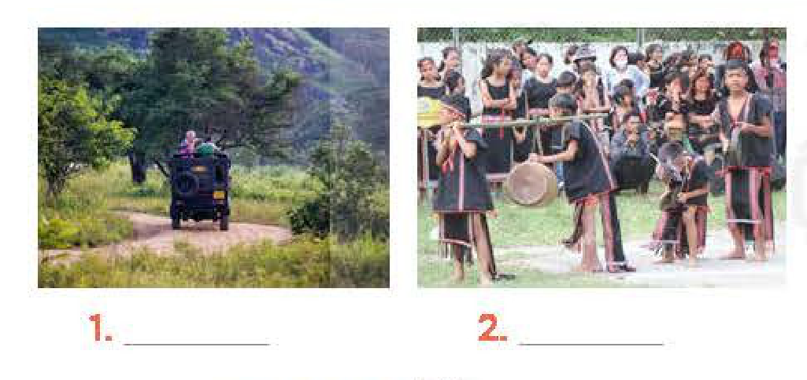
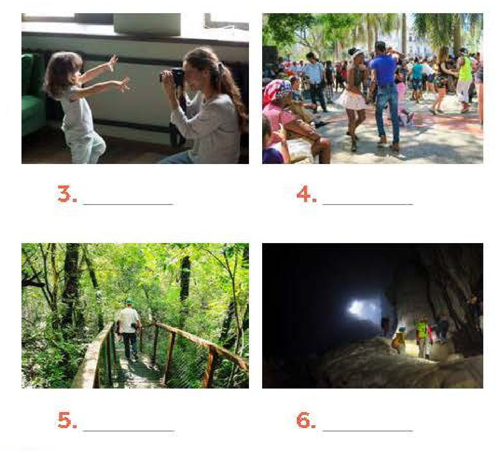
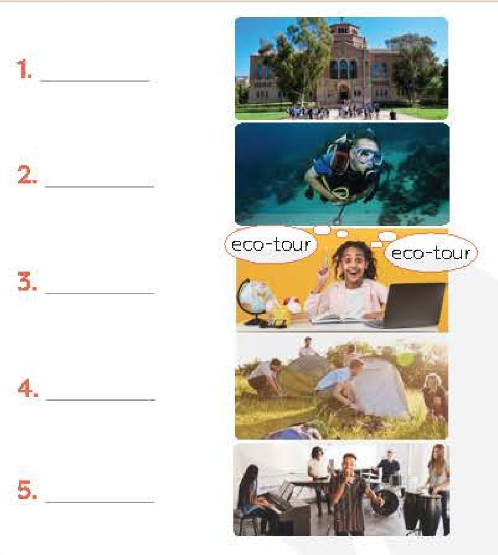
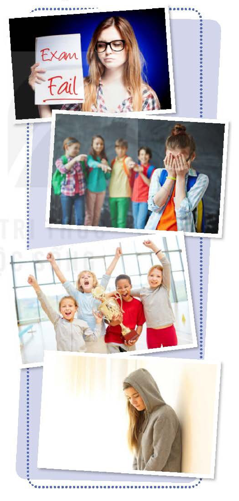

<!-- pdf:49 -->

# UNIT 5: OUR EXPERIENCES

> **THIS UNIT INCLUDES:**
> - **Vocabulary:**
>   - Experiences
>   - Adjectives describing experiences
> - **Pronunciation:**
>   - Sounds: /j/ and /w/
> - **Grammar:**
>   - Present perfect
> - **Skills:**
>   - Reading about different summer course experiences
>   - Talking about a friend's experience of a course
>   - Listening about bad experiences at school
>   - Writing a paragraph about your most pleasant / unpleasant experience at school
> - **Everyday English:**
>   - Apologising and responding

## GETTING STARTED

**Experiences in Da Lat**

**1. Listen and read.**

**Tom:** Hi, Mi. I've been back from Da Lat. I have some local specialities for you.

**Mi:** Thanks, Tom. I guess you and your family had a great time there.

**Tom:** Yeah. We visited Langbiang Mountain and Cu Lan Village. We saw a gong show in the evening.

**Mi:** What did you do on Langbiang Mountain?

**Tom:** We rode a jeep to the top. It was a thrilling ride up there. Then we took an eco-tour of Langbiang Mountain. They said that the area is rich in flora and fauna with more than 150 plant and animal species.

**Mi:** Sounds amazing! What did you do then?

**Tom:** We took pictures of the magnificent scenery. It was really enjoyable!

**Mi:** Then did you explore Cu Lan Village?

**Tom:** Yes. We had a brilliant tour around the village. We also rode horses and a jeep along a stream.

**Mi:** That must have been exciting, Tom.

**Tom:** It definitely was. In the evening, we saw an interesting gong show. We danced and sang with the locals. And we tried grilled pork. It was a really memorable evening. I'll show you some pictures I took there.

**Mi:** Cool!

<!-- pdf:50 -->

**2. Read the conversation again and tick (✓) T (True) or F (False).**

| | T | F |
| --- | --- | --- |
| 1. Mi and Tom had a great time in Da Lat. | | |
| 2. Tom had an eco-tour of Langbiang Mountain. | | |
| 3. There are more than 150 plant and animal species on Langbiang Mountain. | | |
| 4. Tom didn't like his experiences in Cu Lan Village. | | |
| 5. Tom danced and sang with the local people at a gong show. | | |

**3. Write activities under the pictures.**
<!-- ocr-ok: đã đối chiếu ảnh trang gốc, OCR đọc dính chữ underthe -->

| | |
| --- | --- |
| taking photos | dancing with local people |
| exploring a site | taking an eco-tour |
| riding a jeep | seeing a gong show |

1. \_\_\_\_\_\_\_
2. \_\_\_\_\_\_\_
3. \_\_\_\_\_\_\_
4. \_\_\_\_\_\_\_
5. \_\_\_\_\_\_\_
6. \_\_\_\_\_\_\_
<!-- ocr-ok: đã đối chiếu ảnh trang gốc, 6 chỗ trống 1–6 nằm dưới 6 bức ảnh thuộc bài tập 3 -->

**4. Read the conversation again and match the activities with the adjectives.**

| | |
| --- | --- |
| 1. riding a jeep | a. enjoyable |
| 2. seeing a gong show | b. thrilling |
| 3. taking an eco-tour | c. amazing |
| 4. exploring a site | d. interesting |
| 5. taking pictures | e. brilliant |

**5. Work in groups. Carry out a survey. Then report your group's findings to the class.**

**Do you like ...?**

| | Yes | No |
| --- | --- | --- |
| 1. climbing a mountain | | |
| 2. taking an eco-tour | | |
| 3. exploring the seabed | | |
| 4. taking photos from a mountain top | | |
| 5. seeing a tribal dance show | | |

<!-- pdf:51 -->

## A CLOSER LOOK 1

### Vocabulary

**1. Write an activity next to each picture.**

| | |
| --- | --- |
| learning by rote | putting up tents |
| touring a campus | going snorkelling |
| giving a performance | |
<!-- term: put up tents -->

1. \_\_\_\_\_\_\_
2. \_\_\_\_\_\_\_
3. \_\_\_\_\_\_\_
4. \_\_\_\_\_\_\_
5. \_\_\_\_\_\_\_
<!-- ocr-ok: đã đối chiếu ảnh trang gốc, 5 chỗ trống 1–5 nằm cạnh 5 tranh minh hoạ -->

**2. Complete each sentence with an adjective in the box.**

| amazing | exhilarating | unpleasant |
| --- | --- | --- |
| helpless | embarrassing | |
<!-- term: helpless -->

1. He felt \_\_\_\_\_\_\_ when he couldn't protect himself from bullying.
<!-- term: helpless -->
<!-- ocr-ok: đã đối chiếu ảnh trang gốc, OCR đọc dính chữ Hefelt và thiếu dấu nháy đơn couldnt -->
2. The parachute jump was a(n) \_\_\_\_\_\_\_ experience for the boy. He was so excited.
3. It was so \_\_\_\_\_\_\_ to view the mountain range from the distance.
4. I had a(n) \_\_\_\_\_\_\_ experience when I took her bag by mistake.
<!-- term: by mistake -->
5. Tom had a(n) \_\_\_\_\_\_\_ experience putting up a tent in the rain.

**3. Choose the correct answer A, B, C, or D.**

1. His mind \_\_\_\_\_\_\_ when I asked him how to do the homework.
   - A. went blank
   - B. went empty
   - C. became exhausted
   - D. put up
<!-- term: go blank -->
2. Students could see the university's facilities when they \_\_\_\_\_\_\_.
   - A. took an excursion
   - B. toured the campus
   - C. gave a performance
   - D. took an eco-tour
3. Snorkelling in the coral reef is a(n) \_\_\_\_\_\_\_.
   - A. touching moment
   - B. happy time
   - C. exciting experience
   - D. embarrassing moment
4. Nam and his friends felt \_\_\_\_\_\_\_ when they couldn't put up a tent by themselves.
   - A. pleasant
   - B. embarrassing
   - C. embarrassed
   - D. pleased
5. I didn't understand the lesson. I learnt it \_\_\_\_\_\_\_.
   - A. on purpose
   - B. by chance
   - C. with memory
   - D. by rote

### Pronunciation

**/j/ and /w/**

**4. Listen and repeat the words. Pay attention to the sounds /j/ and /w/.**

| /j/ | /w/ |
| --- | --- |
| *y*ellow | *w*atching |
| *y*esterday | sand*w*ich |
| *y*ahoo | high*w*ay |
| *y*ogurt | cross*w*ord |
| *y*ield | for*w*ard |
<!-- ocr-ok: đã đối chiếu ảnh trang gốc, chữ y màu cam bị OCR đọc nhầm thành v -->

**5. Listen to the sentences. Underline the words with /j/ and circle the words with /w/. Practise the sentences.**

1. He tried sailing a yacht, and he did it well.
2. We've made a class yearbook. It looks wonderful.
3. They awarded him a gold medal yesterday.
4. Youngsters should be aware of their responsibilities.
5. They haven't yet learnt about the role of wildlife.

<!-- pdf:52 -->

## A CLOSER LOOK 2

### Grammar

*The present perfect*

**Remember!**

- We use the present perfect to express an action which happened at an unstated time in the past and is completed in the present.
  *Example:*
  - He *has listened* to this piece of music.
  - She *has read* an article about Cu Lan Village.
- We also use the present perfect to express our experiences.
  *Example:*
  - I *have tried* skydiving.
  - *Have* you ever *taken* an eco-tour?
    – No, I haven't.
<!-- term: The present perfect -->

**1. Write the correct forms of the verbs in the table.**

| Verbs | Past simple | Past participle |
| --- | --- | --- |
| work | *worked* | *worked* |
| join | | |
| play | | |
| be | | |
| go | | |
| do | | |

**2. Complete the sentences with the correct forms of the verbs in the present perfect.**

1. We (join) \_\_\_\_\_\_\_ that project.
2. I (play) \_\_\_\_\_\_\_ a computer game at his house once.
3. She \_\_\_\_\_\_\_ never (work) \_\_\_\_\_\_\_ in such an unpleasant workplace.
4. He \_\_\_\_\_\_\_ never (be) \_\_\_\_\_\_\_ a class monitor.
5. They (go) \_\_\_\_\_\_\_ birdwatching several times.

**3. Choose the correct answer A, B, C, or D to complete each sentence.**

1. We \_\_\_\_\_\_\_ in our school's sports competition once.
   - A. participate
   - B. have participated
   - C. has participated
   - D. are participating
2. Nam \_\_\_\_\_\_\_ any photos of his village for two years.
   - A. has not taken
   - B. have not taken
   - C. does not take
   - D. is taking
3. They \_\_\_\_\_\_\_ detective stories several times.
   - A. were reading
   - B. read
   - C. has read
   - D. have read
4. I \_\_\_\_\_\_\_ never \_\_\_\_\_\_\_ that film before.
   - A. did; watched
   - B. has; watched
   - C. have; watched
   - D. was; watching
5. She \_\_\_\_\_\_\_ her cousin since she left school.
   - A. haven't met
   - B. doesn't meet
   - C. hasn't met
   - D. didn't meet

**4. Write sentences about Mai's experiences, using the information in the table.**

| Experiences | Mai |
| --- | --- |
| 0. visit a village of an ethnic group | ✗ |
| 1. climb a mountain | ✗ |
| 2. see an elephant | ✓ |
| 3. join a tribal dance | ✗ |
| 4. take a photo of a forest | ✗ |
| 5. go on an eco-tour | ✓ |
<!-- ocr-ok: đã đối chiếu ảnh trang gốc, bảng dấu tích và dấu nhân bị OCR tách rời khỏi cột câu 1–4 -->

*Example:* Mai hasn't visited a village of an ethnic group.
1. \_\_\_\_\_\_\_\_\_\_\_\_\_\_\_\_\_\_\_\_\_\_\_
2. \_\_\_\_\_\_\_\_\_\_\_\_\_\_\_\_\_\_\_\_\_\_\_
3. \_\_\_\_\_\_\_\_\_\_\_\_\_\_\_\_\_\_\_\_\_\_\_
4. \_\_\_\_\_\_\_\_\_\_\_\_\_\_\_\_\_\_\_\_\_\_\_
5. \_\_\_\_\_\_\_\_\_\_\_\_\_\_\_\_\_\_\_\_\_\_\_
<!-- ocr-ok: đã đối chiếu ảnh trang gốc, OCR đọc cụt chữ Example thành ample và bỏ sót số dòng 1–5 -->

**5. Work in pairs. Ask and answer questions about your experiences using the present perfect.**

*Example:*
- **A:** Have you visited a village of an ethnic group?
- **B:** Yes, I have. / No, I haven't.

<!-- pdf:53 -->

## COMMUNICATION

### Everyday English

*Apologising and responding*

**1. Listen and read the conversations. Pay attention to the highlighted parts.**

1. **Mai:** Can I come in? *I'm really sorry.* I'm late. There was a lot of traffic.
   **Teacher:** *That's okay*, Mai.
<!-- term: Apologising and responding -->

2. **Mother:** Have you done the washing yet?
   **Son:** *Oops, my mistake, Mum.* I thought I could do it later.
   **Mother:** Oh, *that's right*. But please do it now.
<!-- term: Apologising and responding -->

**2. Work in pairs. Make similar conversations with the following situations.**

1. You submit your project after the deadline.
2. You came home later than you promised your mum you would.

**Experiences of your class camping day**
<!-- ocr-ok: đã đối chiếu ảnh trang gốc, tiểu mục màu cam bị OCR bỏ sót -->

**3. Read the posts by three friends about their camping activities and match their names with the experiences.**

- **Mai:** It was actually a terrible day for me. I slipped and hurt my ankle, so I had to stay inside my tent. I couldn't join any team building games at all. I have never experienced such helplessness.
- **Tom:** I haven't had many exciting experiences like that before. We got to a beautiful site in Ninh Binh. We put up the tents and did unforgettable team building activities. We also hired bikes and cycled around the area. It was so relaxing.
<!-- term: put up tents -->
<!-- term: team building activities -->
- **Minh:** I had a brilliant experience by the sea with my class last year. We joined team building activities in the morning. In the afternoon, an instructor taught some of us snorkelling. It was exhilarating. It was also wonderful to see a coral reef and many types of colourful fishes swimming around. It's the best experience I've ever had.
<!-- term: team building activities -->

| | |
| --- | --- |
| Mai | a. exciting experiences in an area b. a terrible experience at the campsite |
| Tom | c. a brilliant experience by the sea d. an exhilarating experience of snorkelling |
| Minh | e. an experience of watching team building activities f. a relaxing bike riding experience |
<!-- ocr-ok: đã đối chiếu ảnh trang gốc, bảng nối tên Mai, Tom, Minh với các trải nghiệm a–f -->

**4. Work in pairs. Ask and answer questions about the experiences of Mai, Tom, and Minh. You can use the questions below.**

- Where did he / she go?
- What did he / she do?
- How was his / her experience?
- Has he / she ever had that experience before?

**5. Work in groups. Take turns to ask and answer about one another's experiences of a trip he / she has had. Use similar questions to those in 4.**

*Example:*
- **A:** Where did you go?
- **B:** I went to ...
- **C:** What did you do?
- **B:** I climbed ...
<!-- ocr-ok: đã đối chiếu ảnh trang gốc, OCR đọc dính chữ lwentto và nhầm I thành | -->

<!-- pdf:54 -->

## SKILLS 1

### Reading

**1. Tick (✓) the experiences you have had.**

- [ ] Joining a performance
- [ ] Attending an army course
- [ ] Travelling to a new place without parents

**2. Read the texts and choose the correct answer A, B, C, or D.**

- **Duong:** I had a hard 10-day course in an army camp in Son Tay last summer. Everything was different from my life at home. We had to wake up at 5 a.m. and attended classes which were like training courses for soldiers. In the evening, we read books or worked in teams. The team leaders walked us through many exciting activities. We also joined a performance that had the *theme*: environment protection. We could only call our parents once a day.
  We also had touching moments when we received letters from our parents. I have never attended such a strict but exciting course like this.

- **Akiko:** I have been on an unforgettable summer course in America. I stayed in Thornwood campus on the outskirts of New York City for three weeks. We had an enjoyable campus tour, attended English classes, and joined team activities. We all tried to communicate in English. In the evening, we played board games and billiards. The most special experience was my visit to the top of Rockefeller Centre. From there, I could view the whole city below.
  *That* was the first time I travelled without my parents, so I felt like I grew up a lot after the trip.

1. Duong and Akiko talked about \_\_\_\_\_\_\_.
   - A. their English summer courses
   - B. experiences at summer courses
   - C. activities in summer
   - D. their army training
2. What didn't Duong do during his course?
   - A. Get up early.
   - B. Work as a leader.
   - C. Receive letters from home.
   - D. Work in teams.
3. The word "*theme*" means \_\_\_\_\_\_\_.
   - A. performance
   - B. environment
   - C. activity
   - D. topic
4. The experience at Rockefeller Centre was \_\_\_\_\_\_\_ for Akiko.
   - A. unforgettable
   - B. enjoyable
   - C. special
   - D. touching
5. The word "*That*" refers to \_\_\_\_\_\_\_.
   - A. travelling to America
   - B. touring the Thornwood campus
   - C. visiting Rockefeller Centre
   - D. viewing the city below

<!-- pdf:55 -->

**3. Read the texts again and tick (✓) Duong or Akiko.**

| Experiences | Duong | Akiko |
| --- | --- | --- |
| 1. attending an English course | | |
| 2. attending an army-like course | | |
| 3. joining a performance | | |
| 4. touring a campus | | |
| 5. receiving letters from home | | |

### Speaking

**4. Match the questions in A with the answers in B. Share your answers with a classmate.**

| A | B |
| --- | --- |
| 1. What course did you attend? | a. It was in June. |
| 2. When was that? | b. I felt that I grew up a lot after that course. |
| 3. What did you do? | c. I attended a course on soft skills with a group of young trainers. |
| 4. What do you remember most about it? | d. We worked in groups on different projects. We also learned to solve problems. We had various experiences. |
| 5. How did you feel? | e. I remember being so embarrassed at first. But the trainers and my peers were great and they helped me a lot. |

**5. Work in pairs. Ask and answer about a course you have experienced. Use the questions in 4 as cues. Then report your partner's answers to the class.**

*Example:*
Minh attended a memorable summer course last year. It was a presentation skills course. He learnt ...

## SKILLS 2

### Listening

**1. Which of the following is a bad experience?**

- failing an exam
- being bullied
- winning a competition
- lacking confidence

<!-- pdf:56 -->

**2. Listen to the conversation between Minh and his dad and tick (✓) T (True) or F (False).**

| | T | F |
| --- | --- | --- |
| 1. Minh's peers bullied him. | | |
| 2. Dad could always get things back. | | |
| 3. Dad's peers got his money. | | |
| 4. Minh had an embarrassing experience. | | |
| 5. Minh understood the lesson well. | | |

**3. Listen again and choose the correct answer A, B, or C.**
<!-- ocr-ok: đã đối chiếu ảnh trang gốc, OCR đọc dính chữ answerA -->

1. Dad and Minh are talking about \_\_\_\_\_\_\_.
   - A. dad's experience
   - B. Minh's experience
   - C. experiences of Minh and his dad
2. Dad's classmates often \_\_\_\_\_\_\_ him.
   - A. bullied
   - B. helped
   - C. argued with
3. Minh's dad \_\_\_\_\_\_\_ the bullies.
   - A. ran away from
   - B. shouted at
   - C. fought
4. Minh got a low mark because he \_\_\_\_\_\_\_.
   - A. reviewed the lesson
   - B. learnt the lesson by rote
   - C. learnt the lesson by heart

### Writing

**4. Work in pairs. Put the phrases from the box in the correct column.**

- a. taking wrong things
- b. doing community service
- c. not revising lessons
- d. winning a competition
- e. arguing with a friend
- f. coming to school late

| Pleasant experience | Unpleasant experience |
| --- | --- |
| | |

**5. Write a paragraph (100 – 120 words) about the most pleasant or unpleasant experience you have had at school.**

**Start as follows:**

> I still remember the most pleasant / unpleasant experience I have had at school.
>
> It was \_\_\_\_\_\_\_\_\_\_\_\_\_\_\_\_\_\_\_\_\_\_\_.

<!-- pdf:57 -->

## LOOKING BACK

### Vocabulary

**1. Use the adjectives in the box to describe the experiences. Add any other adjectives you can think of.**

| brilliant | exhilarating | exciting |
| --- | --- | --- |
| special | embarrassing | amazing |
| thrilling | unpleasant | memorable |
| helpless | | |

1. riding a jeep up to the mountain top
   \_\_\_\_\_\_\_\_\_\_\_\_\_\_\_\_\_\_\_\_\_\_\_
2. touring an area with mountains and villages
   \_\_\_\_\_\_\_\_\_\_\_\_\_\_\_\_\_\_\_\_\_\_\_
3. being bullied
   \_\_\_\_\_\_\_\_\_\_\_\_\_\_\_\_\_\_\_\_\_\_\_
4. joining team building activities
   \_\_\_\_\_\_\_\_\_\_\_\_\_\_\_\_\_\_\_\_\_\_\_
5. not revising previous lessons before the exams
   \_\_\_\_\_\_\_\_\_\_\_\_\_\_\_\_\_\_\_\_\_\_\_

**2. Complete the sentences with the phrases in the box.**

| | |
| --- | --- |
| went blank | exploring a site |
| an eco-tour | learnt it by rote |
| team building activities | |

1. I couldn't answer her questions because I just \_\_\_\_\_\_\_.
2. My mind suddenly \_\_\_\_\_\_\_ when she asked me about our plan.
<!-- term: go blank -->
3. The most memorable part of our picnic was \_\_\_\_\_\_\_ by the mountain.
4. We are now more aware of environment protection after we took \_\_\_\_\_\_\_.
5. After we joined \_\_\_\_\_\_\_, we all got closer to each other.

### Grammar

**3. Complete the sentences with the correct present perfect forms of the verbs in brackets.**

1. I (invite) \_\_\_\_\_\_\_ some of my friends to my birthday party.
2. \_\_\_\_\_\_\_ the students (finish) \_\_\_\_\_\_\_ all their assignments yet?
3. Their children (never be) \_\_\_\_\_\_\_ out of their village before.
4. He won't go to the cinema tonight. He (see) \_\_\_\_\_\_\_ that film already.
5. She (not cook) \_\_\_\_\_\_\_ for herself before, so she is not sure about what to do first.

**4. Put the verbs in brackets in the present perfect to complete the letter.**

> *Dear Nick,*
>
> How are you? Are you having a good time in Ha Noi? We're having a great time here in London. We (1. be) \_\_\_\_\_\_\_ here for four days and we (2. do) \_\_\_\_\_\_\_ many interesting things. We (3. visit) \_\_\_\_\_\_\_ the Tower of London and (4. watch) \_\_\_\_\_\_\_ the traditional Changing of the Guard. It was so wonderful to see it and I took a lot of pictures too. We also (5. have) \_\_\_\_\_\_\_ a ride on the famous London Eye.
> We were excited to view the whole city. We haven't checked out the Windsor Castle yet. We also (6. make) \_\_\_\_\_\_\_ a plan to visit Windsor Castle and Stonehenge, so we're going there tomorrow. We can't wait to explore the Windsor Castle and the prehistoric monument – Stonehenge.
>
> *See you next week,*
>
> Akiko

<!-- pdf:58 -->

## PROJECT

**Your most memorable experience**

**Work individually.**

**1. Think of your most memorable experience. Use the questions below.**

- What is the experience?
- When did it happen?
- What did you do then?
- How did you feel?
- Why is it your most memorable experience?

**2. Make a poster of your experience with pictures or photos.**
<!-- ocr-ok: đã đối chiếu ảnh trang gốc, OCR đọc dính chữ Makea và tách dòng tiêu đề -->

**3. Present it to your class.**
<!-- ocr-ok: đã đối chiếu ảnh trang gốc, OCR đọc dính chữ Presentitto -->

### Now I can ...

- use the words related to experiences and adjectives describing experiences.
- pronounce the sounds /j/ and /w/ correctly in words and sentences.
- use the present perfect correctly.
- apologise and respond.
- read about different summer course experiences.
- talk about a friend's experience of a course.
- listen about bad experiences at school.
- write a paragraph about your most pleasant / unpleasant experience at school.

## 📷 Danh sách hình trong bài

| Mã hình | Trang PDF | Trang sách | Chú thích / Mô tả |
| --- | --- | --- | --- |
| H9-tieng_anh-u05-01 | 50 | 51 | Hai bức ảnh 1–2 thuộc bài tập 3 phần Getting Started: (1) đi xe jeep trên đường núi, (2) nhảy múa cồng chiêng cùng người dân địa phương |
| H9-tieng_anh-u05-02 | 50 | 51 | Bốn bức ảnh 3–6 thuộc bài tập 3 phần Getting Started: (3) chụp ảnh, (4) tham gia chuyến du lịch sinh thái, (5) khám phá một địa điểm rừng núi, (6) xem biểu diễn cồng chiêng buổi tối |
| H9-tieng_anh-u05-03 | 51 | 52 | Năm bức ảnh 1–5 thuộc bài tập 1 phần A Closer Look 1 – Vocabulary: (1) tham quan khuôn viên trường đại học, (2) lặn biển với ống thở, (3) học vẹt từ mới, (4) dựng lều cắm trại, (5) biểu diễn văn nghệ |
| H9-tieng_anh-u05-04 | 55 | 56 | Bốn bức ảnh minh hoạ các trải nghiệm thuộc bài tập 1 phần Skills 2 – Listening: trượt kì thi (Exam Fail), bị bắt nạt học đường, chiến thắng một cuộc thi nhận cúp, thiếu tự tin rụt rè |
