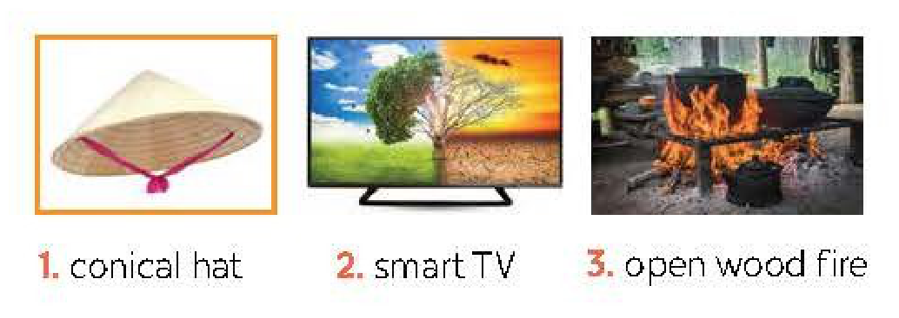

<!-- pdf:69 -->

# REVIEW 2

**(UNITS 4 – 5 – 6)**

## LANGUAGE

### Pronunciation

**1. Read the sentences. Pay attention to the underlined words. Then listen and repeat.**

1. The *water overflowed* from the dam and *flooded* the area.
2. *African American* musicians created jazz about 100 *years* ago.
3. The *children* thought *all* the food at the party was *yummy*.
4. The presentation focused on the *values* of *teamwork*.
5. He sometimes remembers his *younger* days in the *mountain village*.

### Vocabulary

**2. Choose the correct answer A, B, C, or D to complete each sentence.**

1. Angkor Wat in Cambodia is a World \_\_\_\_\_\_\_ Site.
   - A. Camping
   - B. Construction
   - C. Heritage
   - D. Building
2. Watching the forest from the top of the mountain is an amazing \_\_\_\_\_\_\_.
   - A. experience
   - B. habit
   - C. sight
   - D. accident
3. In my grandfather's \_\_\_\_\_\_\_, people travelled mostly on foot or by bike.
   - A. age
   - B. generation
   - C. past
   - D. year
4. The word \_\_\_\_\_\_\_ is new to most elderly people. They didn't know about it in their time.
   - A. 'eco-tour'
   - B. 'dance'
   - C. 'festival'
   - D. 'community'
5. Nowadays, \_\_\_\_\_\_\_ books have significantly replaced paper books.
   - A. science
   - B. picture
   - C. comic
   - D. online
<!-- ocr-ok: đã đối chiếu ảnh trang gốc, OCR đọc nhầm Angkor thành Anghkor và thiếu kí tự B, D ở các phương án -->

**3. Write the correct form of the word in brackets to complete each sentence.**

1. I have \_\_\_\_\_\_\_ memories about my trip to Sentosa in Singapore. (forget)
2. Children nowadays are more aware of environment \_\_\_\_\_\_\_ than we did in the past. (protect)
3. The most memorable part of our \_\_\_\_\_\_\_ was the boat ride on the River Cam. (tourism)
4. England is very good at \_\_\_\_\_\_\_ its historic buildings and monuments. (preserve)
5. We are getting ready for our graduation \_\_\_\_\_\_\_. (perform)

### Grammar

**4. Choose the correct answer A, B, C, or D to complete each sentence.**

1. Do you \_\_\_\_\_\_\_ not showing this photo in your presentation?
   - A. wish
   - B. mind
   - C. decide
   - D. think
2. We \_\_\_\_\_\_\_ we had more time to research changes in our village.
   - A. fancy
   - B. decide
   - C. wish
   - D. like
3. – How was your ceramic course?
   – Fantastic. I \_\_\_\_\_\_\_ how to make simple items.
   - A. have learnt
   - B. was learning
   - C. am learning
   - D. learn
4. I went to the Exhibit Hall while my friend Mark \_\_\_\_\_\_\_ to the museum attendant.
   - A. talked
   - B. was talking
   - C. has talked
   - D. talks
5. I wish I \_\_\_\_\_\_\_ visit Angkor Wat in Cambodia.
   - A. can
   - B. should
   - C. will
   - D. could
<!-- ocr-ok: đã đối chiếu ảnh trang gốc, OCR đọc lỗi các nhãn phương án A, B, C, D trong bài trắc nghiệm -->

**5. Use the correct forms of the verbs in brackets to complete the sentences.**

1. We (walk) \_\_\_\_\_\_\_ down the hill when we saw the castle. It was so beautiful in the sunset.
2. I wish I (have) \_\_\_\_\_\_\_ more time to spend at the Viet Nam National Village for Ethnic Culture and Tourism.
3. \_\_\_\_\_\_\_ you (ever / make) \_\_\_\_\_\_\_ a handicraft item?
4. We all decided (choose) \_\_\_\_\_\_\_ the *Return to the Past* class.
5. Do you mind (search) \_\_\_\_\_\_\_ for more information about Japanese cartoons?

<!-- pdf:70 -->

## SKILLS

### Reading

**1. Read the passage and choose the correct answer A, B, C, or D.**

Not long ago, open-air markets played an important part in the lives of the Vietnamese. Wherever there was open space, the local people could start their own market. There, you could find almost everything from local home-made and home-grown products to those that the sellers bought wholesale from somewhere and resold them for a profit. Since the locals went there nearly every day, they knew one another, and the sellers even remembered the customers' preferences.

Then supermarkets came and soon became popular. There are many reasons to explain their popularity. First, they offer a cool and large shopping site. Shoppers can spend hours in them without worrying about heat or rain. Second, they provide shoppers with a wide range of goods, from foods and kitchenware to cosmetics and pet care products. People do not have to move from shop to shop to collect all the things they need. Nowadays, many supermarkets even offer home-delivery service and online shopping, which makes shopping even easier.

1. In the past, the local people could start an open-air market when \_\_\_\_\_\_\_.
   - A. they paid the rent
   - B. they found a spacious spot
   - C. they had products to sell
   - D. they didn't want to shop elsewhere
2. The relationship between the sellers and the market-goers at an open-air market was \_\_\_\_\_\_\_.
   - A. healthy
   - B. distant
   - C. formal
   - D. close
3. The writer mentions two \_\_\_\_\_\_\_ the supermarket.
   - A. of his experiences with
   - B. types of goods in
   - C. benefits of
   - D. types of shoppers in
4. The supermarket also offers \_\_\_\_\_\_\_.
   - A. pet food
   - B. pets
   - C. pet shops
   - D. pet vets
5. Which statement is true according to the information in this passage?
   - A. Now you can find open-air markets in the countryside only.
   - B. Every supermarket offers home-delivery service.
   - C. It's more convenient to shop in a supermarket than in an open-air market.
   - D. Supermarkets offer everything we need.

### Speaking

**2. Work in groups. Choose ONE of the things below and discuss it, using the cues. Then present it to your class.**

1. conical hat
2. smart TV
3. open wood fire

- Does the thing in the picture represent the past, present, or both?
- Has it changed over time? If it has, how is it different?
- What do you think about the change?

### Listening

**3. Listen to a talk about entertainment for Vietnamese children in the past and complete each sentence with ONE word.**

1. Games in the past required little \_\_\_\_\_\_\_.
2. We floated paper boats on imagined 'rivers' formed from \_\_\_\_\_\_\_.
3. Thanks to making our own toys, we became \_\_\_\_\_\_\_.
4. We played most games in \_\_\_\_\_\_\_ outdoors.
5. Team games helped develop \_\_\_\_\_\_\_ bonds among us.

### Writing

**4. Make complete sentences from the clues. Make any changes and add more words if necessary.**

1. I / wish / I can / attend / traditional festivals / minority people / Viet Nam.
   → \_\_\_\_\_\_\_\_\_\_\_\_\_\_\_\_\_\_\_\_\_\_\_
2. When we / arrive / fair, / rice-cooking competition / taking place.
   → \_\_\_\_\_\_\_\_\_\_\_\_\_\_\_\_\_\_\_\_\_\_\_
3. He promise / help me / PowerPoint presentation / but he / not.
   → \_\_\_\_\_\_\_\_\_\_\_\_\_\_\_\_\_\_\_\_\_\_\_
4. We / never see / sight / as beautiful as / mountain at sunset.
   → \_\_\_\_\_\_\_\_\_\_\_\_\_\_\_\_\_\_\_\_\_\_\_
5. he / fancy / become / fashion designer / when / he / child?
   → \_\_\_\_\_\_\_\_\_\_\_\_\_\_\_\_\_\_\_\_\_\_\_

## 📷 Danh sách hình trong bài

| Mã hình | Trang PDF | Trang sách | Chú thích / Mô tả |
| --- | --- | --- | --- |
| H9-tieng_anh-r02-01 | 70 | 71 | Ba bức ảnh minh hoạ thuộc bài tập 2 phần Skills – Speaking: (1) conical hat (nón lá), (2) smart TV (ti vi thông minh), (3) open wood fire (bếp củi) |
