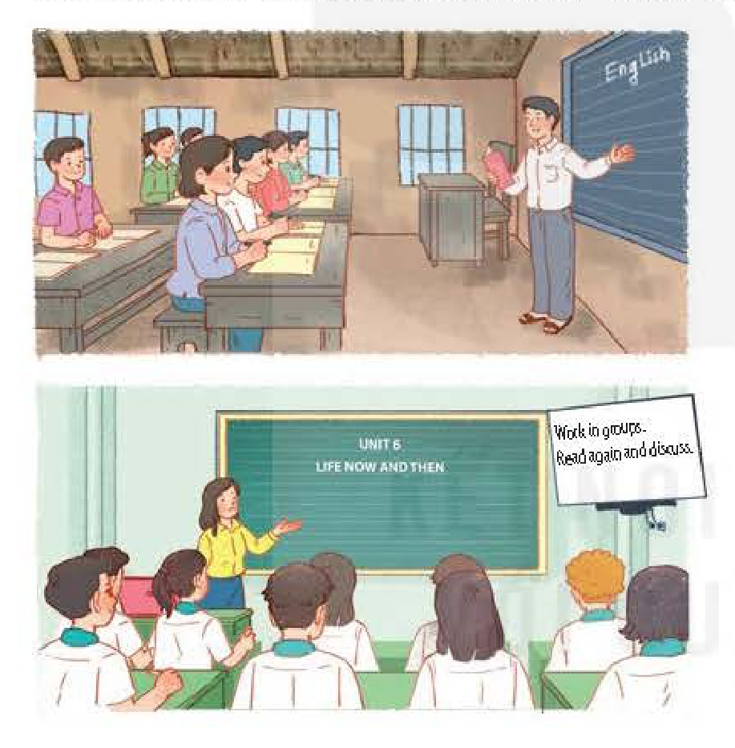
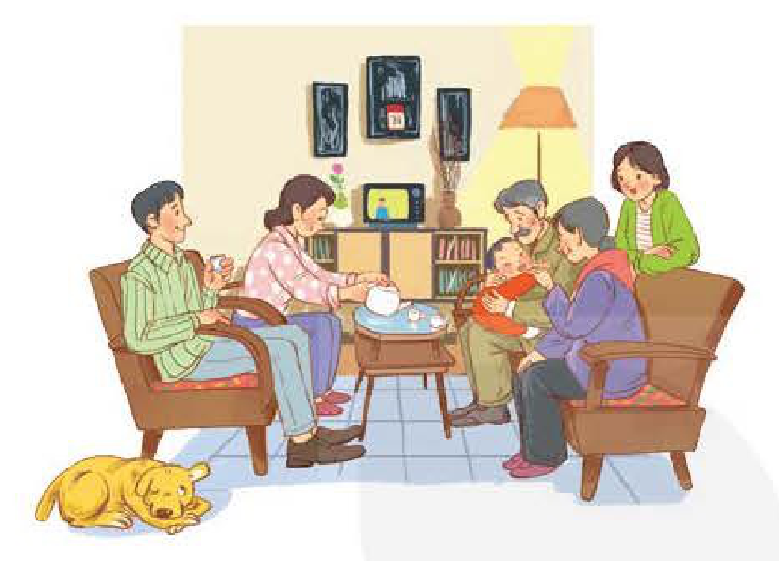

<!-- pdf:59 -->

# UNIT 6: VIETNAMESE LIFESTYLE: THEN AND NOW

> **THIS UNIT INCLUDES:**
> - **Vocabulary:**
>   - Changes in lifestyle
> - **Pronunciation:**
>   - Sounds: /fl/ and /fr/
> - **Grammar:**
>   - Verbs + *to*-infinitive
>   - Verbs + *V-ing*
> - **Skills:**
>   - Reading about learning styles in the past and at present
>   - Talking about changes in your learning style
>   - Listening about changes in family life
>   - Writing an email about changes in your family
> - **Everyday English:**
>   - Making promises

## GETTING STARTED

**We didn't do it in my day.**
<!-- ocr-ok: đã đối chiếu ảnh trang gốc, tiêu đề hội thoại chữ màu cam bị OCR bỏ sót -->

**1. Listen and read.**

**Phong:** Grandpa, do you mind telling me how our lives are different from yours in the past?

**Grandpa:** Well, there are many differences. In my day, we mostly played outdoors. The games were simple and cost little. We made our own toys from natural materials.

**Phong:** That sounds interesting. Nowadays, most leisure games depend on electronic devices.
<!-- term: depend on -->

**Grandpa:** Right, but that is mostly true in the city only. Many children in the countryside still play traditional games.

**Phong:** I know.

**Grandpa:** Another thing is that children nowadays have more freedom of choice. They wear short dresses and jeans with holes. They also dye their hair purple and green.
<!-- term: freedom of choice -->

**Phong:** Ha ha ... Not many, Grandpa.

**Grandpa:** Hm ... And many children of my generation left school early to support their families. Moreover, there were not many schools then.

**Phong:** You mean we have more opportunities to learn now?

**Grandpa:** That's right.

**Phong:** Do you think these changes are for the better?
<!-- term: for the better -->

**Grandpa:** Yes, they mostly are. They have improved our living conditions.
<!-- term: living conditions -->

**Phong:** Thank you, Grandpa.

<!-- pdf:60 -->

**2. Read the conversation again and circle the correct answers.**

1. Phong and his grandpa are talking about some differences between \_\_\_\_\_\_\_.
   - A. children in the city and the countryside
   - B. the living standards in the past and now
   - C. life in the past and now
   - D. past and present entertainment
2. Phong's grandpa mentions \_\_\_\_\_\_\_ differences.
   - A. two
   - B. three
   - C. four
   - D. five
3. Phong's grandpa sees most of the changes as \_\_\_\_\_\_\_.
   - A. positive
   - B. negative
   - C. unnecessary
   - D. necessary

**3. Write the expressions from the conversation in the correct column.**

- a. depend on electronic devices
- b. leave school early
- c. dye their hair
- d. have more opportunities to learn
- e. make toys from natural materials

| The past | The present |
| --- | --- |
| | |

**4. Complete the sentences with the words from the box.**

| opportunity | freedom | dyed |
| --- | --- | --- |
| generation | materials | |

1. A few teenagers in my village have \_\_\_\_\_\_\_ their hair brown.
2. Young people's lifestyle today is different from that of the previous \_\_\_\_\_\_\_.
3. Nowadays, nearly all young people have a(n) \_\_\_\_\_\_\_ to go to school.
4. He wants to live green, so he uses products made from natural \_\_\_\_\_\_\_.
5. My parents give me \_\_\_\_\_\_\_ to pursue my own interests.

**5. QUIZ: Work in pairs. Decide if the statements below are true or false about life in Viet Nam 40 years ago. Share your answers with the class.**
<!-- ocr-ok: đã đối chiếu ảnh trang gốc, chữ QUIZ in màu trong các ô vuông trang trí -->

40 years ago, \_\_\_\_\_\_\_
1. school children didn't wear uniforms.
2. no Vietnamese student could go and study abroad.
3. most people wrote letters instead of writing emails or texting messages.
4. bicycles were the main means of transportation.
5. people lit firecrackers at Tet and weddings.

<!-- pdf:61 -->

## A CLOSER LOOK 1

### Vocabulary

**1. Match the verbs or phrasal verbs with their meanings.**

| A | B |
| --- | --- |
| 1. take notes | a. learn something carefully so that you can remember it exactly |
| 2. depend on | b. take the position of something / somebody |
| 3. memorise | c. write down some key information when listening to a talk, a lecture |
| 4. pursue | d. rely on something / somebody |
| 5. replace | e. try to achieve something over a period of time |
<!-- term: depend on -->
<!-- ocr-ok: đã đối chiếu ảnh trang gốc, bảng nối cột A và B bị OCR đọc lỗi từ depend on, memorise và pursue -->

**2. Work in pairs. Discuss and fill each blank with an adjective from the box.**

| | |
| --- | --- |
| democratic | personal |
| various | extended |
| family-oriented | |

1. Four generations live in my house: my great grandparents, my grandparents, my parents, and me.
   It's a(n) \_\_\_\_\_\_\_ family.
2. In our group, everybody has equal rights to speak and work.
   We have a(n) \_\_\_\_\_\_\_ relationship.
3. Children in the past played a lot of traditional outdoor games such as hide-and-seek, tug of war, and marbles.
   There were \_\_\_\_\_\_\_ outdoor games for children.
4. I don't make public my telephone number, home address, or birthday.
   They are my \_\_\_\_\_\_\_ information.
5. He values his family and spends a lot of time with them.
   He's a(n) \_\_\_\_\_\_\_ person.

**3. Circle the correct answer A, B, C, or D to complete each sentence.**

1. Most of the events at the fair are \_\_\_\_\_\_\_, i.e. they are designed for the family.
   - A. family-oriented
   - B. exciting
   - C. democratic
   - D. various
2. In the past, girls had little opportunity to \_\_\_\_\_\_\_ their interests.
   - A. know
   - B. replace
   - C. pursue
   - D. promise
3. Hi-tech appliances used for housework have \_\_\_\_\_\_\_ our old-fashioned tools.
   - A. made
   - B. replaced
   - C. stopped
   - D. given up
4. The relationship between parents and children is now more \_\_\_\_\_\_\_ than in the past.
   - A. independent
   - B. private
   - C. democratic
   - D. extended
5. Protect your personal \_\_\_\_\_\_\_ online by using strong and unique passwords.
   - A. taste
   - B. experience
   - C. opinions
   - D. privacy

### Pronunciation

**/fl/ and /fr/**

**4. Listen and tick (✓) the words you hear. Then listen again and repeat.**

| | | |
| --- | --- | --- |
| 1. | [ ] a. fruit | [ ] b. flute |
| 2. | [ ] a. frame | [ ] b. flame |
| 3. | [ ] a. free | [ ] b. flea |
| 4. | [ ] a. fright | [ ] b. flight |
| 5. | [ ] a. fresh | [ ] b. flesh |
| 6. | [ ] a. frog | [ ] b. flog |
<!-- ocr-ok: đã đối chiếu ảnh trang gốc, bảng ô vuông chọn từ phát âm /fl/ và /fr/ bị OCR đọc biến dạng kí hiệu -->

**5. Listen and repeat the sentences. Pay attention to the underlined words.**

1. The photos of their fight for *freedom* are on the second *floor*.
2. Who suffers most *from* generation *conflicts*?
3. The man is *reflecting* on his *frightening* trip.
4. How does the past *influence* your *friends*?
5. When I was small, I caught the *flu frequently*.

<!-- pdf:62 -->

## A CLOSER LOOK 2

### Grammar

**Verbs + *to*-infinitive**

**Verbs + *V-ing***

**1. Write the correct form of the verbs in brackets.**

1. fancy (ride) \_\_\_\_\_\_\_ a buffalo
2. learn (use) \_\_\_\_\_\_\_ traditional farming tools
3. mind (not touch) \_\_\_\_\_\_\_ the displays
4. decide (make) \_\_\_\_\_\_\_ a kite
5. avoid (play) \_\_\_\_\_\_\_ on the streets
6. promise (learn) \_\_\_\_\_\_\_ more about the history of our village

**Remember!**

- The verb after *want*, *promise*, *decide*, *agree*, *learn*, *plan* has the *to*-infinitive form.
  *Example:*
  We *decided to do* some research on Thai traditional dancing.
- The verb after *enjoy*, *fancy*, *finish*, *mind*, *avoid*, *suggest* has the *-ing* form.
  *Example:*
  I *suggested visiting* the Viet Nam Museum of Ethnology.
<!-- term: Verbs + to-infinitive and Verbs + V-ing -->

**2. Underline the correct verb form for each sentence.**

1. I really fancy *to wear* / *wearing* this traditional cone hat at our Fashion Show.
2. My brother has decided *to enter* / *entering* the Back to Our Past Competition.
3. Do you mind *to replay* / *replaying* that folk music? It's lovely.
4. My uncle always avoids *to tell* / *telling* stories about his past.
5. They plan *to do* / *doing* research about life in Hue in the 19th century.

**3. Complete each sentence with the correct form of a verb from the box.**

| make | learn | give |
| --- | --- | --- |
| work | teach | |

1. We want \_\_\_\_\_\_\_ how to make toys from natural materials.
2. Yesterday, we finished \_\_\_\_\_\_\_ on the poster for our Good Old Days project.
3. I have promised \_\_\_\_\_\_\_ my grandfather how to find news online.
4. My grandmother suggested \_\_\_\_\_\_\_ a traditional long dress for the wedding.
5. Our group agreed \_\_\_\_\_\_\_ a presentation about school uniforms in the 20th century.

**4. Choose the incorrect underlined word or phrase in each sentence.**

1. Just *a few* (A) years *ago* (B), I would *never* (C) fancy *to have* (D) a smart TV in my home.
2. Tom promised *adding* (A) some *information* (B) about *the past* (C) to his *presentation* (D).
3. *I've* (A) decided *learning* (B) how ethnic minority people *use* (C) natural materials *to dye* (D) cloth.
4. *My* (A) children plan *researching* (B) and make our family *tree* (C) for *the past hundred years* (D).
5. *Do* (A) you mind *not* (B) *to talk* (C) about the past in such a *negative* (D) way?
<!-- ocr-ok: đã đối chiếu ảnh trang gốc, các nhãn gạch chân A, B, C, D đặt dưới từ khiến OCR tách dòng -->

**5. Work in pairs. Take turns to complete the sentences.**

1. For my future career, I want \_\_\_\_\_\_\_\_\_\_\_\_\_\_\_\_\_\_\_\_\_\_\_.
2. Do you mind not \_\_\_\_\_\_\_\_\_\_\_\_\_\_\_\_\_\_\_\_\_\_\_?
3. We all agreed \_\_\_\_\_\_\_\_\_\_\_\_\_\_\_\_\_\_\_\_\_\_\_.
4. I have never fancied \_\_\_\_\_\_\_\_\_\_\_\_\_\_\_\_\_\_\_\_\_\_\_.
5. For our two-day holiday, I suggest \_\_\_\_\_\_\_\_\_\_\_\_\_\_\_\_\_\_\_\_\_\_\_.
<!-- ocr-ok: đã đối chiếu ảnh trang gốc, OCR đọc nhầm chữ I thành dấu sổ dọc | và bỏ sót số 5 -->

<!-- pdf:63 -->

## COMMUNICATION

### Everyday English

*Making promises*

**1. Listen and read the conversations. Pay attention to the highlighted parts.**

1. **Mike:** *I will* share with you the links about the ancient village of Duong Lam.
   **Phong:** Thank you.
<!-- term: Making promises -->

2. **Mi:** *I promise* not to bring my dog to the picnic.
   **Ann:** Great! I appreciate it.
<!-- term: Making promises -->

**2. Work in pairs. Make promises for the following situations.**

1. You are going out with friends. Promise your parents to return before 9 p.m.
2. Promise your friend that you will be on time for the performance.

**Changes around you**

**3. Read the passages about changes. Then match the people with the topics they are talking about.**

- **1. Aki from Tokyo**
  Children used to go to temple schools. Monks, samurai, doctors, and people of other professions served as teachers. Nowadays, children study in modern schools with teachers who get professional training in the subjects they teach.
- **2. Sanjay from New Delhi**
  Once, it was easy to say which country a person was from because people wore their own traditional costumes. Now, trends, comfort, and style are more important. More people are wearing western clothes like jeans and T-shirts instead.
- **3. Asim from Cairo**
  In the past, people used animals such as horses and camels for travelling. Now, airplanes, ships, and trains have replaced them. Transportation has become faster and easier.

| People | Topics |
| --- | --- |
| 1. Aki | a. Transportation |
| 2. Sanjay | b. Education |
| 3. Asim | c. Clothes |

**4. Work in groups. Read the passages in 3 again and discuss:**

- what aspects of life in the past you want to experience.
- what change you think is for the better, and why.

**5. Work in pairs. Read the list below. Tell your partners which of them has remained the same and which has changed over the past five years. Take notes of your partner's answers and report them to the class.**

- Your style of clothes
- Your eating habits
- Your hobbies
- Your favourite actor / singer / book / movie

<!-- pdf:64 -->

## SKILLS 1

### Reading

**1. Work in groups. Discuss if each of the following phrases describes past or present learning.**

- Depending on textbooks
- Using the Internet
- Learning under an oil lamp
- Being independent and active

**2. Two people of different generations are talking about their learning styles. Read the passages and choose the correct answer A, B, C, or D.**

- *Mr Nam, grandfather, a 70-year-old farmer*
  I was one of the few children in my village who was still at school at the age of 15. Every day, I got up early and walked to school. Learning then depended mostly on our teachers and textbooks. We had no library or lab. The nearest bookshop was six kilometres away. I learned simply by taking notes during class, memorising them, and doing the homework. Life then was simple. We rarely travelled outside our village, so we didn't know much about the world around us.

- *Mai, granddaughter, a 15-year-old student*
  Learning today is very different from my grandfather's time. *It* is easier and more convenient. Besides learning from teachers and textbooks, we use the Internet. It provides us with various online sources such as documents, clips, and programmes. Google helps us find the answers to almost any questions we have. The Internet also allows us to pursue our own interests. Learning has become more independent. Although most children in my village have fewer private learning facilities than the students in the city, *we* are still luckier than my grandfather's generation. We have TVs to watch at home and a library and computers at school.

1. In Mr Nam's time, \_\_\_\_\_\_\_.
   - A. teachers played an important role
   - B. there were no bookshops
   - C. students did experiments in labs
   - D. all children stayed on at school until they were 15
2. Few people travelled outside their village, so \_\_\_\_\_\_\_.
   - A. life in the village was simple
   - B. his school didn't have any learning facilities
   - C. the villagers didn't know much about the world around
   - D. none of the villagers knew about city life
3. Learning now \_\_\_\_\_\_\_.
   - A. does not require textbooks
   - B. uses some online programmes
   - C. depends only on the Internet
   - D. does not require students to take notes
4. The word "*It*" refers to \_\_\_\_\_\_\_.
   - A. learning today
   - B. my grandfather's time
   - C. learning facilities
   - D. the Internet
5. The word "*we*" refers to \_\_\_\_\_\_\_.
   - A. learning facilities
   - B. students at my grandfather's generation
   - C. students in the city
   - D. children in the village

<!-- pdf:65 -->

**3. Fill in each blank with ONE word from the passage.**

1. Mr Nam learned mainly from teachers and \_\_\_\_\_\_\_.
2. He learned by \_\_\_\_\_\_\_ the information he got in class.
3. Nowadays, students can learn from \_\_\_\_\_\_\_ online sources.
4. An example of an online source is \_\_\_\_\_\_\_.
5. The Internet helps children \_\_\_\_\_\_\_ their interests.

### Speaking

**4. Work in groups. Discuss and make a list of the changes in your learning over the past five years.**

**You can mention:**
- number of subjects
- teachers
- learning facilities
- learning style (dependent / independent ...)

**5. Share with the class the list your group has made in 4.**

<!-- pdf:66 -->

## SKILLS 2

### Listening

**1. You are going to listen to a talk about family life. Work in pairs. Choose the aspect(s) that you think will be mentioned in the talk.**

- a. Family types
- b. Parents' working places
- c. Family holidays
- d. Birthday parties
- e. Parents-children relations

**2. Listen to the talk and tick (✓) the correct column.**

| Facts | The past | The present |
| --- | --- | --- |
| 1. Popularity of extended families | | |
| 2. More holidays away from home | | |
| 3. More time spent doing things together | | |
| 4. More sources to learn from | | |
| 5. More democratic parent-children relationships | | |
<!-- ocr-ok: đã đối chiếu ảnh trang gốc, tiêu đề cột The past và The present bị OCR đẩy xuống dưới cuối bảng -->

**3. Listen again and fill each blank with a word or a number.**

1. The speaker mentions \_\_\_\_\_\_\_ types of families.
2. In an extended family, there is / are \_\_\_\_\_\_\_ generation(s) living together.
3. The speaker describes Vietnamese people as \_\_\_\_\_\_\_.
4. Children in the past usually came to their \_\_\_\_\_\_\_ to share their experiences.
5. Today's children want their parents to respect their independence and \_\_\_\_\_\_\_.

### Writing

**4. Read the list and tick (✓) the thing(s) that has / have changed in your family in the past five years. Make notes of those which have changed.**

| List | Change |
| --- | --- |
| [x] 1. Family type / members | *Still nuclear. One more member: my brother* |
| [ ] 2. Home facilities | |
| [ ] 3. Ways of spending free time | |
| [ ] 4. Relationships among members | |

**5. Write an email (100 – 120 words) to your penfriend about the changes in your family. Use the ideas in 4.**

**Start and end the email as follows:**

> **New Message**
> - **From:**
> - **To:**
> - **Subject:** Changes in my family
>
> *Hello* \_\_\_\_\_\_\_,
>
> It's nice to hear from you again. Let me tell you about the changes \_\_\_\_\_\_\_\_\_\_\_\_\_\_\_\_\_\_\_\_\_\_\_
>
> *All the best,*
<!-- ocr-ok: đã đối chiếu ảnh trang gốc, khung cửa sổ thư điện tử New Message bị OCR bỏ sót dòng tiêu đề From, To -->

<!-- pdf:67 -->

## LOOKING BACK

### Vocabulary

**1. Choose the correct answer A, B, C, or D to complete each sentence.**

1. I love animals and I'm determined to \_\_\_\_\_\_\_ my dream of becoming a vet.
   - A. have
   - B. pursue
   - C. do
   - D. depend on
2. \_\_\_\_\_\_\_ people tend to put the needs of their families ahead of their own.
   - A. Independent
   - B. Democratic
   - C. Kind
   - D. Family-oriented
3. Rapid changes in society and lifestyle have made the \_\_\_\_\_\_\_ in many families wider.
   - A. generation gap
   - B. family relation
   - C. family values
   - D. experiences
<!-- term: generation gap -->
4. She has found \_\_\_\_\_\_\_ sources of information about life in Viet Nam a century ago.
   - A. extended
   - B. alive
   - C. various
   - D. long
5. Like adults, children sometimes want some \_\_\_\_\_\_\_.
   - A. opportunity
   - B. relations
   - C. values
   - D. privacy

**2. Complete the sentences with the correct forms of the words in brackets.**

1. My parents taught me not to listen to other people's \_\_\_\_\_\_\_ conversations. (privacy)
2. It's amazing that the boy can \_\_\_\_\_\_\_ all the information in such a short time. (memory)
3. Living away from home to attend college has made me more \_\_\_\_\_\_\_. (independence)
4. In a modern society, we learn to value a person's \_\_\_\_\_\_\_. (free)
5. In a \_\_\_\_\_\_\_ classroom, every student has the right to speak as well as the responsibility to listen to others. (democracy)

### Grammar

**3. Circle the correct words or phrases to complete the following sentences.**

1. Do you mind *turning* / *to turn* the volume down? I'm studying.
2. We decided *spending* / *to spend* this whole week learning to cook traditional foods.
3. If you want *seeing* / *to see* the differences between the past and the present of a city, visit its museum.
4. He stayed in his room to avoid *meeting* / *to meet* his parents' guests.
5. My brother promised *taking* / *to take* me to the exhibition of traditional farming tools.

**4. Make complete sentences from the clues. Make any changes and add more words if necessary.**

1. we / plan / visit / historical places / Cao Bang.
   → \_\_\_\_\_\_\_\_\_\_\_\_\_\_\_\_\_\_\_\_\_\_\_
2. we / hope / have / bus station / near / village / soon.
   → \_\_\_\_\_\_\_\_\_\_\_\_\_\_\_\_\_\_\_\_\_\_\_
3. even / grandmother / enjoy / use / Facebook / communicate / her friends.
   → \_\_\_\_\_\_\_\_\_\_\_\_\_\_\_\_\_\_\_\_\_\_\_
4. last year / I / learn / make cakes / watch / cooking videos / Internet.
   → \_\_\_\_\_\_\_\_\_\_\_\_\_\_\_\_\_\_\_\_\_\_\_
5. this morning / I / suggest / do a survey / northern women's traditional costumes.
   → \_\_\_\_\_\_\_\_\_\_\_\_\_\_\_\_\_\_\_\_\_\_\_

<!-- pdf:68 -->

## PROJECT

**I KNOW MY \_\_\_\_\_\_\_ WELL!**
<!-- ocr-ok: đã đối chiếu ảnh trang gốc, tiêu đề dự án chữ in hoa màu cam trên nền vàng bị OCR bỏ sót -->

**Work individually.**

**1. Interview one of your family members about his / her life when he / she was your age now. Take notes of his / her answers.**

**You may focus on:**
- what school he / she went to
- what learning was like then
- how he / she spent his / her free time
- what relations among family members were like then

**2. Make a poster, including his / her photo and the information you have noted.**

**3. Present your poster to the class.**

### Now I can ...

- use the words about changes in lifestyle.
- pronounce the sounds /fl/ and /fr/ correctly in words and sentences.
- recognise and use verbs + *to*-infinitive / *V-ing*.
- make promises.
- read about learning styles in the past and at present.
- talk about changes in my learning style.
- listen about changes in family life.
- write an email about changes in my family.

## 📷 Danh sách hình trong bài

| Mã hình | Trang PDF | Trang sách | Chú thích / Mô tả |
| --- | --- | --- | --- |
| H9-tieng_anh-u06-01 | 64 | 65 | Hai bức tranh minh hoạ phong cách học tập xưa và nay thuộc bài tập 2 phần Skills 1 – Reading: lớp học làng quê mái tranh trước đây và lớp học hiện đại có màn hình trình chiếu |
| H9-tieng_anh-u06-02 | 66 | 67 | Bức tranh minh hoạ gia đình nhiều thế hệ quây quần trò chuyện trong phòng khách thuộc bài tập 1 phần Skills 2 – Listening |
