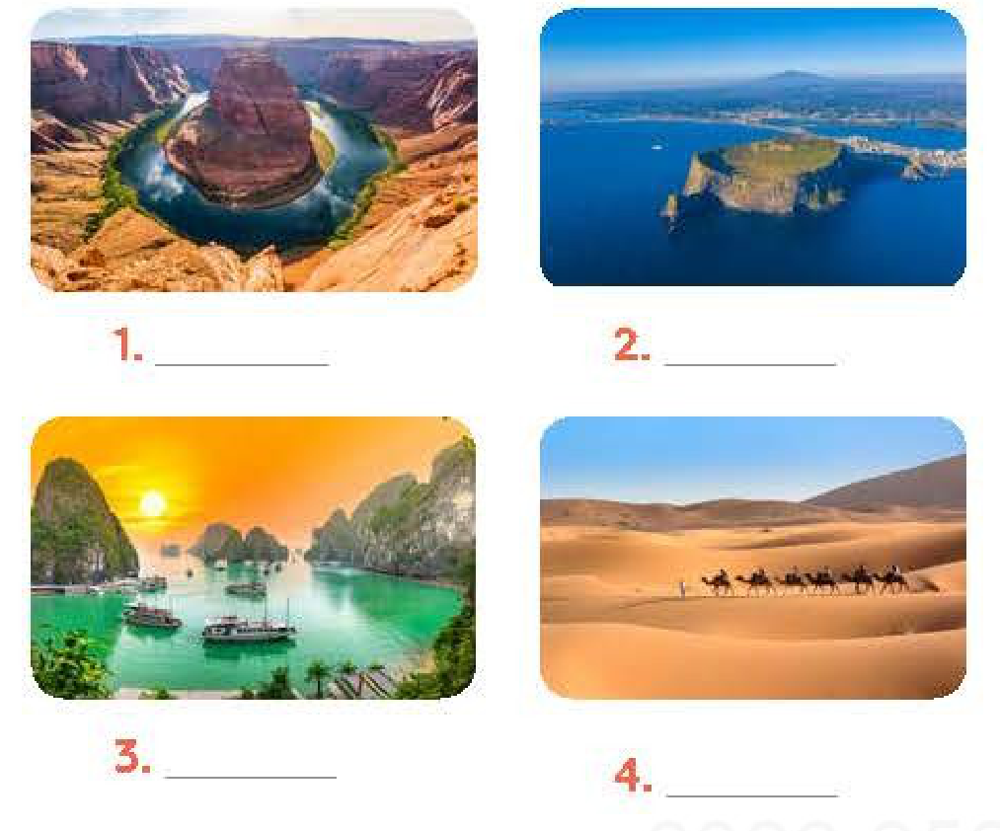
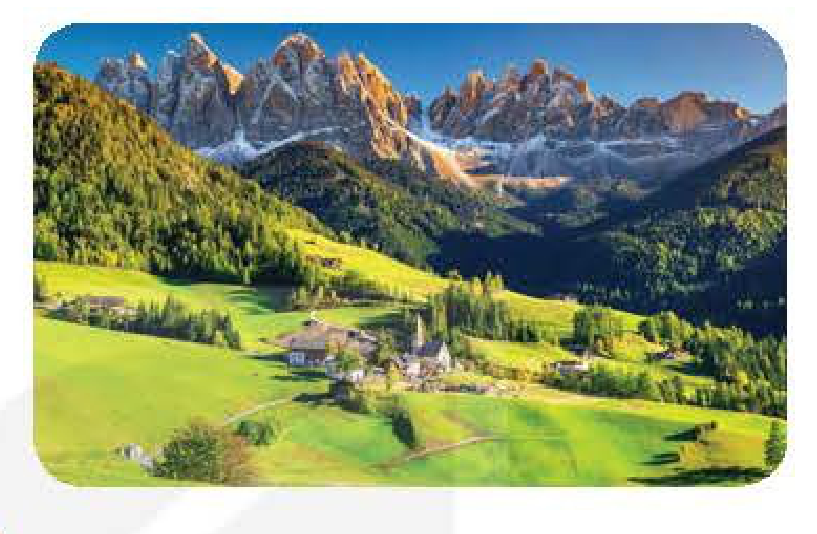
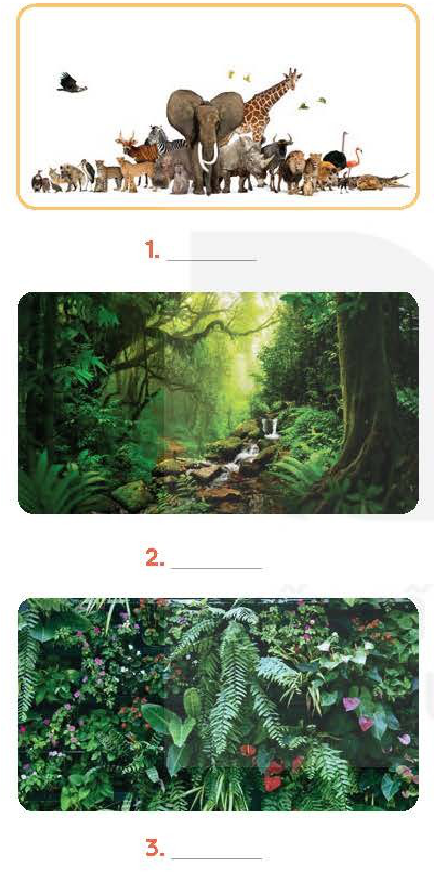

<!-- pdf:71 -->

# UNIT 7: NATURAL WONDERS OF THE WORLD

> **THIS UNIT INCLUDES:**
> - **Vocabulary:**
>   - Natural wonders
> - **Pronunciation:**
>   - Sounds: /sl/ and /sn/
> - **Grammar:**
>   - Reported speech (*Yes / No* questions)
> - **Skills:**
>   - Reading about a **travel destination**
>   - Talking about a natural wonder
>   - Listening about a natural wonder
>   - Writing a paragraph about a natural wonder / landscape in an area
> - **Everyday English:**
>   - Asking for **permission** and responding

## GETTING STARTED

**Meeting on the corridor**

**1. Listen and read.**

**Lan:** Hi, Tom. I hear that you've won second prize in the Natural Wonders Contest. Congratulations!

**Tom:** Thanks, Lan. I like exploring the wonders of nature. I'm **crazy** about them.

**Lan:** What did you talk about in the contest?

**Tom:** I talked about some natural wonders like Mount Everest, the Great Barrier Reef, and the Dead Sea.

**Lan:** Wonderful! I'm interested in them too.

**Tom:** Well, you know our planet has so many beautiful landscapes, from snow-covered **peaks** to charming rivers, lakes, and other natural places that we can't help admiring. So that's what I talked about.
<!-- term: can't help -->

**Lan:** Oh yeah ... And what else did you mention?

**Tom:** Well, I mentioned the risk of us, humans, destroying natural wonders, and I suggested ways to preserve them and **support** **sustainable** development.

**Lan:** Sounds interesting. Do you want to visit any of these places?

**Tom:** The host also asked me if I wanted to visit those places, and I answered that I wanted to see two of them: the Grand Canyon and Ha Long Bay.

**Lan:** I'd love to visit them too.

<!-- pdf:72 -->

**2. Read the conversation again and tick (✓) T (True) or F (False) for each sentence.**

| | T | F |
| --- | --- | --- |
| 1. Tom took part in the Natural Wonders Contest. | | |
| 2. Lan is not keen on natural wonders. | | |
| 3. Tom suggested ways to preserve natural wonders. | | |
| 4. Tom asked the host if he wanted to go to Ha Long Bay. | | |

**3. Complete each sentence with a word or a phrase from the box.**

| explore | couldn't help | landscape |
| --- | --- | --- |
| **support** | development | |

1. A \_\_\_\_\_\_\_ is everything you can see in a large area of land, especially in the countryside.
<!-- term: landscape -->
2. It was risky for him to climb the **peak**, but we \_\_\_\_\_\_\_ admiring his courage.
3. The best way to \_\_\_\_\_\_\_ the Trang An Landscape Complex is by boat.
4. Environmentalists strongly \_\_\_\_\_\_\_ measures to save these heritage trees.
5. **Sustainable** \_\_\_\_\_\_\_ goals will guide us to create a more **sustainable** future for all.

**4. Underline the correct answer to complete each sentence.**

1. Charles is *crazy* / *interested* about football. He follows all the World Cup matches.
2. When you go to Mui Ne, you can see the unique *location* / *landscape* of a desert.
3. The children were very eager to *explore* / *possess* the surrounding countryside.
4. Can you *suggest* / *discover* ways of boosting our local tourism?
5. Tourism *develops* / *contributes* millions of dollars to our country's economy.

**5. GAME: Natural Wonders Knowledge**
<!-- ocr-ok: đã đối chiếu ảnh trang gốc, chữ GAME in màu trong các ô vuông trang trí -->

**Work in groups. List some natural wonders and say where they are located. The group that has the most correct answers wins.**

*Example:*

The Amazon Rainforest – in Brazil / in South America

<!-- pdf:73 -->

## A CLOSER LOOK 1

### Vocabulary

**1. Match the words in A with their definitions / explanations in B.**

| A | B |
| --- | --- |
| 1. **permit** | a. happening once every year |
| 2. **paradise** | b. a way of entering or reaching a place |
| 3. **annual** | c. a range of many things that are very different from each other |
| 4. diversity | d. that needs to be done or happen immediately |
| 5. **access** | e. to allow or make something possible |
| 6. **urgent** | f. a place that is extremely beautiful and that seems perfect |
<!-- ocr-ok: đã đối chiếu ảnh trang gốc, bảng nối cột A và cột B bị OCR đọc trộn dòng -->

**2. Complete the following table. There is one example.**

| Verb | Noun |
| --- | --- |
| *discover* | *discovery* |
| 1. **locate** | |
| 2. hesitate | |
| 3. explore | |
| 4. **possess** | |
| 5. admire | |

**3. Complete the following sentences with the words from the box.**

| **located** | hesitation | **permit** |
| --- | --- | --- |
| **urgent** | diversity | |

1. The government encourages people to protect the \_\_\_\_\_\_\_ of their communities.
2. There is a(n) \_\_\_\_\_\_\_ need to preserve biological diversity of our national parks.
3. \_\_\_\_\_\_\_ between Israel and Jordan, the Dead Sea is the lowest place on Earth.
4. When I asked her to go to Lan Ha Bay with me, she agreed without \_\_\_\_\_\_\_.
5. They do not \_\_\_\_\_\_\_ visitors to take photographs of the palace.

### Pronunciation

**/sl/ and /sn/**

**4. Listen and repeat the words. Pay attention to the sounds /sl/ and /sn/.**

| /sl/ | /sn/ |
| --- | --- |
| sleepy | snack |
| slice | snowy |
| slippery | sneeze |
| slogan | sneaker |
| slope | snake |
<!-- ocr-ok: đã đối chiếu ảnh trang gốc, OCR đọc thiếu chữ cái đầu trong slice, slope và đọc nhầm snake thành shake -->

**5. Listen and repeat the sentences. Pay attention to the underlined words.**

1. There are many *snowstorms* on Mount Everest.
2. He went down the *slope*, wearing a pair of *sneakers*.
3. She *sneezed* when I gave her a *slice* of pizza.
4. The way down the hill was *slippery* as it was covered in *snow*.
5. After eating a *snack*, she felt very *sleepy*.

<!-- pdf:74 -->

## A CLOSER LOOK 2

### Grammar

*Reported speech (Yes / No questions)*
<!-- ocr-ok: đã đối chiếu ảnh trang gốc, tiêu đề chủ điểm ngữ pháp phần A Closer Look 2 -->

**Remember!**

- In reporting *Yes / No* questions, we often use the verb *ask* or *want to know*; we use the word order of statements.
- In reporting *Yes / No* questions, we normally use *if / whether* + clause.
<!-- term: Reported speech: Yes / No questions -->

*Example:*
- Anna: "Do you plan to climb any mountains this summer, Joe?"
- → Anna *asked* Joe *if / whether* he planned to climb any mountains that summer.

**1. Choose the correct answer A, B, C, or D to complete each question.**

1. "Will pollution endanger the wildlife here?" Kate asked.
   → Kate \_\_\_\_\_\_\_ if pollution would endanger the wildlife there.
   - A. told me
   - B. said to me
   - C. wanted to know
   - D. questions me
2. "Are you enjoying your flight?" the stewardess asked me.
   → The stewardess asked me if I \_\_\_\_\_\_\_ my flight.
   - A. am enjoying
   - B. was enjoying
   - C. enjoyed
   - D. would enjoy
3. "Is Ganh Da Dia in Phu Yen Province, Phong?"
   → She asked Phong \_\_\_\_\_\_\_ in Phu Yen Province.
   - A. was Ganh Da Dia
   - B. if Ganh Da Dia is
   - C. whether Ganh Da Dia was
   - D. if it is Ganh Da Dia
4. "Can I take a photo inside the cave?" he said to the guide.
   → He \_\_\_\_\_\_\_ the guide if he could take a photo inside the cave.
   - A. asked
   - B. said
   - C. advised
   - D. ordered
5. "Is the weather good in Sa Pa in the winter?"
   → She wanted to know \_\_\_\_\_\_\_
   - A. was the weather good in Sa Pa in the winter?
   - B. if the weather is good in Sa Pa in the winter.
   - C. whether was the weather good in Sa Pa in the winter.
   - D. if the weather was good in Sa Pa in the winter.

**2. Complete the following reported questions.**

1. "Are you excited about your upcoming trip to Mui Ne?"
   → He asked the children if they were \_\_\_\_\_\_\_.
2. "Do you often meet Angela at school?"
   → She asked us whether we \_\_\_\_\_\_\_.
3. "Will you visit Giang Dien Waterfall next week?"
   → She wanted to know if Mark \_\_\_\_\_\_\_.
4. "Is Con Dao National Park rich in flora and fauna?"
   → I asked the teacher \_\_\_\_\_\_\_.
5. "Can we go to the campsite by bike?"
   → Arthur wanted to know \_\_\_\_\_\_\_.

<!-- pdf:75 -->

**3. Rewrite the sentences in reported questions.**

1. "Are you still working from home?" I asked my dad.
   → \_\_\_\_\_\_\_
2. "Do you have to pack your suitcase, Anne?" said Mark.
   → \_\_\_\_\_\_\_
3. Lan: "Are you interested in visiting Phu Quoc Island, Tom?"
   → \_\_\_\_\_\_\_
4. "Can we afford to go to Niagara Falls, Mum?" said Kay.
   → \_\_\_\_\_\_\_
5. "Will they visit Sa Pa and climb Mount Fansipan this summer?"
   → \_\_\_\_\_\_\_

**4. Read the passage and underline the Yes / No questions. Then write them in reported questions.**

A tour guide is taking a group of tourists to visit Tonle Sap Lake in Cambodia. The guide said to them: "Is it your first time here?" Some said *yes* and some said *no*. Olivia asked the guide: "Do the people here live on fishing?" He said most of them did. Then Mark said: "Do their children go to school on land?" "Yes, they do," said the guide. ...

→ The guide asked them \_\_\_\_\_\_\_.

**5. Work in two groups. Group A gives three direct Yes / No questions. Group B turns them into reported questions. Then they swap roles. The group with more correct answers is the winner.**

*Example:*
- **Group A:** "Is the Atacama Desert in Chile?"
- **Group B:** She asked if the Atacama Desert was in Chile.
- ...

## COMMUNICATION

### Everyday English

*Asking for permission and responding*

**1. Listen and read the conversations. Pay attention to the highlighted parts.**

1. **Anne:** *Can I watch* a horror film, Mum?
   **Anne's Mum:** *No, dear, you can't.* It's late now.
<!-- term: Asking for permission and responding -->

2. **Tourist:** *May we come in* and have a look around the temple?
   **Guard:** *Sure.* But be careful. It's very dark inside.
<!-- term: Asking for permission and responding -->

**2. Work in pairs. Make similar conversations to ask for permission and respond in the following situations.**

1. You ask your friend for **permission** to borrow a book on the Galápagos Islands.
2. You ask your teacher for **permission** to submit your project after the deadline.

**Natural wonders and tourism**

**3. Write each natural wonder under the correct picture.**

| | |
| --- | --- |
| – Ha Long Bay | – Jeju Island |
| – Grand Canyon | – The Sahara Desert |

1. \_\_\_\_\_\_\_
2. \_\_\_\_\_\_\_
3. \_\_\_\_\_\_\_
4. \_\_\_\_\_\_\_
<!-- ocr-ok: đã đối chiếu ảnh trang gốc, 4 chỗ trống đánh số 1-4 nằm dưới từng ảnh minh hoạ -->

<!-- pdf:76 -->

**4. Mai, Phong, and Mark are talking about the natural wonders they have visited. Read and decide which wonder in 3 each of them is talking about.**

- **Mai:** It's an island **located** off the coast of South Korea. It was formed by the eruption of an underwater volcano about 2 million years ago. It ranks among the world's seven natural wonders. Every year, it receives millions of tourists.
  1. \_\_\_\_\_\_\_
- **Phong:** Visiting this place is a wonderful experience for adventurers like me. It's the largest desert on Earth, covering over 9 million square kilometres. You can see red sand and beautiful sand dunes everywhere. You can also see plant life and even nomadic men with their camels.
  2. \_\_\_\_\_\_\_
- **Mark:** It's a UNESCO World Heritage Site and one of the greatest tourist attractions of the USA! It's 446 kilometres long, up to 29 kilometres wide, and over 1,800 metres deep. Some people say that it's the most magnificent landscape on Earth.
  3. \_\_\_\_\_\_\_

**5. Work in groups. Discuss and decide which place in 3 and 4 your group wants to visit. Explain the reasons why you want to visit it. Plan the things you want to do there. Report your decision to the class.**

## SKILLS 1

### Reading

**1. Work in groups. Look at the picture and answer the questions.**

1. What do you see in the picture?
2. What activities do you think visitors can do there?

**2. Read the text and match the highlighted words with their meanings or explanations.**

**The Dolomites – Paradise at Your Feet**
<!-- ocr-ok: đã đối chiếu ảnh trang gốc, tiêu đề bài đọc chữ màu xanh không được OCR nhận diện -->

If you haven't decided on where to travel this holiday, *consider* the Dolomites!

The Dolomites are a mountain range in Italy. It was recognised as a UNESCO World Heritage Site in 2009. The Dolomites are part of the Alps, stretching from the Adige River to the Piave River valley. This mountain range has a total area of about 141,900 hectares. It has 18 **peaks** over 3,000 metres high. It is easy to get **access** to most parts of the Dolomites.

The Dolomites are a **majestic** site. They are widely regarded as being among the most attractive mountain landscapes in the world. There are steep rocky cliffs, sharp **peaks**, narrow and deep valleys, and white snow on the mountain top. Their natural scenery attracts tourists from many parts of the world.

<!-- pdf:77 -->

The Dolomites are a popular place for winter skiing, mountain climbing, hiking, and cycling any time of the year. An **annual** bicycle race covering seven mountain passes on the Dolomites **occurs** in the first week of July.

So do not *hesitate* to book a tour to the Dolomites to see and do these things for yourself!
<!-- term: hesitate -->

*Dolomites /ˈdɒləmaɪts/*
<!-- ocr-ok: đã đối chiếu ảnh trang gốc, chú thích phiên âm IPA của Dolomites -->

| Words | Meaning / Explanation |
| --- | --- |
| 1. consider | a. impressive, magnificent |
| 2. **peaks** | b. happens |
| 3. **majestic** | c. to think about something carefully |
| 4. **occurs** | d. pointed tops, mountains |

**3. Read the text again and choose the correct answer to each question.**

1. According to the text, the Dolomites are a \_\_\_\_\_\_\_.
   - A. river
   - B. work of art
   - C. mountain range
   - D. valley
2. The word "*hesitate*" in the last sentence of the text is closest in meaning to \_\_\_\_\_\_\_.
   - A. be unhappy
   - B. be indecisive
   - C. hurry
   - D. decide
3. Which of the following is NOT true, according to the text?
   - A. The Dolomites are in Italy.
   - B. You can get **access** to the Dolomites easily.
   - C. The Dolomites are a World Heritage Site.
   - D. You can cycle in the Dolomites only in July.
4. This text is probably taken from \_\_\_\_\_\_\_.
   - A. a travel brochure
   - B. a science journal
   - C. a novel
   - D. an arts magazine

### Speaking

**4. Work in pairs. Ask and answer about the Great Barrier Reef, using the facts below. Then prepare a short talk about it.**

- World Heritage Site (1987)
- **Location**: the **Coral** Sea, Australia
- Total area: about 334,400 $\text{km}^2$
- Over 400 different types of **corals**
- Tourists' activities: **coral** watching, sailing, scuba diving

**5. Work in groups. Introduce the Great Barrier Reef to the class.**

<!-- pdf:78 -->

## SKILLS 2

### Listening

**1. Write a word from the box under the correct picture.**

| a. rainforest | b. flora | c. fauna |
| --- | --- | --- |

1. \_\_\_\_\_\_\_
2. \_\_\_\_\_\_\_
3. \_\_\_\_\_\_\_
<!-- ocr-ok: đã đối chiếu ảnh trang gốc, 3 chỗ trống đánh số 1-3 nằm dưới từng tranh minh hoạ -->

**2. Listen to the passage and tick (✓) the things you hear.**

- [ ] Green lung of the world
- [ ] Causing climate change
- [ ] Threats to **biodiversity**
- [ ] Planting trees
- [ ] Exploring **ecosystems**
- [ ] Protecting wildlife

**3. Listen again and choose the correct answers.**

1. The Amazon Rainforest is rich in \_\_\_\_\_\_\_.
   - A. rivers and forests
   - B. flora and fauna
   - C. climate change
2. The threats to **biodiversity** are deforestation, fires, and extinction of rare animal \_\_\_\_\_\_\_.
   - A. flora
   - B. fauna
   - C. species
3. Which activity can governments and communities do to restore damaged **ecosystems**?
   - A. Punishing loggers.
   - B. Establishing parks.
   - C. Putting out fires.
4. Governments are encouraging people to live in a way that doesn't hurt the \_\_\_\_\_\_\_.
   - A. environment
   - B. animals
   - C. marine life

### Writing

**4. Work in pairs. Brainstorm ideas about a natural wonder / beautiful landscape in your area. Ask and answer about it, using the following prompts.**

- Name of the natural wonder / beautiful landscape
- **Location**
- Natural **features**
- Activities
- Ways to protect it

**5. Write a paragraph (100 – 120 words) about the natural wonder / beautiful landscape you have talked about in 4.**

**You can start your paragraph as follows:**

> *There is a beautiful \_\_\_\_\_\_\_ near my home.*

<!-- pdf:79 -->

## LOOKING BACK

### Vocabulary

**1. Choose A, B, C, or D to indicate the correct answer to each question.**

1. I'm sure you will be amazed by the \_\_\_\_\_\_\_ of the Atacama Desert.
   - A. landscape
   - B. land
   - C. backdrop
   - D. territory
2. Can all of you \_\_\_\_\_\_\_ new ideas for improving our Geography Club?
   - A. explore
   - B. conserve
   - C. suggest
   - D. discover
3. \_\_\_\_\_\_\_ is all the animals living in an area or in a period of history.
   - A. Species
   - B. Nature
   - C. Flora
   - D. Fauna
4. He \_\_\_\_\_\_\_ before sending the e-mail because he was afraid that she would not like it.
   - A. **possessed**
   - B. hesitated
   - C. accepted
   - D. admired
5. When he reached the mountain \_\_\_\_\_\_\_, he found it covered with countless flags of climbers before him.
   - A. **peak**
   - B. bottom
   - C. height
   - D. side

**2. Give the correct forms of the words in brackets to complete the sentences.**

1. Natural wonders are one of our country's valuable (**possess**) \_\_\_\_\_\_\_.
2. Our Central Highlands has (charm) \_\_\_\_\_\_\_ sights: natural and wild landscapes amid magnificent forests.
3. The Gobi is a very large desert (**locate**) \_\_\_\_\_\_\_ in China and Mongolia.
4. The Amazon River was named by the Spanish (explore) \_\_\_\_\_\_\_ Francisco de Orellana.
5. You don't need special (**permit**) \_\_\_\_\_\_\_ to visit Cuc Phuong National Park.

### Grammar

**3. Underline the correct answers to complete the sentences.**

1. Minh asked me *did I know* / *if I knew* much about the Amazon Rainforest.
2. I asked Frankie if *he was living* / *he is living* near the Grand Canyon.
3. Trang *said* / *wanted to know* whether Tom wanted to visit Mount Fansipan.
4. My mum *told* / *asked* me whether I was studying or playing then.
5. The teacher asked Liam *whether he wanted* / *did he want* to visit Son Doong Cave.

**4. Rewrite the sentences in reported questions.**

1. "Do you know about the Shilin Stone Forest in China?" she asked me.
   → \_\_\_\_\_\_\_
2. "Do you enjoy having virtual tours of these natural wonders?" Mi said to Nam.
   → \_\_\_\_\_\_\_
3. "Are you interested in the natural wonders of your country?" David asked me.
   → \_\_\_\_\_\_\_
4. "Can you manage to meet the deadline for the project?" I said to Linh.
   → \_\_\_\_\_\_\_
5. "Will you visit some natural wonders overseas this summer?" she said.
   → \_\_\_\_\_\_\_

<!-- pdf:80 -->

## PROJECT

**NATURAL WONDERS OF THE WORLD**
<!-- ocr-ok: đã đối chiếu ảnh trang gốc, tiêu đề chữ trang trí trên nền ảnh thác nước -->

**Work in groups.**

1. **Find a natural wonder.**
2. **Collect pictures of it.**
3. **Look for information about:**
   - its **location**
   - its special **features** / attractions
   - threats to its existence
   - ways / plans to preserve it
4. **Make a poster about it.**
5. **Give a presentation about it to the class.**
<!-- ocr-ok: đã đối chiếu ảnh trang gốc, OCR đọc sót phần hướng dẫn nhóm 1-5 trên nền màu xanh -->

### Now I can ...

- use the words related to the topic *Natural wonders of the world*.
- pronounce the sounds /sl/ and /sn/ correctly in words and sentences.
- use the reported *Yes / No* questions.
- ask for **permission** and respond.
- read about a travel **destination**.
- talk about a natural wonder.
- listen about a natural wonder.
- write a paragraph about a natural wonder / landscape in an area.

## 📷 Danh sách hình trong bài

| Mã hình | Trang PDF | Trang sách | Chú thích / Mô tả |
| --- | --- | --- | --- |
| H9-tieng_anh-u07-01 | 75 | 76 | Bốn bức ảnh 1–4 thuộc bài tập 3 phần Communication (Natural wonders and tourism): (1) hẻm núi Grand Canyon, (2) đảo Jeju nhìn từ trên cao, (3) vịnh Hạ Long, (4) đoàn lạc đà trên sa mạc Sahara |
| H9-tieng_anh-u07-02 | 76 | 77 | Bức ảnh phong cảnh dãy núi Dolomites hùng vĩ với thung lũng xanh thuộc bài tập 1 phần Skills 1 – Reading |
| H9-tieng_anh-u07-03 | 78 | 79 | Ba bức ảnh 1–3 thuộc bài tập 1 phần Skills 2 – Listening: (1) các loài động vật hoang dã (fauna), (2) rừng mưa nhiệt đới (rainforest), (3) thảm thực vật rừng nhiệt đới (flora) |
