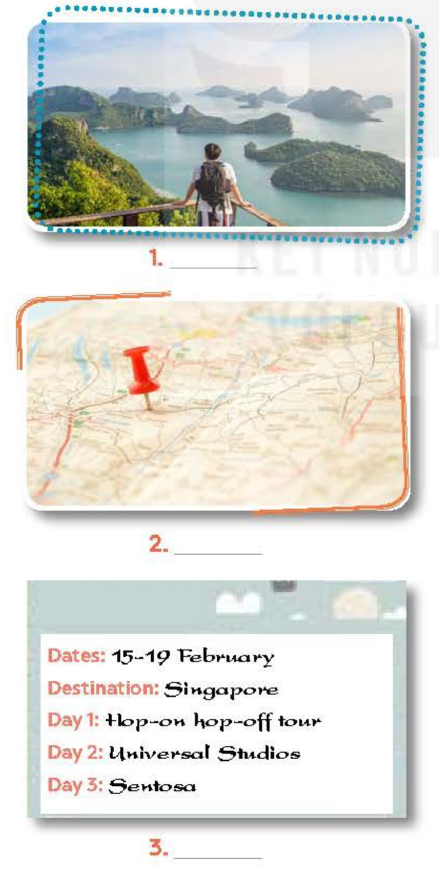
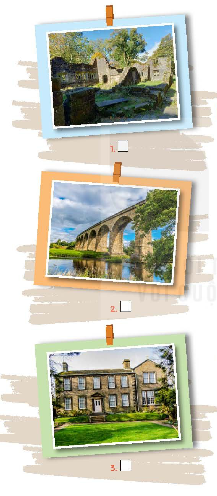
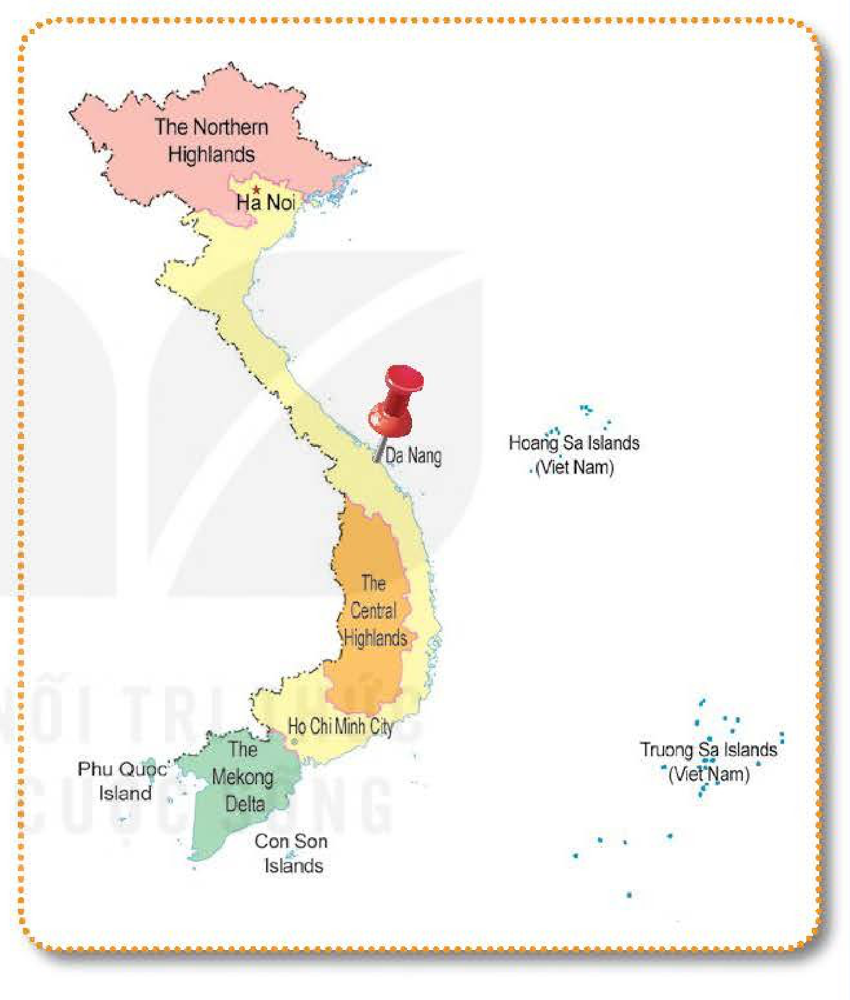

<!-- pdf:81 -->

# UNIT 8: TOURISM

> **THIS UNIT INCLUDES:**
> - **Vocabulary:**
>   - Tourism
> - **Pronunciation:**
>   - Stress in words ending in *-ic* and *-ious*
> - **Grammar:**
>   - Relative pronouns
> - **Skills:**
>   - Reading about different types of tours
>   - Talking about your travel experience
>   - Listening about a tour announcement
>   - Writing a paragraph introducing a tour
> - **Everyday English:**
>   - Expressing obligation

## GETTING STARTED

**You've got a nice tan.**

**1. Listen and read.**

**Tom:** Hi, An.

**An:** Hi, Tom. You've got a nice tan.

**Tom:** Well, I've just got back from Bali.

**An:** Bali? Where is it?

**Tom:** It's in Indonesia. My family flew there for a holiday, and we spent most of the time on the beach. That's how I got this tan.

**An:** Awesome. Tell me more about Bali.

**Tom:** Sure. It's an ideal destination for **holidaymakers**, especially those who love the sea.

**An:** It must be beautiful!

**Tom:** Very. It's well-known for its natural beauty, sunny beaches, and terraced fields.

**An:** Is it expensive to travel there?

**Tom:** Not really. My father was able to buy cheap air tickets and rent a cheap accommodation. He usually uses travel apps for our domestic and international holidays.

**An:** Where did you stay?

**Tom:** We stayed in a three-star hotel which is just a ten-minute walk from the sea. Have you been somewhere for holiday?

**An:** Yeah. Last year my family travelled to Da Nang. We ate different types of local food, and they all were so delicious. My brother said it was a perfect destination for food tourists.

**Tom:** Yes, I love **food tourism**, too. There are also other types of tourism like **shopping tourism** or sports tourism.
<!-- term: sports tourism -->

**An:** I didn't know that. Well, I'll try one of those someday.

<!-- pdf:82 -->

**2. Read the conversation again and tick (✓) T (True) or F (False).**

| | T | F |
| --- | --- | --- |
| 1. Tom and An are talking about their holidays. | | |
| 2. Bali is especially interesting for mountain lovers. | | |
| 3. People can use **online apps** for booking tickets and accommodation. | | |
| 4. An did not enjoy some of Da Nang's local food. | | |
| 5. Tom mentions some types of tourism. | | |

**3. Match a word in A with a word in B as in the conversation.**
<!-- ocr-ok: đã đối chiếu ảnh trang gốc, OCR đọc dính chữ Awith, aword, asin -->

| A | B |
| --- | --- |
| 1. ideal | a. holiday |
| 2. natural | b. food |
| 3. domestic | c. destination |
| 4. shopping | d. beauty |
| 5. local | e. tourism |

**4. Complete the sentences with the words and phrases from the box.**

| sports tourism | destination | safari |
| --- | --- | --- |
| **online apps** | domestic | |

1. If you go on \_\_\_\_\_\_\_, you can see wild animals in their natural habitat.
<!-- term: safari -->
2. Noi Bai Airport has two terminals: one for international flights and one for \_\_\_\_\_\_\_ flights.
3. You should learn how to use \_\_\_\_\_\_\_ for booking transportation and accommodation.
4. \_\_\_\_\_\_\_ is travelling to watch a sports event.
<!-- term: sports tourism -->
5. Japan is a must-go \_\_\_\_\_\_\_ for me.
<!-- ocr-ok: đã đối chiếu ảnh trang gốc, OCR đọc dính chữ is a thành isa -->

**5. QUIZ: How much do you know about tourism in Viet Nam?**

**Work in pairs. Discuss and write the names of the places next to the sentences.**

1. This ancient city in central Viet Nam used to be the capital of our country. \_\_\_\_\_\_\_
2. This city in the South is famous for its floating market. \_\_\_\_\_\_\_
3. This central highland city usually holds a Flower Festival in December. \_\_\_\_\_\_\_
4. This northern province has a famous waterfall. \_\_\_\_\_\_\_
5. This province possesses a World Heritage Site, Ha Long Bay. \_\_\_\_\_\_\_

<!-- pdf:83 -->

## A CLOSER LOOK 1

### Vocabulary

**1. Match the words and phrases with the explanations.**

| | |
| --- | --- |
| 1. **package holiday** | a. a plan of a journey, including the route and the places that you visit |
| 2. **self-guided** tour | b. accommodation provided in the home of a family in exchange for payment |
| 3. trip **itinerary** | c. a trip where a traveller does everything on his / her own |
| 4. **homestay** | d. a web platform which shows directions to a destination |
| 5. Google Maps | e. a vacation where a travel **agent** organises everything for you |
<!-- ocr-ok: đã đối chiếu ảnh trang gốc, bảng nối cột từ vựng và giải nghĩa bị OCR đọc tách rời hai cột -->

**2. Write a phrase from the box next to the sentence to replace 'it'.**

| **ruinous** site | entrance ticket |
| --- | --- |
| **smooth** trip | **fixed** **itinerary** |
| travel **agency** | |
<!-- ocr-ok: đã đối chiếu ảnh trang gốc, khung từ vựng 2 cột bài tập 2 -->

1. If you want to go into a place to see what is inside, you have to buy *it*. \_\_\_\_\_\_\_
<!-- term: entrance ticket -->
2. The Colosseum in Rome is not in its original condition. You can see only parts of *it*. \_\_\_\_\_\_\_
3. *It* takes care of everything for travellers. \_\_\_\_\_\_\_
4. I don't like *it* because I cannot change anything: the time, the destination, ... . \_\_\_\_\_\_\_
5. We had no trouble at all during *it*. Everything was OK. \_\_\_\_\_\_\_

**3. Complete the sentences with the words from the box.**

| entrance | apps | package |
| --- | --- | --- |
| **self-guided** | **itinerary** | |

1. We'd like to go on a(n) \_\_\_\_\_\_\_ tour which will be interesting and be within our budget.
2. Lan sent us the \_\_\_\_\_\_\_ of her trip to Sa Pa for reference.
3. During the tour, we have to buy the \_\_\_\_\_\_\_ tickets for the Glass Museum and the Art Gallery.
4. If you take a(n) \_\_\_\_\_\_\_ holiday, you have to follow a **fixed** **itinerary**.
5. If you want to get information about domestic tourist destinations, download these \_\_\_\_\_\_\_.

### Pronunciation

*Stress in words ending in -ic and -ious*

**Remember!**

Words containing the *-ic* or *-ious* suffixes are stressed on the syllable previous to *-ic* and *-ious*.

*Example:* fan'tastic, 'anxious

**4. Listen and repeat the words. Pay attention to the word stress.**

| -ic | -ious |
| --- | --- |
| basic | curious |
| public | serious |
| classic | delicious |
| domestic | hilarious |
| historic | religious |
<!-- ocr-ok: đã đối chiếu ảnh trang gốc, OCR đọc thiếu chữ c và ic cuối từ basic, domestic -->

**5. Mark the stress in the underlined words. Then listen and repeat the sentences.**

1. The visitors are *curious* about the history of the old *public* building.
2. They have an *ambitious* goal which is to go on a cruise across the *Pacific*.
3. We watched some *classic* movies while we were here on our *previous* holiday.
4. We stayed at a *luxurious* hotel near a *terrific* beach.
5. The village has a *romantic* landscape with *various* flower beds.

<!-- pdf:84 -->

## A CLOSER LOOK 2

### Grammar

*Relative pronouns: which, who, and whose*

**Remember!**

*Who* and *which* are relative pronouns. They are used after a noun to show which person / thing we are talking about. *Who* refers to a person, and *which* refers to a thing.
<!-- term: Relative pronouns: which, who, and whose -->

*Example:*
- I know a girl *who* works as a tour guide in Singapore.
- I'm reading a travel **brochure** *which* I picked up in Japan.

**1. Underline the noun or noun phrase in each sentence that which or who refers to.**

1. People *who* travel abroad usually use travel apps.
2. The **brochure** *which* you can get free at the airport is useful for your stay in Bangkok.
3. Is this the video *which* explains some new trends in tourism?
4. Could you recommend to me a local tour guide *who* can speak English?
5. They want to visit a city *which* is famous for its rich history.

**2. Underline the correct relative pronoun for each sentence.**

1. This is the **brochure** *which* / *who* provides the information you need for your visit to Beijing.
2. ABC is the company *which* / *who* won the Best Travel **Agency** Award last year.
3. The elders *which* / *who* are not good at using **online apps** prefer package tours.
<!-- ocr-ok: đã đối chiếu ảnh trang gốc, chữ bị nhoè trong OCR ở câu 1 và câu 3 đã được đọc chuẩn từ ảnh trang 85 -->
4. A **hop-on hop-off** bus *which* / *who* runs from here every hour is the fastest way to visit a city.
5. **Food tourism** is for tourists *which* / *who* want to explore the unique dishes of a place.

**Remember!**

*Whose* is a relative pronoun. It is used to show possession by people and things.
<!-- term: Relative pronouns: which, who, and whose -->

*Example:*
- The man *whose* book you are reading is my friend.
- We visited a city *whose* houses are painted in different bright colours.

**3. Complete each sentence with who or whose.**

1. Mr Minh, \_\_\_\_\_\_\_ will guide us on our Cu Chi Tunnel tour, is on his way.
2. This is the writer \_\_\_\_\_\_\_ book *Travel on \$50 a Day* is my favourite travel guide.
3. My son, \_\_\_\_\_\_\_ is a huge fan of Taylor Swift, is on a music tour to see her in concert.
4. Ha Giang, \_\_\_\_\_\_\_ beauty and history are appealing, is a must-go in my tour list.
5. While travelling, my father often spends time talking with the locals \_\_\_\_\_\_\_ stories, he says, are interesting about the land we are visiting.

**4. Match a clause in A with a clause in B to make a complete sentence.**

| A | B |
| --- | --- |
| 1. Don't forget to visit the National Air and Space Museum | a. whose products are on display at the Handicraft Show. |
| 2. Yesterday I phoned Pierre, | b. who knows a lot about the history of this area? |
| 3. There, I could see the **ruinous** hall | c. which appeared in the film "Jane Eyre". |
| 4. Could you recommend a local tour guide | d. whose breathtaking collection is a must-to-see. |
| 5. We were lucky to meet some artisans | e. who is arranging accommodation for our stay in Paris. |
<!-- ocr-ok: đã đối chiếu ảnh trang gốc, bảng nối mệnh đề cột A và cột B bị OCR tách rời hai cột -->

<!-- pdf:85 -->

**5. Work in pairs. Discuss and finish the sentences.**

1. Son Doong is now a **world-famous** destination for travellers who \_\_\_\_\_\_\_.
2. I'm personally against tours which \_\_\_\_\_\_\_.
3. We shared a holiday home with two Germans whose \_\_\_\_\_\_\_.
4. I bought a city map which \_\_\_\_\_\_\_.
5. Most travellers prefer working with tour guides who \_\_\_\_\_\_\_.

## COMMUNICATION

### Everyday English

*Expressing obligation*

**1. Listen and read the conversations. Pay attention to the highlighted parts.**

1. **Mother:** Lan, you *must hurry up* or we'll miss the train.
   **Lan:** Yes, Mum. I'm coming.
<!-- term: Expressing obligation -->

2. **Nick:** *Is it necessary* for us to wait in the queue?
   **Stranger:** I'm sorry, it is.
<!-- term: Expressing obligation -->

**2. Work in pairs. Express obligation in the following situations.**

1. You ask your younger brother to make a list of the things he will pack for his holiday so that he does not forget anything.
2. The teacher asks the class to strictly follow the factory regulations while visiting.

**My travel**

**3. Read what people say about their travels. Then complete the table.**

- **Nam:** Last year, my family travelled to Ninh Thuan for a leisure holiday. We rented a **homestay** by the sea. We swam in the sea and ate the local seafood.
- **Agi:** Next month, my class is going on a trip to Budapest. A travel **agency** takes care of everything for us. We'll stay in a three-star hotel. We'll visit some cultural places and take a cruise on the Danube River.
- **Haruto:** It was the **low season**, so my brother and I were able to afford a seven-day holiday in Beijing, China. We stayed in a **loft** room of a guest house. We spent every day visiting historical places. We wanted to learn about China's history.

| People | Accommodation | Activities |
| --- | --- | --- |
| Nam | | |
| Agi | | |
| Haruto | | |
<!-- ocr-ok: đã đối chiếu ảnh trang gốc, bảng 3 cột People - Accommodation - Activities -->

<!-- pdf:86 -->

**4. Work in groups. Share with your partners an unforgettable holiday you've taken. In your talk, you can mention:**

- holiday destination
- travel transportation
- accommodation
- activities
<!-- ocr-ok: đã đối chiếu ảnh trang gốc, OCR đọc nhầm accommodation thành accommaodation -->

## SKILLS 1

### Reading

**1. Write the words under their correct pictures.**

| a. destination | b. traveller |
| --- | --- |
| c. **itinerary** | |
<!-- ocr-ok: đã đối chiếu ảnh trang gốc, khung từ vựng bài tập 1 phần Reading -->

1. \_\_\_\_\_\_\_
2. \_\_\_\_\_\_\_
3. \_\_\_\_\_\_\_
<!-- ocr-ok: đã đối chiếu ảnh trang gốc, 3 bức ảnh và chỗ trống đánh số 1-3 dưới từng ảnh -->

**2. Read the passage and match the words and phrases in A with the definitions in B.**

The two most popular types of tours now are package and **self-guided** tours.

When you buy a package tour, a travel **agency** takes care of almost everything for you. You will get a notice about the places of your visit, the detailed **itinerary**, and the *cost*. They will protect you if something goes wrong during the trip. This type of holiday saves time and reduces stress for travellers. It offers a convienient option for people who are elderly, who do not want to spend much time searching on their own, or who are not confident about using **online apps**. One disadvantage of this type is you have to follow a **fixed** **itinerary**.
<!-- term: package tour -->

Nowadays, more young people choose **self-guided** tours which require them to do everything on their own. They have to look for a destination, **work out** an **itinerary**, and **estimate** the cost. They then **hunt** for tickets and accommodation, usually **homestay**. This type of holiday may require people more time and effort, but it is cheaper and more flexible than a **package holiday**. It gives travellers more freedom to decide where to go and how much time and money to spend at a place. However, to have a **smooth** trip and avoid trouble, these travellers should be good at using apps.

| A | B |
| --- | --- |
| 1. cost | a. happening or continuing without any problems |
| 2. **fixed** | b. money spent on something |
| 3. **hunt** for | c. not changing |
| 4. **smooth** | d. look for |
<!-- ocr-ok: đã đối chiếu ảnh trang gốc, bảng nối từ vựng cột A và cột B cuối trang 87 -->

<!-- pdf:87 -->

**3. Read the passage again and answer the questions.**

1. What can a package tour save you?
2. What disadvantage of a package tour does the passage mention?
3. What do travellers have to do on a **self-guided** tour?
4. What is an advantage of **self-guided** tours?
5. What skill should you have if you go on a **self-guided** tour?

### Speaking

**4. Work in pairs. Take turns to interview your partner about his / her recent tour. Take notes of your partner's answers.**

**You can ask about:**

1. where he / she went
2. which tour he / she took: package or **self-guided**
3. how he / she travelled
4. where he / she stayed
5. what he / she did / saw

**5. Share with the class your partner's travel experience. You can then share what you think about it.**

*Example:*

Last summer, Mai went to Da Lat. She took a package tour ...

## SKILLS 2

### Listening

**1. Work in pairs. Discuss if these statements are true.**

1. The Brontes is a family of **world-famous** writers.
2. Together, the three sisters wrote *Jane Eyre*.
3. You can read some of their novels in Vietnamese.

**2. A tour guide is announcing the schedule for a one-day trip to the home of the Brontes. Listen and complete the missing information.**

| DAY TRIP: Haworth and the Brontes | |
| --- | --- |
| Trip will take: | (1) \_\_\_\_\_\_\_ hours |
| *Jane Eyre*: | (2) a \_\_\_\_\_\_\_ book |
| At Haworth, we see: | the Brontes' house, school, and (3) \_\_\_\_\_\_\_ |
| The tour includes: | (4) \_\_\_\_\_\_\_ ticket to the house |
| The Brontes lived in Haworth: | (5) \_\_\_\_\_\_\_ years ago |
| The main street of the village: | has witnessed little (6) \_\_\_\_\_\_\_ |

<!-- pdf:88 -->

**3. Look at the pictures, listen again and tick (✓) the two which illustrate the ideas of the listening passage.**

1. [ ]
2. [ ]
3. [ ]
<!-- ocr-ok: đã đối chiếu ảnh trang gốc, 3 ô đánh dấu dưới ba ảnh minh hoạ -->

### Writing

**4. Work in pairs. Discuss and tick (✓) the thing(s) that the tour guide in the listening passage mentions in her announcement at the beginning of the tour.**

1. [ ] The length of the tour
2. [ ] The cost of the tour
3. [ ] The place(s) they visit
4. [ ] Some brief details about each place

**5. Write a paragraph (100 – 120 words) introducing this half day tour in Hue. Use the clues below.**

1. Length of the tour: 5 hours
2. Transportation: mini bus
3. The place(s):
   - Thien Mu Pagoda: oldest pagoda in central and south Viet Nam, built in 1602.
   - The Citadel: see the palace ruins, learn about the history of the Nguyen Dynasty, and visit the altars of the Kings.
   - Dong Ba Market + lunch (at tourists' own expense): biggest market in the city. Get to know about the local products and chat with the locals.

**You can start with:**

> *This is the **itinerary** for a five-hour tour. ...*

<!-- pdf:89 -->

## LOOKING BACK

### Vocabulary

**1. Choose the correct answer A, B, C, or D to complete each sentence.**

1. If you are travelling abroad for the first time, it's better to look for a good travel \_\_\_\_\_\_\_ to arrange everything for you.
   - A. budget
   - B. **agency**
   - C. tourism
   - D. **homestay**
2. Many \_\_\_\_\_\_\_ buildings have become UNESCO World Heritage Sites.
   - A. modern
   - B. domestic
   - C. **ruinous**
   - D. international
3. Young people are usually good at \_\_\_\_\_\_\_ for cheap transportation and accommodation.
   - A. buying
   - B. booking
   - C. **hunting**
   - D. applying
4. Nowadays, people can travel on their own to new places by using \_\_\_\_\_\_\_.
   - A. tours
   - B. earphones
   - C. entrance tickets
   - D. Google Maps
5. \_\_\_\_\_\_\_ is for people who love trying different local dishes.
   - A. **Food tourism**
   - B. **Domestic tourism**
   - C. Ecotourism
   - D. **Shopping tourism**

**2. Fill in each blank with a suitable word or phrase. The first letter has been given.**

1. Would you like to go on an international or a d\_\_\_\_\_\_\_ tour?
2. – Can I make a small change to this **itinerary**?
   – I'm afraid not. It's f\_\_\_\_\_\_\_.
3. Thanks to her skills with a\_\_\_\_\_\_\_, she was able to buy cheap tickets to Quy Nhon.
4. They are not experienced enough to go on a s\_\_\_\_\_\_\_ tour. They need an adult to go with them.
5. – What did you enjoy most on your tour to Sa Pa?
   – The n\_\_\_\_\_\_\_ beauty of the mountains and valleys.

### Grammar

**3. Use a relative pronoun which, who, or whose to complete each sentence.**

1. Excuse me, could you show me a souvenir shop \_\_\_\_\_\_\_ sells small-size paintings of this city?
2. We can ask my uncle \_\_\_\_\_\_\_ has a lot of experience in organising tours.
3. A visa is a stamp or mark in your passport \_\_\_\_\_\_\_ allows you to enter or leave a foreign country.
4. I'm lost. The hotel I'm staying in is a white multi-storey one \_\_\_\_\_\_\_ name is Islander Hotel.
5. The police officer is talking to the tourist \_\_\_\_\_\_\_ passport is missing.

**4. Combine each pair of sentences, using a suitable relative pronoun which, who, or whose.**

1. My family spent four days in India. Its culture is unique.
2. Organising **self-guided** tours helps develop personal skills. They are important for everybody.
3. Russel stayed in a hotel in Bui Vien Street. It is one of the best streets for foreign tourists.
4. After the Muay Thai Show, my sons talked to the artists. They admired their performance so much.
5. We participated in a lot of activities with the local people. They were friendly and helpful.

<!-- pdf:90 -->

## PROJECT

**Making a plan for a two-day trip**

**Work in groups.**

1. **Discuss then choose a destination for your group's two-day trip.**
2. **Decide the means of transport and accommodation.**
3. **Create an itinerary which includes:**
   - the dates and the time (when to leave, when to return)
   - the tourist attraction(s) you want to visit
   - the activities (what to do) and their timing (when to do)
4. **Estimate the costs.**
5. **Present your plan to your class. Add explanations where relevant.**
<!-- ocr-ok: đã đối chiếu ảnh trang gốc, OCR đọc lẫn chữ của bản đồ Việt Nam vào hướng dẫn nhóm 1-5 -->

### Now I can ...

- use the words and phrases about tourism.
- pronounce the words ending in *-ic* and *-ious* with correct stress.
- recognise and use some relative pronouns.
- express obligation.
- read about different types of tours.
- talk about my travel experience.
- listen about a tour announcement.
- write a paragraph introducing a tour.

## 📷 Danh sách hình trong bài

| Mã hình | Trang PDF | Trang sách | Chú thích / Mô tả |
| --- | --- | --- | --- |
| H9-tieng_anh-u08-01 | 86 | 87 | Ba bức ảnh 1–3 thuộc bài tập 1 phần Skills 1 – Reading: (1) du khách đứng ngắm cảnh vịnh biển, (2) ghim đánh dấu điểm đến trên bản đồ, (3) bản lịch trình chuyến đi Singapore (Dates, Destination, Day 1–3) |
| H9-tieng_anh-u08-02 | 88 | 89 | Ba bức ảnh 1–3 kèm ô đánh dấu thuộc bài tập 3 phần Skills 2 – Listening: (1) phế tích bằng đá cổ, (2) cầu cạn bằng đá bắc qua sông, (3) ngôi nhà cổ của gia đình nhà văn Brontë |
| H9-tieng_anh-u08-03 | 90 | 91 | Bản đồ Việt Nam minh hoạ phần Project (thể hiện Hà Nội, Đà Nẵng, TP. Hồ Chí Minh, đảo Phú Quốc, Côn Đảo cùng quần đảo Hoàng Sa và quần đảo Trường Sa của Việt Nam) |
