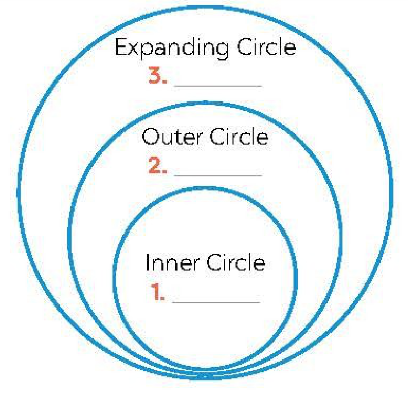

<!-- pdf:91 -->

# UNIT 9: WORLD ENGLISHES

> **THIS UNIT INCLUDES:**
> - **Vocabulary:**
>   - Aspects of languages
>   - English language learning
> - **Pronunciation:**
>   - Stress in words ending in *-ion* and *-ity*
> - **Grammar:**
>   - Defining relative clauses
> - **Skills:**
>   - Reading about the three circles of English
>   - Talking about **borrowed words**
>   - Listening about ways to improve one's English **vocabulary**
>   - Writing a paragraph about ways to improve an area of English learning
> - **Everyday English:**
>   - Saying good luck and responding

## GETTING STARTED

**What do you mean?**

**1. Listen and read.**

**Teacher:** Hi class. I'd like to introduce an **exchange student** who comes from New York. Welcome Jack!

**Students:** Hello, Jack. Nice to meet you.

**Jack:** Nice to meet you all. This is my first time in Viet Nam.
<!-- ocr-ok: đã đối chiếu ảnh trang gốc, OCR đọc nhầm first time in Viet Nam thành Prt Lovie bi rms -->

**Teacher:** Now you can ask Jack any questions you would like to ask.

**Phong:** Do American students wear school uniforms every day, Jack?

**Jack:** No, most American students don't wear school uniforms. Most students at my school wear pants and T-shirts.

**Phong:** What do you **mean** by 'pants', Jack?

**Jack:** Ah, I **mean** trousers. In American English, 'pants' **mean** 'trousers'.

**Phong:** I see.

**Teacher:** Yeah, there are some differences in **vocabulary** between American English and British English. Are there any more questions?

**Mi:** Yes. I want to know about the students in your school. Are all of you American? And do all of you speak English?

**Jack:** Good question. Most of us are American, but some are **immigrants** from other countries like Viet Nam, India, and Mexico. Their **first language** is not English, but they all speak English at school.

**Mi:** That's interesting!

<!-- pdf:92 -->

**2. Read the conversation again. Fill in each blank with no more than TWO words from the conversation.**

1. Jack is an **exchange student** from \_\_\_\_\_\_\_.
2. This is the \_\_\_\_\_\_\_ Jack has visited Viet Nam.
3. Most students at Jack's school wear \_\_\_\_\_\_\_ and T-shirts.
4. American English and British English have \_\_\_\_\_\_\_ in **vocabulary**.
5. Not all students in Jack's school are \_\_\_\_\_\_\_, but they all speak English.

**3. Match the words and phrases with their definitions.**

| | |
| --- | --- |
| 1. **exchange student** | a. all the words in a language |
| 2. **mean** | b. a student who attends a school in a foreign country for a period of time |
| 3. **vocabulary** | c. people who have come to live permanently in a different country |
| 4. **immigrants** | d. the language someone learns to speak from birth |
| 5. **first language** | e. to express or represent something |
<!-- ocr-ok: đã đối chiếu ảnh trang gốc, bảng nối từ vựng và định nghĩa bị OCR đọc trộn dòng -->

**4. Fill in each blank with a word or phrase from 3.**

1. – What does your name \_\_\_\_\_\_\_, Mi?
   – It's the name of a bird.
2. English \_\_\_\_\_\_\_ is increasing because it borrows words from other languages.
3. In Australia, there are a lot of \_\_\_\_\_\_\_ who have come from other countries.
4. His \_\_\_\_\_\_\_ is Vietnamese, but he can speak English and French fluently.
5. This year our school has a(n) \_\_\_\_\_\_\_ from Britain. She will study with us for one month.

**5. QUIZ: Match the words in British English with those in American English so that they mean the same. Who is the quickest?**

| British English | American English |
| --- | --- |
| flat | sweater |
| holiday | apartment |
| jumper | soccer |
| chips | vacation |
| football | French fries |

**Do you know any other pairs of words?**

<!-- pdf:93 -->

## A CLOSER LOOK 1

### Vocabulary

**1. Match a word or phrase in A with its meaning in B.**

| A | B |
| --- | --- |
| 1. **variety** | a. a language which has legal status in a country |
| 2. **bilingual** | b. a different type of something |
| 3. **fluent** | c. (of circles) having the same centre |
| 4. **concentric** | d. able to speak two languages equally well |
| 5. **official language** | e. able to speak, read, or write a language, especially a foreign language, easily and well |

**2. Match a verb in A with a phrase in B to make a meaningful expression.**

| A | B |
| --- | --- |
| 1. **translate** | a. over the grammatical points |
| 2. **copy** | b. up a new language |
| 3. pick | c. up new words in an English-English dictionary |
| 4. look | d. from Vietnamese into English |
| 5. go | e. words into a notebook |

**3. Choose the correct word to complete each sentence.**

1. English is a(n) *official* / *first* language in Singapore besides Malay, Mandarin, and Tamil.
2. Although he was born in Britain, he is *fluent* / *bilingual* in Vietnamese.
3. After you *pick* / *look* up a word in the dictionary, remember to make an example with it.
4. How many books have you *picked* / *translated* from English into Vietnamese?
<!-- ocr-ok: đã đối chiếu ảnh trang gốc, các từ in màu cam câu 1-4 bị OCR đọc khuyết kí tự Malay, fluent, look, translated -->
5. Remember to *go* / *copy* over the words you have learnt in class.

### Pronunciation

*Stress in words ending in -ion and -ity*

**Remember!**

Words ending in *-ion* and *-ity* have stress on the syllable immediately before them.

**4. Listen and repeat the words. Pay attention to the word stress.**

| -ion | -ity |
| --- | --- |
| relation | charity |
| decision | quality |
| position | clarity |
| education | ability |
| operation | obesity |
<!-- ocr-ok: đã đối chiếu ảnh trang gốc, OCR đọc khuyết âm cuối của position, education, operation -->

**5. Listen and repeat the sentences. Mark the stress in the underlined words.**

1. They had a *discussion* about the *quality* of the courses at their language centre.
2. Pay *attention* to her *ability* to express herself in English.
3. I have an *intention* of organising an English class for the *community*.
4. Let's do a *revision* *activity* before the exam.
5. What is the *function* of the word '*identity*' in this sentence?

<!-- pdf:94 -->

## A CLOSER LOOK 2

### Grammar

*Defining relative clauses*

**Remember!**

- A relative clause tells us more about people and things. It usually starts with a relative pronoun.
- Defining relative clauses give us essential information. Without this information, people are not clear which person(s) or thing(s) we are talking about.
<!-- term: Defining relative clauses -->

*Example:*
- The teacher *who taught me my first words in English* is Mr Vinh.
- He gave me the dictionary *which you suggested*.

**1. Choose the correct answer A, B, C, or D to complete each sentence.**

1. English is the language \_\_\_\_\_\_\_ is known as a global language.
   - A. who
   - B. which
   - C. whose
   - D. what
2. People \_\_\_\_\_\_\_ speak English well can find jobs in international companies more easily.
   - A. who
   - B. which
   - C. whose
   - D. why
3. People from countries \_\_\_\_\_\_\_ do not share a common language use English to work together effectively.
   - A. who
   - B. which
   - C. whose
   - D. where
4. The woman \_\_\_\_\_\_\_ son won the English speaking contest felt very proud.
   - A. who
   - B. which
   - C. whose
   - D. when
5. I met a man \_\_\_\_\_\_\_ **first language** is Arabic at the conference.
   - A. who
   - B. which
   - C. what
   - D. whose

**Remember!**

The relative pronoun *who* or *which* can be the subject or the object of the relative clause. We must use it when it is the subject of the relative clause. We can omit it if it is the object.
<!-- term: Defining relative clauses -->

*Example:*
- The man *who* (S) is talking to the girl is **bilingual** in English and French.
  → must use *who*
- The man *who* (O) you met this morning is **bilingual** in English and French.
  → can omit *who*

**2. Underline the relative clause in each sentence. Decide if the relative pronoun is the subject (S) or object (O) of the relative clause and if we can or cannot omit it.**

1. The new **vocabulary** items which we learnt yesterday are difficult to remember.
2. I don't like the grammar exercises which are in this book.
3. The man who **translated** this novel into Vietnamese must be proficient in English.
4. The students who love languages can join our Reading Club.
5. The teacher who we admire can speak three languages.

**3. Are these sentences right or wrong? Correct them if necessary.**
<!-- ocr-ok: đã đối chiếu ảnh trang gốc, OCR đọc dính chữ or wrong thành orwrong -->

1. My sister doesn't like films have unhappy endings.
2. What is the name of the man who is the director of the language centre?
3. One of the four **official languages** people use in Singapore is English.
4. I like the English lesson which Ms Oanh taught yesterday.
5. Students who grades are high can compete in this contest.

<!-- pdf:95 -->

**4. Combine the two sentences into one, using a relative pronoun.**

1. I met a woman. Her husband is a famous linguist.
2. My friend's father gave us the tickets. He owns a travel agency.
3. The grammar exercise was very complicated. Nobody could do it.
4. I study English in a language school. It is in the centre of the city.
5. The student completed the quiz the fastest. The teacher praised him.

**5. GAME: Clues for you**
<!-- ocr-ok: đã đối chiếu ảnh trang gốc, chữ GAME in màu và OCR đọc dính for you -->

**Work in two teams. A student from each team gives clues about an object or a person in class, using a relative clause. Students from the other team guess which object or person it is.**

*Example:*
- **A:** This is something which we write with.
- **B:** Is it a pen?
- **A:** Yes, it is.
<!-- ocr-ok: đã đối chiếu ảnh trang gốc, lời thoại ví dụ nằm trong các bóng thoại minh hoạ -->

## COMMUNICATION

### Everyday English

*Saying good luck and responding*

**1. Listen and read the conversations. Pay attention to the highlighted parts.**

1. **Tom:** *Good luck with* your English exam.
   **Mi:** *Thanks. I'll try my best.*
<!-- term: Saying good luck and responding -->

2. **Phong:** I've heard that you're moving to the US. *I wish you all the best of luck.*
   **Neighbour:** *Thank you so much.*
<!-- term: Saying good luck and responding -->

**2. Work in pairs. Practise saying good luck and responding in the following situations.**

1. Your friend is giving a presentation in English this week.
2. Your cousin is taking the university entrance exam next week.
3. Your English teacher is going to the UK for further study.

**Interesting facts about English**

**3. Work in pairs. Read the interesting facts below about English. Order them from the most interesting to the least interesting.**

1. The most common letter in English is 'e'.
2. Only two English words in current use end in '-gry'. They are 'angry' and 'hungry'.
3. The word 'uncopyrightable' is the longest English word in normal use which contains no letter more than once.
4. The longest English word without a true vowel (*a*, *e*, *i*, *o*, or *u*) is 'rhythms'.
5. 'Queueing' and 'cooeeing' are the two words with five consecutive vowels (five vowels in a row).

<!-- pdf:96 -->

**4. QUIZ: Work in groups. Work out the answers to the questions in the quiz.**

1. Which of these languages has the highest number of native speakers?
   - A. English.
   - B. Chinese.
   - C. Spanish.
<!-- term: native speaker -->
2. Which language do people use the most at international events?
   - A. English.
   - B. Chinese.
   - C. Spanish.
3. Americans call it "truck". What do the British call it?
   - A. Car.
   - B. Bus.
   - C. Lorry.
4. The British call it "chemist's". What do Americans call it?
   - A. Shop.
   - B. Drugstore.
   - C. Store.
5. Which is the longest word in English which has only one vowel?
   - A. Length.
   - B. Strengths.
   - C. Depth.

**5. Share your group's answers with the class. Which group has the most correct answers?**

## SKILLS 1

### Reading

**1. Look at the diagram. Put the names of the countries where English is spoken in the correct circle.**

| Viet Nam | Singapore | Russia |
| --- | --- | --- |
| New Zealand | Malaysia | |

- **Expanding Circle:** 3. \_\_\_\_\_\_\_
- **Outer Circle:** 2. \_\_\_\_\_\_\_
- **Inner Circle:** 1. \_\_\_\_\_\_\_
<!-- ocr-ok: đã đối chiếu ảnh trang gốc, ba nhãn vòng tròn đồng tâm kèm chỗ trống 1-3 trong sơ đồ -->

**Now read the text quickly to check your answers.**

**2. Read the text and choose the correct answer A, B, C, or D.**

Braj Kachru was a Professor of Linguistics who invented the term 'World Englishes'. The term refers to the fact that English has become a global means of communication with a lot of **varieties**.

In 1985, Kachru **proposed** a **model** of the different uses of English around the world. There are three **concentric** circles in the **model**.

The first of these circles is the **Inner Circle**, which **consists** of the traditional English-speaking countries, such as the UK, the USA, Australia, New Zealand, and Canada. In these regions, English is the **first language**, and their speakers provide the **standards** of English.

The next circle is the **Outer Circle** where English is not the **first language** but the second or **official language**. The countries in this circle include India, Singapore, the Philippines, Pakistan, Malaysia, etc. The speakers of these places follow the **standards** which the countries in the Inner circle provide.

The last circle is the **Expanding Circle**. People in *this circle* speak English as a foreign language. Some of the countries in the **Expanding Circle** are Brazil, Japan, Russia, and Viet Nam. Speakers of English in these places follow the rules which the people in the **Inner Circle** have **established**.
<!-- term: foreign language -->

<!-- pdf:97 -->

1. What is the text mainly about?
   - A. Professor Braj Kachru.
   - B. The three circles of World Englishes.
   - C. Native speakers of English.
   - D. The development of English.
2. The word "**model**" in paragraph 2 means \_\_\_\_\_\_\_.
   - A. an excellent person
   - B. an example to copy
   - C. a small copy of something
   - D. a description of a system
3. The phrase "*this circle*" in paragraph 5 refers to the \_\_\_\_\_\_\_.
   - A. **model**
   - B. **Inner Circle**
   - C. **Outer Circle**
   - D. **Expanding Circle**

**3. Read the text again and fill in each blank in the summary with no more than TWO words.**

**Kachru's Model**

| | |
| --- | --- |
| **Inner Circle** | - English is the (1) \_\_\_\_\_\_\_. - Countries: the UK, the USA, Australia, etc. - Speakers provide the **standards**. |
| **Outer Circle** | - English is the second or (2) \_\_\_\_\_\_\_ language. - Countries: India, Singapore, the Philippines, etc. - Speakers (3) \_\_\_\_\_\_\_ the **standards**. |
| **Expanding Circle** | - English is a (4) \_\_\_\_\_\_\_. - Countries: Brazil, Russia, Viet Nam, etc. - Speakers follow the (5) \_\_\_\_\_\_\_ **established**. |

### Speaking

**4. Work in pairs. Read the following words. What do all the words have in common?**

*banh mi, sushi, robot, piano, kung fu*

**5. Work in groups. Discuss and write the meaning / explanation of each word and choose the language of origin for each word from the given list. Then present your answers to the class.**

Chinese – Japanese – Vietnamese – Italian – Czech

| Words | Meaning / Explanation | Language of origin |
| --- | --- | --- |
| banh mi | A type of Vietnamese sandwich filled with cold meats, pâté, and vegetables | Vietnamese |
| sushi | | |
| kung fu | | |
| robot | | |
| piano | | |

<!-- pdf:98 -->

## SKILLS 2

### Listening

**1. Work in pairs. Look at the pictures and answer the questions.**

1. What is the person in each picture doing?
2. How can these activities help them learn English?

**2. Listen to Trang talking. Decide if the statements are true (T) or false (F).**

| | T | F |
| --- | --- | --- |
| 1. Trang has studied English for seven years. | | |
| 2. She talks about how she has learnt English **vocabulary** and grammar. | | |
| 3. She has learnt new words from reading English books. | | |
| 4. She is confident about her English **vocabulary** now. | | |

**3. Listen again and fill in each blank with no more than TWO words.**

**Tips to improve English vocabulary learning**
<!-- ocr-ok: đã đối chiếu ảnh trang gốc, tiêu đề nằm trong hình tròn trung tâm của sơ đồ -->

- **Reading English books:** Guessing the (1) \_\_\_\_\_\_\_
- **Using a good dictionary:** Checking the meaning and (2) \_\_\_\_\_\_\_
- **Using a vocabulary notebook:** (3) \_\_\_\_\_\_\_ all new words into a notebook
- **(4) \_\_\_\_\_\_\_ in English:** Trying to use the words learnt and (5) \_\_\_\_\_\_\_ more new words
<!-- ocr-ok: đã đối chiếu ảnh trang gốc, sơ đồ tư duy 4 nhánh Tips to improve English vocabulary learning bị OCR đọc rời rạc -->

### Writing

**4. Work in pairs. Discuss the questions below.**

1. What is the thing you find most challenging when learning English?
2. What have you done to improve it?

**5. Write a paragraph (100 – 120 words) about the most challenging thing you face when learning English and what you have done to improve it.**

**You can start your paragraph as follows:**

> *When learning English, I find \_\_\_\_\_\_\_ the most challenging, and I have done several things to improve it. Firstly, \_\_\_\_\_\_\_*

<!-- pdf:99 -->

## LOOKING BACK

### Vocabulary

**1. Fill in each blank with a word from the box.**

| **bilingual** | **mean** | **immigrants** |
| --- | --- | --- |
| **concentric** | **fluent** | |

1. What does this word \_\_\_\_\_\_\_ in English?
2. The Kachru's **model** has three \_\_\_\_\_\_\_ circles.
3. The little boy talks to his mum in Vietnamese and to his dad in English. He's \_\_\_\_\_\_\_.
4. Many children in this area are \_\_\_\_\_\_\_ English speakers, but they can't write in English.
5. The number of \_\_\_\_\_\_\_ in this country has increased quickly for the last three years.

**2. Choose the correct answer A, B, C, or D to complete each sentence.**

1. My students usually go \_\_\_\_\_\_\_ their homework before they hand it in.
   - A. into
   - B. over
   - C. in
   - D. up
2. Do you know how many \_\_\_\_\_\_\_ of English are there?
   - A. grammars
   - B. **vocabulary**
   - C. **varieties**
   - D. **official languages**
3. For homework, please **copy** these English sentences \_\_\_\_\_\_\_ your notebook.
   - A. into
   - B. over
   - C. on
   - D. up
4. She's good at \_\_\_\_\_\_\_ English short stories into Vietnamese.
   - A. **translating**
   - B. picking
   - C. looking
   - D. copying
5. After living in Singapore for several years, she has \_\_\_\_\_\_\_ up some Singaporean English.
   - A. copied
   - B. gone
   - C. looked
   - D. picked

### Grammar

**3. Read each sentence and circle the relative pronoun which can be omitted.**

1. These are the words which are the same in both British English and American English.
2. English is the language which people use the most in the world.
3. The boy who is giving a presentation in English on the stage is my student.
4. Spanish is the language which has the second largest number of native speakers.
5. The **exchange student** who we invited to join our club comes from the Philippines, so his English is so good.

**4. Combine the two sentences, using a relative pronoun. Start the new sentence with the given phrase.**

1. The English-English dictionary is on the table. My dad gave it to me last year.
   → The English-English dictionary \_\_\_\_\_\_\_.
2. She used some words in her speech. These words are from French.
   → She used some \_\_\_\_\_\_\_.
3. He has learnt English on a website. I recommended the website to him two years ago.
   → He has learnt \_\_\_\_\_\_\_.
4. Some languages have a lot of speakers. English is one of them.
   → English is one of \_\_\_\_\_\_\_.
5. My sister is learning English at a language centre. It has the best teachers in our town.
   → My sister is learning \_\_\_\_\_\_\_.

<!-- pdf:100 -->

## PROJECT

**ENGLISH AROUND THE WORLD**
<!-- ocr-ok: đã đối chiếu ảnh trang gốc, tiêu đề chữ in hoa màu cam trong phần Project -->

**Work in groups.**

1. **Choose a country where people use English as a second or an official language.**
2. **Collect information about:**
   - its number of English speakers
   - any other languages its people speak
   - the roles of English in the country
3. **Make a poster about this country.**
4. **Present your group's poster to the class.**

### Now I can ...

- use the words related to the topic *World Englishes*.
- pronounce the words ending in *-ion* and *-ity* with correct stress.
- use defining relative clauses.
- say good luck and respond.
- read about the three circles of English.
- talk about **borrowed words**.
- listen about ways to improve one's English **vocabulary**.
- write a paragraph about ways to improve an area of English learning.

## 📷 Danh sách hình trong bài

| Mã hình | Trang PDF | Trang sách | Chú thích / Mô tả |
| --- | --- | --- | --- |
| H9-tieng_anh-u09-01 | 96 | 97 | Sơ đồ ba vòng tròn đồng tâm của tiếng Anh trên thế giới (Inner Circle, Outer Circle, Expanding Circle) thuộc bài tập 1 phần Skills 1 – Reading |
| H9-tieng_anh-u09-02 | 98 | 99 | Hai bức ảnh a–b thuộc bài tập 1 phần Skills 2 – Listening: (a) bạn nữ đọc sách / tra từ điển trên bàn học, (b) bạn nữ ghi chép từ vựng vào sổ tay |
