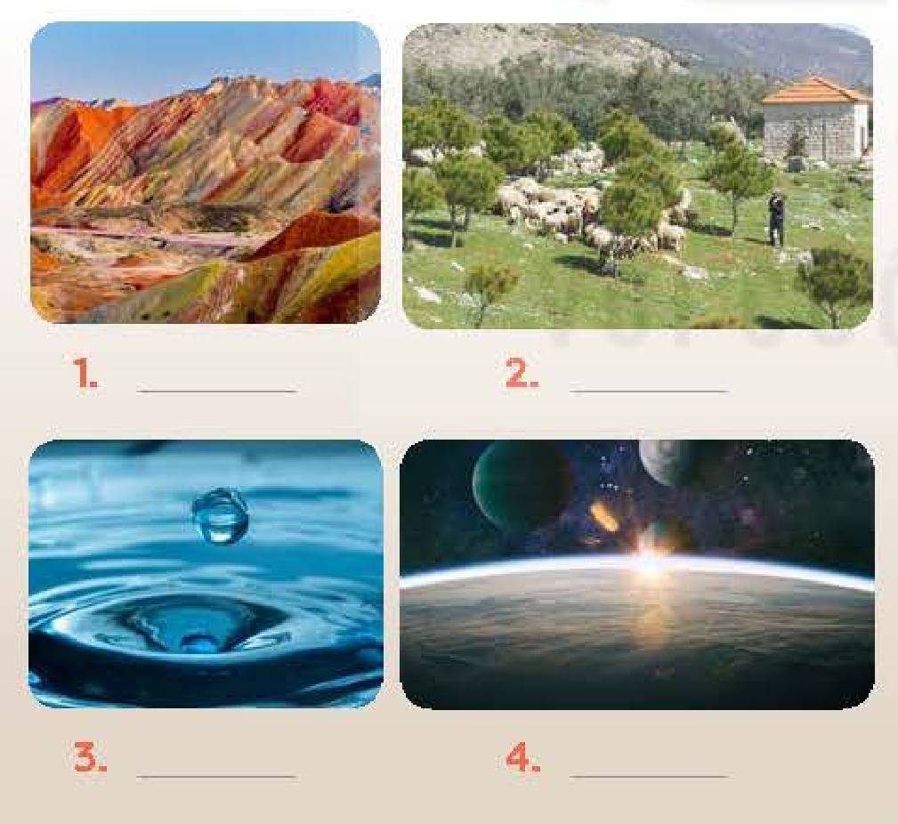
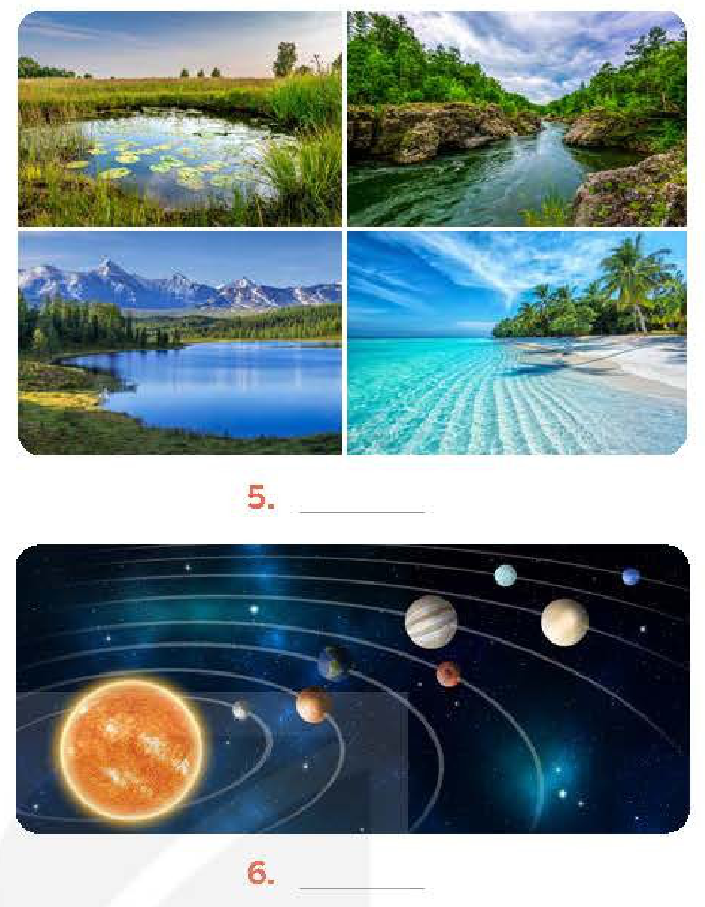
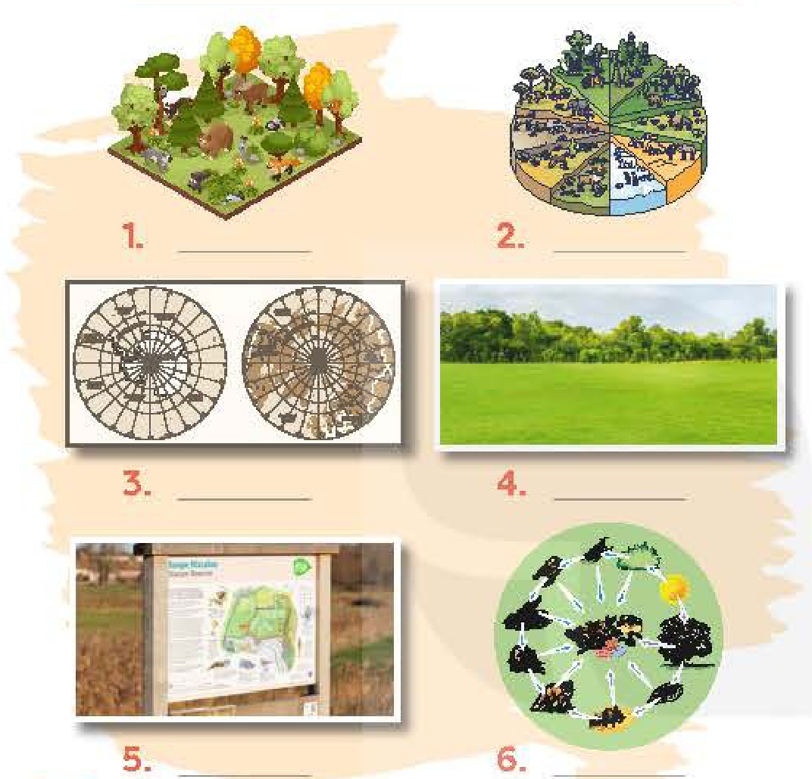
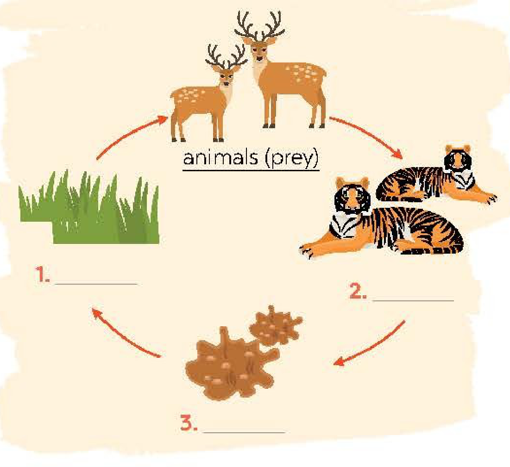
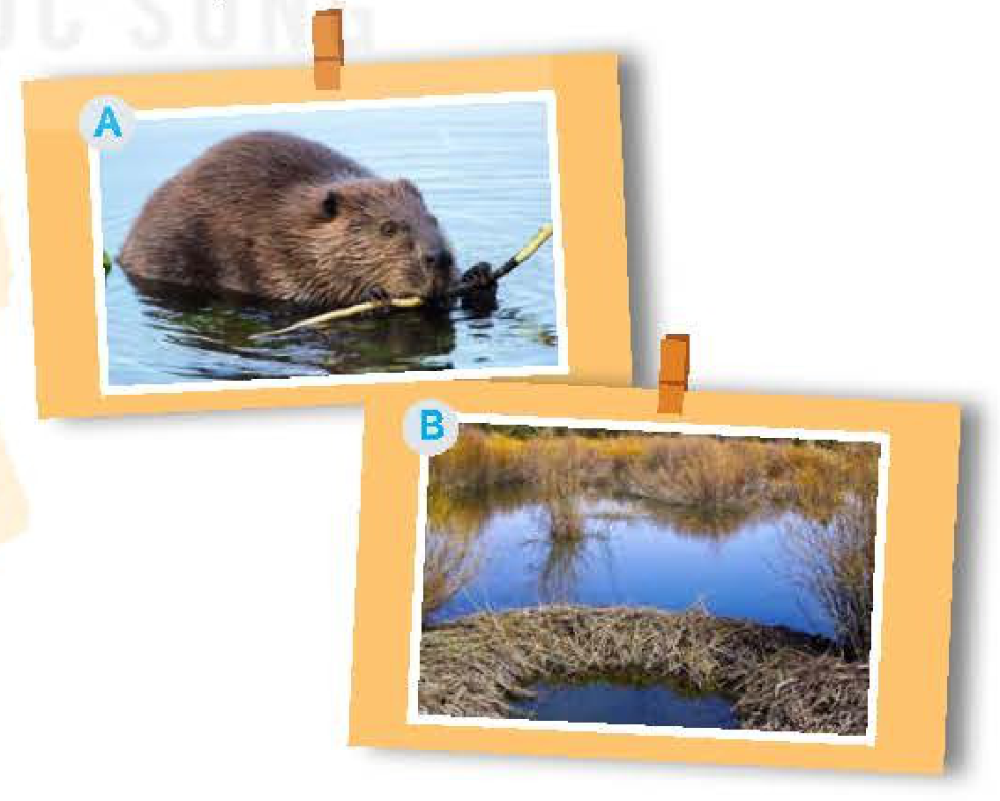
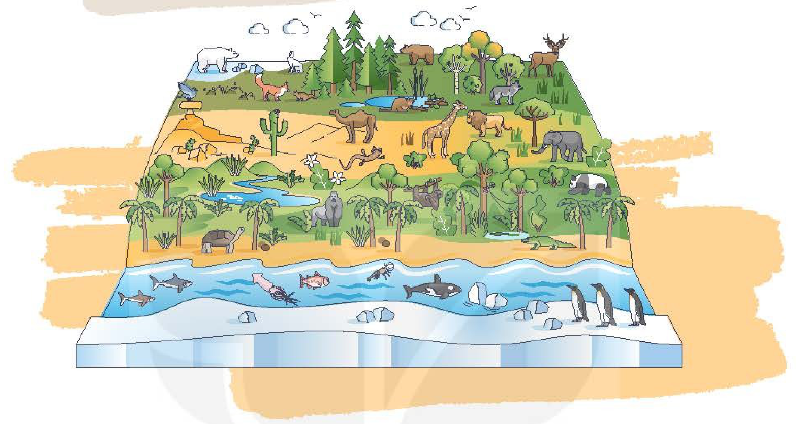

<!-- pdf:103 -->

# UNIT 10: PLANET EARTH

> **THIS UNIT INCLUDES:**
> - **Vocabulary:**
>   - Planet Earth
>   - **Habitats**
>   - Flora and fauna
> - **Pronunciation:**
>   - Rhythm in sentences
> - **Grammar:**
>   - Non-defining relative clauses
> - **Skills:**
>   - Reading about flora and fauna
>   - Talking about **threats** to flora and fauna and how to protect them
>   - Listening about the effects of living things on the environment
>   - Writing a summary
> - **Everyday English:**
>   - Persuading someone to do something and responding

## GETTING STARTED

**In a science club**

**1. Listen and read.**

**President:** Hi, welcome to our science club. Our topic today is planet Earth. Our guest is Mr An, an earth scientist.

**Mr An:** Hi everybody. Pleased to meet you. I'm looking forward to answering your questions about our planet.

**Lan:** Mr An, where's Earth in the Solar System?
<!-- term: Solar System -->

**Mr An:** There are eight planets in the Solar System, and Earth is the third from the Sun, after Mercury and Venus. It's also the fifth largest in our system.
<!-- term: Solar System -->

**Nick:** Is it also called the Blue Planet?

**Mr An:** Right. From the **outer space** it looks blue because water covers more than 70 per cent of it.

**Lan:** Is it the only planet that has liquid water?

**Mr An:** Exactly. Without it, there wouldn't be living things, like humans, or the flora and fauna of your **habitat**.

**Nick:** How about the role of air, light, and heat? How do they **affect** Earth?

**Mr An:** Well, water bodies and **landforms**, which are main areas on Earth, together with air, light, and heat, provide **essential** **habitats** for plants and animals.
<!-- term: water bodies -->

**Nick:** It's **fascinating** to **observe** and study these **habitats**.

**Mr An:** Yes. However, they are being destroyed by pollution. We should all help out to **preserve** them. ...

<!-- pdf:104 -->

**2. Read the conversation again and tick (✓) T (True) or F (False) for each sentence.**

| | T | F |
| --- | --- | --- |
| 1. The students are asking about the Solar System. | | |
| 2. Another name for Earth is the Blue Planet. | | |
| 3. Water covers four fifths of Earth. | | |
| 4. Water bodies and **landforms** are **essential** **habitats** for plants and animals. | | |
| 5. Mr An thinks pollution is threatening the **habitats** of plants and animals. | | |

**3. Write a word or phrase from the box under the correct picture.**

| liquid water | **landforms** |
| --- | --- |
| flora and fauna | water bodies |
| Solar System | **outer space** |

1. \_\_\_\_\_\_\_
2. \_\_\_\_\_\_\_
3. \_\_\_\_\_\_\_
4. \_\_\_\_\_\_\_

5. \_\_\_\_\_\_\_
6. \_\_\_\_\_\_\_
<!-- ocr-ok: đã đối chiếu ảnh trang gốc, 6 bức ảnh chia làm 2 cụm trái (1-4) và phải (5-6) -->

**4. Complete each sentence with a word or phrase from 3.**

1. \_\_\_\_\_\_\_ refer to the plants and animals of a particular place.
<!-- term: flora and fauna -->
2. Oceans, seas, rivers, and lakes are different types of \_\_\_\_\_\_\_ on Earth.
<!-- term: water bodies -->
3. There are eight planets in the \_\_\_\_\_\_\_.
<!-- term: Solar System -->
4. The Soviet Union launched Sputnik 1 into \_\_\_\_\_\_\_ in 1957.
5. Some examples of \_\_\_\_\_\_\_ include mountains, **grassland**, and deserts.

**5. QUIZ: Work in groups. Answer the following questions.**

1. How many continents are there on Earth?
2. How many oceans are there on Earth?
3. How many moons **orbit** Earth?
4. Which gas is **essential** for life on Earth?
5. Which planet has conditions similar to those on Earth?

<!-- pdf:105 -->

## A CLOSER LOOK 1

### Vocabulary

**1. Write a word or phrase from the box under each picture.**

| **habitats** | flora and fauna |
| --- | --- |
| **grassland** | **nature reserves** |
| **food chain** | **poles** |

1. \_\_\_\_\_\_\_
2. \_\_\_\_\_\_\_
3. \_\_\_\_\_\_\_
4. \_\_\_\_\_\_\_
5. \_\_\_\_\_\_\_
6. \_\_\_\_\_\_\_
<!-- ocr-ok: đã đối chiếu ảnh trang gốc, 6 chỗ trống đánh số 1-6 nằm dưới từng tranh minh hoạ -->

**2. Complete each sentence with a word or phrase from 1.**

1. In a \_\_\_\_\_\_\_, some animals eat other animals and become food for a third group of animals.
2. A \_\_\_\_\_\_\_ is often wide and its plants are mostly grass and flowers.
3. Areas of land to protect animals and plants are called \_\_\_\_\_\_\_.
4. The North and South \_\_\_\_\_\_\_ are both extremely cold and icy.
5. Natural \_\_\_\_\_\_\_ for pandas are bamboo forests.

**3. Choose the correct answer A, B, C, or D.**
<!-- ocr-ok: đã đối chiếu ảnh trang gốc, OCR đọc dính chữ answerA và C,orD -->

1. When humans use a natural **habitat** for farming and housing, they cause \_\_\_\_\_\_\_.
   - A. **climate change**
   - B. global warming
   - C. habitat loss
   - D. **ecological balance**
<!-- term: habitat loss -->
2. When Earth's average temperature increases, we face \_\_\_\_\_\_\_.
   - A. **ecological balance**
   - B. global warming
   - C. pollution
   - D. protection
<!-- term: global warming -->
3. Each of us can lend a hand to \_\_\_\_\_\_\_ the natural environment.
   - A. hunt
   - B. change
   - C. **preserve**
   - D. pollute
4. We can keep a(n) \_\_\_\_\_\_\_ by stopping hunting and cutting down trees.
   - A. **ecological balance**
   - B. habitat loss
   - C. **climate change**
   - D. **nature reserve**
5. One way to \_\_\_\_\_\_\_ Mother Earth is by planting more trees.
   - A. keep
   - B. **harm**
   - C. provide
   - D. protect

### Pronunciation

*Rhythm in sentences*

**Remember!**

When we speak English, we place stress on certain syllables in a sentence. The combination of stressed and unstressed syllables produces rhythm in spoken English.

**4. Listen to the sentences and pay attention to the bold syllables. Does the speaker place stress on them?**

1. *Earth* is the *third* pla*net* from the *Sun*.
2. *O*ceans, *seas*, *ri*vers, and *lakes* are *wa*ter *bo*dies.
3. The *North* and *South* **poles** are ex*treme*ly *cold* and *i*cy.
4. Do *moon*quakes *last* up to *half* an *hour*?
5. Pre*ser*ving *na*tural re*sour*ces is *ve*ry im*por*tant.
<!-- ocr-ok: đã đối chiếu ảnh trang gốc, đánh dấu nghiêng từng âm tiết in đậm trong câu bài tập 4 -->

**5. Circle the stressed syllables in the sentences. Listen, check, and repeat.**

1. We're doing a study on **climate change**.
2. What is the distance from Earth to Mars?
3. They'll have a discussion on natural **habitats**.
4. Plants provide us with food, oxygen, and energy.
5. Our school organised various activities on Earth Day.

<!-- pdf:106 -->

## A CLOSER LOOK 2

### Grammar

*Non-defining relative clauses*

**Remember!**

- We use non-defining relative clauses to add extra information.
  *Example:* Earth, *which is the third planet from the Sun*, depends much on the Sun for its energy.
- If we remove the non-defining relative clause, the sentence still makes sense.
  *Example:* Earth depends much on the Sun for its energy.
- We use comma(s) with non-defining relative clauses.
- Relative pronouns cannot be omitted in non-defining relative clauses.
<!-- term: Non-defining relative clauses -->

**1. Complete the sentences with correct relative pronouns.**

1. Planet Earth, \_\_\_\_\_\_\_ is also called the Blue Planet, is covered with water and land.
2. Peter Molnar, \_\_\_\_\_\_\_ has done many studies on **climate change**, is one of the best-known Earth scientists.
3. Neil Armstrong, \_\_\_\_\_\_\_ trip to the moon marked a giant leap for mankind, was the first to walk on the moon.
4. Suoi Thau, \_\_\_\_\_\_\_ is in Ha Giang, is one of the most gorgeous **grasslands** in Viet Nam.
5. People often do green things to protect Earth on the Earth Day, \_\_\_\_\_\_\_ is celebrated on 22nd April.

**2. Underline the relative clauses. Tick (✓) if the relative clause can be omitted.**

1. \_\_\_\_\_\_\_ The second planet from the Sun is Venus, which is sometimes called the Earth's sister.
2. \_\_\_\_\_\_\_ The ocean, which is the body of salt water, contains 97% of Earth's water.
3. \_\_\_\_\_\_\_ **Landforms** make up the areas which include mountains, hills, plains, and plateaus.
4. \_\_\_\_\_\_\_ One of the world's most famous Earth scientists is James Hutton, who is a British geologist.
5. \_\_\_\_\_\_\_ Arctic Ocean ice and water make up a **habitat** for polar bears, whose main food is seals.

**3. Complete each sentence (1 – 5) with a non-defining relative clause (A – E).**

- A. which is a Germanic word
- B. which is also called the Red Planet
- C. whose radius is nearly 4 million miles
- D. who explained **ecological balance** to us
- E. which has a large collection of animals, birds and reptiles, and unique plants

1. Mars, \_\_\_\_\_\_\_, is very much similar to Earth.
2. Earth, \_\_\_\_\_\_\_, is the fifth largest planet in our solar system.
3. The name of our planet, \_\_\_\_\_\_\_, simply means "the ground".
4. Cat Ba National Park, \_\_\_\_\_\_\_, is one of the most famous tropical rainforests in Viet Nam.
5. We were interested in the talk by Mr An, \_\_\_\_\_\_\_.

**4. Combine the two sentences into one, using a non-defining relative clause.**

1. The Moon is Earth's only natural satellite. Its surface is dark.

<!-- pdf:107 -->

2. Moonquakes are much weaker than Earthquakes. Moonquakes can last up to half an hour.
3. Mars has mountains and canyons on its surface. It is a rocky planet like Earth.
4. Venus is considered the twin sister of Earth. Venus has a similar size and structure as Earth.
5. We should protect rivers and lakes. Rivers and lakes provide humans with their main sources of fresh water.

**5. Work in two groups. Take turns to say aloud one of the places in the table. The other group explains or gives more information about it. The team that has the most correct sentences wins.**

| Place | Feature | Feature |
| --- | --- | --- |
| The Nile | longest river | flows into the Mediterranean Sea |
| Pacific Ocean | covers 30% of planet surface | largest ocean |
| Viet Nam | has the shape of letter S | has a long coastline |
| The Sahara | largest desert | has almost no rainfall |
| Mount Fansipan | highest peak in Viet Nam | also called the 'Roof of Indochina' |
<!-- ocr-ok: đã đối chiếu ảnh trang gốc, bảng 3 cột Place - Feature - Feature bị OCR đọc trộn dòng -->

*Example:*
- **Group A:** The Nile
- **Group B:** The Nile, which is the longest river, flows into the Mediterranean Sea.

## COMMUNICATION

### Everyday English

*Persuading someone to do something and responding*
<!-- ocr-ok: đã đối chiếu ảnh trang gốc, OCR đọc dính chữ to do thành todo -->

**1. Listen and read the conversations. Pay attention to the highlighted parts.**

1. **Mi:** Have you read this book about the Solar System?
   **Tom:** Not yet. I don't feel like reading it.
   **Mi:** *Why don't you give it a go?* You will like it.
   **Tom:** *OK, I'll think about that.*
<!-- term: Persuading someone to do something and responding -->

2. **Lan:** *How would you feel about* contributing to the fund to protect our wildlife?
   **Local resident:** Contribute to a fund?
   **Lan:** *Yes, your contribution would really help us out.*
   **Local resident:** *Alright. I'll make a contribution.*
<!-- term: Persuading someone to do something and responding -->

**2. Work in pairs. Make similar conversations with the following situations.**

1. You persuade your friend to watch a movie about planet Earth.
2. You persuade local people to contribute to a fund to build a **nature reserve**.

**Earth's habitats**

**3. Read the short descriptions of various habitats and match them with their features.**

- *Polar habitats* include the North **Pole** and the South **Pole**. These **habitats** are covered in ice and extremely cold and dry. Animals here include small fish, polar bears, penguins, leopard seals, etc.

<!-- pdf:108 -->

- *Forest habitats* include tropical forests, temperate forests, and boreal forests. They are considered the Earth's lungs because they produce oxygen. They also provide homes to bats, owls, deer, squirrels, foxes, lizards, etc.
- *Ocean habitats* include the Pacific, Atlantic, Indian, Southern, and Arctic Oceans. They produce more than 50 per cent of Earth's oxygen and help adjust the climate. They provide living places for plants like sea grasses, microscopic algae, and fish, etc.
- *Grasslands* include tropical and temperate ones. The main plants are grasses. They are crucial for grazing livestock. **Grassland** animals include giraffes, zebras, lions, elephants, etc.

| | |
| --- | --- |
| 1. Polar regions | a. two main types and are crucial for livestock grazing |
| 2. Forests | b. largest, produce oxygen and adjust the climate |
| 3. Oceans | c. extremely cold, dry, covered in snow and ice |
| 4. **Grasslands** | d. the lungs of Earth, home to many species |

**4. Work in pairs. Choose two habitats and compare them.**

**You can refer to the following:**

- their specific types / examples
- their importance
- plants / animals living there
- other special features

**5. Report the results of your comparison to the class.**

*Example:*

While oceans are water bodies, forests are **landform** **habitats**. Both oceans and forests provide oxygen to Earth.

## SKILLS 1

### Reading

**1. Tick (✓) the things that show the roles of plants and animals.**

1. [ ] providing sources of food
2. [ ] causing habitat loss
3. [ ] keeping the **ecological balance**
4. [ ] making Earth beautiful
<!-- ocr-ok: đã đối chiếu ảnh trang gốc, OCR bỏ sót số thứ tự 1-4 trước các dòng đánh dấu -->

**2. Read the passage and choose the correct answer A, B, C, or D.**

Plants and animals are an **essential** part of Earth's ecology. When we speak about a specific **habitat** and time, we refer to them as flora and fauna. Flora refers to plants and fauna refers to animals. They are **fascinating** to study due to their beauty and significance to human life.
<!-- term: flora and fauna -->

First, the flora and fauna on Earth create an **ecological balance**, making life possible for humans. Flora releases oxygen for humans. The carbon dioxide we breathe out is **vital** to plants. Humans also rely on the plants and animals for food, medicine, and water.

Second, plants and animals combine to create a **food chain**. In the **food chain**, the animals play an important part. They feed on plants and, in turn, are the prey of other animals. Their **droppings** become **fertilizers** for plants.

Finally, plants and animals add a lot of beauty to our earth. People love and **appreciate** the natural beauty, the relaxed feeling in green spaces and water areas.

However, plants and animals are facing habitat loss, pollution, and **climate change**. To protect them, we should raise people's awareness of their significance, stop hunting, plant more trees, and build **nature reserves** for our wildlife.

<!-- pdf:109 -->

1. What is the passage mainly about?
   - A. The beauty of plants and animals.
   - B. How plants and animals protect the environment.
   - C. The wonder of plants and animals.
   - D. The natural **food chain**.
2. The author mentions \_\_\_\_\_\_\_ significant roles plants and animals play.
   - A. two
   - B. three
   - C. four
   - D. five
3. Which of the following do plants provide humans?
   - A. Oxygen.
   - B. Aquatic environment.
   - C. Carbon dioxide.
   - D. Habitat loss.
4. Which action does NOT **preserve** plants and animals?
   - A. Planting more trees.
   - B. Raising awareness.
   - C. Building **nature reserves**.
   - D. Hunting animals.
5. The word "**appreciate**" means \_\_\_\_\_\_\_.
   - A. protect the qualities of
   - B. recognise the wonder of
   - C. learn more about
   - D. be aware of

**3. Read the passage again and fill in the diagram.**

- animals (prey)
- 1. \_\_\_\_\_\_\_
- 2. \_\_\_\_\_\_\_
- 3. \_\_\_\_\_\_\_
<!-- ocr-ok: đã đối chiếu ảnh trang gốc, các nhãn 1-3 và animals (prey) nằm trên sơ đồ vòng tuần hoàn chuỗi thức ăn -->

### Speaking

**4. Work in pairs. Discuss the threats to plants and animals and how we can protect them. You can use the ideas from the reading or your own ideas.**

| Threats | Actions |
| --- | --- |
| – habitat loss ... | – building **nature reserves** ... |
<!-- ocr-ok: đã đối chiếu ảnh trang gốc, bảng 2 cột Threats và Actions bài tập 4 -->

**5. Report the results of your discussion to the class.**
<!-- ocr-ok: đã đối chiếu ảnh trang gốc, OCR đọc dính chữ of your thành ofyour -->

*Example:*

There are many **threats** to plants and animals. First, they face habitat loss. ...

We can do several things to **preserve** their **habitat**. We should ...

## SKILLS 2

### Listening

**1. Look at the pictures and answer the questions below.**

1. Which animal do you see in picture A?
2. What is it doing in picture A?
3. What do you see in picture B?

<!-- pdf:110 -->

**2. Listen to a conversation and choose the correct answer A, B, or C.**

1. Mr An is talking about \_\_\_\_\_\_\_.
   - A. effects of the **habitats** on plants and animals
   - B. the effects of habitat loss
   - C. effects of plants and animals on the **habitats**
2. What did Mr An suggest humans should do?
   - A. Bring plants and animals from one place to another.
   - B. **Preserve** **habitats**.
   - C. Use **pesticides**.

**3. Listen again and fill in each blank in the summary with ONE word.**

| | |
| --- | --- |
| **Effects from plants** | – They help or (1) \_\_\_\_\_\_\_ the environment. – They make a place more beautiful. – They (2) \_\_\_\_\_\_\_ over the resources of local plants. |
| **Effects from animals** | – They can cause harm to or (3) \_\_\_\_\_\_\_ a **habitat**. – Beavers can build dams and ponds, which helps some plants and animals. – Beavers may (4) \_\_\_\_\_\_\_ the homes of other plants and animals. |
| **We should** | – (5) \_\_\_\_\_\_\_ **habitats**. – stop destroying forest **habitats**. – stop using (6) \_\_\_\_\_\_\_. |

### Writing

**4. Work in pairs. Ask and answer the questions below.**

1. What is the main topic of Mr An's talk?
2. How do plants **affect** their **habitat**?
3. How do animals **affect** their **habitat**?
4. What should humans do?

**5. Write a summary (100 – 120 words) of the main points of the conversation. Use the information in 3 and answers in 4.**

**You can start the summary as follows:**

> *Mr An talked about the effects of plants and animals on their **habitat** and the things people should do. Firstly, plants help \_\_\_\_\_\_\_*

<!-- pdf:111 -->

## LOOKING BACK

### Vocabulary

**1. Fill in the table with words and phrases about habitats.**

| Types of habitats | Things in a habitat |
| --- | --- |
| **poles** | flora and fauna |
| | |

**2. Complete the passage, using the words and phrases in the box.**

| **nature reserves** | habitat loss |
| --- | --- |
| **ecological balance** | **food chain** |
| **climate change** | |
<!-- ocr-ok: đã đối chiếu ảnh trang gốc, khung từ vựng 2 cột bài tập 2 phần Looking Back -->

Earth's **habitats** are various and many are threatened. Each **habitat** includes living things, non-living things, and the surrounding environment. The relations of all living things and their environment in a **habitat** make up the **habitat**'s ecology. (1) \_\_\_\_\_\_\_ or changes in population of plants and animals can cause changes to the natural (2) \_\_\_\_\_\_\_ and the ecology. That means to maintain a(n) (3) \_\_\_\_\_\_\_, we shouldn't cause changes to the climate and the plants and animals of any **habitat**. In many countries, people have built (4) \_\_\_\_\_\_\_ to keep endangered plants and animals safe. People should also avoid activities that may cause pollution and (5) \_\_\_\_\_\_\_.

### Grammar

**3. Complete each sentence (1 – 5) with a non-defining relative clause (A – E).**

- A. who is considered the God of Thunder
- B. which are large and extremely dry areas
- C. whose work in geology is considered very important
- D. which is the oldest national park in Viet Nam
- E. which attract many tourists worldwide

1. The Alps are a well-known mountain range, \_\_\_\_\_\_\_.
2. Deserts on Earth, \_\_\_\_\_\_\_, hardly get any rain.
3. People used to believe that Thor, \_\_\_\_\_\_\_, causes storms and lightning.
4. We spent time trekking, bird-watching, and kayaking in Cuc Phuong, \_\_\_\_\_\_\_.
5. James Hutton, \_\_\_\_\_\_\_, was one of the first scientists to study geology.

**4. Combine the two sentences into one, using a non-defining relative clause.**

1. Boreal forests cover vast areas in Canada, Alaska, and Russia. They are also called Taiga.
2. Polar bears are endangered animals. Their natural **habitat** is the Arctic.
3. Julie Arblaster focuses on studying **climate change**. She is an Australian scientist.
4. Antarctica is Earth's least populated continent. It is surrounded by the Southern Ocean.
5. The natural world is the world of living things. Living things include plants and animals.

<!-- pdf:112 -->

## PROJECT

**Our flora and fauna**

**Work in groups.**

1. **Choose an area you know / like.**
2. **Collect pictures of some flora and / or fauna in that area.**
3. **Create a poster.**
4. **Introduce the area's flora and fauna to the class.**

### Now I can ...

- use the words and phrases related to planet Earth, **habitats**, and flora and fauna.
- say sentences with correct rhythm.
- use non-defining relative clauses.
- persuade someone to do something and respond.
- read about flora and fauna.
- talk about **threats** to flora and fauna and how to protect them.
- listen about the effects of living things on the environment.
- write a summary.

## 📷 Danh sách hình trong bài

| Mã hình | Trang PDF | Trang sách | Chú thích / Mô tả |
| --- | --- | --- | --- |
| H9-tieng_anh-u10-01 | 104 | 105 | Bốn bức ảnh 1–4 thuộc bài tập 3 phần Getting Started: (1) các dạng địa hình núi đồi, (2) hệ động thực vật trên đồng cỏ, (3) nước ở thể lỏng, (4) khoảng không vũ trụ nhìn từ quỹ đạo Trái Đất |
| H9-tieng_anh-u10-02 | 104 | 105 | Hai bức ảnh 5–6 thuộc bài tập 3 phần Getting Started: (5) các thuỷ vực (ao hồ, sông, biển), (6) Hệ Mặt Trời |
| H9-tieng_anh-u10-03 | 105 | 106 | Sáu hình minh hoạ 1–6 thuộc bài tập 1 phần A Closer Look 1 – Vocabulary: (1) hệ động thực vật rừng, (2) các môi trường sống, (3) hai cực Bắc và Nam, (4) đồng cỏ, (5) biển báo khu bảo tồn thiên nhiên, (6) vòng chuỗi thức ăn |
| H9-tieng_anh-u10-04 | 109 | 110 | Sơ đồ vòng tuần hoàn chuỗi thức ăn gồm cỏ, động vật ăn cỏ — animals (prey), hổ săn mồi và phân động vật (1–3) thuộc bài tập 3 phần Skills 1 – Reading |
| H9-tieng_anh-u10-05 | 109 | 110 | Hai bức ảnh A và B thuộc bài tập 1 phần Skills 2 – Listening: (A) con hải ly đang tha cành cây dưới nước, (B) đập nước và hồ do hải ly xây dựng |
| H9-tieng_anh-u10-06 | 112 | 113 | Tranh minh hoạ lát cắt các sinh cảnh và hệ động thực vật trên Trái Đất từ vùng cực, rừng, sa mạc, thảo nguyên đến đại dương thuộc phần Project |
