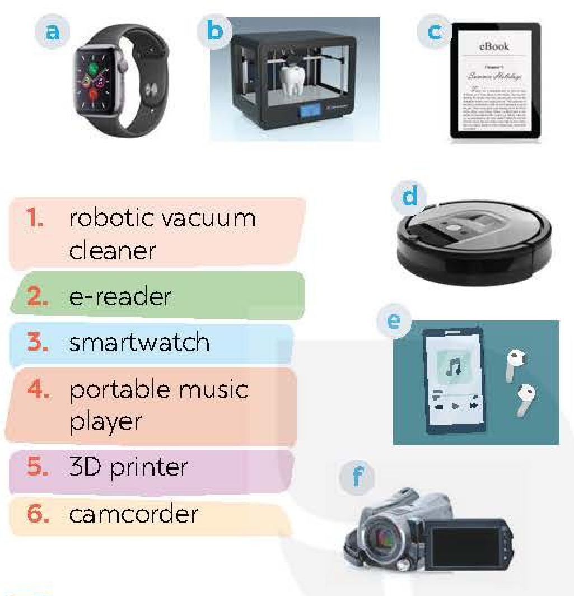
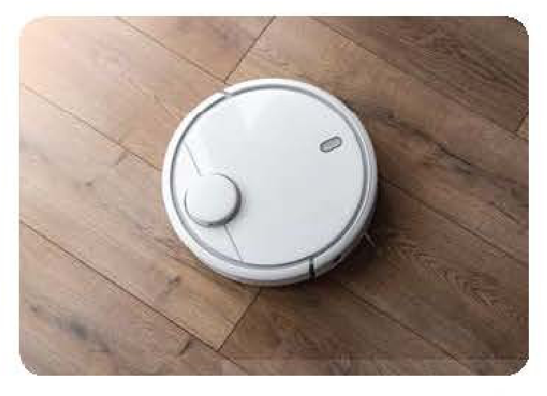
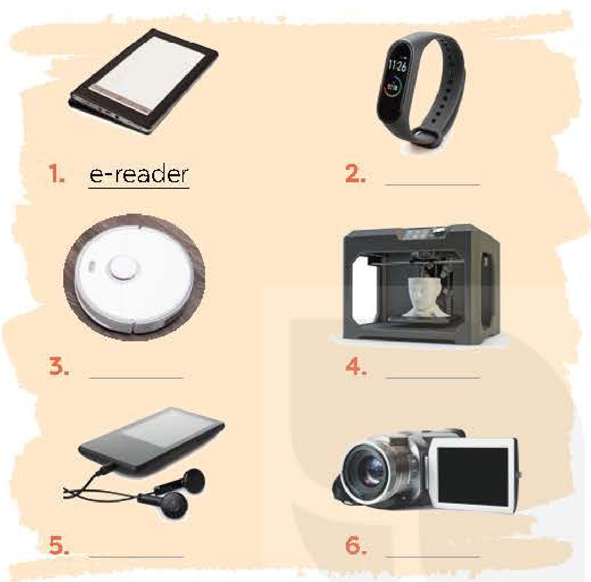

<!-- pdf:113 -->

# UNIT 11: ELECTRONIC DEVICES

> **THIS UNIT INCLUDES:**
> - **Vocabulary:**
>   - Electronic devices
> - **Pronunciation:**
>   - Stress on all words in sentences
> - **Grammar:**
>   - *suggest* / *advise* / *recommend* + *V-ing* / a clause with *should*
> - **Skills:**
>   - Reading about electronic devices
>   - Talking about an electronic device which is important to you
>   - Listening about the current and future uses of one's favourite electronic device
>   - Writing a passage about the current and future capabilities of one's favourite electronic device
> - **Everyday English:**
>   - Checking understanding and responding

## GETTING STARTED

**In an electronic shop**
<!-- ocr-ok: đã đối chiếu ảnh trang gốc, OCR bỏ sót dòng tiêu đề In an electronic shop -->

**1. Listen and read.**

**Shop assistant:** Good morning! What can I do for you?

**Customer:** Good morning! I'd like to buy a computer for my son.

**Shop assistant:** We have desktops, laptops, and tablets. Which one are you interested in?

**Customer:** I want to buy one for my son that is **portable** and can be used for studying and entertainment.

**Shop assistant:** Ah, in this case I suggest you should buy a tablet. Look at this grey tablet. It can work as effectively as a laptop. But it's the size of a book. And it's much lighter than a laptop because it's smaller. It also has a lightweight **aluminium** case.
<!-- term: tablet -->

**Customer:** Sounds good.

**Shop assistant:** It also has two cameras to take photos, shoot videos, and scan documents. It has a **touchscreen**, so you can do everything with your fingers.

**Customer:** Is it easy to type on?

**Shop assistant:** Yes, it is. There is a **virtual** keyboard. If you don't want to use it, you can use the **wireless** hardware keyboard.

**Customer:** Can I write and draw on it?

**Shop assistant:** You can use its pencil to take notes, draw pictures or diagrams, and make 3D designs.

<!-- pdf:114 -->

**2. Read the conversation again and answer the following questions.**

1. What does the customer want to buy?
2. What kind of electronic device does the shop assistant suggest the customer should buy?
3. What is the tablet's case made of?
4. What is the tablet's pencil used for?

**3. Match the following words with their definitions.**

| | |
| --- | --- |
| 1. **aluminium** | a. a screen of a laptop or a tablet that enables the user to interact directly with what is displayed |
| 2. **portable** | b. made to appear to exist by the use of computer software, rather than in the real world |
| 3. **touchscreen** | c. not needing wires to make a connection or to communicate |
| 4. **wireless** | d. a light, silver-grey metal |
| 5. **virtual** | e. easy to carry or to move |

**4. Complete the sentences with the words from 3.**

1. The website allows you to take a \_\_\_\_\_\_\_ tour of the art gallery.
2. You can carry your \_\_\_\_\_\_\_ laptop with you from class to class because it's small and light.
3. Nowadays we often use \_\_\_\_\_\_\_ keyboards because they are **portable**.
4. We often use \_\_\_\_\_\_\_ to make vehicles like aircraft or cars because of its strength and lightweight.
5. Most smartphones today have a \_\_\_\_\_\_\_ which allows us to navigate, type, and interact with apps and games easily.

**5. GAME: Work in pairs. Think of an electronic device and describe it to your partner. Can your partner guess what you are describing?**

*Example:*
- **A:** It's a small, flat computer. We can control it by touching its screen or by using a special pen.
- **B:** Is that a **portable music player**?
- **A:** No. Try again.

<!-- pdf:115 -->

## A CLOSER LOOK 1

### Vocabulary

**1. Match the electronic devices with the correct pictures.**

1. **robotic vacuum cleaner**
2. **e-reader**
3. **smartwatch**
4. **portable music player**
5. **3D printer**
6. **camcorder**
<!-- ocr-ok: đã đối chiếu ảnh trang gốc, danh sách 6 thiết bị điện tử trong các thẻ màu đánh số 1-6 -->

**2. Complete the sentences with the material words from the box.**

| **rubber** | **cardboard** | **steel** |
| --- | --- | --- |
| **plastic** | **copper** | |

1. We often use \_\_\_\_\_\_\_, which is a soft reddish-brown metal, to make electric wire, pipes, and coins.
2. Today, \_\_\_\_\_\_\_ is often used to make cases of electric devices because it doesn't conduct electricity and it is light, and easily be shaped into many different forms.
3. We often use \_\_\_\_\_\_\_ in the construction industry because it is a strong and hard metal.
4. We use \_\_\_\_\_\_\_, which comes from **rubber** trees, for making tyres, boots, etc.
5. The kids need a piece of \_\_\_\_\_\_\_ to easily cut shapes and make toys.

**What do you call these materials in Vietnamese?**

**3. Circle the correct words or phrases to complete the following sentences.**

1. The most common use for *rubber* / *iron* is for producing tyres for cars, motorbikes, bicycles, etc.
2. The most popular material for the construction of buildings and bridges is *plastic* / *steel* because it is strong enough to support heavy loads.
3. Today *3D printers* / *photocopiers* allow us to create three-dimensional objects, e.g. medical implants, clothes, cars, etc.
4. We use *copper* / *cardboard* to make food packaging such as cereal and pasta boxes, as it is food-safe and not harmful to the environment.
5. They use *camcorders* / *portable music players* for live-streaming video content such as concerts, live events, and webinars.

### Pronunciation

*Stress on all words in sentences*

**4. Listen and repeat the sentences. Pay attention to the stress pattern of each sentence.**

1. Don't talk!
2. Don't worry!
3. Keep silent!
4. Look out!
5. Remember!
<!-- ocr-ok: đã đối chiếu ảnh trang gốc, OCR đọc nhầm Don't worry! và Remember! -->

**5. Write each sentence in the suitable box. Then listen, check, and repeat.**
<!-- ocr-ok: đã đối chiếu ảnh trang gốc, OCR đọc nhiễu dòng đề bài tập 5 -->

1. I see!
2. Be quiet!
3. Say sorry!
4. Watch out!
5. That long?
6. Speak louder!
<!-- ocr-ok: đã đối chiếu ảnh trang gốc, OCR đọc dính và sai dấu các câu cảm thán ngắn 1-6 -->

| OO | OOo |
| --- | --- |
| | |
<!-- ocr-ok: đã đối chiếu ảnh trang gốc, kí hiệu trọng âm OO và OOo bị OCR đọc thành số 00 và 000 -->

<!-- pdf:116 -->

## A CLOSER LOOK 2

### Grammar

*suggest / advise / recommend + V-ing or a clause with should*

**Remember!**

After the verbs *suggest*, *advise*, and *recommend* we can use *V-ing* or a clause with *should* to report someone's ideas about what someone else should do, or what they should do themselves.
<!-- term: suggest / advise / recommend + V-ing / a clause with should -->

- *suggest* / *advise* / *recommend* + *V-ing*
- *suggest* / *advise* / *recommend* + (*that*) + sb + (*should*) + bare infinitive

*Example:*
- My sister suggested *buying* a new laptop.
- They recommended *(that) he (should) give up writing*.

**1. Choose the correct answer A, B, C, or D.**
<!-- ocr-ok: đã đối chiếu ảnh trang gốc, OCR đọc dính chữ answerA -->

1. The sales assistant suggested that Tom \_\_\_\_\_\_\_ the **portable** laptop.
   - A. should buy
   - B. will buy
   - C. buys
   - D. bought
2. My smartphone broke down last week, and Mary recommended \_\_\_\_\_\_\_ it to the repair centre.
   - A. I will bring
   - B. I bringing
   - C. I bring
   - D. me bring
3. My uncle recommended \_\_\_\_\_\_\_ a **robotic vacuum cleaner**.
   - A. to buy
   - B. buying
   - C. to buying
   - D. buy
4. I suggest that you \_\_\_\_\_\_\_ the directions carefully before assembling the computer.
   - A. should read
   - B. would read
   - C. will read
   - D. could read
5. She advises \_\_\_\_\_\_\_ a yoga class to improve flexibility and relaxation.
   - A. to take
   - B. took
   - C. take
   - D. taking

**2. Write the correct form of each verb in brackets.**

1. I recommended (collect) \_\_\_\_\_\_\_ old electronic devices.
2. The sales assistant suggested that I (exchange) \_\_\_\_\_\_\_ the digital music player I bought last month.
3. The teacher advised that we (access) \_\_\_\_\_\_\_ the Internet for extra information about our lecture.
4. The doctor advised (not use) \_\_\_\_\_\_\_ digital devices before bedtime.
5. My classmate recommended that I (have) \_\_\_\_\_\_\_ the PC repaired as soon as possible.

**3. Find a mistake in the underlined parts in each sentence below and correct it.**

1. The *teacher* (A) suggested that we *don't waste* (B) time *playing* (C) video *games* (D).
2. I advise *to try* (A) a new workout *routine* (B) to *keep* (C) things *interesting* (D).
3. Her parents recommend *that* (A) she *studies* (B) harder *so that* (C) she can get *into* (D) a good university.
4. The *sales* (A) assistant suggested that I *must* (B) choose a tablet *with* (C) a brighter *colour* (D).
5. *If* (A) you *like* (B) chicken, I recommend *eat* (C) at the restaurant *opposite* (D) our office.
<!-- ocr-ok: đã đối chiếu ảnh trang gốc, các nhãn A, B, C, D đặt dưới từng phần gạch chân -->

<!-- pdf:117 -->

**4. Fill in each blank with the correct form of the verb in brackets. Then practise the exchanges with your partner.**

*Example:*
- **A:** What should we do to keep our house clean?
- **B:** I suggest (buy) *buying* a **robotic vacuum cleaner**.

1. - **A:** What should we do to create three dimensional objects?
   - **B:** I recommend (use) \_\_\_\_\_\_\_ a **3D printer**.
2. - **A:** What should we do to prevent global warming?
   - **B:** I suggest we should (reduce) \_\_\_\_\_\_\_ exhaust fumes.
3. - **A:** What should we do if we want to communicate with others on the move?
   - **B:** I advise (use) \_\_\_\_\_\_\_ a smartphone.
4. - **A:** What should we do to protect and preserve our national parks?
   - **B:** I advise that we should (limit) \_\_\_\_\_\_\_ the number of visitors every day.
5. - **A:** What should we do to improve our health?
   - **B:** I recommend (eat) \_\_\_\_\_\_\_ more fruits and vegetables.

**5. Work in pairs. Tell your partner what he / she should do in the following situations, using suggest / advise / recommend + V-ing OR clauses with should.**

1. His / Her laptop has broken down.
2. He / She is considering buying a new smartphone.
3. He / She likes to read a lot of books but he / she doesn't want them to take up too much space.
4. He / She is feeling tired.

*Example:*
- **A:** Oh no! My laptop has broken. What should I do?
- **B:** I recommend bringing it to a computer repair centre. / I recommend that you (should) bring it to a computer repair centre.

## COMMUNICATION

### Everyday English

*Checking understanding and responding*

**1. Listen and read the conversations. Pay attention to the highlighted sentences.**

1. **Sister:** I can't do my English homework. Can you help me?
   **Brother:** You just read it carefully and find the key words from the questions. *Got it?*
   **Sister:** *OK, I got what you mean.*
<!-- ocr-ok: đã đối chiếu ảnh trang gốc, OCR bỏ sót câu đầu của Sister trong hội thoại 1 -->
<!-- term: Checking understanding and responding -->

2. **Manager:** First, enter the Event Title and then enter the Event Description. Next, select the Location and Room. *Do you follow me?*
   **Employee:** *I'm sorry. I don't quite follow you. Could you say that again, please?*
<!-- term: Checking understanding and responding -->

**2. Work in pairs. Make similar conversations for the following situations.**

1. Your friend asks you to explain the rules of a game. You explain the rules to him / her and check if he / she understands what you are saying. He / She answers that he / she understands it.
2. A stranger asks you the way to the nearest hospital. You tell him / her the way and check if he / she could follow you. He / She answers that he / she doesn't quite follow you and asks you to repeat it.

<!-- pdf:118 -->

**Electronic devices in modern classrooms**

**3. Read Nick's and Phong's ideas about the use of electronic devices in modern classrooms and tick (✓) T (True) or F (False).**

- **Nick:** Nowadays, electronic devices are becoming more and more popular in modern classrooms. Teachers can use electronic devices to teach interactive lessons, provide real-time feedback to students, etc. Students can use them to access online resources, cooperate with their classmates, and complete assignments online. Some schools use digital textbooks and educational software instead of traditional print materials.
- **Phong:** There are some disadvantages of using electronic devices in modern classrooms. Students may become distracted by non-educational content such as social media or entertainment websites. Additionally, constant use of electronic devices may cause eye strain, headaches, and poor posture, as well as other health problems.
<!-- term: eye strain -->

| | T | F |
| --- | --- | --- |
| 1. Nick says that electronic devices help students collaborate with their classmates. | | |
| 2. According to Nick, print materials have been replaced by digital textbooks and educational software in most schools. | | |
| 3. Phong says social media or entertainment websites help increase students' focus and attention during class time. | | |
| 4. According to Phong, prolonged use of electronic devices can lead to health problems. | | |

**4. Work in pairs. Put the advantages and disadvantages of using electronic devices in modern classrooms (1 – 6) in the suitable column.**

1. Using electronic devices in classrooms can help students stay engaged and motivated.
2. Relying too much on electronic devices for information can lead to a decrease in critical thinking, problem-solving, and creativity skills.
3. Using electronic devices in classrooms can help students develop technology skills and better prepare them for future careers.
4. Electronic devices can be expensive, and schools may need to invest more to purchase and maintain them for students.
5. Electronic devices can be used by students to cheat on tests and assignments.
6. Electronic devices can help students store, organise, and access their notes and assignments.

| Advantages | Disadvantages |
| --- | --- |
| | |

**5. Work in groups. Take turns to give your opinions about the use of electronic devices in modern classrooms.**

**You can begin as follows:**

> I think / don't think that the use of electronic devices in modern classrooms is convenient / good / ... First, ...

<!-- pdf:119 -->

## SKILLS 1

### Reading

**1. Work in pairs. Discuss the following questions.**

What electronic device do you use most often? What do you use it for?

**2. Read the following leaflets and match the highlighted words with their meanings.**

- You can do a lot of things with this small smartphone! This light, **stylish** phone has a special **self-portrait** feature that helps you send great photos of yourself right away. Its **camcorder** will record important moments, so you can share them with friends. Besides standard text messaging and phone calls, it can keep you connected through emails, video calls, and social networking apps.
- This **portable music player** can carry your music collection everywhere you go and supply your favourite hits at your fingertips. Listen to up to 24 hours of high-quality music wherever you are – on the bus, in the car, or at the gym. The **portable music player** allows you to store up to 5,000 songs and even play games.
- This smart **window shade** doesn't only help you control how much light comes into your house, but it also saves money by preventing heat or cold from entering our house. It's an excellent option for those that have trouble controlling the temperature of their houses. It can also give additional *privacy* to apartments by blocking out light as well as unwanted views.

| Words | Meanings |
| --- | --- |
| 1. **stylish** | a. a piece of material fixed onto a roller that we can pull down to cover a window |
| 2. **self-portrait** | b. fashionable; elegant and attractive |
| 3. **window shade** | c. the state of being not watched or disturbed by other people |
| 4. privacy | d. a picture or photograph that you make of yourself |

**3. Read the leaflets again and tick T (True) or F (False).**

| | T | F |
| --- | --- | --- |
| 1. The smartphone allows you to connect with everybody through emails, video calls, and social networking apps. | | |
| 2. You can send the photographs of yourself immediately with the smartphone. | | |
| 3. The **portable music player** doesn't allow you to play games on it. | | |
| 4. You cannot control how much light comes into your house with the smart **window shade**. | | |
| 5. The smart **window shade** allows you to control the temperature of your house. | | |

### Speaking

**4. Work in pairs. Ask and answer the following questions about an electronic device which is important to you. Make notes of your partner's answers.**

1. What electronic device is important to you?
2. How long have you had it?
3. What does it look like?
4. When do you use it?
5. Why is it important to you?

**5. Work in groups. Take turns to talk about the electronic device that is important to your partner.**

**You can begin as follows:**

> I talked with ... about his / her ... that is important to him / her. He / She has had it for ...

<!-- pdf:120 -->

## SKILLS 2

### Listening

**1. Work in pairs. Discuss the following questions.**

1. What is this electronic device?
2. Do you want to have one in your home? Why / Why not?

**2. You will hear Trang talking about her favourite electronic device. Listen and choose the correct answer A, B, or C.**

1. In Trang's opinion, cleaning the floor \_\_\_\_\_\_\_.
   - A. is an easy and interesting task
   - B. is boring and takes a lot of time
   - C. can only be done by housekeepers
2. Trang's current **robotic vacuum cleaner** can clean \_\_\_\_\_\_\_.
   - A. almost every dust, spot, and dirty mark in her house
   - B. only dust, spots, and dirty marks that we can see
   - C. dust, spots, and dirty marks under human control
3. If you drop crumbs to the floor, **robotic vacuum cleaners** of the future will come by and \_\_\_\_\_\_\_.
   - A. wipe all of them with a **rubber**
   - B. **suck** them all up
   - C. remind you to clean them
4. In the future, laser technology will enable robot vacuum cleaners to \_\_\_\_\_\_\_.
   - A. get to any floor or room in our houses
   - B. climb stairs and open doors or drawers
   - C. see everything on the ground

**3. Listen again and fill in each blank with ONE word that you hear.**

1. Trang can control her current **robotic vacuum cleaner** with an app on her \_\_\_\_\_\_\_.
2. Trang's current **robotic vacuum cleaner** is easy to store and \_\_\_\_\_\_\_.
3. **Robotic vacuum cleaners** of the future will be able to recognise patterns and then take \_\_\_\_\_\_\_.
4. Trang thinks **robotic vacuum cleaners** will be more \_\_\_\_\_\_\_ to us in the future.

### Writing

**4. Think of one of your favourite electronic devices. Make notes of your answers to the following questions.**

- What is your favourite electronic device?
- What can it do for you now?
- What will it be able to do for you in the future?

**5. Write a passage (100 – 120 words) about what your favourite electronic device can do now and what it will be able to do in the future. Use the ideas in 4 or of your own.**

> My favourite electronic device is \_\_\_\_\_\_\_\_\_\_\_\_\_\_\_\_\_\_\_\_\_\_\_.

<!-- pdf:121 -->

## LOOKING BACK

### Vocabulary

**1. Write the name of an electronic device under each picture.**

1. *e-reader*
2. \_\_\_\_\_\_\_
3. \_\_\_\_\_\_\_
4. \_\_\_\_\_\_\_
5. \_\_\_\_\_\_\_
6. \_\_\_\_\_\_\_
<!-- ocr-ok: đã đối chiếu ảnh trang gốc, 6 chỗ trống đánh số 1-6 nằm dưới từng thiết bị điện tử -->

**2. Complete the sentences with the words from the box.**

| **3D printer** | **copper** | **plastic** |
| --- | --- | --- |
| **e-reader** | **smartwatch** | |
<!-- ocr-ok: đã đối chiếu ảnh trang gốc, OCR đọc nhầm 3D printer thành 5D printer trong khung từ vựng -->

1. We often use \_\_\_\_\_\_\_ to make power lines and electrical wires because it is a good conductor of electricity.
2. I can adjust the text size and font to suit my reading preferences on my \_\_\_\_\_\_\_.
3. My \_\_\_\_\_\_\_ can track my physical activity, heart rate, and sleep patterns, so it can help me monitor my overall health and fitness.
4. We often use \_\_\_\_\_\_\_ to make toys for children because it's durable, lightweight, and easy to mold into different shapes.
5. If I need a replacement part for a machine or device, I can use my \_\_\_\_\_\_\_ to create a new one that is a perfect fit.

### Grammar

**3. Choose the correct answer A, B, C, or D.**
<!-- ocr-ok: đã đối chiếu ảnh trang gốc, OCR đọc dính chữ answerA -->

1. My teacher advised I \_\_\_\_\_\_\_ harder to pass the exam.
   - A. studies
   - B. study
   - C. studying
   - D. to study
2. The professor suggested he \_\_\_\_\_\_\_ the research before March.
   - A. submit
   - B. submitting
   - C. submits
   - D. would submit
3. Her leader suggested \_\_\_\_\_\_\_ on time.
   - A. be
   - B. being
   - C. is
   - D. to be
4. Linh recommended that Nam \_\_\_\_\_\_\_ a new **e-reader**.
   - A. should buy
   - B. bought
   - C. buying
   - D. will buy
5. The coaches advised that we \_\_\_\_\_\_\_ a Facebook group.
   - A. creating
   - B. created
   - C. to create
   - D. create

**4. Fill in each blank with the correct form of the verb in brackets.**

1. I recommend that you (reduce) \_\_\_\_\_\_\_ your screentime.
2. It's so cold outside. We suggest (close) \_\_\_\_\_\_\_ the window.
3. My teacher advised that I (look) \_\_\_\_\_\_\_ for a part-time job to earn more money.
4. Henry has recommended (choose) \_\_\_\_\_\_\_ a better **smartwatch** for your dad.
5. The government advised (travel) \_\_\_\_\_\_\_ by bus to reduce environmental pollution.

<!-- pdf:122 -->

## PROJECT

**A COMPETITION FOR DESIGNING LEAFLETS ON ELECTRONIC DEVICES**
<!-- ocr-ok: đã đối chiếu ảnh trang gốc, tiêu đề chữ trang trí màu trắng trên băng màu phần Project -->

**You are taking part in a competition for designing leaflets on electronic devices. Work in groups.**

1. **Choose an electronic device and design a leaflet to promote it, including:**
   - name of the electronic device
   - its appearance, main parts, key features, etc.
   - its benefits
   - pictures or photos to illustrate the electronic device.
2. **Present your leaflet to the other groups.**
3. **Vote for the best leaflet.**

### Now I can ...

- use the words and phrases about electronic devices.
- say sentences with all words having stress correctly.
- use the verb *suggest* / *advise* / *recommend* + *V-ing* / a clause with *should*.
- check understanding and respond.
- read about electronic devices.
- talk about an electronic device which is important to me
- listen about the current and future uses of one's favourite electronic device.
- write a passage about the current and future capabilities of one's favourite electronic device.

## 📷 Danh sách hình trong bài

| Mã hình | Trang PDF | Trang sách | Chú thích / Mô tả |
| --- | --- | --- | --- |
| H9-tieng_anh-u11-01 | 115 | 116 | Sáu bức ảnh thiết bị điện tử a–f kèm danh sách tên gọi 1–6 thuộc bài tập 1 phần A Closer Look 1 – Vocabulary: (a) đồng hồ thông minh, (b) máy in 3D, (c) máy đọc sách điện tử, (d) robot hút bụi tự động, (e) máy nghe nhạc cầm tay, (f) máy quay phim xách tay |
| H9-tieng_anh-u11-02 | 120 | 121 | Bức ảnh robot hút bụi tự động trên sàn gỗ thuộc bài tập 1 phần Skills 2 – Listening |
| H9-tieng_anh-u11-03 | 121 | 122 | Sáu bức ảnh thiết bị điện tử 1–6 thuộc bài tập 1 phần Looking Back – Vocabulary: (1) e-reader, (2) đồng hồ thông minh, (3) robot hút bụi tự động, (4) máy in 3D, (5) máy nghe nhạc cầm tay, (6) máy quay phim xách tay |
