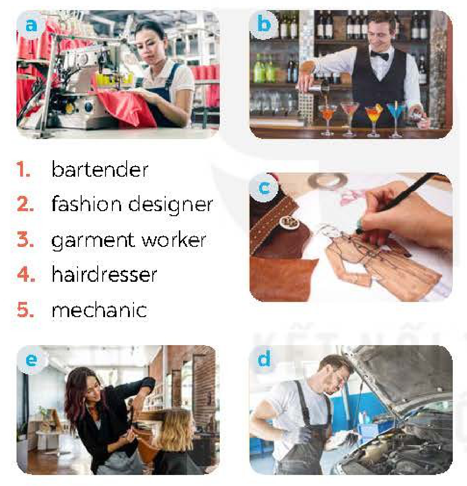
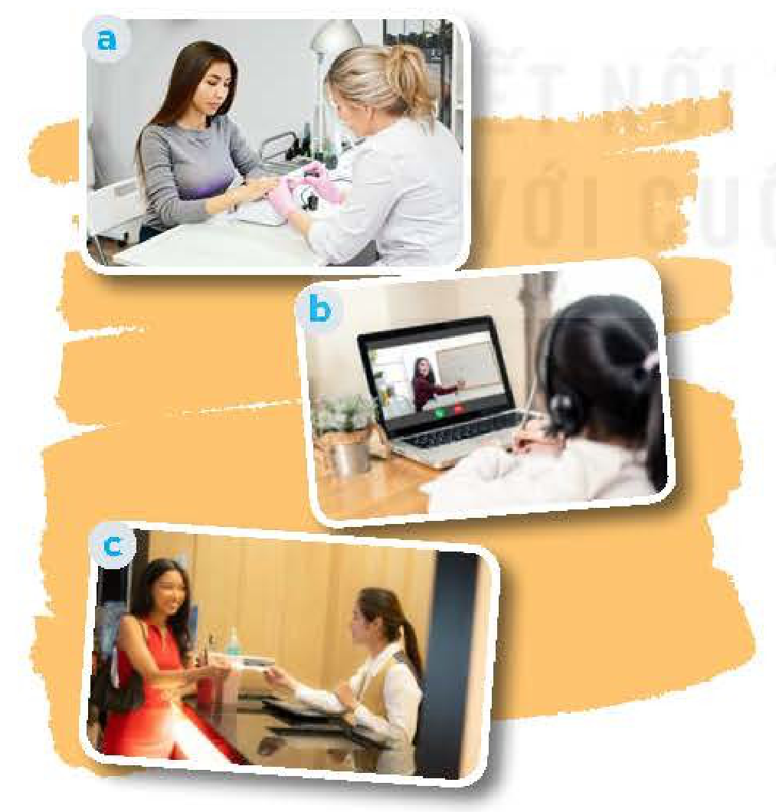

<!-- pdf:123 -->

# UNIT 12: CAREER CHOICES

> **THIS UNIT INCLUDES:**
> - **Vocabulary:**
>   - Jobs
> - **Pronunciation:**
>   - Intonation in statements used as questions
> - **Grammar:**
>   - Adverbial clauses of concession, result, and reason
> - **Skills:**
>   - Reading about the future world of work
>   - Talking about the job you want to do in the future
>   - Listening about people's **career** paths
>   - Writing an email about your future favourite job
> - **Everyday English:**
>   - Expressing hope and responding

## GETTING STARTED

**What will you do in the future?**

**1. Listen and read.**

**Mi:** Did you attend the **career** **orientation** session yesterday?

**Nick:** No, I didn't. I had to complete my project. How was it?
<!-- ocr-ok: đã đối chiếu ảnh trang gốc, OCR đọc nhầm chữ I thành dấu gạch đứng -->

**Mi:** It was really informative. There were three guest speakers from **vocational** colleges. They introduced their job training courses for lower secondary leavers.

**Nick:** My teacher told us that if we didn't like academic subjects, we should apply for courses which would prepare us for a job such as **mechanic**, hairdresser, or **garment worker**. That way, we could start working and earn a living earlier.
<!-- term: academic subjects -->
<!-- term: earn a living -->

**Mi:** My cousin did that. He learnt bartending after finishing grade 9. Now he's a skilful **bartender** and makes lots of money.

**Nick:** And you? What will you be in five years from now?

**Mi:** Well, I'll be studying at a teachers' college because I want to be a teacher. How about you?

**Nick:** I'll be a fashion designer.
<!-- term: fashion designer -->

**Mi:** You really want to be a fashion designer?
<!-- term: fashion designer -->

**Nick:** Yeah. My art teacher says I have such a good sense of style that I should get formal training in fashion design after high school.
<!-- term: sense of style -->
<!-- term: formal training -->

**Mi:** Hope you'll achieve your dream.

**Nick:** Thanks. I think we should know our passions and abilities to make a good **career** choice.

<!-- pdf:124 -->

**2. Read the conversation again and answer the following questions.**

1. Where did the guest speakers come from?
2. According to Nick's teacher, who should apply for **vocational** courses?
3. What did Mi's cousin do after finishing grade 9?
4. What quality does a fashion designer need to have?
5. What do we need to know to make a good **career** choice?

**3. Match the words and phrases in the conversation with their pictures.**

1. **bartender**
2. fashion designer
3. **garment worker**
4. hairdresser
5. **mechanic**
<!-- ocr-ok: đã đối chiếu ảnh trang gốc, OCR bỏ sót số thứ tự 1-5 và đọc nhầm mechanic thành rmechanic -->

**4. Choose the correct answer A, B, C, or D to complete each sentence.**

1. Subjects like maths, physics, English, and literature are called \_\_\_\_\_\_\_ subjects.
   - A. theoretical
   - B. art
   - C. academic
   - D. physical
<!-- term: academic subjects -->
2. She earns a \_\_\_\_\_\_\_ by selling home-made foods.
   - A. life
   - B. salary
   - C. money
   - D. living
<!-- term: earn a living -->
3. He went to college to get \_\_\_\_\_\_\_ training in business management.
   - A. life-long
   - B. informal
   - C. formal
   - D. online
<!-- term: formal training -->
4. Finding a \_\_\_\_\_\_\_ job in big cities is rather difficult.
   - A. teacher
   - B. teaching
   - C. taught
   - D. teach
5. **Career** \_\_\_\_\_\_\_ programmes are useful because they help students make good decisions about their future jobs.
   - A. **orientation**
   - B. pressure
   - C. tradition
   - D. income

**5. GAME: Guess my job.**
<!-- ocr-ok: đã đối chiếu ảnh trang gốc, chữ GAME in màu trong các ô vuông trang trí -->

**Work in two groups. Take turns to explain and guess the jobs the teacher shares. The group with more correct answers wins.**

*Example:* (T shows a picture of a **mechanic**)
- **Group members:** This person works in a garage. He repairs cars or motorbikes.
- **Student A:** A **mechanic**.

<!-- pdf:125 -->

## A CLOSER LOOK 1

### Vocabulary

**1. Match the jobs in A with their descriptions in B to make complete sentences.**

| A | B |
| --- | --- |
| 1. A tailor | a. receives and pays out money in a shop, bank, restaurant, etc. |
| 2. A **surgeon** | b. performs a particular task in the process of making a product in a factory. |
| 3. An **assembly worker** | c. designs and develops computer software. |
| 4. A **cashier** | d. performs medical operations. |
| 5. A **software engineer** | e. makes clothes. |

**2. Choose the correct answer A, B, C, or D to complete each sentence.**

1. My brother is applying for a \_\_\_\_\_\_\_ as a customer manager in a supermarket.
   - A. job
   - B. duty
   - C. **career**
   - D. work
2. Mr Hoang was a police officer. He had a successful \_\_\_\_\_\_\_ in the police force.
   - A. work
   - B. job
   - C. **career**
   - D. task
3. A **cashier** has to do \_\_\_\_\_\_\_ tasks, such as receiving money and printing receipts.
   - A. effective
   - B. creative
   - C. **decisive**
   - D. **repetitive**
4. A tailor can have a \_\_\_\_\_\_\_ job if he / she is creative and **knowledgeable** about **fabric**.
   - A. boring
   - B. basic
   - C. **well-paid**
   - D. difficult
5. A **surgeon**'s job is \_\_\_\_\_\_\_. He / She works long hours and occasionally deals with life-and-death situations.
   - A. easy
   - B. **demanding**
   - C. **rewarding**
   - D. stress-free

**3. Complete the texts, using the words from the box.**

| **demanding** | **repetitive** |
| --- | --- |
| **software engineer** | **well-paid** |
| **assembly worker** | |

- **Mr Lam:** I'm a(n) (1) \_\_\_\_\_\_\_. I design and develop programmes for computers. My job is (2) \_\_\_\_\_\_\_. I work long hours on the computer, especially when deadlines approach. However, it's a (3) \_\_\_\_\_\_\_ job, so I'm happy with it.
- **Ms Nga:** I'm a(n) (4) \_\_\_\_\_\_\_. I'm in charge of sticking labels on the products. Besides basic skills, I must be able to stand for a long time and do (5) \_\_\_\_\_\_\_ tasks at a reasonable speed.

### Pronunciation

*Intonation in statements used as questions*

**Remember!**

We use a statement question when we want to express our surprise at the previous statement. In some cases, we use it to check if our information is correct. In these cases, we raise our voice at the end of the statement.

*Example:*
- **A:** I want to be a doctor. ↘
- **B:** You want to be a doctor? ↗

**4. Listen to the conversations. Pay attention to the intonation in the statement questions. Then practise the conversations with a partner.**

1. **Minh:** It's 4:20 now. I must go.
   **Hoa:** It's 4:20? Oh dear, I must go, too!
2. **Mai:** Mum, Ms Lan has invited you to a party.
   **Mother:** She invited me to a party?

<!-- pdf:126 -->

**5. Complete each conversation with a statement question. Then practise the conversations with a partner. Pay attention to the intonation of each sentence.**

1. **Nick:** Minh is very happy with the **vocational** test.
   **Trang:** \_\_\_\_\_\_\_? He told me something different.
2. **Elena:** I want to become a **surgeon**.
   **Tom:** \_\_\_\_\_\_\_? Do you have skilful hands?

## A CLOSER LOOK 2

### Grammar

*Adverbial clauses of concession, result, and reason*

**Remember!**

An adverbial clause of concession expresses contrast. It is introduced with a subordinate conjunction. The most common conjunctions are *though* and *although*. *Though* and *although* can be placed at the beginning or in the middle of the sentence.
<!-- term: Adverbial clauses of concession, result, and reason -->

**1. Choose the correct word to complete each sentence.**

1. *Although* / *But* footballers are **well-paid**, they have short careers.
<!-- ocr-ok: đã đối chiếu ảnh trang gốc, OCR đọc nhầm short careers thành shin careers -->
2. She still applied for the job *so* / *though* she had almost no chance to get it.
3. *Although* / *However* she went to the cinema early, she couldn't buy the ticket.
4. She has to do **repetitive** tasks in her job, *although* / *but* she still likes it.
5. *Though* / *But* Mike felt tired, he managed to finish his homework.

**Remember!**

- An adverbial clause of result shows the result of an action or event. It is often introduced with *so / such ... that ...* We use *so + adj + that* and *such (+ a / an) + adj + noun + that*.
  *Example:*
  - The box was *so* heavy *that* the worker couldn't lift it up.
  - She is *such* a skilful tailor *that* all the ladies in the neighbourhood like the clothes she makes.
- An adverbial clause of reason explains the reason why an action is done or an event happens. It is often introduced with *because* and *since*. *Since* is often placed at the beginning of a sentence. *Because* can be placed at the beginning or in the middle of the sentence.
  *Example:*
  - James wants to become a tour guide *because* he loves travelling. / *Because* he loves travelling, James wants to become a tour guide.
  - *Since* she was late, she couldn't join the **career** **orientation** session.
<!-- term: Adverbial clauses of concession, result, and reason -->

**2. Complete the sentences with so or such.**
<!-- ocr-ok: đã đối chiếu ảnh trang gốc, OCR đọc dính so or thành soor -->

1. The factory was \_\_\_\_\_\_\_ far from his home that he couldn't go there to work.
2. Katie was \_\_\_\_\_\_\_ a lazy worker that no manager wanted to hire her.
3. They are \_\_\_\_\_\_\_ creative designers that everyone admires them.
4. Can you speak louder? You voice is \_\_\_\_\_\_\_ soft that I can't hear you.
5. He is \_\_\_\_\_\_\_ a handsome man that many people think he could be an actor.

**3. Join the sentences, using the given word in brackets.**

1. Jenny didn't attend the job fair. She was ill. (because)
2. Henry is excellent at maths. Everyone thinks he will become a mathematician. (since)

<!-- pdf:127 -->

3. Mai practised speaking English a lot. She wanted to get a high score on the speaking test. (because)
4. Ms Nga is away this week. We'll put off the next class meeting. (since)
5. I couldn't go to the office on time. There was a traffic jam. (because)

**4. Rewrite each sentence. Use the given word in brackets.**

1. I forgot to bring money, so I couldn't buy the **career** guidebook. (because)
   → I couldn't \_\_\_\_\_\_\_.
2. My navigation skill is very bad. I could never work as a taxi driver. (so)
   → I'm \_\_\_\_\_\_\_.
3. Sally couldn't use the computer. There was a power cut. (since)
   → Since \_\_\_\_\_\_\_.
4. She had a university degree, but she couldn't find a good job. (although)
   → Although \_\_\_\_\_\_\_.
5. The florist was very skilful. Her flower shop attracted many customers. (such)
   → She was \_\_\_\_\_\_\_.

**5. Complete the sentences with your own ideas. Then exchange them with a partner.**

1. Although my sister is a fashion designer, \_\_\_\_\_\_\_.
2. I want to become a pilot because \_\_\_\_\_\_\_.
3. My father has such a hard job that \_\_\_\_\_\_\_.
4. Since most **vocational** courses take a short time to finish, \_\_\_\_\_\_\_.
5. The **garment worker** felt so bored that \_\_\_\_\_\_\_.

## COMMUNICATION

### Everyday English

*Expressing hope and responding*

**1. Listen and read the conversations below. Pay attention to the highlighted parts.**

1. **Minh:** I've filled in the registration form. *Hopefully*, I'll be a member of the science club.
   **Duong:** *I hope so, too.*
<!-- term: Expressing hope and responding -->

2. **Student:** Here's my teacher's reference letter. *I hope* I'll get the job.
   **Staff:** *Thank you.* Good luck.
<!-- term: Expressing hope and responding -->

**2. Work in pairs. Make similar conversations with the following situations.**

1. A friend has just taken part in a design competition. She is looking forward to the result.
2. A teacher is asking a student to give a teacher-parent conference invitation to his / her parents. She hopes that the parents will come.

**What's your future job?**
<!-- ocr-ok: đã đối chiếu ảnh trang gốc, OCR bỏ sót tiêu đề màu cam What's your future job? -->

**3. Work in pairs. Read about the jobs that Khang and An want to do. Then complete the summary table.**

- **Khang:** I've always dreamt of this job. I'll enter a medical university. This seems to be a suitable job for me because I have good **hand-eye coordination**. Besides, I'm calm and **decisive**, so I can lead a surgical team.
- **An:** I hope I can do this job as soon as possible. I've got **hands-on** training on how to use the scanner and calculator. I can do this job well because I have good basic maths skills. I'm patient and helpful to customers even when the store is busy.

<!-- pdf:128 -->

| | Training | Skills | Personal qualities |
| --- | --- | --- | --- |
| **Khang** | (1) \_\_\_\_\_\_\_ degree | **hand-eye coordination** | (2) \_\_\_\_\_\_\_ and **decisive** |
| **An** | (3) \_\_\_\_\_\_\_ training | using some equipment having basic (4) \_\_\_\_\_\_\_ | patient and (5) \_\_\_\_\_\_\_ |

**4. Work in pairs. Look at the jobs below. Which job might be appropriate for each person in 3? Explain your choice.**

1. **surgeon**
2. **mechanic**
3. nurse
4. **cashier**

**5. Work in groups. Think of a job that you like or know well. Discuss the type of training, skill(s), and personal qualities which are necessary for it.**

**Now present your group's ideas and have the class guess the job you are describing.**

## SKILLS 1

### Reading

**1. Look at the jobs below and answer the questions.**

1. Which job is most **repetitive**?
2. Which job relates to beauty?
3. Which job depends heavily on technology?

**2. Read the article and do the tasks that follow.**

When you turn 15, you should start thinking seriously about your **career**. However, making **career** choices can be challenging, especially in this changing world.

1. **Assembly workers** and ticket sellers, whose jobs are **repetitive**, are being replaced by machines. However, technology has also created new jobs, such as **software engineers** and online teachers. Besides, beauty jobs like nail artists and hairdressers are becoming popular because people want to take better care of themselves.

2. Computer skills have become a must for many jobs. For example, doctors need to keep digital medical records of their patients. People also collaborate with each other so often that teamwork and communication skills are now increasingly important.

<!-- pdf:129 -->

3. Many teenagers are willing to take **vocational** courses instead of going to university. Training can be both face-to-face and online. Opportunities to learn new skills are open to everyone provided that they have **inquiring** minds.

In the future, there may be even more changes in the world of work. It's a good idea for you to work well in teams, keep on learning and have good computer skills. By doing so, you can move confidently on your **career** path.

**a. Which number (1 – 3) does each sentence (A – C) below fit in? Tick (✓) the correct number for each sentence.**

| | 1 | 2 | 3 |
| --- | --- | --- | --- |
| A. The skills needed for the jobs are changing, too. | | | |
| B. The preferred type of training is also changing. | | | |
| C. The kinds of jobs people are doing are changing. | | | |

**b. Which of the following is the best title for the article?**

- A. The changing world of work
- B. How to choose your **career** path
- C. Making good job decisions

**3. Read the article again and tick (✓) T (True) or F (False).**

| | T | F |
| --- | --- | --- |
| 1. Teenagers should consider their **career** paths as soon as they reach 18. | | |
| 2. A nail artist is an example of a job created by technology. | | |
| 3. In many jobs, people need to be able to use computers well. | | |
| 4. People can get job training in more ways than they could in the past. | | |
| 5. There will be fewer changes in the world of work in the future. | | |

### Speaking

**4. Complete the conversation with the sentences from the box. Then practise it with a partner.**

- A. You're creative and fashionable. You're good at persuading other people, too.
- B. What skills do you need for the job?
- C. What job do you think you'll do in the future?
- D. Why do you like this job?

**Ben:** (1) \_\_\_\_\_\_\_

**Hoa:** I want to be a hairdresser.

**Ben:** Interesting! (2) \_\_\_\_\_\_\_

**Hoa:** Well, I'm keen on creating new hairstyles. I can also earn a good living because it's a **well-paid** job.

**Ben:** (3) \_\_\_\_\_\_\_

**Hoa:** Though there are many skills, I think hair cutting and colouring are the most important.

**Ben:** You'll do that job well. (4) \_\_\_\_\_\_\_

**Hoa:** Thanks. I hope I'll be such a successful hairdresser that I'll have my own hair salon some day.

**5. Work in pairs. Make similar conversations about the job you want to do in the future. Then report your conversation to the class.**

**You may use the following frame for your report:**

> My partner is ... She wants to be a ... because ... She'll need to learn many skills, such as ... She'll do the job well since ... She hopes that one day, she'll ...

<!-- pdf:130 -->

## SKILLS 2

### Listening

**1. Work in pairs. Which of the reasons below is the most important to you when choosing a job?**

1. passion
2. family tradition
3. ability
4. salary
5. opportunity to travel

**2. Listen to two people talking about their career paths and tick (✓) T (True) or F (False).**

| | T | F |
| --- | --- | --- |
| 1. Minh's parents were farmers. | | |
| 2. Minh is now working for an agricultural company. | | |
| 3. Ann first learnt cooking from a family member. | | |
| 4. Ann is now a chef in a famous restaurant. | | |
<!-- ocr-ok: đã đối chiếu ảnh trang gốc, OCR đọc lỗi số thứ tự và dấu sở hữu cách trong bảng T/F -->

**3. Listen again. Choose the correct answer A, B, or C.**

1. Why did Minh decide to learn **agriculture engineering**?
   - A. Because he wanted to help the farmers.
   - B. Because he could get a **well-paid** job.
   - C. Because he had no other choice for university.
2. What does Minh's job involve?
   - A. Using technology in farming.
   - B. Solving problems among farmers.
   - C. Creating new kinds of plants.
3. How did Ann earn her cooking certificate?
   - A. By taking a short course in cooking.
   - B. By attending a **vocational** college.
   - C. By enrolling in an online course.
4. In the future, Ann wants to \_\_\_\_\_\_\_.
   - A. work in a hotel restaurant
   - B. get another cooking certificate
   - C. open her own restaurant

### Writing

**4. Work in pairs. Ask and answer the following questions.**

1. What is your favourite job?
2. What does this job involve?
3. What skills does this job need?
4. What personal qualities do you need to have for this job?

**5. Write an email (100 – 120 words) to your friend telling him / her about your future favourite job. You can use the ideas from 4.**

**Start and end the email as follows:**

> *Dear* \_\_\_\_\_\_\_,
>
> It's nice to hear from you again.
>
> Let me tell you about \_\_\_\_\_\_\_\_\_\_\_\_\_\_\_\_\_\_\_\_\_\_\_
>
> Write to me soon.
>
> *Cheers,*

<!-- pdf:131 -->

## LOOKING BACK

### Vocabulary

**1. Put the words and phrases in the appropriate column.**

| **surgeon** | **demanding** |
| --- | --- |
| **repetitive** | **well-paid** |
| designing | **assembly worker** |
| teamwork | **software engineer** |
| **hand-eye coordination** | |

| Jobs | Job features | Job skills |
| --- | --- | --- |
| | | |

**2. Complete the text, using words / phrases from the box.**

| job | creative | **career** |
| --- | --- | --- |
| **rewarding** | **sewing** | |

My mum first learnt (1) \_\_\_\_\_\_\_ skills from my grandmother. She got her (2) \_\_\_\_\_\_\_ as a tailor when she was 16. Now she owns a small tailor shop in the village. She is (3) \_\_\_\_\_\_\_ and hardworking. She has such an excellent sense of style that many ladies love the clothes she makes. Though sometimes she has to work late at night, she finds her job (4) \_\_\_\_\_\_\_ because she can satisfy her customers. I think my mum has had a successful (5) \_\_\_\_\_\_\_ in tailoring.

### Grammar

**3. Combine each pair of sentences into one, using the given word in brackets.**

1. The salary was low. She accepted the job. (though)
   → She \_\_\_\_\_\_\_.
2. My sister is too shy. She can't be an MC. (such)
   → My sister is \_\_\_\_\_\_\_.
3. Life in the city was too **demanding**, so he came back to his village. (because)
   → He came \_\_\_\_\_\_\_.
4. Her backache was too painful. She had to stop working in the factory. (so)
   → Her backache \_\_\_\_\_\_\_.
5. Clara didn't like academic subjects. Her mum insisted that she go to university. (although)
   → Clara's mum \_\_\_\_\_\_\_.

**4. Fill in each gap in the text with a conjunction from the box.**

| although | because | since |
| --- | --- | --- |
| so | such | |
<!-- ocr-ok: đã đối chiếu ảnh trang gốc, OCR đọc nhầm từ so thành số 50 trong khung từ vựng -->

Making **career** choices is (1) \_\_\_\_\_\_\_ a difficult process that conflicts happen in many families when they discuss their teenager's future **career**. (2) \_\_\_\_\_\_\_ some parents consider their child's dream job unrealistic, they try to stop him / her from pursuing it. Sometimes, the parents force their child to study for a job which is (3) \_\_\_\_\_\_\_ **demanding** that he / she feels stressed just (4) \_\_\_\_\_\_\_ they overestimate their child's ability. (5) \_\_\_\_\_\_\_ parents want to help their children make good **career** decisions, they really need to understand their teenaged children's passions and abilities.

<!-- pdf:132 -->

## PROJECT

**YOUR FUTURE JOBS**
<!-- ocr-ok: đã đối chiếu ảnh trang gốc, tiêu đề chữ in hoa màu cam trong phần Project -->

**Work in groups**

1. **Choose TWO jobs that members of your group would like to do in the future.**
2. **Compare the jobs in terms of:**
   - what they are
   - what type(s) of training they require
   - what skills and personal qualities you need to do them well
   - whether they will be popular in the future
3. **Prepare a poster presentation.**
4. **Present your poster to the class.**

### Now I can ...

- use the words and phrases related to jobs.
- say statements used as questions with correct intonation.
- use adverbial clauses of concession, result, and reason.
- express hope and respond.
- read about the future world of work.
- talk about the job I want to do in the future.
- listen about people's **career** paths.
- write an email about my future favourite job.

## 📷 Danh sách hình trong bài

| Mã hình | Trang PDF | Trang sách | Chú thích / Mô tả |
| --- | --- | --- | --- |
| H9-tieng_anh-u12-01 | 124 | 125 | Năm bức ảnh nghề nghiệp a–e kèm danh sách từ vựng 1–5 thuộc bài tập 3 phần Getting Started: (a) công nhân may, (b) nhân viên pha chế đồ uống, (c) nhà thiết kế thời trang, (d) thợ sửa chữa ô tô, (e) thợ làm tóc |
| H9-tieng_anh-u12-02 | 128 | 129 | Ba bức ảnh nghề nghiệp a–c thuộc bài tập 1 phần Skills 1 – Reading: (a) thợ làm móng (nail artist), (b) giáo viên dạy học trực tuyến (online teacher), (c) nhân viên bán vé (ticket seller) |
