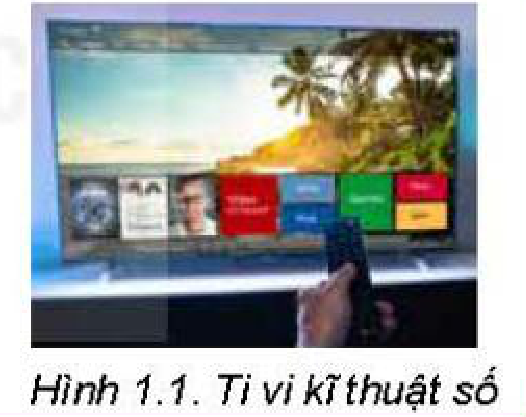
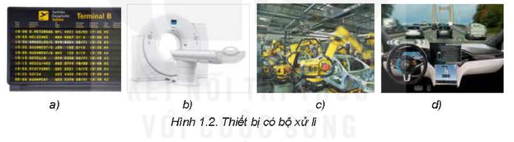
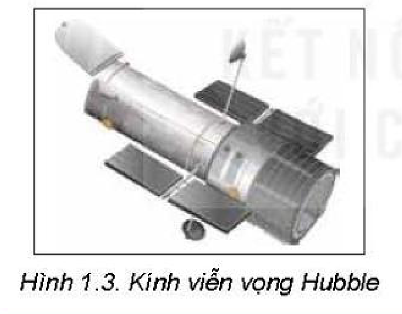
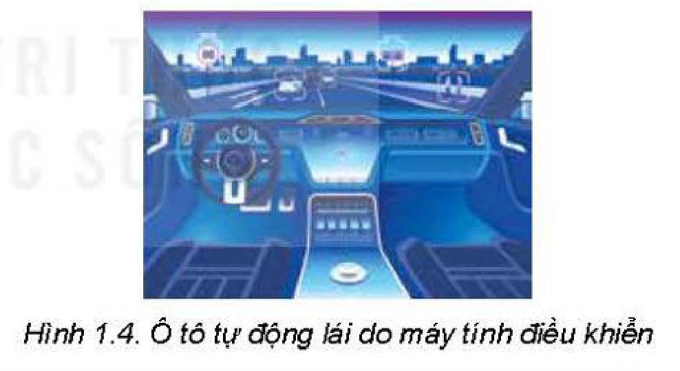

<!-- pdf:7 -->

# BÀI 1: THẾ GIỚI KĨ THUẬT SỐ

## 🎯 Sau bài học này em sẽ:

- Nhận biết được sự có mặt của các thiết bị có gắn bộ xử lí thông tin ở khắp nơi và nêu được ví dụ minh hoạ.
- Nêu được khả năng của máy tính và chỉ ra được một số ứng dụng thực tế của nó trong khoa học kĩ thuật và đời sống.
- Giải thích được tác động của công nghệ thông tin lên giáo dục và xã hội thông qua các ví dụ cụ thể.

## 🔴 Khởi động

> *An:* Bộ xử lí là thành phần quan trọng của máy tính, thường được gọi là "bộ não" của máy tính. Nhưng liệu có phải chỉ máy tính mới có bộ xử lí không?
>
> *Khoa:* Bộ xử lí không chỉ xuất hiện trong máy tính để bàn hoặc máy tính xách tay mà nhiều thiết bị điện tử khác cũng cần bộ xử lí để hoạt động như ti vi kĩ thuật số hay rô bốt quét nhà,...
>
> *An:* Thế thì còn nhiều thiết bị nữa có gắn bộ xử lí ở xung quanh chúng ta.

## 1. THẾ GIỚI KĨ THUẬT SỐ

> **Hoạt động 1: Tìm hiểu ti vi kĩ thuật số**
>
> Hầu hết ti vi được sử dụng hiện nay là ti vi kĩ thuật số (Hình 1.1). Em hãy tìm hiểu và cho biết:
> 1. Thông tin đầu vào nào được ti vi tiếp nhận từ bộ điều khiển?
> 2. Ti vi thể hiện sự thay đổi ở đầu ra như thế nào?
> 3. Ti vi có thực hiện thao tác xử lí thông tin không?

*Hình 1.1. Ti vi kĩ thuật số*

Khi em nhấn nút chuyển kênh ti vi trên bộ điều khiển từ xa, ti vi sẽ nhận được thông tin. Xử lí thông tin này, ti vi sẽ chuyển sang kênh mà em yêu cầu. Để làm việc đó, ti vi phải được gắn một bộ xử lí thông tin.

**Bộ xử lí thông tin** (hay thường gọi là **bộ xử lí**) là thành phần quan trọng của máy tính. Bộ xử lí làm việc với dữ liệu được biểu diễn dưới dạng dãy bit. Tuy nhiên, bộ xử lí không chỉ xuất hiện trong máy tính hay điện thoại thông minh mà còn được gắn vào các thiết bị khác để hỗ trợ xử lí bất kì loại thông tin nào có thể số hoá được.

- Trong nhà, nhiều thiết bị điện như ti vi, tủ lạnh, máy giặt,... được gắn bộ xử lí để có thêm nhiều tính năng và vận hành một cách linh hoạt. Hiện nay, nhiều thiết bị điện thông dụng như bếp điện, nồi cơm điện, thậm chí đèn, quạt,... cũng có thể được gắn bộ xử lí để có thêm nhiều tính năng tiện lợi hơn.

<!-- pdf:8 -->

- Hệ thống nhận dạng khuôn mặt trong các cơ quan, tổ chức; máy chiếu trong lớp học; bảng điện tử hiển thị thông tin chuyến bay; máy rút tiền tự động (ATM) của ngân hàng; hệ thống thu phí tự động trên đường cao tốc;... là những ví dụ cho thấy thiết bị có gắn bộ xử lí thông tin xuất hiện trong mọi lĩnh vực của đời sống.
- Hệ thống thanh toán trong siêu thị, hệ thống băng chuyền tự động trong công nghiệp chế biến, những cỗ máy lắp ráp tự động hay hệ thống phun tưới vận hành tự động,... là những ví dụ về thiết bị có gắn bộ xử lí trong thương mại, trong sản xuất công nghiệp và nông nghiệp hiện đại.

Những thiết bị có gắn bộ xử lí hiện diện xung quanh ta và ngày càng trở nên quen thuộc. Chúng có thể là những vật dụng cá nhân, đồ dùng trong gia đình hay những thiết bị chuyên dụng trong hầu hết các lĩnh vực như công nghiệp, nông nghiệp, thương mại, giáo dục, y tế, giao thông,... Sự đa dạng của các thiết bị đó tạo nên **thế giới kĩ thuật số**.

<!-- term: Thiết bị được gắn bộ xử lí -->
> Thiết bị được gắn bộ xử lí hiện diện xung quanh ta. Chúng giúp con người tự động hoá một phần hoạt động xử lí thông tin và xuất hiện trong hầu hết các lĩnh vực kinh tế, xã hội và đời sống,...

> ❓ **Câu hỏi**
>
> 1. Em hãy ghép mỗi cụm từ *ô tô lái tự động, máy chụp cắt lớp, bảng điện tử, rô-bốt lắp ráp* với một thiết bị có gắn bộ xử lí trong Hình 1.2.
> 2. Những thiết bị trong Hình 1.2 thường xuất hiện ở nơi nào trong thực tế?

*Hình 1.2. Thiết bị có bộ xử lí*

## 2. ỨNG DỤNG THỰC TẾ CỦA MÁY TÍNH TRONG KHOA HỌC KĨ THUẬT VÀ ĐỜI SỐNG

> **Hoạt động 2: Máy tính thật là cần thiết**
>
> Em hãy nêu một số khả năng của máy tính mà nhờ đó máy tính có thể hỗ trợ con người một cách đắc lực trong cuộc sống.

### a) Khả năng của máy tính

**Máy tính** là thiết bị điện tử có thể hỗ trợ tích cực nhiều hoạt động của con người do nó có khả năng tính toán nhanh, chính xác; lưu trữ dung lượng lớn; kết nối toàn cầu với tốc độ cao.

<!-- term: Khả năng của máy tính -->
- Máy tính có thể thực hiện hàng tỉ phép tính trong một giây một cách bền bỉ với độ chính xác cao, giúp con người giải quyết được những bài toán phức tạp.
- Máy tính có thể lưu trữ và xử lí nhiều loại dữ liệu như văn bản, hình ảnh, âm thanh, video,... với dung lượng lớn và có thể truy xuất nhanh chóng khi cần thiết.

<!-- pdf:9 -->

<!-- term: Khả năng của máy tính -->
- Máy tính có thể kết nối với nhau, tạo thành mạng máy tính toàn cầu Internet và truy cập các nguồn thông tin, dịch vụ và giải trí phong phú trên môi trường đó.

### b) Ứng dụng của máy tính trong khoa học kĩ thuật và đời sống

<!-- term: Ứng dụng của máy tính trong khoa học kĩ thuật và đời sống -->
Sự phát triển nhanh của công nghệ máy tính làm cho nó trở thành công cụ đắc lực, hỗ trợ hoạt động của con người trong hầu hết các lĩnh vực. Ví dụ:
- **Máy tính hiệu năng cao** được sử dụng để tính toán trong khoa học và kĩ thuật như mô phỏng dòng chảy của chất lỏng, chất khí,... mà việc nghiên cứu trong thực tế là rất khó.
- **Siêu máy tính** có thể được sử dụng để thực hiện những tính toán phức tạp trong hoá học, vật lí, công nghệ kết cấu hay dự báo thời tiết,...
- Công nghệ thông tin được ứng dụng trên các vệ tinh nhân tạo để nghiên cứu vũ trụ. **Kính viễn vọng không gian Hubble** (Hình 1.3) là một trong những cỗ máy xử lí thông tin đắt tiền nhất được tạo ra.
- Trong y tế, bác sĩ sử dụng máy tính để hiểu cơ thể con người và chẩn đoán những rối loạn về thể chất và tinh thần. Bệnh viện sử dụng máy tính để quản lí dữ liệu người bệnh và bác sĩ.
- Trong nghiên cứu, các nhà khoa học có thể tìm thấy tài liệu tham khảo từ kho dữ liệu được số hoá và được lưu trữ trên thiết bị lưu trữ hoặc Internet.
- Trong lĩnh vực giao thông, máy tính được sử dụng để điều khiển xe tự động lái (Hình 1.4), điều khiển hệ thống đèn tín hiệu,...
- Trong cuộc sống hằng ngày, hầu như mọi dịch vụ thiết yếu như gửi hàng, di chuyển, mua thực phẩm, đọc báo,... đều có thể tìm được bằng vài lần nháy chuột đơn giản. Nhiều người có thể làm việc tại nhà một cách hiệu quả với sự trợ giúp của máy tính.
- Máy tính cung cấp nhiều lựa chọn giải trí nên được nhiều người sử dụng. Thông qua máy tính, em có thể nghe nhạc, xem phim cũng như trò chuyện với bạn bè của mình và chơi những trò chơi hấp dẫn.

*Hình 1.3. Kính viễn vọng Hubble*

*Hình 1.4. Ô tô tự động lái do máy tính điều khiển*

> - Máy tính có khả năng tính toán nhanh, bền bỉ, chính xác; lưu trữ dữ liệu với dung lượng lớn; kết nối toàn cầu với tốc độ cao.
> - Máy tính được ứng dụng hiệu quả trong nhiều lĩnh vực của khoa học kĩ thuật và đời sống.

## 3. TÁC ĐỘNG CỦA CÔNG NGHỆ THÔNG TIN LÊN GIÁO DỤC VÀ XÃ HỘI

> **Hoạt động 3: Tác động của công nghệ thông tin**
>
> Em hãy kể một số ví dụ cho thấy tác động của công nghệ thông tin lên giáo dục và xã hội.

<!-- pdf:10 -->

<!-- term: Tác động của công nghệ thông tin lên giáo dục và xã hội -->
Công nghệ thông tin được con người sử dụng để khám phá tri thức mới, kết nối cá nhân với thế giới, hỗ trợ họ trong học tập và lao động. Về khía cạnh xã hội, công nghệ thông tin mang lại phương tiện mới, giúp con người dễ dàng giao tiếp với nhau. Nếu chúng ta biết sử dụng công nghệ thông tin một cách tích cực, nguồn lực đó sẽ phát triển, làm cho cuộc sống của chúng ta trở nên dễ dàng hơn nhiều.
- Công nghệ thông tin đem đến những phương tiện giao tiếp hiệu quả như: thư điện tử, tin nhắn, mạng xã hội,... giúp con người giảm bớt sự phụ thuộc vào không gian và thời gian. Ngày nay, mỗi người đều có thể trò chuyện và nhìn thấy người thân của mình một cách dễ dàng ngay cả khi họ ở rất xa nhau, thậm chí cả khi họ đang di chuyển.
- Công nghệ thông tin còn giúp con người dễ dàng chuyển giao và tiếp cận thông tin. Trong giáo dục, công nghệ thông tin giúp con người chia sẻ kiến thức, kĩ năng và cổ vũ thái độ sống tích cực. Ngày nay, mọi người có thể bổ sung sự hiểu biết của mình về bất kì lĩnh vực nào, ở mọi nơi, vào mọi lúc bằng cách sử dụng Internet. Nhiều dữ liệu hiện có trên Internet là miễn phí.

Tuy nhiên, việc sử dụng công nghệ không đúng cách và thiếu trách nhiệm có thể đem lại những tác động tiêu cực như ảnh hưởng xấu đến sức khoẻ thể chất và tinh thần của con người.

Nói chung, công nghệ thông tin có tác động tích cực đến con người và xã hội nhiều hơn so với tác động tiêu cực. Tuy nhiên, cách chúng ta sử dụng công nghệ thông tin sẽ quyết định tác động của nó có lợi hay có hại cho xã hội.

> - Công nghệ thông tin có tác động mạnh mẽ, đem lại những thay đổi tích cực trong xã hội, trong đó có giáo dục.
> - Cần sử dụng công nghệ thông tin đúng cách để tránh những tác động tiêu cực đến cuộc sống.

> ❓ **Câu hỏi**
>
> Em hãy:
> a) Kể về một ứng dụng của công nghệ thông tin mà em thường xuyên sử dụng.
> b) Nêu những tác động tích cực của ứng dụng đó và cách em sử dụng nó hằng ngày.

## ✏️ Luyện tập

1. Hãy tưởng tượng, các hoạt động xung quanh em sẽ thay đổi như thế nào khi một ngày các bộ xử lí biến mất, các thiết bị được gắn bộ xử lí không hoạt động nữa?
2. Em hãy kể một ví dụ về kiến thức, kĩ năng hoặc nội dung thú vị, có nhiều ý nghĩa mà em học được từ nguồn thông tin trên Internet.

## 🚀 Vận dụng

Em hãy tìm hiểu và trả lời các câu hỏi sau:
a) Đồng hồ thông minh có những chức năng nào khác với đồng hồ thông thường?
b) Tại sao đồng hồ thông minh cần có bộ xử lí?

## 📷 Danh sách hình trong bài

| Mã hình | Trang PDF | Trang sách | Chú thích |
| --- | :---: | :---: | --- |
| H9-tin_hoc-b01-01 | 7 | 5 | Hình 1.1. Ti vi kĩ thuật số |
| H9-tin_hoc-b01-02 | 8 | 6 | Hình 1.2. Thiết bị có bộ xử lí |
| H9-tin_hoc-b01-03 | 9 | 7 | Hình 1.3. Kính viễn vọng Hubble |
| H9-tin_hoc-b01-04 | 9 | 7 | Hình 1.4. Ô tô tự động lái do máy tính điều khiển |
