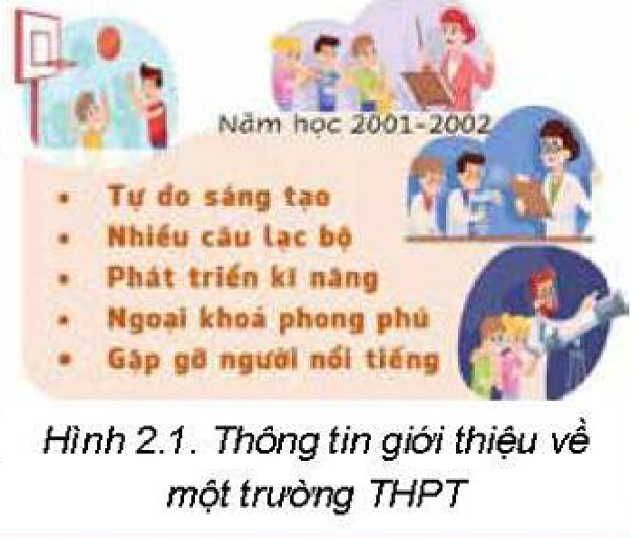
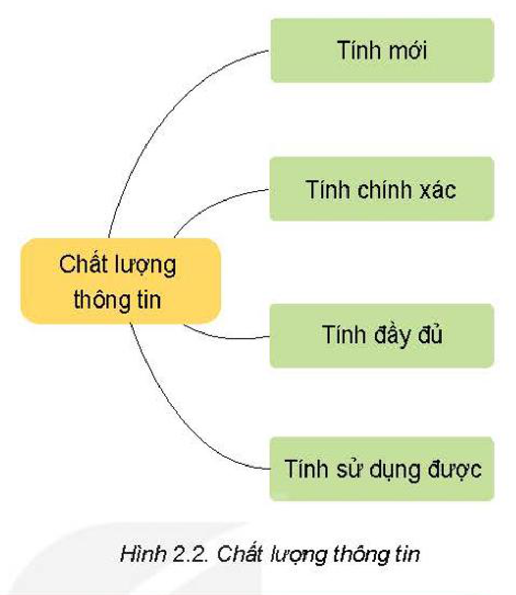

<!-- pdf:11 -->

# BÀI 2: THÔNG TIN TRONG GIẢI QUYẾT VẤN ĐỀ

## 🎯 Sau bài học này em sẽ:

- Giải thích được sự cần thiết phải quan tâm đến chất lượng thông tin khi tìm kiếm, tiếp nhận và trao đổi thông tin. Nêu được ví dụ minh hoạ.
- Giải thích được tính mới, tính chính xác, tính đầy đủ, tính sử dụng được của thông tin. Nêu được ví dụ minh hoạ.

## 🔴 Khởi động

> *Minh:* Chào An, bạn đã quyết định chọn trường nào sau khi tốt nghiệp THCS chưa?
>
> *An:* Chưa, tớ đang phân vân giữa hai lựa chọn: trường công lập hay trường dân lập.
>
> *Minh:* Trường công lập thì học phí thấp, trang thiết bị được Nhà nước đầu tư chắc là phải hơn chứ, bạn còn băn khoăn gì nữa?
>
> *An:* Nhưng trường dân lập cũng có ưu điểm: kế hoạch giáo dục linh hoạt hơn, lại có nhiều cơ hội hoạt động, tiếp xúc với các tổ chức, doanh nghiệp nữa.
>
> *Minh:* Ừ nhỉ, thế thì phải tìm hiểu thêm thông tin. Nhưng thông tin trên Internet thì mỗi người một ý kiến khác nhau, không phải ý kiến nào cũng đúng hoặc phù hợp với mình. Biết làm sao nhỉ?
>
> *An:* Vậy tớ sẽ cân nhắc thêm để chọn trường phù hợp với sở thích và khả năng của mình.
>
> Chúng ta hãy cùng hai bạn tìm hiểu về vai trò của thông tin và chất lượng thông tin trong việc giải quyết những vấn đề được đặt ra trong cuộc sống nhé!

## 1. VAI TRÒ CỦA CHẤT LƯỢNG THÔNG TIN TRONG GIẢI QUYẾT VẤN ĐỀ

> **Hoạt động 1: Chọn trường**
>
> Minh đã tìm kiếm thông tin về các trường THPT trên Internet và gửi cho An địa chỉ trang web giới thiệu về một trường THPT. An xem trang web và thấy có nhiều chi tiết ấn tượng, phù hợp với mình (Hình 2.1). Không tìm hiểu thêm nữa, An quyết định chọn trường đó làm nguyện vọng duy nhất của mình.
>
> Em hãy cho biết việc Minh chia sẻ thông tin với An và An đã tin tưởng, sử dụng thông tin để chọn trường mà chưa tìm hiểu kĩ sẽ có thể xảy ra vấn đề gì?

*Hình 2.1. Thông tin giới thiệu về một trường THPT*

<!-- pdf:12 -->

Tìm được trang web có nhiều thông tin về một trường THPT, Minh đã gửi cho An. Thấy có những lời giới thiệu ấn tượng, An đã vội vàng ra quyết định mà không kiểm tra để biết thông tin có chính xác, đầy đủ và phù hợp với tiêu chí chọn trường của mình hay không. Do dựa trên thông tin chưa được kiểm chứng, quyết định của An có thể không đúng. Hơn nữa, việc An chỉ đăng kí một nguyện vọng sẽ làm giảm cơ hội lựa chọn. Để đưa ra quyết định đúng, An cần sử dụng thông tin có chất lượng từ những nguồn đáng tin cậy như trang web của Sở Giáo dục và Đào tạo, ý kiến của giáo viên chủ nhiệm hay của người thân có kinh nghiệm.

Internet là một kho thông tin khổng lồ. Em có thể tìm thấy nhiều thông tin trên đó nhưng không phải thông tin nào cũng có thể sử dụng để giải quyết vấn đề một cách hiệu quả. Không phải số lượng bản tin mà là chất lượng của thông tin mới thực sự làm cho thông tin trở thành hữu ích. Vì vậy, em cần quan tâm đến chất lượng thông tin khi tìm kiếm, tiếp nhận và trao đổi thông tin.

<!-- term: Vai trò của chất lượng thông tin trong giải quyết vấn đề -->
> Thông tin là cơ sở để đưa ra các quyết định. Cần phải quan tâm đến chất lượng thông tin khi tìm kiếm, tiếp nhận, trao đổi và sử dụng thông tin để có thể đưa ra các quyết định đúng đắn.

> ❓ **Câu hỏi**
>
> **KOL** là thuật ngữ viết tắt của Key Opinion Leader có nghĩa là *người dẫn dắt dư luận chủ chốt* hay *người có ảnh hưởng*. Khi em thấy một KOL quảng cáo sản phẩm trên mạng, em sẽ ứng xử thế nào?
> A. Chia sẻ thông tin với người thân vì KOL là một nguồn tin đáng tin cậy.
> B. Sử dụng sản phẩm vì KOL là một đảm bảo cho sản phẩm đã qua kiểm định.
> C. Cân nhắc, đánh giá chất lượng thông tin trước khi sử dụng sản phẩm.
> D. Không sử dụng và cảnh báo người thân về nguồn tin kém chất lượng.

## 2. CHẤT LƯỢNG THÔNG TIN

> **Hoạt động 2: Thông tin hữu ích**
>
> 1. Hãy tìm kiếm và lựa chọn thông tin mà theo em là hữu ích giúp em chọn trường THPT.
> 2. Tại sao thông tin đó là hữu ích đối việc giải quyết vấn đề chọn trường của em?

Mặc dù thông tin đóng vai trò quan trọng trong việc ra quyết định nhưng không phải thông tin nào cũng hữu ích đối với việc giải quyết vấn đề. **Chất lượng thông tin** thể hiện ở mức độ đáp ứng của thông tin đối với các yêu cầu cụ thể nhằm giải quyết vấn đề, làm thông tin trở nên hữu ích.

Để đánh giá chất lượng thông tin, em cần xem xét các tiêu chí như tính mới, tính chính xác, tính đầy đủ, tính sử dụng được của thông tin (Hình 2.2).

- **Tính mới** (tính cập nhật): Tính mới cho biết thông tin đã bị lỗi thời chưa. Em cần thông tin cập nhật gần nhất vào thời gian nào? Nếu thông tin đã lỗi thời, cũ hoặc chậm trễ, em có thể chọn nhầm trường hoặc bỏ lỡ cơ hội vì không biết những thay đổi của các trường.

- **Tính chính xác**, đúng đắn của thông tin: Nội dung có cụ thể không? Có cách để xác minh hay không? Nếu thông tin không chính xác (ví dụ: sai điểm tuyển sinh, sai tên hoặc sai địa chỉ), em có thể sẽ nhầm lẫn và bỏ qua các trường tiềm năng.

<!-- pdf:13 -->

- **Tính đầy đủ**: Tính đầy đủ thể hiện sự bao quát nhiều khía cạnh, cho em có được cái nhìn tổng thể về vấn đề được đặt ra. Nếu thông tin không đầy đủ (ví dụ: thiếu chi tiết về học phí, môi trường học tập hoặc độ uy tín), em sẽ không có được cái nhìn toàn diện về các trường.

- **Tính sử dụng được** (tính liên quan, phù hợp) của thông tin với vấn đề hay câu hỏi được đặt ra: Nếu thông tin không liên quan (ví dụ: thông tin về du học nước ngoài hay về trung tâm giáo dục thường xuyên không phù hợp với mục tiêu lựa chọn một trường THPT công lập), em sẽ không sử dụng được và thông tin trở nên vô ích.

*Hình 2.2. Chất lượng thông tin*

> - Chất lượng thông tin là yếu tố quan trọng, quyết định hiệu quả của việc giải quyết vấn đề.
> - Chất lượng thông tin được đánh giá thông qua tính mới, tính chính xác, tính đầy đủ, tính sử dụng được.

> ❓ **Câu hỏi**
>
> Trong khi tìm thông tin về các trường THPT, bạn An đã không để ý đến thời gian đăng kí nguyện vọng dự thi và xét tuyển vào lớp 10 các trường THPT công lập. Theo em:
> a) Sơ suất này vi phạm tiêu chí nào về chất lượng thông tin?
> b) Điều đó có thể dẫn đến khó khăn gì cho bạn An?

## ✏️ Luyện tập

Để chuẩn bị cho chuyến tham quan một nông trại, An gọi đến số điện thoại liên lạc được cung cấp trên trang web của nông trại nhưng không được. Minh cho rằng có thể đầu số điện thoại đã thay đổi nhưng nông trại chưa kịp cập nhật lên trang web nên đã tìm kiếm thông tin trên website của các nhà cung cấp dịch vụ viễn thông. Nhờ đó, Minh đã liên hệ thành công với nông trại. Em hãy nhận xét về chất lượng của thông tin (theo 4 tính chất ở Hình 2.2) mà mỗi bạn thu nhận được.

## 🚀 Vận dụng

Em hãy tìm trên Internet thông tin về chiếc máy tính điện tử kĩ thuật số đầu tiên trên thế giới. Đánh giá chất lượng thông tin tìm được.

## 📷 Danh sách hình trong bài

| Mã hình | Trang PDF | Trang sách | Chú thích |
| --- | :---: | :---: | --- |
| H9-tin_hoc-b02-01 | 11 | 9 | Hình 2.1. Thông tin giới thiệu về một trường THPT |
| H9-tin_hoc-b02-02 | 13 | 11 | Hình 2.2. Chất lượng thông tin |
