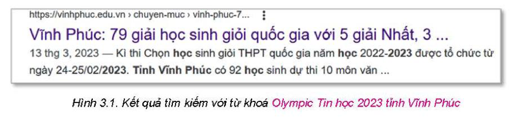
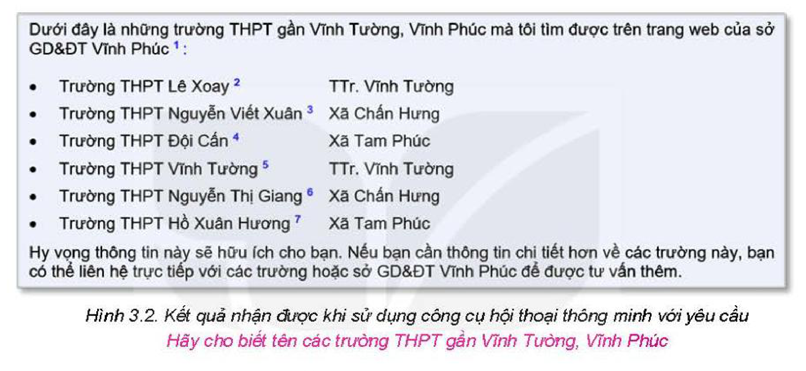
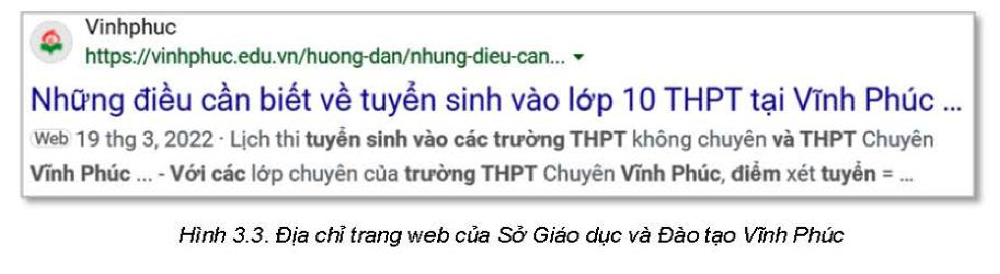

<!-- pdf:14 -->

# BÀI 3: THỰC HÀNH: ĐÁNH GIÁ CHẤT LƯỢNG THÔNG TIN

## 🎯 Sau bài học này em sẽ:

- Tìm kiếm được thông tin để giải quyết vấn đề.
- Đánh giá được chất lượng thông tin trong giải quyết vấn đề.

## 🔴 Khởi động

> Để chuẩn bị cho việc tiếp tục học tập sau khi kết thúc bậc THCS, em cần tìm hiểu thông tin để giải quyết vấn đề lựa chọn môi trường học tập và xu hướng nghề nghiệp trong tương lai, phù hợp với năng lực và nguyện vọng của em.
>
> Theo em, làm thế nào để tìm kiếm được thông tin giúp giải quyết vấn đề chọn trường và đánh giá được chất lượng thông tin mà em đã tìm được?

## Nhiệm vụ 1. TÌM KIẾM THEO MỤC ĐÍCH, YÊU CẦU

**Yêu cầu**

- Xác định mục đích tìm kiếm và những yêu cầu tìm kiếm cụ thể.
- Thực hiện tìm kiếm thông tin dựa trên mục đích và yêu cầu đã xác định.

**Hướng dẫn**

### a) Xác định mục đích, yêu cầu tìm kiếm thông tin

<!-- term: Xác định mục đích, yêu cầu tìm kiếm thông tin -->
- Mục đích: Tìm thông tin về các trường THPT tại địa phương để quyết định lựa chọn nguyện vọng đăng kí.
- Những yêu cầu tìm kiếm có thể là:
  + Điểm chuẩn và chỉ tiêu tuyển sinh của trường trong ba năm gần nhất.
  + Tỉ lệ học sinh của trường tốt nghiệp THPT và trúng tuyển vào các trường đại học có uy tín.
  + Những nhóm môn học mà trường có thế mạnh.
  + Các hoạt động ngoại khoá của trường.
  + Khoảng cách từ nhà đến trường.

### b) Thực hiện tìm kiếm

- Sử dụng máy tìm kiếm và các từ khoá tìm kiếm (xác định từ khoá tìm kiếm dựa vào yêu cầu tìm kiếm) để tìm thông tin trên Internet. Ví dụ: dùng từ khoá *Olympic Tin học 2023 tỉnh Vĩnh Phúc* để tìm thông tin về thế mạnh của các trường (Hình 3.1).
- Lưu trữ tóm tắt (nội dung tóm tắt, địa chỉ trang web) của thông tin tìm được vào một tệp để có thể sử dụng trong việc đánh giá ở bước tiếp theo.

<!-- pdf:15 -->

- Có thể sử dụng công cụ **hội thoại thông minh** (công cụ tương tác giữa người với máy tính có ứng dụng trí tuệ nhân tạo) để khoanh vùng phạm vi tìm kiếm với những yêu cầu cụ thể. Ví dụ: *Hãy cho biết tên các trường THPT gần Vĩnh Tường, Vĩnh Phúc* để biết các trường có địa điểm ở gần nhà (Hình 3.2).

*Hình 3.1. Kết quả tìm kiếm với từ khoá Olympic Tin học 2023 tỉnh Vĩnh Phúc*

*Hình 3.2. Kết quả nhận được khi sử dụng công cụ hội thoại thông minh với yêu cầu Hãy cho biết tên các trường THPT gần Vĩnh Tường, Vĩnh Phúc*

<!-- term: Xem xét thẩm quyền của nguồn thông tin -->
- Em có thể tìm kiếm thông tin từ nhiều nguồn nhưng lưu ý rằng độ tin cậy của thông tin trên Internet rất khác nhau. Vì vậy, với mỗi yêu cầu cụ thể, nguồn thông tin cần được xem xét về thẩm quyền để đảm bảo tính tin cậy. Ví dụ:
  + Thông tin về tuyển sinh vào lớp 10 cần tìm trên website của Sở Giáo dục và Đào tạo. Lưu ý: trang web các Sở Giáo dục và Đào tạo thường có dạng edu.vn (ví dụ vinhphuc.edu.vn) (Hình 3.3).

*Hình 3.3. Địa chỉ trang web của Sở Giáo dục và Đào tạo Vĩnh Phúc*

  + Thông tin về các hoạt động giáo dục và ngoại khoá nên tìm trên website của nhà trường.
  + Không phải mọi thông tin đều có thể tìm được trên website của Sở Giáo dục và Đào tạo hoặc của các trường. Thông tin cần được đối chiếu, kiểm chứng trước khi sử dụng.

<!-- pdf:16 -->

## Nhiệm vụ 2. QUYẾT ĐỊNH DỰA TRÊN CHẤT LƯỢNG THÔNG TIN

**Yêu cầu**

Đánh giá chất lượng thông tin tìm được trong Nhiệm vụ 1. Từ đó, đưa ra danh sách lựa chọn nguyện vọng gồm ba trường theo thứ tự ưu tiên mà em thấy phù hợp với năng lực và sở thích của mình.

**Hướng dẫn**

### a) Đánh giá thông tin

<!-- term: Đánh giá chất lượng thông tin tìm được -->
- Tính mới: Em cần thông tin được cập nhật gần nhất. Em có thể kiểm tra xem thông tin về trường có bị lỗi thời không bằng cách kiểm tra ngày đăng bài hoặc ngày cuối cùng được đề cập đến trong bài viết.
- Tính chính xác: Em có thể kiểm tra xem thông tin có chính xác không bằng cách đối chiếu thông tin từ những nguồn khác nhau. Chẳng hạn, những đánh giá tiêu cực về một trường THPT qua một sự việc cụ thể cần được kiểm chứng qua nhiều nguồn thông tin khác nhau.
- Tính đầy đủ: Em cần hình dung về một trường THPT trong một bức tranh tổng thể, gồm nhiều khía cạnh trong yêu cầu tìm kiếm thông tin. Chẳng hạn, thiếu bất kì thông tin nào như điểm chuẩn, học phí, khoảng cách,... thì lựa chọn của em cũng có thể không thực hiện được.
- Tính sử dụng được: Em có thể kiểm tra thông tin tìm được có phù hợp với yêu cầu chọn trường của em không nhờ tiêu đề và nội dung của bài viết, tránh tập trung vào những thông tin chỉ nhằm thu hút sự chú ý của người xem mà không liên quan đến mục đích tìm kiếm.

### b) Lựa chọn và sắp xếp thứ tự

- Dựa trên thông tin tìm được, em có thể lựa chọn các trường phù hợp với năng lực và sở thích của mình. Em cần lưu ý tính khả thi của phương án được chọn.
- Sắp xếp các trường được chọn theo một danh sách ưu tiên. Thứ tự ưu tiên giữa các tiêu chí lựa chọn sẽ giúp em xác định danh sách các trường được chọn một cách thuận lợi hơn.

## ✏️ Luyện tập

Em hãy thực hành tìm kiếm thông tin trên Internet để biết về các môn học được dạy ở bậc THPT. Dựa vào các thông tin tìm được, em hãy đưa ra dự kiến chọn các môn học mà em thích ở bậc THPT.

## 🚀 Vận dụng

Em hãy tạo một bài trình chiếu về chủ đề Chọn môi trường học tập sau khi kết thúc bậc THCS, với các nguồn thông tin mà em thu thập được.

## 📷 Danh sách hình trong bài

| Mã hình | Trang PDF | Trang sách | Chú thích |
| --- | :---: | :---: | --- |
| H9-tin_hoc-b03-01 | 15 | 13 | Hình 3.1. Kết quả tìm kiếm với từ khoá Olympic Tin học 2023 tỉnh Vĩnh Phúc |
| H9-tin_hoc-b03-02 | 15 | 13 | Hình 3.2. Kết quả nhận được khi sử dụng công cụ hội thoại thông minh với yêu cầu Hãy cho biết tên các trường THPT gần Vĩnh Tường, Vĩnh Phúc |
| H9-tin_hoc-b03-03 | 15 | 13 | Hình 3.3. Địa chỉ trang web của Sở Giáo dục và Đào tạo Vĩnh Phúc |
