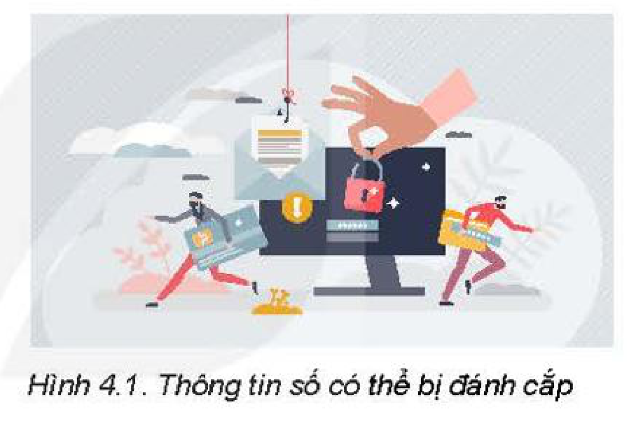
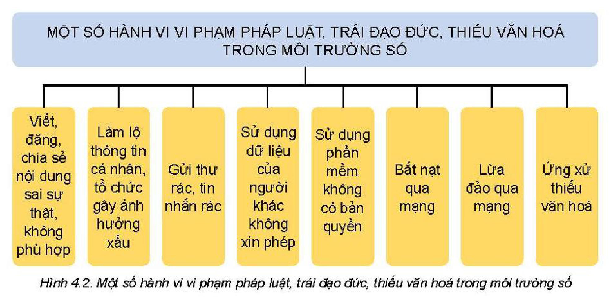

<!-- pdf:17 -->

# BÀI 4: MỘT SỐ VẤN ĐỀ PHÁP LÍ VỀ SỬ DỤNG DỊCH VỤ INTERNET

## 🎯 Sau bài học này em sẽ:

- Trình bày được một số tác động tiêu cực của công nghệ kĩ thuật số đối với đời sống con người và xã hội, nêu được ví dụ minh hoạ.
- Nêu được một số nội dung liên quan đến luật Công nghệ thông tin, nghị định về sử dụng dịch vụ Internet, các khía cạnh pháp lí của việc sở hữu, sử dụng và trao đổi thông tin.
- Nêu được một số hành vi vi phạm pháp luật, trái đạo đức, thiếu văn hoá khi hoạt động trong môi trường số thông qua một vài ví dụ.

## 🔴 Khởi động

> Trong thời đại kĩ thuật số phát triển, hầu hết thông tin đều ở dạng số. Điều này khiến cho đời sống xã hội thay đổi toàn diện. Công nghệ kĩ thuật số giúp cho mọi việc của con người trong lao động, sản xuất, học tập hay giải trí,... thuận tiện, dễ dàng và nhanh chóng hơn. Bên cạnh những tác động tích cực đó, công nghệ kĩ thuật số cũng có những tác động tiêu cực đến con người. Em hãy thảo luận với bạn và kể ra một vài tác động tiêu cực đó.

## 1. MỘT SỐ TÁC ĐỘNG TIÊU CỰC CỦA CÔNG NGHỆ KĨ THUẬT SỐ

> **Hoạt động 1: Mặt trái của công nghệ kĩ thuật số**
>
> 1. Chọn những phương án nói về tác động tiêu cực của công nghệ kĩ thuật số tới đời sống con người và xã hội.
>    A. Quyền riêng tư dễ bị ảnh hưởng.
>    B. Dữ liệu tài khoản ngân hàng bị đánh cắp.
>    C. Giao dịch trong thương mại tăng nhanh nhờ ứng dụng ngân hàng số.
>    D. Ô nhiễm do rác thải từ những thiết bị công nghệ số lỗi thời.
> 2. Em hãy kể thêm một vài tác động tiêu cực của công nghệ kĩ thuật số đối với xã hội.

Mặc dù công nghệ kĩ thuật số thúc đẩy sự phát triển của mọi lĩnh vực trong đời sống, xã hội và đem tới cho chúng ta một cuộc sống ngày càng hiện đại hơn, thông minh hơn, tiện lợi hơn,... nhưng không thể phủ nhận những tác động tiêu cực của công nghệ kĩ thuật số đến con người và xã hội.

<!-- term: Tác động tiêu cực của công nghệ kĩ thuật số đến con người -->
Đối với con người, công nghệ kĩ thuật số tác động tiêu cực đến sức khoẻ thể chất và tinh thần như: gây nghiện Internet, ít giao tiếp, mất ngủ,...; tác động tiêu cực đến quyền riêng tư như: thông tin cá nhân có thể bị rò rỉ và sử dụng bất hợp pháp vì dữ liệu số bị đánh cắp dễ dàng hơn, quy mô lớn hơn.

<!-- pdf:18 -->

<!-- term: Tác động tiêu cực của công nghệ kĩ thuật số đối với xã hội -->
Bên cạnh các ứng dụng nhằm nâng cao chất lượng đời sống, phát triển xã hội thì vẫn có những ứng dụng hỗ trợ và phổ biến tệ nạn trên mạng như lừa đảo, tổ chức đánh bạc trực tuyến,... Công nghệ phát triển, tự động hoá ứng dụng nhiều dẫn đến nguy cơ thất nghiệp tăng và khiến cho một bộ phận người dân yếu thế như người già, người khuyết tật hoặc người dân ở các vùng khó khăn càng ngày càng tụt hậu. Đó chính là những tác động tiêu cực đối với xã hội của công nghệ kĩ thuật số. Ngoài ra, công nghệ phát triển nhanh khiến những thiết bị số nhanh chóng trở nên lỗi thời. Những thiết bị số bị thải ra nhiều, sẽ tạo ra **rác thải điện tử** nguy hại cho môi trường.

Một số ví dụ cụ thể về tác động tiêu cực của công nghệ kĩ thuật số là:
- Chơi game quá nhiều, liên tục có thể gây nghiện. Không được chơi sẽ cảm thấy bứt rứt, khó chịu, không kiểm soát được cảm xúc.
- Quá lệ thuộc vào công nghệ kĩ thuật số để giải quyết những vấn đề nhỏ trong cuộc sống (học sinh nhờ trí tuệ nhân tạo làm bài tập về nhà, làm văn,...).
- Trò chuyện trực tuyến với đối tượng ẩn danh hay mạo danh dẫn đến nguy cơ mất an toàn do có thể lộ thông tin cá nhân.
- Thông tin số có thể bị đánh cắp, gây thiệt hại cho người sử dụng. Ví dụ: Việc lộ thông tin tài khoản ngân hàng có thể bị mất tiền trong tài khoản (Hình 4.1).
- Thông tin về cha mẹ, số điện thoại, địa chỉ nhà của học sinh có thể bị đánh cắp và bị các đối tượng xấu lợi dụng, giả danh liên hệ để lừa cha mẹ học sinh.

*Hình 4.1. Thông tin số có thể bị đánh cắp*

> Ngoài các tác động tích cực, công nghệ kĩ thuật số còn có một số tác động tiêu cực lên đời sống con người và xã hội.

> ❓ **Câu hỏi**
>
> 1. Phương án nào sau đây không phải là tác động tiêu cực của công nghệ kĩ thuật số đến đời sống con người?
>    A. Nhờ trí tuệ nhân tạo làm bài tập về nhà.
>    B. Truy cập mạng xã hội trong nhiều giờ.
>    C. Thường xuyên sử dụng phần mềm soạn thảo văn bản để làm báo cáo.
>    D. Vừa ăn vừa xem video trên trang Youtube.
> 2. Những phương án nào sau đây là tác động tiêu cực của công nghệ kĩ thuật số đến xã hội?
>    A. Thông tin cá nhân của con người được số hoá.
>    B. Sử dụng thiết bị số liên tục trong thời gian dài ảnh hưởng đến sức khoẻ thể chất và tinh thần của lớp trẻ.
>    C. Gia tăng ô nhiễm môi trường.
>    D. Làm gia tăng tỉ lệ thất nghiệp.

<!-- pdf:19 -->

## 2. SỬ DỤNG DỊCH VỤ INTERNET ĐÚNG LUẬT

> **Hoạt động 2: Sử dụng dịch vụ Internet đúng luật**
>
> 1. Những hành động nào sau đây vi phạm pháp luật, trái đạo đức, thiếu văn hoá?
>    A. Tải về một hình ảnh trên Internet khi chưa có sự cho phép của chủ sở hữu và sử dụng như là của mình.
>    B. Sử dụng ngôn ngữ phản cảm khi giao tiếp trên mạng xã hội.
>    C. Chúc mừng sinh nhật bạn trên mạng xã hội.
>    D. Đăng hình ảnh, video bôi nhọ, xúc phạm tập thể hoặc cá nhân lên mạng.
> 2. Em hãy kể thêm một số hành vi vi phạm pháp luật, trái đạo đức, thiếu văn hoá của người sử dụng khi sử dụng dịch vụ Internet.

### a) Những hành vi vi phạm pháp luật, trái đạo đức, thiếu văn hoá khi hoạt động trong môi trường số

Ở lớp 7 em đã biết ứng xử khi giao tiếp qua mạng cần theo đúng quy tắc và bằng ngôn ngữ lịch sự, có văn hoá; đã biết cách ứng xử hợp lí khi gặp những thông tin trên mạng có nội dung xấu, không phù hợp lứa tuổi. Ở lớp 8, em cũng đã được học để nhận biết một số biểu hiện vi phạm đạo đức và pháp luật, biểu hiện thiếu văn hoá khi sử dụng công nghệ kĩ thuật số. Em có thể nhận biết một số hành vi vi phạm pháp luật, trái đạo đức, thiếu văn hoá trong môi trường mạng (Hình 4.2), ví dụ như:

<!-- term: Hành vi vi phạm pháp luật, trái đạo đức, thiếu văn hoá trong môi trường số -->
- Viết bài, đăng tin tức hoặc chia sẻ bài đăng sai sự thật hoặc không phù hợp lên mạng. Tuỳ theo nội dung thông tin và hậu quả mà những hành vi đó có thể là vi phạm pháp luật hay vi phạm đạo đức.
- Làm lộ thông tin của cá nhân hay tổ chức mà không được phép, gây ảnh hưởng đến uy tín và danh dự của cá nhân hay tổ chức là hành vi vi phạm pháp luật.
- Gửi thư rác hay tin nhắn rác với mục đích quảng cáo mà người được gửi không muốn nhận. Quảng cáo bằng tin nhắn không phải là hành vi xấu và không vi phạm pháp luật, nhưng nếu gửi nhiều mà người nhận đã có phản ứng không muốn nhận thì trở thành hành vi quấy nhiễu.
- Sử dụng dữ liệu của người khác không xin phép hay sử dụng phần mềm không có bản quyền là hành vi vi phạm pháp luật. Những sản phẩm được số hoá và đưa lên mạng rất dễ bị sao chép, phát tán, sửa đổi gây thiệt hại cho chủ sở hữu.
- Dùng lời nói xúc phạm, đăng bình luận đả kích, khiếm nhã, quấy rối hoặc kêu gọi tẩy chay; thậm chí dùng hình ảnh, video nhằm chỉ trích, hạ nhục người khác.
- Bằng các hình thức như giả mạo ngân hàng, cơ quan nhà nước, người thân,... tạo liên kết hoặc gọi điện lừa đảo dưới dạng trúng thưởng, từ thiện, gây tò mò,... nhằm lừa đảo chiếm tài khoản, lấy cắp thông tin, chiếm đoạt tài sản, tống tiền.
- Ứng xử thiếu văn hoá: Trên các diễn đàn, mạng xã hội, có những người tranh luận thiếu văn hoá, không tôn trọng người đối thoại, thậm chí dùng từ ngữ phản cảm.

<!-- pdf:20 -->

*Hình 4.2. Một số hành vi vi phạm pháp luật, trái đạo đức, thiếu văn hoá trong môi trường số*

### b) Sử dụng dịch vụ Internet đúng luật

Ở lớp 7 em đã biết chỉ ra ví dụ truy cập không hợp lệ vào các nguồn thông tin, ở lớp 8 em đã biết cách bảo đảm được các sản phẩm số do em tạo ra thể hiện được đạo đức, tính văn hoá và không vi phạm pháp luật.

Năm 2006, Quốc hội ban hành **Luật Công nghệ thông tin số 67/2006/QH11** quy định chi tiết về quyền và trách nhiệm của tổ chức, cá nhân tham gia ứng dụng và phát triển công nghệ thông tin cũng như các hành vi bị nghiêm cấm.

Năm 2013, Chính phủ ban hành **Nghị định số 72/2013/NĐ-CP** quy định chi tiết việc quản lí, cung cấp, sử dụng dịch vụ Internet, thông tin trên mạng, trò chơi điện tử trên mạng; bảo đảm an toàn thông tin và an ninh thông tin; quyền và nghĩa vụ của tổ chức, cá nhân tham gia việc quản lí, cung cấp, sử dụng dịch vụ Internet, thông tin trên mạng, trò chơi điện tử trên mạng;... Trong nghị định này cũng ghi rõ các hành vi bị cấm.

Năm 2018, Quốc hội ban hành **Luật An ninh mạng** quy định về hoạt động bảo vệ an ninh quốc gia và bảo đảm trật tự, an toàn xã hội trên không gian mạng; trách nhiệm của cơ quan, tổ chức, cá nhân có liên quan. Trong đó có ghi rõ các hành vi bị nghiêm cấm về an ninh mạng.

Tóm lại, người sử dụng Internet, mạng xã hội phải trang bị cho mình những kiến thức cần thiết để bảo đảm sử dụng không gian mạng có trách nhiệm, không vi phạm pháp luật. Có thể nêu ra một số hành vi cần tránh như sau:

<!-- term: Các hành vi cần tránh khi sử dụng dịch vụ Internet -->
- Hành vi vi phạm pháp luật về an ninh quốc gia, trật tự, an toàn xã hội. Chẳng hạn, không xem xét kĩ mà đã chia sẻ, phát tán thông tin chưa kiểm chứng, bình luận sai trái, chi tiết bịa đặt,... vì như vậy là đã vô tình tiếp tay cho kẻ xấu phát tán thông tin vi phạm pháp luật.
- Hành vi vi phạm quyền nhân thân, uy tín của cá nhân và tổ chức. Chẳng hạn, đăng hình ảnh, địa chỉ nhà, biển số xe,... của người khác hoặc các thông tin cá nhân, thông tin của tổ chức, doanh nghiệp,... mà không có sự đồng ý của họ cũng là vi phạm pháp luật.
- Hành vi vi phạm pháp luật liên quan đến sở hữu trí tuệ, sở hữu tài sản, đánh bạc,... Chẳng hạn, tuỳ tiện chia sẻ đoạn văn, bài thơ, bức ảnh, đoạn mã chương trình hay sản phẩm số của người khác khi không được phép hoặc truy cập trang web tổ chức đánh bạc trực tuyến trái pháp luật,...

<!-- pdf:21 -->

<!-- term: Các hành vi cần tránh khi sử dụng dịch vụ Internet -->
- Hành vi vi phạm đến việc bảo đảm an toàn thông tin trên không gian mạng. Chẳng hạn, làm phát tán virus máy tính thông qua truy cập các liên kết lừa đảo nhận thưởng hoặc gây tò mò.
- Hành vi tuyên truyền, quảng cáo, giới thiệu sản phẩm, dịch vụ không phù hợp quy định của pháp luật, trái với thuần phong, mĩ tục, lối sống văn minh,... Chẳng hạn, quảng cáo vũ khí, buôn bán động vật quý hiếm,...
- Hành vi xuyên tạc lịch sử, phủ nhận thành tựu cách mạng, phá hoại khối đại đoàn kết toàn dân tộc, xúc phạm hoặc phân biệt đối xử về tôn giáo, về giới, về chủng tộc, về vùng miền,...

> - Khi hoạt động trong môi trường số, sử dụng các dịch vụ Internet, người sử dụng cần có trách nhiệm, không vi phạm pháp luật và ứng xử lành mạnh, có văn hoá.
> - Khi hoạt động trong môi trường số, em cần cẩn trọng, tránh vi phạm bản quyền khi sử dụng dữ liệu, phần mềm và cảnh giác với các giao tiếp trên mạng. Đồng thời khi giao tiếp cũng luôn thể hiện là người có văn hoá, tôn trọng mọi người.

> ❓ **Câu hỏi**
>
> 1. Hành vi nào sau đây khi hoạt động trong môi trường số không vi phạm pháp luật, trái đạo đức, thiếu văn hoá?
>    A. Đăng bài hoặc bình luận gây mâu thuẫn vùng miền.
>    B. Quảng cáo bán hàng hoá, dịch vụ bị cấm.
>    C. Sử dụng trái phép tài khoản mạng của tổ chức, cá nhân khác.
>    D. Chia sẻ thông tin về lớp học ngôn ngữ lập trình trực tuyến.
> 2. Minh nhận được một liên kết lạ từ một bạn mới quen trên mạng yêu cầu chia sẻ liên kết này cho 5 bạn và truy cập liên kết để nhận được một phần quà là chiếc ba lô rất đẹp. Theo em, Minh có nên làm theo yêu cầu đó không? Tại sao?

## ✏️ Luyện tập

1. Em hãy cho biết những cách nào sau đây giúp em tránh được các tác động tiêu cực khi sử dụng công nghệ kĩ thuật số?
   A. Không sử dụng thiết bị số trong thời gian dài và liên tục.
   B. Không xem các video phản cảm.
   C. Giảm thời gian dùng điện thoại để nói chuyện với gia đình.
   D. Tham gia luyện tập thể dục thể thao.
2. Em hãy lấy ví dụ về một hành vi vi phạm pháp luật, một hành vi trái đạo đức khi hoạt động trong môi trường số.

## 🚀 Vận dụng

Em hãy tìm hiểu các hành vi bị cấm trong *Luật Công nghệ thông tin số 67/2006/QH11* và *Nghị định số 72/2013/NĐ-CP*. Hai văn bản này giống và khác nhau như thế nào?

## 📷 Danh sách hình trong bài

| Mã hình | Trang PDF | Trang sách | Chú thích |
| --- | :---: | :---: | --- |
| H9-tin_hoc-b04-01 | 18 | 16 | Hình 4.1. Thông tin số có thể bị đánh cắp |
| H9-tin_hoc-b04-02 | 20 | 18 | Hình 4.2. Một số hành vi vi phạm pháp luật, trái đạo đức, thiếu văn hoá trong môi trường số |
