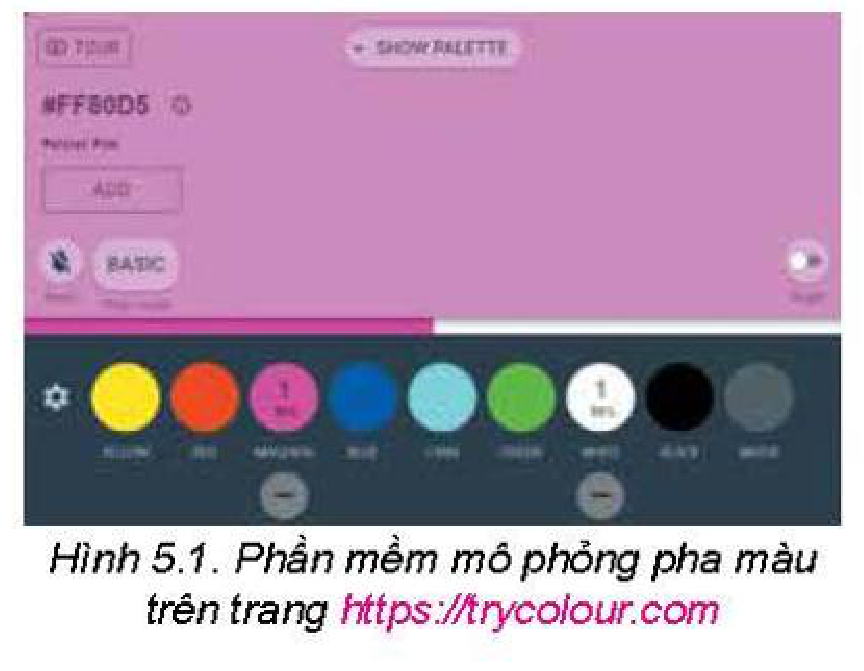
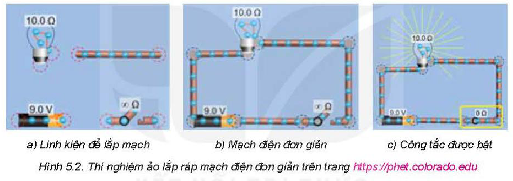
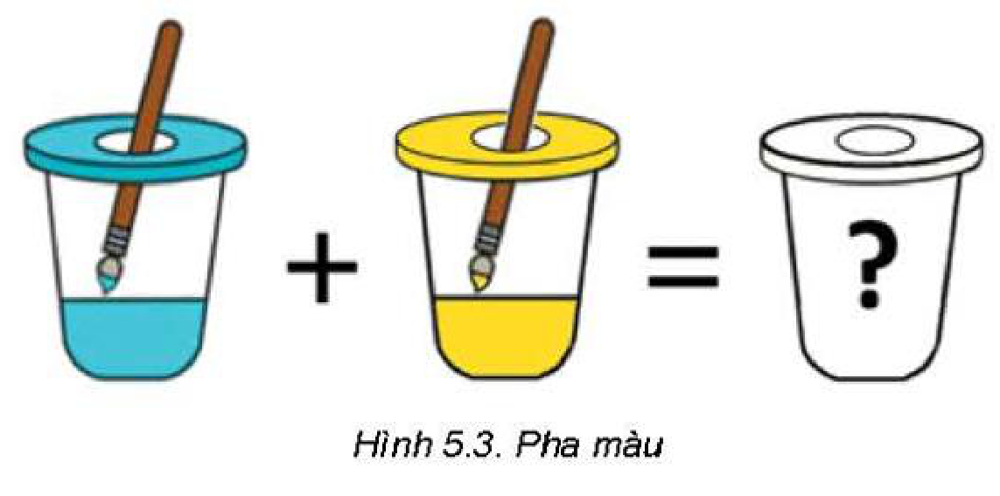

<!-- pdf:22 -->

# BÀI 5: TÌM HIỂU PHẦN MỀM MÔ PHỎNG

## 🎯 Sau bài học này em sẽ:

- Nêu được ví dụ phần mềm mô phỏng. Nhận ra được ích lợi của phần mềm mô phỏng.

## 🔴 Khởi động

> *Minh:* Pha màu để vẽ tưởng là đơn giản nhưng rất phức tạp. Tớ pha mãi mà chưa tạo ra được màu cánh sen ưng ý.
>
> *An:* Đúng là pha màu cần nhiều kinh nghiệm. Bạn sẽ phải tốn nhiều thời gian và màu vẽ đấy.
>
> *Minh:* Tớ đã trộn nhiều màu đến mức, màu trở nên xỉn đục và không dùng được nữa.
>
> *An:* Theo tớ, để tập pha màu mà tiết kiệm được thời gian và màu vẽ thì cậu nên sử dụng phần mềm mô phỏng trước khi thực hành pha màu.

## 1. PHẦN MỀM MÔ PHỎNG

> **Hoạt động 1: Pha màu**
>
> Trong thực tế, khi pha màu, em chỉ có thể thay đổi tỉ lệ (giữa các màu) trong hỗn hợp màu đã pha bằng cách trộn thêm màu. Việc bổ sung nhiều màu có thể dẫn đến hỗn hợp màu xỉn đục và không dùng được nữa. Điều đó xảy ra nhiều lần, khiến em mất nhiều thời gian và giảm hứng thú đối với việc pha màu.
>
> Phần mềm mô phỏng pha màu (Hình 5.1) cho phép em chọn màu, tăng giảm tỉ lệ các màu và giúp em nhìn thấy màu kết quả được tạo ra trên màn hình. Em hãy cho biết việc sử dụng phần mềm mô phỏng pha màu để tập pha màu và tìm hiểu về màu sắc có những lợi ích gì?

Em có thể tìm thấy những phần mềm pha màu trên Internet bằng từ khoá “mixing colors simulator”. Một trong số đó là https://trycolors.com. Em có thể tương tác với phần mềm bằng cách chọn và thay đổi tỉ lệ của các màu đã cho và quan sát màu kết quả.

Việc tạo ra màu mới một cách dễ dàng giúp em tiết kiệm vật liệu, thời gian, qua đó hứng thú đối với việc tạo ra những màu mới và tìm hiểu về những hệ thống màu khác nhau. Tuy không phải màu vẽ thật nhưng màu và cách tạo màu trong phần mềm có thể giúp em hình dung ra sự kết hợp của các màu và tập pha màu một cách hiệu quả.

*Hình 5.1. Phần mềm mô phỏng pha màu trên trang https://trycolour.com*

<!-- pdf:23 -->

<!-- term: Phần mềm mô phỏng -->
**Phần mềm mô phỏng** là phương tiện giúp em quan sát và hình dung ra những hiện tượng khó hoặc không thể trải nghiệm trong thực tế, giúp em giải quyết nhiều vấn đề trong học tập, ví dụ như:

- Phần mềm Crocodile Physics hay phần mềm trực tuyến https://phet.colorado.edu mô phỏng nhiều thí nghiệm vật lí (Hình 5.2).
- Phần mềm Crocodile Chemistry hay ChemLab mô phỏng thí nghiệm hoá học.
- Những phần mềm như GeoGebra, Cabri II plus, Cabri 3D, Geometer’s Sketchpad,... giúp em vẽ các hình hình học và giải toán.
- Phần mềm Flowgorithm cho phép em chạy thử thuật toán dạng sơ đồ khối trước khi cài đặt trong một ngôn ngữ lập trình.

Bên cạnh đó, phần mềm mô phỏng còn có thể được sử dụng trong nhiều lĩnh vực khác, chẳng hạn:

- Nghiên cứu chuyển động và tương tác giữa các phân tử trong những điều kiện khác nhau https://physics.weber.edu/schroeder/md.
- Nghiên cứu và xây dựng các giải pháp giao thông nhằm giảm bớt hiện tượng tắc nghẽn giao thông trong các thành phố https://www.traffic-simulation.de.

*Hình 5.2. Thí nghiệm ảo lắp ráp mạch điện đơn giản trên trang https://phet.colorado.edu*

<!-- term: Phần mềm mô phỏng -->
> **Phần mềm mô phỏng** thể hiện trực quan sự vận động của một đối tượng, cho phép người dùng tương tác và tìm hiểu cách thức hoạt động của đối tượng đó.

> ❓ **Câu hỏi**
>
> Em hãy kể tên một phần mềm mô phỏng mà em biết. Phần mềm đó mô phỏng hoạt động của đối tượng nào?

## 2. LỢI ÍCH CỦA PHẦN MỀM MÔ PHỎNG

> **Hoạt động 2: Lợi ích của phần mềm mô phỏng**
>
> Phần mềm mô phỏng pha màu có những lợi ích gì trong việc tìm hiểu và tập pha trộn màu theo cách thông thường?

<!-- term: Hệ màu -->
Phần mềm mô phỏng pha màu giúp em học cách tạo ra màu mới từ những màu đã cho mà vẫn tiết kiệm được thời gian và vật liệu. Ngoài ra, bằng cách thay đổi các lựa chọn của phần mềm, em có thể tìm hiểu được những hệ màu cơ bản khác nhau như RGB (đỏ, lục, lam), CMYK (xanh lơ, hồng sẫm, vàng, đen) hay RYB (đỏ, vàng, lam).

<!-- pdf:24 -->

<!-- term: Lợi ích của phần mềm mô phỏng -->
Phần mềm mô phỏng có những lợi ích như:

- Giúp người sử dụng làm quen, tìm hiểu, nghiên cứu hoạt động của một đối tượng, sự vật với chi phí thấp.
- Giúp người sử dụng nghiên cứu những nội dung lí thuyết một cách trực quan, sinh động bằng cách tương tác với phần mềm.
- Tạo ra nhiều tình huống để luyện tập hoặc nghiên cứu đối tượng một cách đầy đủ hơn.
- Hạn chế những tình huống có thể làm hỏng thiết bị hoặc gây nguy hiểm cho con người.

Tuy nhiên, các phần mềm mô phỏng có chất lượng khác nhau. Em cần lưu ý sử dụng các phần mềm có chất lượng cao và không vi phạm bản quyền.

> **Lợi ích của phần mềm mô phỏng** là hỗ trợ nghiên cứu đối tượng một cách toàn diện, sinh động và an toàn với chi phí thấp hơn nghiên cứu trực tiếp trong thực tế.

> ❓ **Câu hỏi**
>
> Em hãy cho biết lợi ích của phần mềm mô phỏng mà em đã kể tên ở phần Câu hỏi của Mục 1.

## ✏️ Luyện tập

Em hãy tìm một phần mềm mô phỏng hỗ trợ học tập và trả lời các câu hỏi sau:

a) Phần mềm đó mô phỏng hoạt động nào?

b) Phần mềm đó giúp em làm gì?

c) Phần mềm đó có những lợi ích gì?

## 🚀 Vận dụng

Em hãy tìm kiếm trên Internet một phần mềm mô phỏng pha màu để tìm hiểu hệ màu CMYK và cho biết các màu đỏ (**Red**), lục (**Green**) và lam (**Blue**) lần lượt được tạo ra từ những màu nào trong ba màu cơ bản xanh lơ (**Cyan**), hồng sẫm (**Magenta**) và vàng (**Yellow**) của hệ màu CMYK bằng cách trả lời các câu hỏi sau:

a) Cyan + Yellow = ? (Hình 5.3)

b) Cyan + Magenta = ?

c) Magenta + Yellow = ?

*Hình 5.3. Pha màu*

## 📷 Danh sách hình trong bài

| Mã hình | Trang PDF | Trang sách | Chú thích |
| --- | --- | --- | --- |
| H9-tin_hoc-b05-01 | 22 | 20 | Hình 5.1. Phần mềm mô phỏng pha màu trên trang https://trycolour.com |
| H9-tin_hoc-b05-02 | 23 | 21 | Hình 5.2. Thí nghiệm ảo lắp ráp mạch điện đơn giản trên trang https://phet.colorado.edu |
| H9-tin_hoc-b05-03 | 24 | 22 | Hình 5.3. Pha màu |
