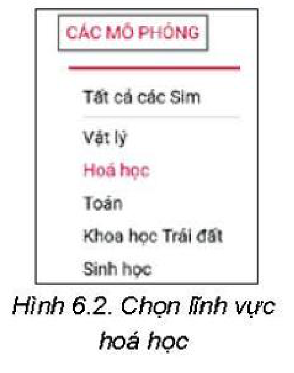
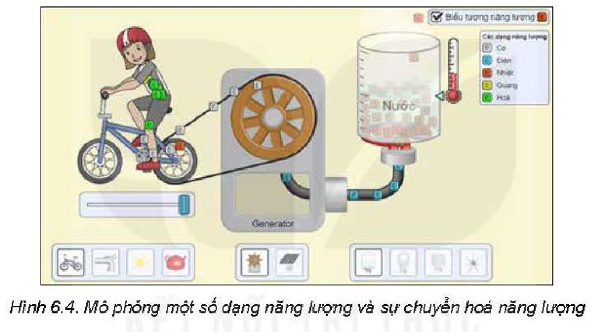
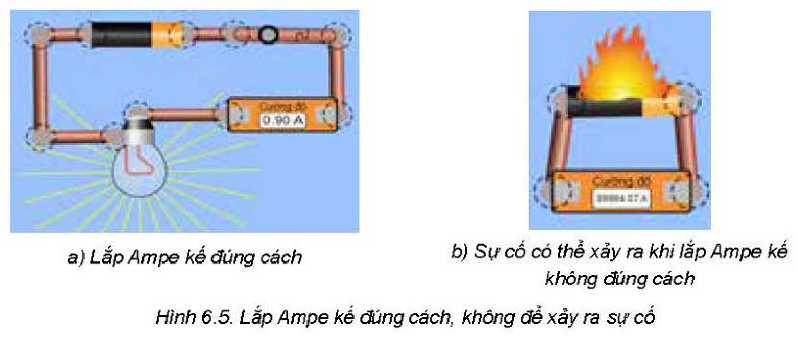
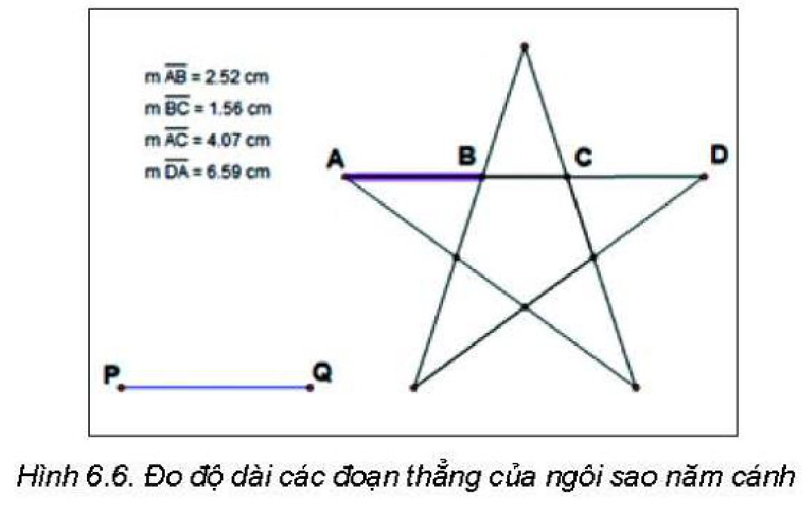
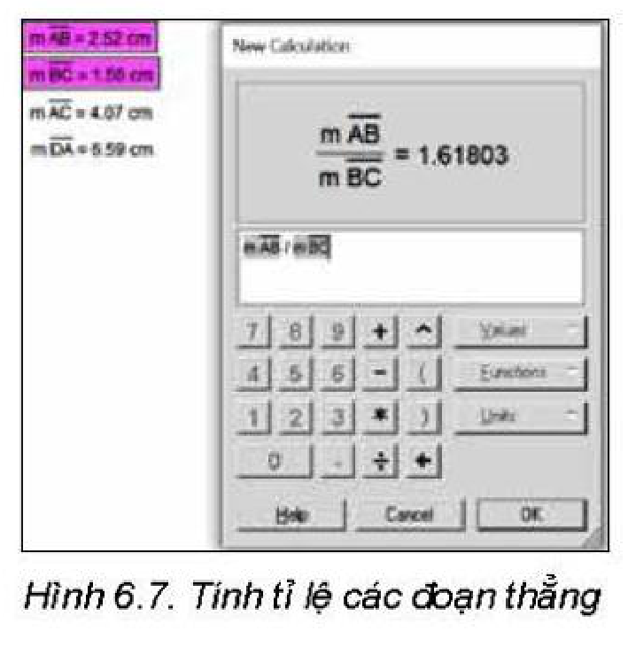
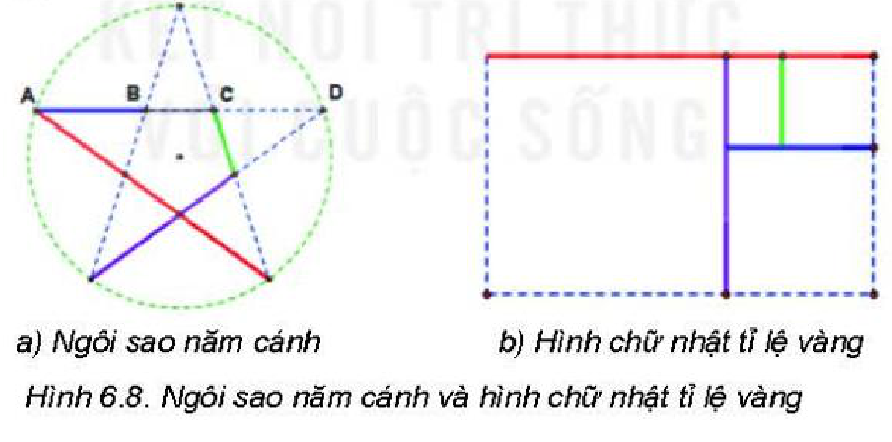

<!-- pdf:25 -->

# BÀI 6: THỰC HÀNH: KHAI THÁC PHẦN MỀM MÔ PHỎNG

## 🎯 Sau bài học này em sẽ:

- Nêu được những kiến thức đã thu nhận từ việc khai thác một vài phần mềm mô phỏng.
- Nhận biết được sự mô phỏng thế giới thực nhờ máy tính có thể giúp con người khám phá tri thức và giải quyết vấn đề.

## 🔴 Khởi động

<!-- term: Thí nghiệm ảo -->
> Phần mềm mô phỏng trình bày các hiện tượng khoa học bằng cách sử dụng hình ảnh động hay ba chiều, giúp em cảm nhận được sự vận động của các đối tượng. Bằng cách tương tác, khám phá nhiều chức năng của phần mềm mô phỏng dạng thí nghiệm ảo, em không chỉ bổ sung kiến thức về khoa học, toán học, học cách giải quyết một số vấn đề đặt ra trong công nghệ mà còn có thể phát hiện được những điều mới mẻ.

## Nhiệm vụ 1. CHUYỂN HOÁ NĂNG LƯỢNG

**Yêu cầu**

– Sử dụng phần mềm mô phỏng quá trình năng lượng được chuyển hoá từ dạng này qua dạng khác.

– Kể tên một số dạng năng lượng và nêu ví dụ về quá trình chuyển hoá giữa những dạng năng lượng đó.

**Hướng dẫn**

### a) Mở cửa sổ mô phỏng một số dạng năng lượng và sự chuyển hoá năng lượng

– Khởi động trình duyệt web. Nhập https://phet.colorado.edu/ vào thanh địa chỉ để mở trang PhET.

– Di chuyển đến cuối trang web, chọn ngôn ngữ hiển thị là tiếng Việt (Hình 6.1).

– Chọn mục **CÁC MÔ PHỎNG**. Chọn **Hoá học** (Hình 6.2).

– Nháy chuột vào biểu tượng **Các dạng và sự chuyển hoá năng lượng** để chọn nội dung mô phỏng (Hình 6.3). Nháy chuột vào nút play [biểu tượng nút play] để mở cửa sổ tương tác.

*Hình 6.1. Chọn ngôn ngữ hiển thị là tiếng Việt*

*Hình 6.2. Chọn lĩnh vực hoá học*

*Hình 6.3. Chọn nội dung mô phỏng*

*Lưu ý:* Em cũng có thể truy cập trực tiếp mô phỏng “Các dạng và sự chuyển hoá năng lượng” qua đường liên kết sau: https://phet.colorado.edu/vi/simulations/energy-forms-and-changes.

<!-- pdf:26 -->

### b) Tương tác với phần mềm

Trong cửa sổ, em có thể quan sát được sự chuyển hoá của các dạng năng lượng thông qua những biểu tượng. Em cũng có thể tương tác với ứng dụng bằng cách chọn nguồn năng lượng, thiết bị chuyển hoá năng lượng và thiết bị tiêu thụ năng lượng (Hình 6.4).

– Thay đổi nguồn năng lượng: người đạp xe, ánh sáng mặt trời, vòi nước chảy, ấm nước sôi (Hình 6.4).

– Thay đổi thiết bị chuyển hoá năng lượng thành điện năng: pin mặt trời và máy phát điện.

– Thay đổi thiết bị tiêu thụ điện: bếp điện, bóng đèn sợi đốt, bóng đèn compact, quạt điện.

### c) Nêu kiến thức thu nhận được

– Em quan sát được những dạng năng lượng nào?

– Nêu một tình huống năng lượng được chuyển hoá từ dạng này sang dạng khác.

*Hình 6.4. Mô phỏng một số dạng năng lượng và sự chuyển hoá năng lượng*

## Nhiệm vụ 2. ĐO CƯỜNG ĐỘ DÒNG ĐIỆN

**Yêu cầu**

Sử dụng phần mềm thí nghiệm ảo lắp ráp mạch điện một chiều. Giải quyết vấn đề đo cường độ dòng điện đi qua một điện trở, chẳng hạn một bóng đèn.

**Hướng dẫn**

### a) Truy cập phần mềm mô phỏng

– Thực hiện tương tự Nhiệm vụ 1, chọn **CÁC MÔ PHỎNG**. Chọn **Vật lý**.

– Chọn **Bộ lắp ráp mạch điện: DC–Phòng thí nghiệm ảo** để vào phòng thí nghiệm ảo lắp ráp mạch điện.

### b) Vẽ mạch điện

– Kéo các biểu tượng Pin, Đèn tròn, Ampe kế, Công tắc và Dây nối, thả vào vùng hiển thị.

– Kết nối các thành phần của mạch điện (Hình 6.5a).

*Lưu ý:* Ampe kế cần mắc nối tiếp với đoạn mạch điện cần đo cường độ dòng điện và không mắc trực tiếp vào hai cực của nguồn điện (Hình 6.5b).

<!-- pdf:27 -->

*Hình 6.5. Lắp Ampe kế đúng cách, không để xảy ra sự cố*

### c) Trình bày giải pháp

Tương tác với phần mềm và nêu giải pháp đo cường độ dòng điện trên một đoạn của mạch điện bằng cách trả lời các câu hỏi sau:

– Em cần dùng thiết bị nào để đo cường độ dòng điện trên mạch điện?

– Thiết bị đó được nối song song hay nối tiếp với mạch điện cần đo?

## Nhiệm vụ 3. TỈ LỆ VÀNG TRONG NGÔI SAO NĂM CÁNH

**Yêu cầu**

Sử dụng công cụ đo và tính toán trong phần mềm mô phỏng hình học. Khám phá tri thức về tỉ lệ các đoạn thẳng xuất hiện trong một ngôi sao có năm cánh cách đều nhau.

**Hướng dẫn**

*(Hướng dẫn sau đây sử dụng phần mềm Geometer’s Sketchpad để minh hoạ.)*

### a) Truy cập phần mềm và mở tệp dữ liệu

– Khởi động phần mềm Geometer’s Sketchpad. Mở tệp `TyLeVang.gsp` bằng cách chọn **File/Open** hoặc nhấn tổ hợp phím **Ctrl + O** và chọn tệp. Tệp dữ liệu đã có sẵn một ngôi sao năm cánh (Hình 6.6a).

– Em hãy di chuyển ngôi sao này bằng cách chọn đỉnh hoặc cạnh của nó và kéo thả chuột đến vị trí khác. Kích thước ngôi sao được điều chỉnh bằng cách kéo thả điểm P hoặc điểm Q để độ dài đoạn thẳng PQ thay đổi.

*Hình 6.6. Đo độ dài các đoạn thẳng của ngôi sao năm cánh*

<!-- pdf:28 -->

### b) Đo độ dài

– Sử dụng công cụ chọn đối tượng [biểu tượng mũi tên chọn] để chọn đoạn thẳng AB (Hình 6.6) và chọn **Measure/Length** để đo độ dài đoạn AB đã chọn.
<!-- ocr-ok: đối chiếu ảnh trang PDF 28; biểu tượng mũi tên chọn là hình vẽ trong dòng nên OCR không đọc -->

– Tương tự như vậy, em sẽ đo được độ dài các đoạn thẳng BC, AC và AD.

### c) Tính tỉ lệ

– Mở công cụ tính bằng cách gõ tổ hợp phím **Alt + =** hoặc chọn **Number/Calculate...** (**Measure/Calculate...** với Geometer’s Sketchpad 4.x).

– Nhập biểu thức cần tính bằng bàn phím, bàn phím ảo hoặc sử dụng chuột để chọn các giá trị đã được đo hoặc tính trước trên màn hình (Hình 6.7).

*Hình 6.7. Tính tỉ lệ các đoạn thẳng*

### d) Khám phá tri thức

– Thay đổi kích thước ngôi sao bằng cách kéo thả điểm P hoặc điểm Q, em sẽ thấy số đo các đoạn thẳng AB, BC, AC và AD cũng thay đổi theo.

– Điều đáng kinh ngạc là dù độ dài của các đoạn thẳng thay đổi nhưng tỉ lệ giữa chúng không thay đổi, luôn bằng nhau và xấp xỉ 1,62. Chính xác hơn, ta sẽ có:

$$\frac{AB}{BC} = \frac{AC}{AB} = \frac{AD}{AC} = \frac{1 + \sqrt{5}}{2} \approx 1,618034$$
<!-- ocr-ok: đối chiếu ảnh trang PDF 28; công thức toán học tỷ lệ vàng -->

– Tỉ lệ trên có tính chất đặc biệt, được gọi là **tỉ lệ vàng**. Nếu một hình chữ nhật có tỉ lệ hai cạnh là tỉ lệ vàng thì sau khi cắt bỏ một hình vuông, phần còn lại là một hình chữ nhật cũng có tỉ lệ hai cạnh là tỉ lệ vàng (Hình 6.8b). Một hình chữ nhật như vậy được gọi là **hình chữ nhật tỉ lệ vàng**.

*Hình 6.8. Ngôi sao năm cánh và hình chữ nhật tỉ lệ vàng*

## ✏️ Luyện tập

Em hãy nêu giải pháp đo điện áp giữa hai đầu một điện trở bằng cách sử dụng phần mềm mô phỏng.

## 🚀 Vận dụng

Trong phần mềm mô phỏng, em có thể lắp ráp mạch điện gồm: nguồn điện, công tắc, điện trở, ampe kế, vôn kế. Bằng cách thay đổi trị số của các linh kiện, hãy khám phá quy luật phụ thuộc lẫn nhau giữa điện trở, cường độ dòng điện qua nó và điện áp giữa hai đầu điện trở đó.

## 📷 Danh sách hình trong bài

| Mã hình | Trang PDF | Trang sách | Chú thích |
| --- | --- | --- | --- |
| H9-tin_hoc-b06-01 | 25 | 23 | Hình 6.1. Chọn ngôn ngữ hiển thị là tiếng Việt |
| H9-tin_hoc-b06-02 | 25 | 23 | Hình 6.2. Chọn lĩnh vực hoá học |
| H9-tin_hoc-b06-03 | 25 | 23 | Hình 6.3. Chọn nội dung mô phỏng |
| H9-tin_hoc-b06-04 | 26 | 24 | Hình 6.4. Mô phỏng một số dạng năng lượng và sự chuyển hoá năng lượng |
| H9-tin_hoc-b06-05 | 27 | 25 | Hình 6.5. Lắp Ampe kế đúng cách, không để xảy ra sự cố |
| H9-tin_hoc-b06-06 | 27 | 25 | Hình 6.6. Đo độ dài các đoạn thẳng của ngôi sao năm cánh |
| H9-tin_hoc-b06-07 | 28 | 26 | Hình 6.7. Tính tỉ lệ các đoạn thẳng |
| H9-tin_hoc-b06-08 | 28 | 26 | Hình 6.8. Ngôi sao năm cánh và hình chữ nhật tỉ lệ vàng |
