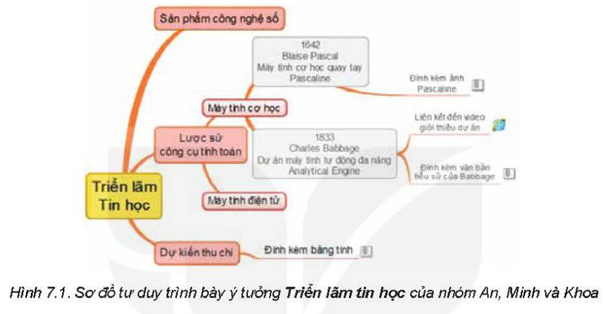

<!-- pdf:29 -->

# BÀI 7: TRÌNH BÀY THÔNG TIN TRONG TRAO ĐỔI VÀ HỢP TÁC

## 🎯 Sau bài học này em sẽ:

- Sử dụng được bài trình chiếu và sơ đồ tư duy trong trao đổi thông tin và hợp tác.
- Biết được khả năng đính kèm văn bản, ảnh, video, trang tính vào sơ đồ tư duy.

## 🔴 Khởi động

> Dự án **Triển lãm tin học**
>
> “Trải qua quá trình học tập môn Tin học, chúng ta đã có những hiểu biết gì và tạo được những sản phẩm nào?” Đó là câu hỏi đặt ra với các bạn học sinh lớp 9A. Để tổng kết một chặng đường học tập môn Tin học, các bạn đã quyết định tổ chức **Triển lãm tin học**. Có rất nhiều ý tưởng về sản phẩm trưng bày trong triển lãm. Có nhóm trưng bày sổ lưu niệm của lớp đã làm từ lớp 6. Có nhóm trưng bày bộ sưu tập hình ảnh về **CLB Tin học** được thành lập từ lớp 8. Nhóm khác lại muốn tạo sản phẩm là một số trò chơi bằng ngôn ngữ lập trình trực quan,... Nhóm ba bạn An, Minh, Khoa lựa chọn sản phẩm là bài trình bày về nội dung Lược sử công cụ tính toán để tham gia triển lãm.
>
> Việc tổ chức một hoạt động như **Triển lãm tin học** cần làm việc nhóm, cần sự cộng tác của nhiều người. Có nhiều công cụ hỗ trợ thực hiện hoạt động cộng tác, trong đó có sơ đồ tư duy và bài trình chiếu. Tuy nhiên, việc sử dụng sơ đồ tư duy hay bài trình chiếu không chỉ là vấn đề kĩ thuật, mà cần được hướng dẫn về cách làm việc hợp tác để công cụ hỗ trợ hiệu quả cho một nhóm cùng nhau thực hiện dự án.

## 1. TRÌNH BÀY THÔNG TIN TRONG TRAO ĐỔI VÀ HỢP TÁC

> **Hoạt động 1: Sử dụng sơ đồ tư duy hoặc bài trình chiếu để chia sẻ thông tin**
>
> Sơ đồ tư duy và bài trình chiếu là những công cụ giúp trình bày thông tin trong trao đổi và hợp tác. Em hãy cho biết có thể sử dụng các công cụ này như thế nào cho việc trình bày nội dung Lược sử công cụ tính toán trong **Triển lãm tin học**.

<!-- term: Trình bày thông tin trong trao đổi và hợp tác -->
Sơ đồ tư duy hay bài trình chiếu đều là những công cụ hiệu quả để trình bày thông tin. Để sử dụng sơ đồ tư duy hoặc bài trình chiếu trong trao đổi và hợp tác, em có thể tiến hành theo một số cách sau đây:

- **Sử dụng sơ đồ tư duy hoặc bài trình chiếu để trình bày trực tiếp:** Đây là cách dễ dàng nhất để cộng tác vì em có thể diễn giải bức tranh toàn cảnh, làm rõ các nội dung chi tiết và trực tiếp trả lời các câu hỏi mà người nghe đặt ra.

<!-- pdf:30 -->

<!-- term: Cộng tác theo thời gian thực -->
- **Chia sẻ sơ đồ tư duy hoặc bài trình chiếu để các thành viên khác xem:** Khi không có điều kiện trình bày trực tiếp, em có thể chia sẻ sơ đồ tư duy hoặc bài trình chiếu để các thành viên khác xem. Để thuận lợi cho người xem, nên sử dụng hình ảnh, biểu đồ, video một cách hợp lí để làm rõ thông tin. Sơ đồ tư duy nên được trình bày trong một trang và có thể đính kèm văn bản, hình ảnh, video, trang tính để trình bày chi tiết.
- **Chia sẻ sơ đồ tư duy hoặc bài trình chiếu để các thành viên khác chủ động cập nhật:** Em có thể sử dụng phần mềm để tạo sơ đồ tư duy hoặc bài trình chiếu trực tuyến để các thành viên trong nhóm có thể chỉnh sửa. Mỗi thành viên có thể chủ động chỉnh sửa theo thời gian phù hợp với mình.
- **Chia sẻ sơ đồ tư duy hoặc bài trình chiếu để cộng tác theo thời gian thực:** Em có thể sử dụng phần mềm tạo sơ đồ tư duy hoặc bài trình chiếu trực tuyến để tất cả các thành viên cùng làm việc trực tuyến chỉnh sửa sản phẩm. Việc mở một kênh hội thoại để các thành viên trao đổi trong quá trình hoàn thiện sản phẩm là rất cần thiết.

<!-- term: Sơ đồ dòng thời gian -->
Để sử dụng các công cụ trực quan như hình ảnh, biểu đồ và video một cách hợp lí trong trình bày thông tin, em cần chú ý:

- **Sử dụng đúng công cụ trực quan:** Sử dụng công cụ trực quan theo nguyên tắc đơn giản và rõ ràng, chọn loại công cụ minh hoạ tốt nhất để truyền tải thông điệp. Ví dụ: nếu trình bày tiến trình lịch sử thì **sơ đồ dòng thời gian** sẽ phát huy hiệu quả.
- **Đảm bảo chất lượng dữ liệu:** Cần đảm bảo rằng công cụ trực quan có thể xem được từ khoảng cách xa. Hình ảnh phải sắc nét và có bố cục hợp lí. Có thể sử dụng màu sắc để tăng sự chú ý của người xem và cải thiện khả năng hiển thị thông tin.

<!-- term: Trình bày thông tin trong trao đổi và hợp tác -->
> - Em có thể sử dụng bài trình chiếu và sơ đồ tư duy trong trao đổi thông tin và hợp tác theo các cách sau:
>   – Trình bày trực tiếp.
>   – Chia sẻ để các thành viên khác xem độc lập.
>   – Chia sẻ để các thành viên cập nhật độc lập.
>   – Chia sẻ để cộng tác theo thời gian thực.
> - Để sử dụng hình ảnh, biểu đồ và video hợp lí, em cần chú ý:
>   – Sử dụng đúng công cụ trực quan.
>   – Đảm bảo chất lượng dữ liệu.

> ❓ **Câu hỏi**
>
> Em hãy chỉ ra những kiến thức về tạo sơ đồ tư duy và bài trình chiếu mà em cần được bổ sung để việc trao đổi, hợp tác được hiệu quả.

<!-- pdf:31 -->

## 2. KHẢ NĂNG ĐÍNH KÈM VĂN BẢN, ẢNH, VIDEO, TRANG TÍNH VÀO SƠ ĐỒ TƯ DUY

<!-- term: Đính kèm dữ liệu vào sơ đồ tư duy -->
Khi tạo sơ đồ tư duy bằng phần mềm, em có thể đính kèm tệp văn bản, hình ảnh, video và trang tính vào sơ đồ tư duy để minh hoạ chi tiết cho nội dung cần trình bày. Hình 7.1 minh hoạ sơ đồ tư duy mà nhóm các bạn An, Minh, Khoa trình bày ý tưởng về nội dung Lược sử công cụ tính toán, trong đó một số nhánh của sơ đồ có đính kèm dữ liệu. Thao tác đính kèm dữ liệu sẽ được hướng dẫn cụ thể trong Bài 8.

*Hình 7.1. Sơ đồ tư duy trình bày ý tưởng Triển lãm tin học của nhóm An, Minh và Khoa*

<!-- term: Đính kèm dữ liệu vào sơ đồ tư duy -->
> Có thể đính kèm văn bản, hình ảnh, video, trang tính vào sơ đồ tư duy giúp trình bày thông tin đầy đủ và hiệu quả.

> ❓ **Câu hỏi**
>
> Em hãy chỉ ra các loại dữ liệu được đính kèm vào sơ đồ tư duy ở Hình 7.1.

## ✏️ Luyện tập

1. Em hãy nhận xét về tính hợp lí và lợi ích của những dữ liệu đính kèm trong sơ đồ tư duy ở Hình 7.1 khi trình bày thông tin trong trao đổi và hợp tác.
2. Em hãy nêu những cách mà nhóm các bạn An, Minh và Khoa sử dụng sơ đồ tư duy ở Hình 7.1 trong trao đổi và hợp tác để hoàn thành công việc chuẩn bị nội dung Lược sử công cụ tính toán cho **Triển lãm tin học**.

## 🚀 Vận dụng

Em hãy tạo sơ đồ tư duy trình bày nội dung mà em muốn trưng bày trong **Triển lãm tin học**. Hãy ghi ra những thông tin dạng văn bản, hình ảnh, video và trang tính cần đính kèm vào sơ đồ tư duy để minh hoạ chi tiết cho nội dung mà em đã chọn. Hãy chia sẻ sơ đồ tư duy với các bạn cùng nhóm theo cách phù hợp với em.

## 📷 Danh sách hình trong bài

| Mã hình | Trang PDF | Trang sách | Chú thích |
| --- | --- | --- | --- |
| H9-tin_hoc-b07-01 | 31 | 29 | Hình 7.1. Sơ đồ tư duy trình bày ý tưởng Triển lãm tin học của nhóm An, Minh và Khoa |
