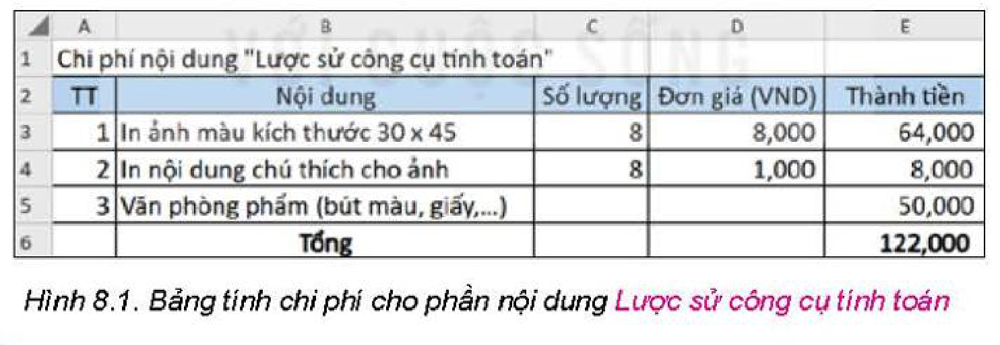
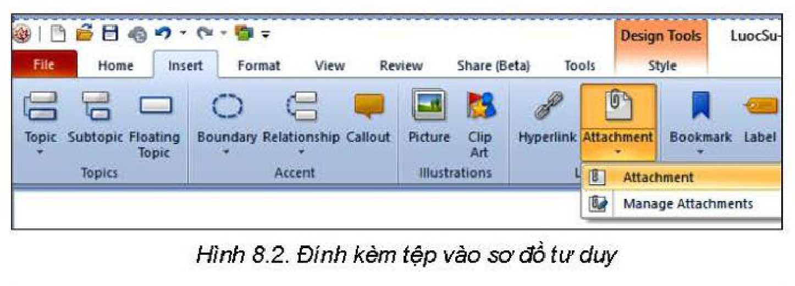
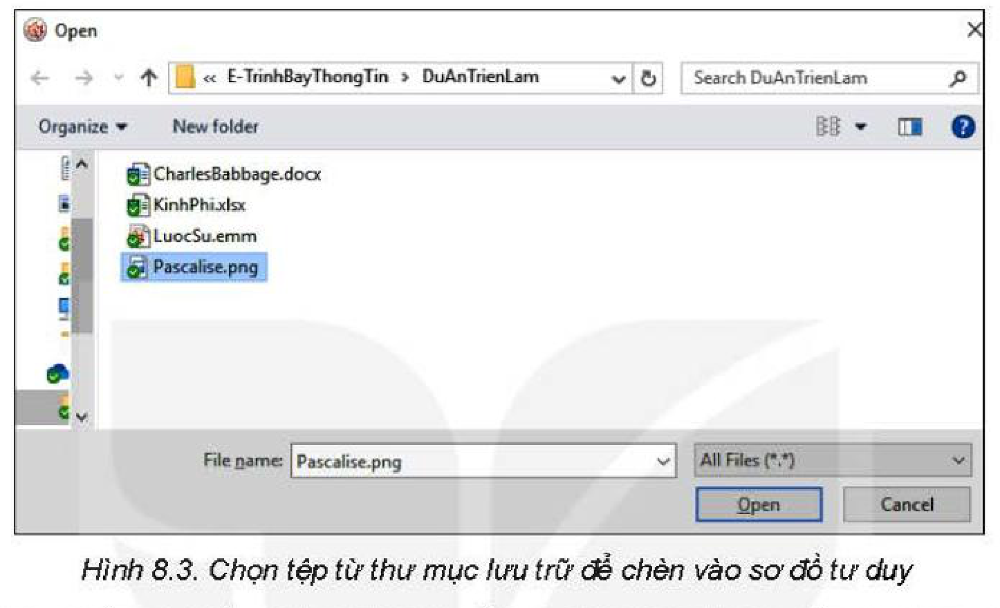
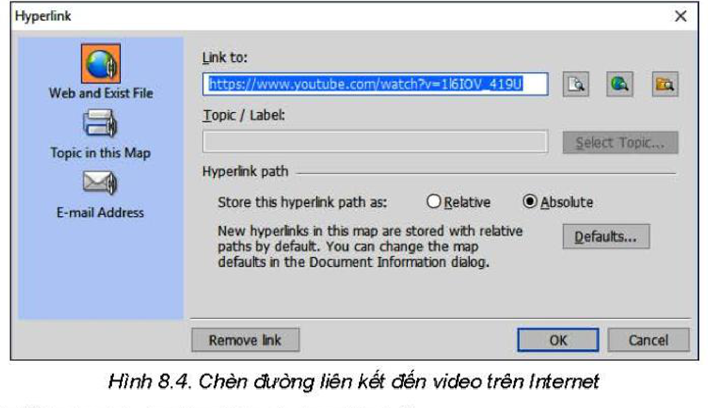
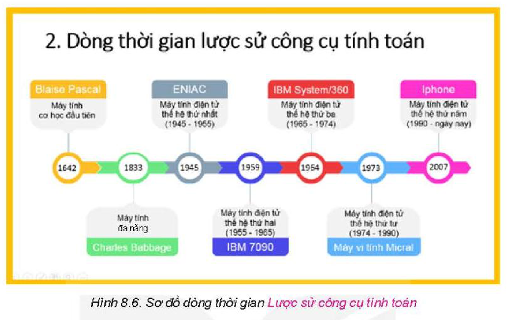

<!-- pdf:32 -->

# BÀI 8: THỰC HÀNH: SỬ DỤNG CÔNG CỤ TRỰC QUAN TRÌNH BÀY THÔNG TIN TRONG TRAO ĐỔI VÀ HỢP TÁC

## 🎯 Sau bài học này em sẽ:

- Sử dụng được hình ảnh, biểu đồ, video một cách hợp lí.
- Tạo được sơ đồ tư duy có đính kèm văn bản, hình ảnh, video và trang tính.
- Tạo được bài trình chiếu có sử dụng hình ảnh, biểu đồ và video hợp lí.

## 🔴 Khởi động

> Trong Bài 7 em đã biết cách sử dụng sơ đồ tư duy và bài trình chiếu trong trao đổi và hợp tác. Em cũng biết cách sử dụng hình ảnh, biểu đồ và video hợp lí để trình bày thông tin. Bài học này hướng dẫn em tạo sơ đồ tư duy có dữ liệu đính kèm và bài trình chiếu sử dụng hình ảnh, biểu đồ và video hợp lí.

## Nhiệm vụ 1: SỬ DỤNG PHẦN MỀM TẠO SƠ ĐỒ TƯ DUY CÓ ĐÍNH KÈM DỮ LIỆU

**Yêu cầu**

Sử dụng phần mềm tạo sơ đồ tư duy như minh hoạ trong Hình 7.1 với dữ liệu đính kèm đã chuẩn bị hoặc được cung cấp, ví dụ:

– Tệp bảng tính có tên là `KinhPhi.xlsx` để tính toán chi phí triển lãm (Hình 8.1).

– Tệp hình ảnh có tên là `Pascaline.png`, minh hoạ cho máy tính cơ học Pascaline.

– Tệp văn bản có tên là `CharlesBabbage.docx` chứa tiểu sử nhà khoa học Charles Babbage.

– Đường liên kết đến video về nhà khoa học Charles Babbage trên Internet.

*Hình 8.1. Bảng tính chi phí cho phần nội dung Lược sử công cụ tính toán*

**Hướng dẫn**

### a) Tạo sơ đồ tư duy

– Khởi động phần mềm tạo sơ đồ tư duy MindMaple Lite.

– Tạo một sơ đồ tư duy mới với chủ đề chính và các chủ đề nhánh như Hình 7.1.

– Lưu tệp với tên `LuocSu.emm`.

### b) Đính kèm tệp

<!-- term: Đính kèm tệp vào sơ đồ tư duy -->
– Chọn nhánh của sơ đồ tư duy cần đính kèm tệp.

– Chọn **Insert/Attachment/Attachment** như minh hoạ trong Hình 8.2.

<!-- pdf:33 -->

*Hình 8.2. Đính kèm tệp vào sơ đồ tư duy*

*Hình 8.3. Chọn tệp từ thư mục lưu trữ để chèn vào sơ đồ tư duy*

<!-- term: Đính kèm tệp vào sơ đồ tư duy -->
– Khi hộp thoại mở tệp xuất hiện, chọn tệp cần chèn như minh hoạ ở Hình 8.3. Nháy chuột chọn **Open**. Biểu tượng tệp đính kèm xuất hiện ở nhánh của sơ đồ (Hình 7.1).

– Thực hiện tương tự để hoàn thành việc đính kèm các tệp văn bản, hình ảnh, bảng tính vào sơ đồ tư duy.

### c) Đính kèm đường liên kết

<!-- term: Đính kèm đường liên kết vào sơ đồ tư duy -->
– Chọn nhánh của sơ đồ tư duy cần đính kèm đường liên kết.

<!-- term: Đính kèm đường liên kết vào sơ đồ tư duy -->
– Chọn **Insert/Hyperlink**. Khi hộp thoại **Hyperlink** xuất hiện, sao chép đường liên kết đến video vào ô **Link to:** (Hình 8.4).

*Hình 8.4. Chèn đường liên kết đến video trên Internet*

– Chọn **OK** để hoàn thành việc chèn đường liên kết.

<!-- pdf:34 -->

## Nhiệm vụ 2. TRÌNH BÀY SƠ ĐỒ TƯ DUY

**Yêu cầu**

Trình bày sơ đồ tư duy trước nhóm để các thành viên trao đổi, bổ sung nội dung cho sơ đồ tư duy.

**Hướng dẫn**

– Lựa chọn một cách trong các cách sử dụng sơ đồ tư duy để trình bày thông tin (mà em đã học ở Bài 7). Chọn một thành viên đóng vai trò trưởng nhóm trình bày nội dung chuẩn bị về Lược sử công cụ tính toán.

– Trao đổi, thảo luận để bổ sung thêm nội dung cần chuẩn bị.

– Phân công công việc để các thành viên của nhóm tiếp tục hoàn thành những nội dung cần chuẩn bị.

## Nhiệm vụ 3. TẠO BÀI TRÌNH CHIẾU CÓ SỬ DỤNG HÌNH ẢNH, SƠ ĐỒ, VIDEO HỢP LÍ

**Yêu cầu**

Tạo bài trình chiếu chủ đề Lược sử công cụ tính toán có sử dụng hình ảnh, sơ đồ, video hợp lí.

**Hướng dẫn**

– Khởi động phần mềm trình chiếu.

– Tạo trang tiêu đề, nhập tiêu đề Lược sử công cụ tính toán.

– Tạo trang dàn ý. Nhập nội dung theo mẫu ở Hình 8.5.

– Sử dụng mẫu có sẵn (tìm trên Internet hoặc giáo viên cung cấp) để tạo sơ đồ dòng thời gian về Lược sử công cụ tính toán tương tự Hình 8.6.

*Hình 8.5. Nội dung trang dàn ý*

<!-- pdf:35 -->

*Hình 8.6. Sơ đồ dòng thời gian Lược sử công cụ tính toán*

– Tạo thêm trang chiếu để trình bày nội dung về Blaise Pascal và máy tính cơ học đầu tiên. Chèn hình ảnh minh hoạ máy tính Pascaline vào trang chiếu.

<!-- term: Chèn video vào trang chiếu -->
– Tạo thêm trang chiếu để trình bày nội dung về Charles Babbage và máy tính đa năng. Nháy chuột chọn **Insert**, chọn **Video/Insert Video from This Device** để chèn thêm video minh hoạ đã chuẩn bị vào trang chiếu.

– Lưu bài trình chiếu với tên là `LuocSuMayTinh`.

## ✏️ Luyện tập

Em thực hiện các yêu cầu sau với bài trình chiếu `LuocSuMayTinh`:

a) Lựa chọn một cách trong các cách sử dụng bài trình chiếu trình bày thông tin ở Bài 7 để một thành viên đóng vai trò trưởng nhóm thực hiện trước tập thể.

b) Các thành viên trao đổi, thảo luận để rà soát nội dung bài trình chiếu theo các yêu cầu được nêu trong Nhiệm vụ 3.

c) Chỉnh sửa bài trình chiếu theo kết quả thảo luận ở Câu b.

## 🚀 Vận dụng

Em hãy sử dụng phần mềm để bổ sung vào bài trình chiếu `LuocSuMayTinh` nội dung về đặc điểm của máy tính từng thế hệ. Yêu cầu: Sử dụng công cụ trực quan một cách hợp lí. Sau đó hãy phân công một bạn trong nhóm chia sẻ bài trình chiếu với các bạn khác để cùng hoàn chỉnh sản phẩm cho **Triển lãm tin học**.

## 📷 Danh sách hình trong bài

| Mã hình | Trang PDF | Trang sách | Chú thích |
| --- | --- | --- | --- |
| H9-tin_hoc-b08-01 | 32 | 30 | Hình 8.1. Bảng tính chi phí cho phần nội dung Lược sử công cụ tính toán |
| H9-tin_hoc-b08-02 | 33 | 31 | Hình 8.2. Đính kèm tệp vào sơ đồ tư duy |
| H9-tin_hoc-b08-03 | 33 | 31 | Hình 8.3. Chọn tệp từ thư mục lưu trữ để chèn vào sơ đồ tư duy |
| H9-tin_hoc-b08-04 | 33 | 31 | Hình 8.4. Chèn đường liên kết đến video trên Internet |
| H9-tin_hoc-b08-05 | 34 | 32 | Hình 8.5. Nội dung trang dàn ý |
| H9-tin_hoc-b08-06 | 35 | 33 | Hình 8.6. Sơ đồ dòng thời gian Lược sử công cụ tính toán |
