<!-- pdf:36 -->

# BÀI 9A: SỬ DỤNG CÔNG CỤ XÁC THỰC DỮ LIỆU

*a. Sử dụng bảng tính điện tử nâng cao*

## 🎯 Sau bài học này em sẽ:

- Sử dụng được công cụ xác thực dữ liệu (Data Validation) của phần mềm bảng tính để giải quyết bài toán quản lí tài chính.

## 🔴 Khởi động

> Ở các lớp trước, em đã biết sử dụng các công cụ cơ bản của phần mềm bảng tính để giải quyết bài toán trong thực tế. Trong chủ đề này, em sẽ tiếp tục tìm hiểu và sử dụng các công cụ nâng cao của phần mềm bảng tính để giải quyết bài toán thực tế (bài toán quản lí tài chính gia đình) bằng cách hoàn thành một dự án nhỏ (dự án **Quản lí tài chính gia đình**).
>
> Dự án gồm các nội dung sau đây:
>
> - Xây dựng cấu trúc của bảng tính cho bài toán quản lí tài chính gia đình.
> - Sử dụng một số công cụ cơ bản và nâng cao của phần mềm bảng tính để giải quyết bài toán.
>
> Em hãy khám phá kiến thức để thực hiện dự án nhé.

## 1. CÔNG CỤ XÁC THỰC DỮ LIỆU

> **Hoạt động 1: Xây dựng cấu trúc bảng tính**
>
> Dựa trên hiểu biết về những khoản chi tiêu của gia đình, em hãy cho biết:
>
> 1. Tài chính gia đình gồm những khoản mục gì?
> 2. Nêu cấu trúc một bảng tính điện tử quản lí tài chính mà em thấy phù hợp với gia đình em.

### a) Sử dụng bảng tính để quản lí tài chính gia đình

<!-- term: Sử dụng bảng tính để quản lí tài chính gia đình -->
Ưu điểm nổi bật của phần mềm bảng tính là xử lí dữ liệu tự động. Sử dụng chương trình bảng tính để quản lí tài chính sẽ giúp kiểm soát được tình hình chi tiêu một cách cụ thể, trực quan, từ đó điều chỉnh chi tiêu sao cho phù hợp với thu nhập gia đình và mục tiêu phát triển. Có nhiều cách khác nhau để quản lí tài chính gia đình hiệu quả. Ví dụ: lên kế hoạch chi tiết cho từng khoản chi tiêu, theo dõi ngân sách định kì, quản lí các khoản tiết kiệm và đầu tư,... Mỗi gia đình lại có các khoản mục tài chính khác nhau. Các khoản mục đó thường được phân thành hai loại là Thu và Chi. Do vậy, thông tin lưu trữ trong bảng tính điện tử quản lí tài chính gia đình sẽ gồm ít nhất hai loại đó. Ví dụ về các khoản thu, chi thường có của một gia đình được minh hoạ ở Hình 9a.1.

<!-- pdf:37 -->

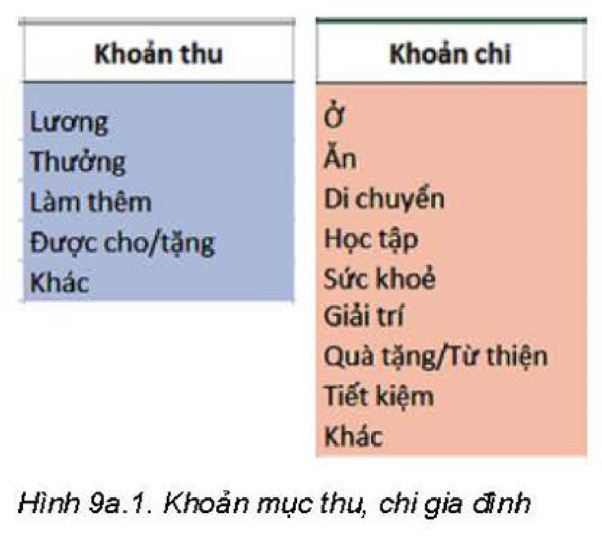

*Hình 9a.1. Khoản mục thu, chi gia đình*

### b) Công cụ xác thực dữ liệu

Khi dùng bảng tính để quản lí tài chính gia đình, em có thể lưu trữ dữ liệu Thu và Chi trên cùng một trang tính hoặc ở hai trang tính khác nhau. Hình 9a.2 minh hoạ trang tính `Chi tiêu` ghi lại các khoản chi của một gia đình (các khoản thu được lưu ở trang tính `Thu nhập`). Trong Hình 9a.2, em có thể thấy danh sách các khoản chi được lưu ở cột F. Khi cập nhật thông tin về khoản chi cho dữ liệu ở cột B, em chỉ cần chọn trong danh sách đã có.

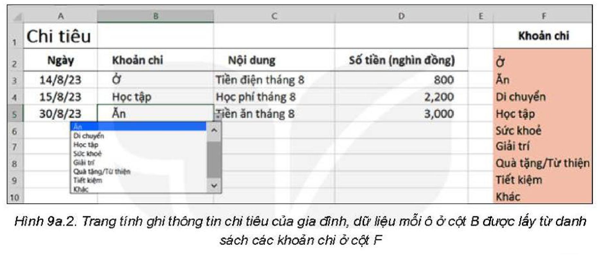

*Hình 9a.2. Trang tính ghi thông tin chi tiêu của gia đình, dữ liệu mỗi ô ở cột B được lấy từ danh sách các khoản chi ở cột F*

Để hạn chế loại dữ liệu hoặc giá trị của dữ liệu khi nhập vào ô tính, em sử dụng **công cụ xác thực dữ liệu** (**Data Validation**). Hình 9a.3 minh hoạ một ví dụ khác cần sử dụng công cụ này khi cập nhật dữ liệu.

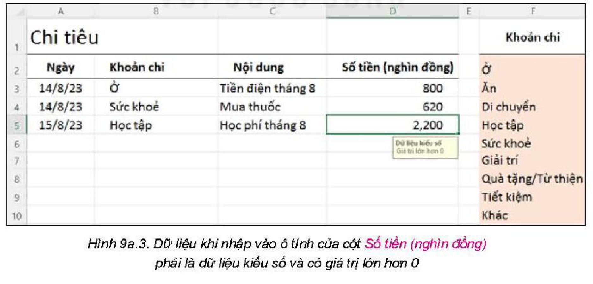

*Hình 9a.3. Dữ liệu khi nhập vào ô tính của cột Số tiền (nghìn đồng) phải là dữ liệu kiểu số và có giá trị lớn hơn 0*

<!-- pdf:38 -->

Để sử dụng công cụ **xác thực dữ liệu**, trong nhóm lệnh **Data Tools** của dải lệnh **Data**, chọn **Data Validation** (Hình 9a.4). Hộp thoại **Data Validation** xuất hiện. Tại ô **Allow** trong thẻ **Settings**, em lựa chọn kiểu dữ liệu hoặc giá trị dữ liệu cho phù hợp với yêu cầu của từng bài toán cụ thể.

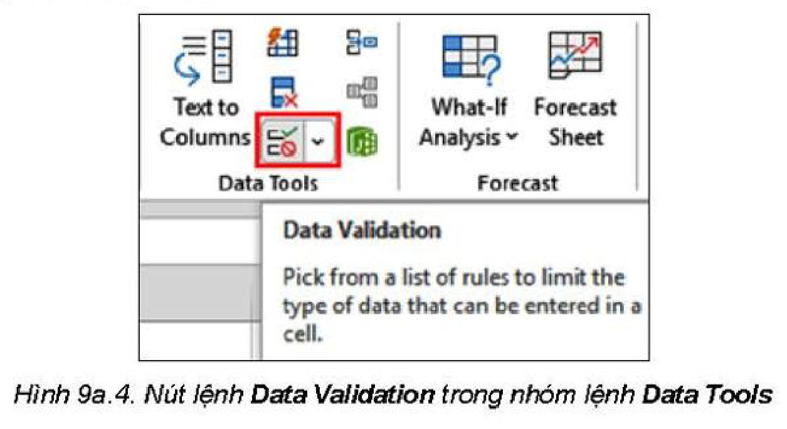

*Hình 9a.4. Nút lệnh Data Validation trong nhóm lệnh Data Tools*

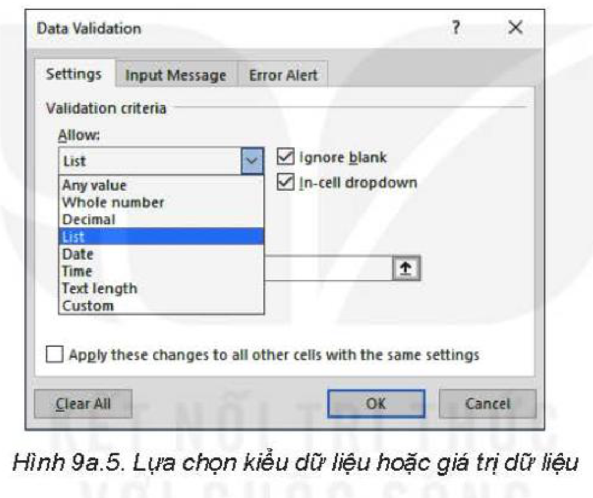

*Hình 9a.5. Lựa chọn kiểu dữ liệu hoặc giá trị dữ liệu*

Ý nghĩa của mỗi kiểu dữ liệu hoặc giá trị dữ liệu ở Hình 9a.5 được giải thích trong Bảng 9a.1.

**Bảng 9a.1. Các kiểu dữ liệu hoặc giá trị dữ liệu cho phép**

| Kiểu / Giá trị | Ý nghĩa |
| --- | --- |
| Any value | Bất kì giá trị nào |
| Whole number | Số nguyên - ô tính chỉ chấp nhận các số nguyên |
| Decimal | Số thập phân - ô tính chỉ chấp nhận các số thập phân |
| List | Danh sách - chọn dữ liệu từ danh sách thả xuống |
| Date | Ngày tháng - ô tính chỉ chấp nhận dữ liệu ngày tháng |
| Time | Thời gian - ô tính chỉ chấp nhận dữ liệu thời gian |
| Text length | Độ dài văn bản - hạn chế độ dài của văn bản nhập vào ô tính |
| Custom | Tuỳ chỉnh - cho công thức tuỳ chỉnh |

> **Công cụ xác thực dữ liệu** (**Data Validation**) hạn chế kiểu dữ liệu hoặc giá trị dữ liệu nhập vào ô tính, giúp cho việc nhập dữ liệu được chính xác và thoả mãn những yêu cầu bài toán đặt ra.

<!-- pdf:39 -->

> ❓ **Câu hỏi**
>
> Trang tính `Thu nhập` trong Hình 9a.6 lưu dữ liệu về các khoản thu của gia đình. Em hãy quan sát Hình 9a.6 và cho biết dữ liệu ở cột B cần được thiết lập để thoả mãn điều kiện xác thực nào.

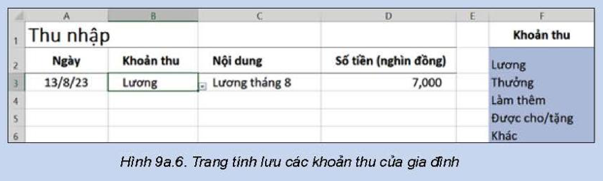

*Hình 9a.6. Trang tính lưu các khoản thu của gia đình*

## 2. THỰC HÀNH: SỬ DỤNG CÔNG CỤ XÁC THỰC DỮ LIỆU ĐỂ TẠO BẢNG TÍNH QUẢN LÍ TÀI CHÍNH GIA ĐÌNH

**Nhiệm vụ 1:** Tạo bảng tính có trang tính `Chi tiêu` theo mẫu trong Hình 9a.2. Sử dụng công cụ xác thực dữ liệu cho các khoản chi của gia đình.

**Hướng dẫn**

*(Hướng dẫn sau đây sử dụng phần mềm Microsoft Excel phiên bản 2016 để minh hoạ.)*

### a) Tạo trang tính lưu các khoản chi

– Khởi động phần mềm bảng tính. Đặt tên cho trang tính hiện hành là `Chi tiêu`.

– Tạo bảng và nhập dữ liệu khoản chi (cột F) như minh hoạ ở Hình 9a.7.

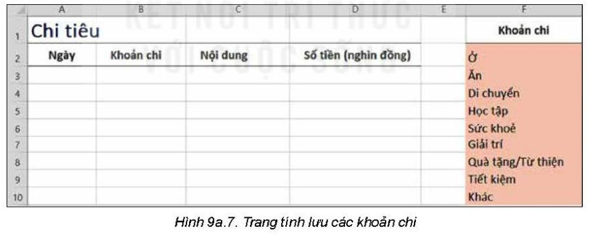

*Hình 9a.7. Trang tính lưu các khoản chi*

### b) Sử dụng công cụ xác thực dữ liệu thuộc danh sách cho trước

<!-- term: Xác thực dữ liệu thuộc danh sách cho trước -->
Để dữ liệu ở mỗi ô của cột B là một mục trong danh sách cho trước ở cột F em thực hiện như sau:

– Chọn các ô của cột B để nhập dữ liệu thoả mãn điều kiện xác thực, ví dụ các ô từ B3 đến B10.

– Trong nhóm lệnh **Data Tools** của dải lệnh **Data**, chọn **Data Validation** (Hình 9a.4), hộp thoại **Data Validation** xuất hiện.

<!-- pdf:40 -->

<!-- term: Xác thực dữ liệu thuộc danh sách cho trước -->
– Trong thẻ **Settings**, nhập yêu cầu xác thực dữ liệu cho từng tiêu chí, cụ thể là:

<!-- term: Xác thực dữ liệu thuộc danh sách cho trước -->
+ **Allow:** Dữ liệu nhập vào cột `Khoản chi` cần thuộc danh sách cho trước, vì vậy em chọn giá trị là `List` để chọn dữ liệu từ danh sách thả xuống.

<!-- term: Xác thực dữ liệu thuộc danh sách cho trước -->
+ **Source:** Là vùng dữ liệu chứa danh sách. Chọn vùng dữ liệu chứa danh sách các khoản chi là `F2:F10`, khi đó địa chỉ của vùng được đưa vào ô **Source** (Hình 9a.8). Chọn **OK** để hoàn thành công việc.

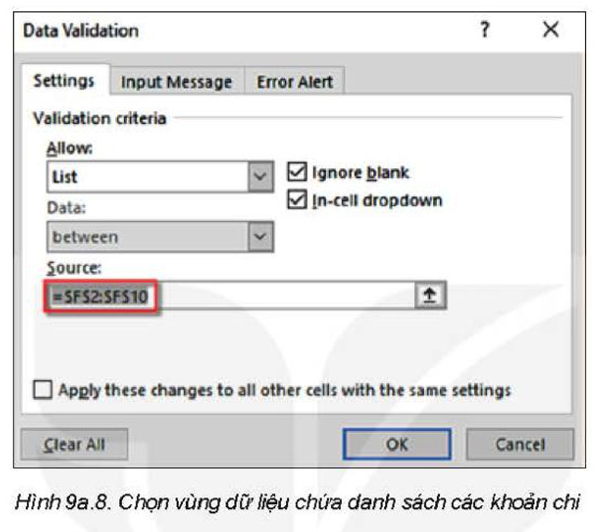

*Hình 9a.8. Chọn vùng dữ liệu chứa danh sách các khoản chi*

– Nhập dữ liệu cho trang tính, trong đó dữ liệu cột B được lấy từ danh sách thả xuống (Hình 9a.2).

– Lưu tệp bảng tính với tên `TaiChinhGiaDinh.xlsx`.

**Nhiệm vụ 2:** Em hãy sử dụng công cụ xác thực dữ liệu để xác thực cho dữ liệu cột `Số tiền (nghìn đồng)` (cột D) chỉ chấp nhận kiểu số lớn hơn 0 và yêu cầu này hiển thị trên màn hình khi nhập dữ liệu như minh hoạ ở Hình 9a.3.

**Hướng dẫn**

– Chọn trang tính `Chi tiêu`.
<!-- ocr-ok: đối chiếu ảnh trang PDF 40; OCR đọc nhầm "Chi tiêu" thành "Chị tiêu" -->

– Chọn vùng sẽ nhập liệu của cột `Số tiền (nghìn đồng)`, ví dụ vùng `D3:D10`.

– Chọn **Data/Data Tools/Data Validation**, hộp thoại **Data Validation** xuất hiện.

– Trong thẻ **Settings**, nhập yêu cầu xác thực dữ liệu như minh hoạ trong Hình 9a.9.

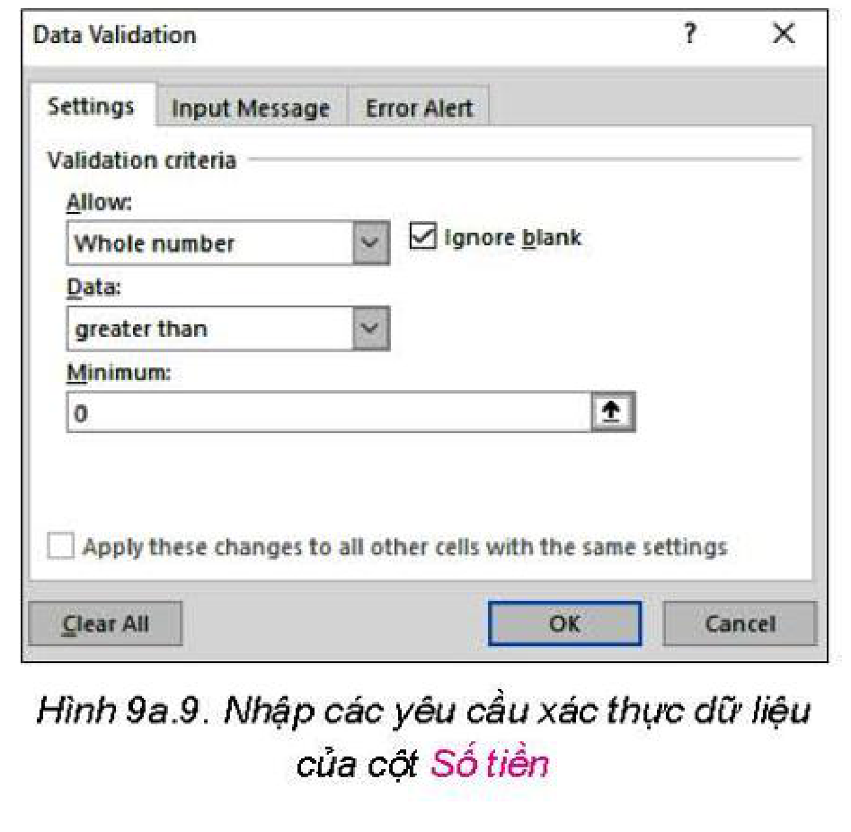

*Hình 9a.9. Nhập các yêu cầu xác thực dữ liệu của cột Số tiền*

<!-- pdf:41 -->

<!-- term: Thông báo khi nhập dữ liệu và thông báo lỗi -->
– Trong thẻ **Input Message**, nhập nội dung thông báo như Hình 9a.10.

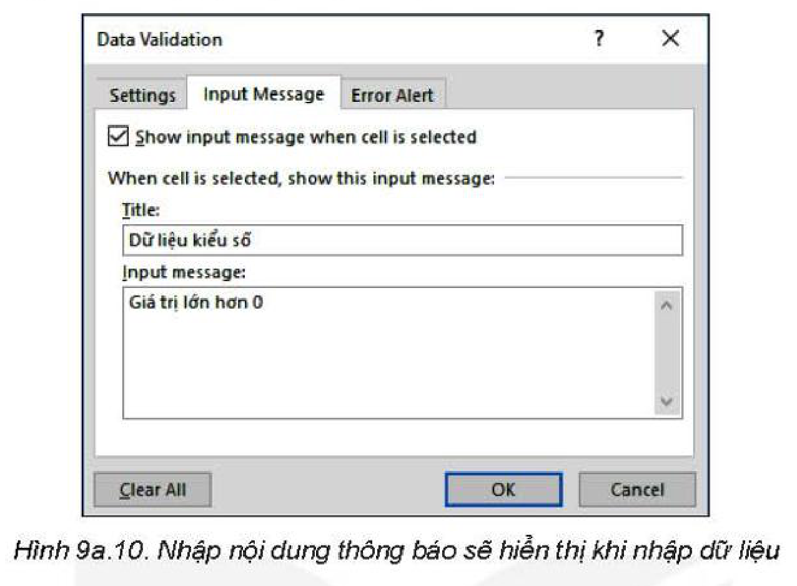

*Hình 9a.10. Nhập nội dung thông báo sẽ hiển thị khi nhập dữ liệu*

<!-- term: Thông báo khi nhập dữ liệu và thông báo lỗi -->
– Trong thẻ **Error Alert**, nhập nội dung thông báo lỗi khi nhập dữ liệu như Hình 9a.11.

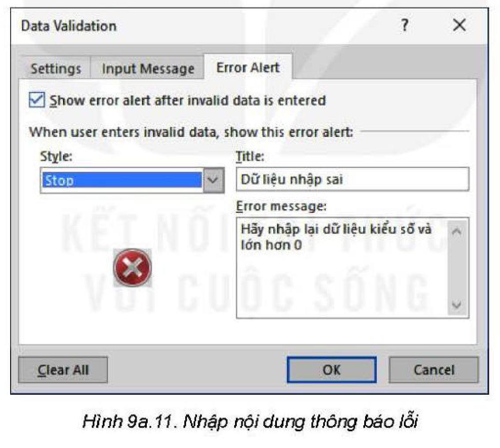

*Hình 9a.11. Nhập nội dung thông báo lỗi*

<!-- term: Thông báo khi nhập dữ liệu và thông báo lỗi -->
– Nhập thêm dữ liệu vào bảng. Nếu em nhập dữ liệu không đúng với yêu cầu xác thực của ô thì màn hình sẽ xuất hiện thông báo như Hình 9a.12.

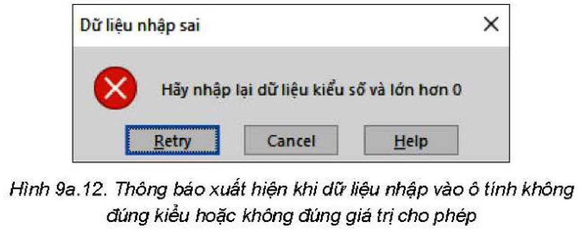

*Hình 9a.12. Thông báo xuất hiện khi dữ liệu nhập vào ô tính không đúng kiểu hoặc không đúng giá trị cho phép*

– Lưu tệp.

<!-- pdf:42 -->

## ✏️ Luyện tập

1. Mở tệp bảng tính `TaiChinhGiaDinh.xlsx` và thực hiện các yêu cầu sau:

   a) Tạo thêm một trang tính mới, đặt tên là `Thu nhập`.

   b) Nhập dữ liệu khoản thu (cột F), nhập nội dung các khoản thu của gia đình như minh hoạ ở Hình 9a.6, trong đó sử dụng công cụ xác thực dữ liệu để khoản thu ở cột B được lấy từ danh sách ở cột F.

2. Mở trang tính `Thu nhập` trong tệp bảng tính `TaiChinhGiaDinh.xlsx` (Hình 9a.13). Sử dụng công cụ xác thực dữ liệu để hạn chế kiểu dữ liệu và giá trị dữ liệu cho cột `Số tiền (nghìn đồng)` tương tự như yêu cầu của trang tính `Chi tiêu`. Hãy nhập thêm ít nhất ba hàng dữ liệu vào bảng.

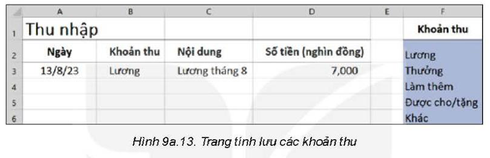

*Hình 9a.13. Trang tính lưu các khoản thu*

## 🚀 Vận dụng

Em hãy tạo bảng tính để quản lí tài chính cho dự án **Triển lãm Tin học**. Nhập dữ liệu các khoản thu, chi của dự án. Trong đó, các khoản thu (ví dụ như: kinh phí tài trợ, quỹ lớp,...) được lưu ở một trang tính (Hình 9a.14), các khoản chi cho triển lãm (ví dụ như: mua văn phòng phẩm, in tài liệu,...) được lưu ở một trang tính khác (Hình 9a.15). Hãy sử dụng công cụ xác thực dữ liệu để việc nhập dữ liệu các khoản thu, chi được chính xác. Lưu tệp bảng tính với tên `KinhPhiTrienLam.xlsx`.

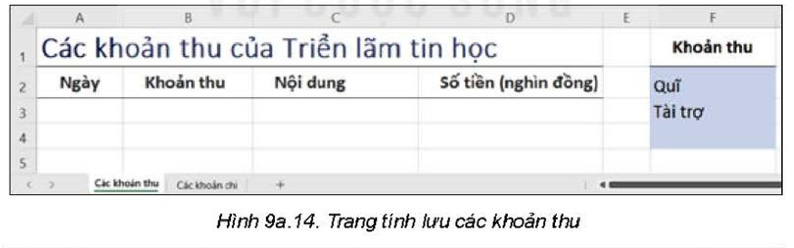

*Hình 9a.14. Trang tính lưu các khoản thu*

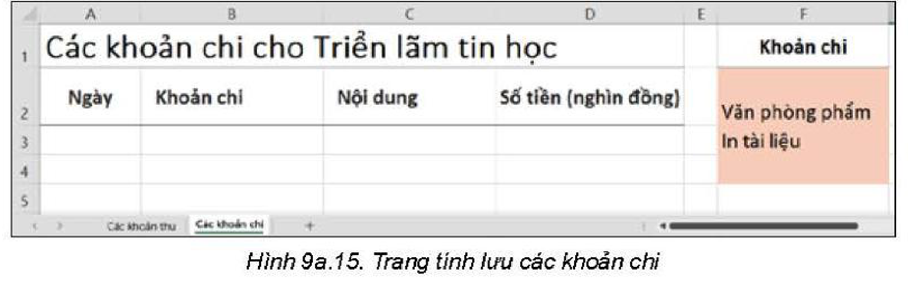

*Hình 9a.15. Trang tính lưu các khoản chi*

## 📷 Danh sách hình trong bài

| Mã hình | Trang PDF | Trang sách | Chú thích |
| --- | --- | --- | --- |
| H9-tin_hoc-b09a-01 | 37 | 35 | Hình 9a.1. Khoản mục thu, chi gia đình |
| H9-tin_hoc-b09a-02 | 37 | 35 | Hình 9a.2. Trang tính ghi thông tin chi tiêu của gia đình, dữ liệu mỗi ô ở cột B được lấy từ danh sách các khoản chi ở cột F |
| H9-tin_hoc-b09a-03 | 37 | 35 | Hình 9a.3. Dữ liệu khi nhập vào ô tính của cột Số tiền (nghìn đồng) phải là dữ liệu kiểu số và có giá trị lớn hơn 0 |
| H9-tin_hoc-b09a-04 | 38 | 36 | Hình 9a.4. Nút lệnh Data Validation trong nhóm lệnh Data Tools |
| H9-tin_hoc-b09a-05 | 38 | 36 | Hình 9a.5. Lựa chọn kiểu dữ liệu hoặc giá trị dữ liệu |
| H9-tin_hoc-b09a-06 | 39 | 37 | Hình 9a.6. Trang tính lưu các khoản thu của gia đình |
| H9-tin_hoc-b09a-07 | 39 | 37 | Hình 9a.7. Trang tính lưu các khoản chi |
| H9-tin_hoc-b09a-08 | 40 | 38 | Hình 9a.8. Chọn vùng dữ liệu chứa danh sách các khoản chi |
| H9-tin_hoc-b09a-09 | 40 | 38 | Hình 9a.9. Nhập các yêu cầu xác thực dữ liệu của cột Số tiền |
| H9-tin_hoc-b09a-10 | 41 | 39 | Hình 9a.10. Nhập nội dung thông báo sẽ hiển thị khi nhập dữ liệu |
| H9-tin_hoc-b09a-11 | 41 | 39 | Hình 9a.11. Nhập nội dung thông báo lỗi |
| H9-tin_hoc-b09a-12 | 41 | 39 | Hình 9a.12. Thông báo xuất hiện khi dữ liệu nhập vào ô tính không đúng kiểu hoặc không đúng giá trị cho phép |
| H9-tin_hoc-b09a-13 | 42 | 40 | Hình 9a.13. Trang tính lưu các khoản thu |
| H9-tin_hoc-b09a-14 | 42 | 40 | Hình 9a.14. Trang tính lưu các khoản thu |
| H9-tin_hoc-b09a-15 | 42 | 40 | Hình 9a.15. Trang tính lưu các khoản chi |
