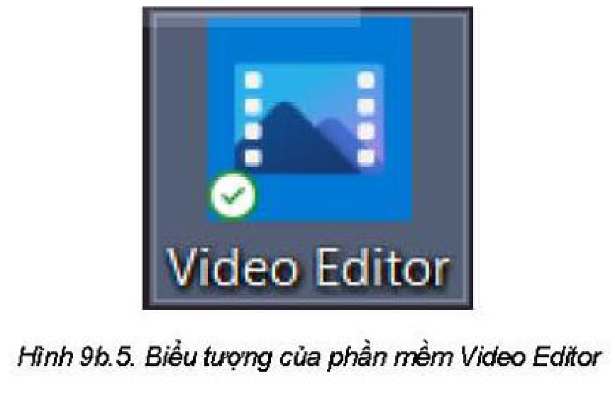
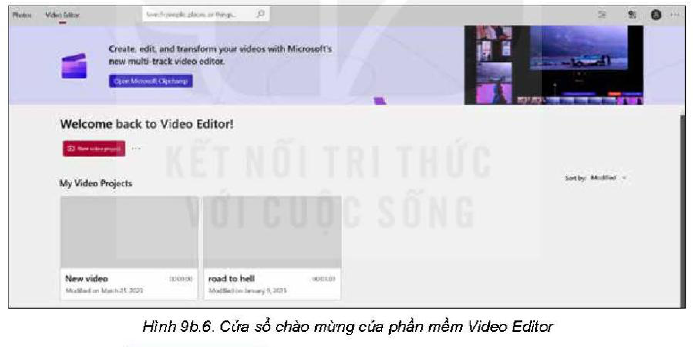
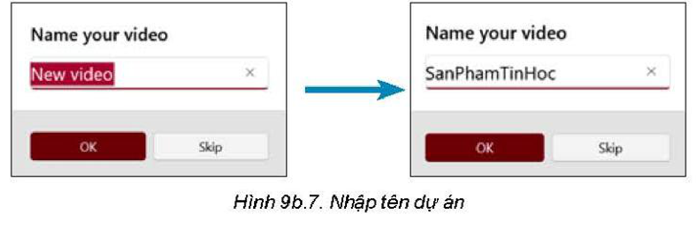
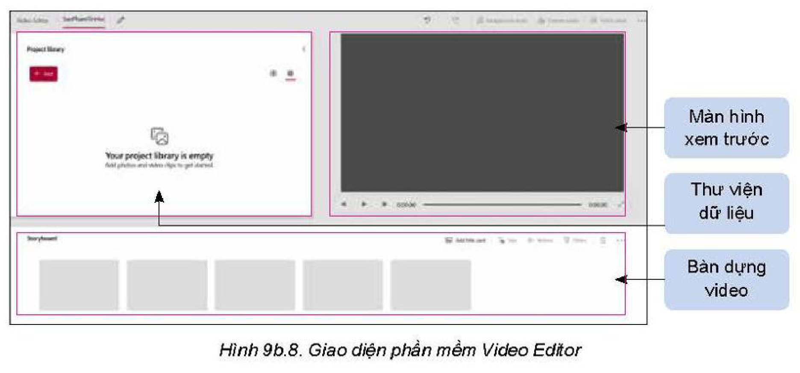
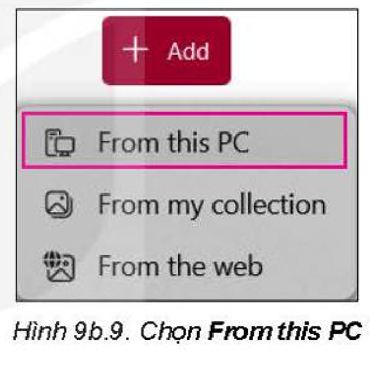
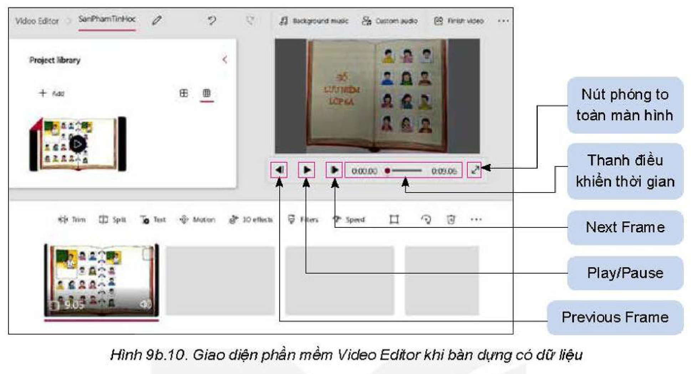

<!-- pdf:57 -->

# BÀI 9B: CÁC CHỨC NĂNG CHÍNH CỦA PHẦN MỀM LÀM VIDEO

*b. Làm quen với phần mềm làm video*

## 🎯 Sau bài học này em sẽ:

- Nêu được một số chức năng và thực hiện được một số thao tác cơ bản trong sử dụng một phần mềm làm video.

## 🔴 Khởi động

> Video là dạng thông tin đặc biệt (kết hợp của văn bản, âm thanh, hình ảnh). Video tác động đến nhiều giác quan của người xem cùng lúc nên mang đến hiệu quả cao. Trong dự án **Triển lãm tin học**, nếu các em làm được những video minh hoạ cho các nội dung triển lãm thì sẽ mang đến ấn tượng mạnh cho người xem. Làm ra một video có khó không? Có những cách nào để làm ra một video? Khi muốn chỉnh sửa một video em làm thế nào?

## 1. PHẦN MỀM LÀM VIDEO VÀ CÁC CHỨC NĂNG CHÍNH

> **Hoạt động 1: Làm thế nào để tạo video từ văn bản, hình ảnh, âm thanh, video?**
>
> An dùng điện thoại thông minh quay một đoạn video về sản phẩm tin học đã thực hiện khi học môn Tin học ở lớp 6 là **Sổ lưu niệm**. Minh chụp ảnh cây xanh ở vườn trường, sân trường để minh hoạ cho sự thành công của dự án **Trường học xanh**. Khoa có hình ảnh tờ rơi quảng cáo và tài liệu của dự án **Thành lập CLB Tin học**,... Các bạn muốn làm ra một video kết hợp các đoạn video, hình ảnh đó và thêm vào lời bình, nhạc nền,... Theo em, làm thế nào để tạo được video tổng hợp từ những gì các bạn đã có để chiếu trong buổi triển lãm tin học?

*Hình 9b.1. Đoạn video quay sản phẩm của dự án Sổ lưu niệm*

*Hình 9b.2. Hình ảnh chụp kết quả dự án Trường học xanh*

*Hình 9b.3. Hình ảnh tờ rơi quảng cáo của dự án Thành lập CLB Tin học*

*Hình 9b.4. Đoạn âm thanh nền*

Để tạo mới, chỉnh sửa, kết hợp các loại thông tin thành một video theo ý muốn của mình, em cần sử dụng **phần mềm làm video**. **Phần mềm làm video** là phần mềm ứng dụng, được thiết kế với các chức năng chính: tạo mới video, chỉnh sửa video, thêm hiệu ứng, tạo các video kết hợp từ nhiều loại thông tin (chèn thêm âm thanh, phụ đề,...), tạo các đoạn hoạt hình từ ảnh, ghi lại và chuyển đổi video sang các định dạng và **độ phân giải** khác nhau.

<!-- pdf:58 -->

<!-- term: Phần mềm làm video -->
> Chức năng chính của **phần mềm làm video**: tạo mới, chỉnh sửa, thêm hiệu ứng, tạo các video kết hợp từ nhiều loại thông tin, tạo các đoạn hoạt hình từ ảnh, ghi lại và chuyển đổi video sang các định dạng và độ phân giải khác nhau.

> ❓ **Câu hỏi**
>
> Em hãy chọn phương án ghép đúng:
>
> Phần mềm làm video là
>
> A. phần mềm ứng dụng giúp người sử dụng quay được video.
>
> B. phần mềm ứng dụng giúp người sử dụng làm ra các video từ các dữ liệu dạng văn bản, hình ảnh, âm thanh, video.
>
> C. phần mềm hệ thống giúp người sử dụng xem video.
>
> D. phần mềm hệ thống giúp người sử dụng phát video lên mạng.

## 2. PHẦN MỀM VIDEO EDITOR

> **Hoạt động 2: Em biết những phần mềm làm video nào?**
>
> 1. Em hãy kể tên một vài phần mềm làm video mà em biết.
> 2. Em muốn sử dụng một phần mềm làm video có những chức năng gì?

<!-- term: Video Editor -->
Có nhiều phần mềm làm video, trong đó có loại miễn phí, trả phí, có loại chuyên nghiệp, không chuyên nghiệp. **Video Editor** (Hình 9b.5) là một phần mềm làm video (được tích hợp sẵn trong hệ điều hành Windows 10, Windows 11) giúp người sử dụng làm video, chỉnh sửa video với các thao tác cơ bản. Video Editor hỗ trợ nhiều định dạng tệp như mp3, wma, wav, mp4, avi, mpg, jpg, bmp, png,... Đây là phần mềm được rất nhiều người sử dụng vì những ưu điểm sau:

- Giao diện thân thiện, dễ sử dụng.
- Có đầy đủ những chức năng cơ bản và nâng cao để làm ra các video từ dữ liệu hình ảnh, video; thêm hiệu ứng, âm thanh, phụ đề; tự động tạo hoạt hình từ ảnh;...
- Dễ dàng chia sẻ video.

Em có thể sử dụng Video Editor để làm ra các video đáp ứng nhu cầu cuộc sống của cá nhân, gia đình, trường học,... và có thể chia sẻ trên các mạng xã hội như YouTube, Facebook,...

*Hình 9b.5. Biểu tượng của phần mềm Video Editor*

> **Video Editor** là phần mềm làm video được nhiều người sử dụng vì có đầy đủ các chức năng làm video cơ bản và nâng cao.

<!-- pdf:59 -->

> ❓ **Câu hỏi**
>
> Chọn phương án ghép **sai**:
>
> Video Editor là phần mềm làm video
>
> A. có giao diện thân thiện, dễ sử dụng.
>
> B. hỗ trợ nhiều định dạng tệp.
>
> C. được tích hợp sẵn trong tất cả các hệ điều hành.
>
> D. có đầy đủ những chức năng làm video cơ bản và nâng cao.

## 3. THỰC HÀNH: LÀM QUEN VỚI PHẦN MỀM LÀM VIDEO

**Nhiệm vụ:** Thực hiện được một số thao tác cơ bản trong sử dụng một phần mềm làm video.

**Hướng dẫn**

*(Hướng dẫn sau đây sử dụng phần mềm Video Editor để minh hoạ.)*

### a) Khởi động phần mềm và tạo một video mới

– Nháy đúp chuột vào biểu tượng [biểu tượng Video Editor] trên màn hình nền, phần mềm Video Editor được mở ra với cửa sổ chào mừng tương tự như Hình 9b.6.

*Hình 9b.6. Cửa sổ chào mừng của phần mềm Video Editor*

– Nháy chuột vào nút **New video project** trong cửa sổ chào mừng để bắt đầu thực hiện dự án làm video. Phần mềm hiển thị cửa sổ cho em nhập tên dự án. Nhập `SanPhamTinHoc` rồi chọn **OK**.
<!-- ocr-ok: đối chiếu ảnh trang PDF 59; nút lệnh New video project là hình chèn trong dòng nên OCR bỏ sót -->

*Hình 9b.7. Nhập tên dự án*

<!-- pdf:60 -->

– Giao diện phần mềm mở ra như Hình 9b.8 để em bắt đầu làm video.

*Hình 9b.8. Giao diện phần mềm Video Editor*

### b) Nhập dữ liệu vào thư viện

<!-- term: Thư viện dữ liệu -->
– **Thư viện dữ liệu** chứa những tệp hình ảnh, video mà em sử dụng để làm video.

– Nháy chuột vào lệnh **+ Add**, chọn **From this PC** để nhập dữ liệu từ máy tính vào thư viện (Hình 9b.9).

– Nếu muốn xoá dữ liệu khỏi thư viện, em nháy chuột chọn dữ liệu, nháy nút phải chuột rồi chọn lệnh **Remove**.

*Hình 9b.9. Chọn From this PC*

### c) Đưa dữ liệu từ thư viện vào bàn dựng

<!-- term: Bàn dựng video -->
– Sau khi thư viện đã có dữ liệu, trên **bàn dựng** sẽ xuất hiện dòng hướng dẫn `Drag items from the project library here`. Em dùng chuột kéo thả các tệp dữ liệu từ thư viện vào bàn dựng.

– Nếu muốn xoá dữ liệu (một đoạn video, một hình ảnh,...) khỏi bàn dựng, em nháy chuột chọn dữ liệu rồi chọn biểu tượng [biểu tượng thùng rác] ở góc trên, bên phải bàn dựng.

– Nếu muốn xoá tất cả dữ liệu đang có trong bàn dựng, em nháy chuột chọn biểu tượng `...` ở góc trên, bên phải bàn dựng, chọn **Remove all**.

*Lưu ý:* Dữ liệu bị xoá khỏi bàn dựng nhưng vẫn còn trong thư viện. Dữ liệu bị xoá khỏi thư viện thì trong bàn dựng cũng bị xoá.

### d) Xem trước kết quả ở màn hình

<!-- term: Màn hình xem trước -->
– Sau khi bàn dựng đã có dữ liệu, **màn hình xem trước** sẽ hiển thị hình ảnh dữ liệu (Hình 9b.10). Em có thể dùng các lệnh điều khiển video: **Play** (mở video), **Pause** (tạm dừng), **Next Frame** (chuyển về khung hình phía trước), **Previous Frame** (chuyển về khung hình phía sau) hoặc dùng chuột kéo thả con chạy ở thanh điều khiển thời gian để xem video.

<!-- pdf:61 -->

*Hình 9b.10. Giao diện phần mềm Video Editor khi bàn dựng có dữ liệu*

## ✏️ Luyện tập

1. Em hãy nêu các chức năng chính của phần mềm làm video.
2. Em hãy thu thập các tệp video, hình ảnh, tài liệu về các sản phẩm em đã làm được trong quá trình thực hiện các dự án (ví dụ **Sổ lưu niệm**, **Trường học xanh**, **Thành lập CLB Tin học**) khi học môn Tin học. Lưu các tệp vào một thư mục trong máy tính và thực hiện:

   a) Khởi động phần mềm Video Editor, mở dự án làm video `SanPhamTinHoc`.

   b) Nhập các tệp dữ liệu em đã thu thập vào thư viện dữ liệu.

   c) Đưa dữ liệu vào bàn dựng.

   d) Dùng các nút điều khiển ở màn hình xem trước để xem video.

   e) Xoá bỏ lần lượt từng dữ liệu khỏi bàn dựng, quan sát xem dữ liệu trong thư viện có bị mất không.

   f) Xoá bỏ lần lượt từng dữ liệu khỏi thư viện.

## 🚀 Vận dụng

Em hãy làm video để giới thiệu về một vấn đề mà em quan tâm, ví dụ một cuốn sách, một môn học, một địa danh ở địa phương,... Bắt đầu bằng việc thực hiện các công việc sau đây:

a) Dùng máy quay phim, điện thoại thông minh,... quay video, chụp ảnh; tìm kiếm các thông tin liên quan đến vấn đề em muốn giới thiệu. Lưu các tệp dữ liệu em thu thập được vào một thư mục trong máy tính có tên là `DuLieuMyVideo`.

b) Sử dụng phần mềm Video Editor tạo một dự án làm video mới có tên `MyVideo`.

## 📷 Danh sách hình trong bài

| Mã hình | Trang PDF | Trang sách | Chú thích |
| --- | --- | --- | --- |
| H9-tin_hoc-b09b-01 | 57 | 55 | Hình 9b.1. Đoạn video quay sản phẩm của dự án Sổ lưu niệm |
| H9-tin_hoc-b09b-02 | 57 | 55 | Hình 9b.2. Hình ảnh chụp kết quả dự án Trường học xanh |
| H9-tin_hoc-b09b-03 | 57 | 55 | Hình 9b.3. Hình ảnh tờ rơi quảng cáo của dự án Thành lập CLB Tin học |
| H9-tin_hoc-b09b-04 | 57 | 55 | Hình 9b.4. Đoạn âm thanh nền |
| H9-tin_hoc-b09b-05 | 58 | 56 | Hình 9b.5. Biểu tượng của phần mềm Video Editor |
| H9-tin_hoc-b09b-06 | 59 | 57 | Hình 9b.6. Cửa sổ chào mừng của phần mềm Video Editor |
| H9-tin_hoc-b09b-07 | 59 | 57 | Hình 9b.7. Nhập tên dự án |
| H9-tin_hoc-b09b-08 | 60 | 58 | Hình 9b.8. Giao diện phần mềm Video Editor |
| H9-tin_hoc-b09b-09 | 60 | 58 | Hình 9b.9. Chọn From this PC |
| H9-tin_hoc-b09b-10 | 61 | 59 | Hình 9b.10. Giao diện phần mềm Video Editor khi bàn dựng có dữ liệu |
