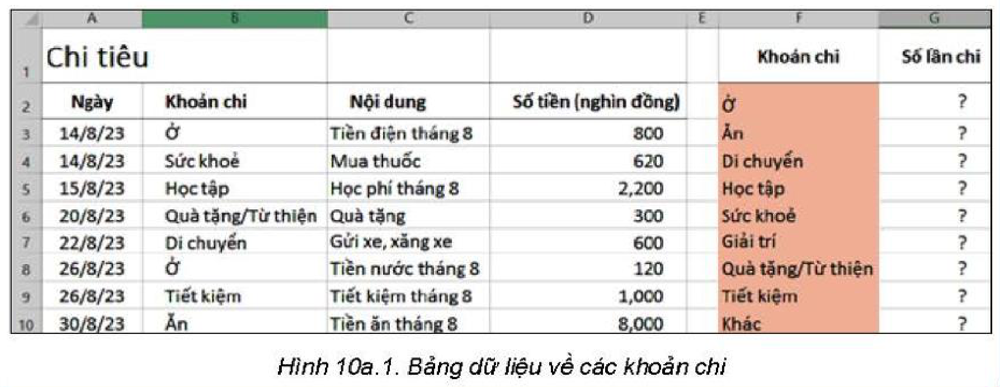
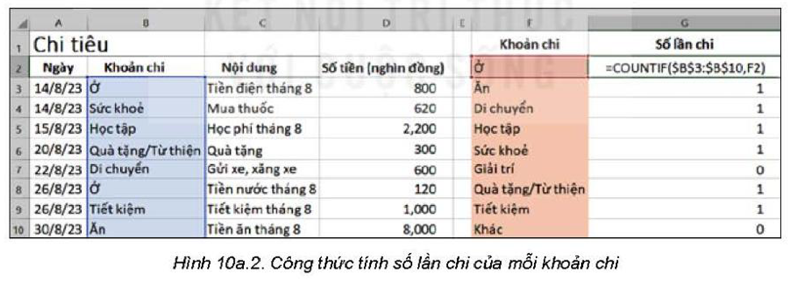
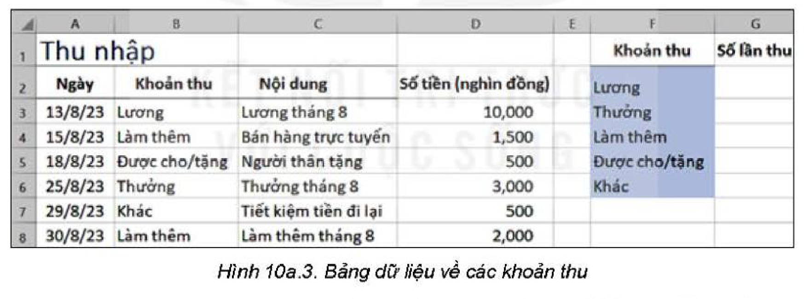
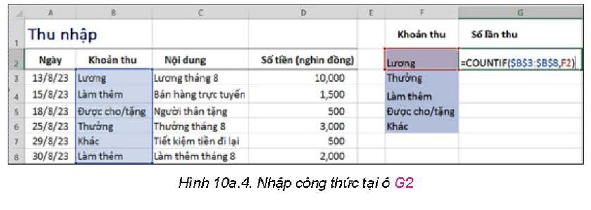
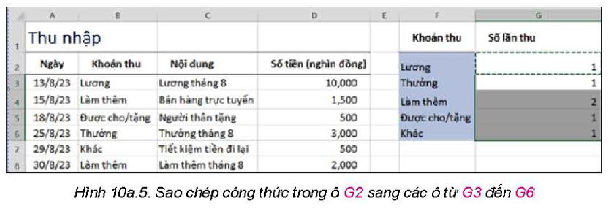
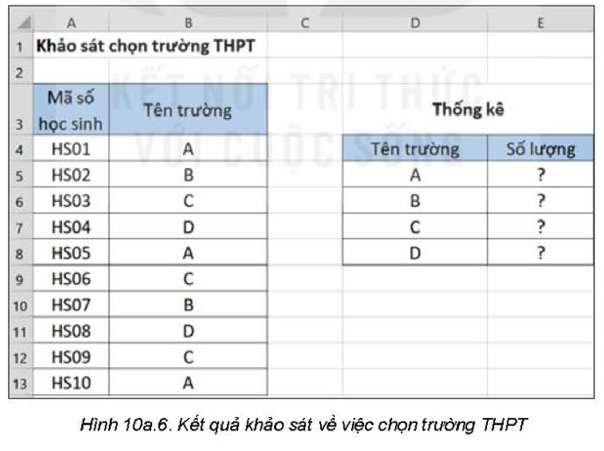

<!-- pdf:43 -->

# BÀI 10A: SỬ DỤNG HÀM COUNTIF

## 🎯 Sau bài học này em sẽ:

- Sử dụng được hàm đếm theo điều kiện COUNTIF trong giải quyết bài toán thực tế về quản lí tài chính.

## 🔴 Khởi động

> Trong các bài học trước, em đã sử dụng công cụ xác thực dữ liệu để nhập dữ liệu chính xác cho bảng tính quản lí tài chính gia đình. Để việc chi tiêu của gia đình được kiểm soát thường xuyên hoặc định kì theo khoảng thời gian nào đó tuỳ vào mỗi gia đình, dữ liệu thu và chi cần được tổng hợp để trả lời những câu hỏi sau:
>
> - Mỗi khoản chi đã được chi bao nhiêu lần?
> - Mỗi khoản thu đã được thu bao nhiêu lần?
> - Tổng số tiền đã chi tiêu của từng khoản chi là bao nhiêu?
> - Tổng số tiền thu nhập của từng khoản thu là bao nhiêu?
> - Thu nhập và chi tiêu của gia đình đã cân đối chưa?
>
> Những bài học tiếp theo của chủ đề này sẽ hướng dẫn em trả lời các câu hỏi trên, giúp cho việc chi tiêu của gia đình được kiểm soát hiệu quả.

## 1. HÀM COUNTIF

> **Hoạt động 1: Các khoản chi được tổng hợp như thế nào?**
>
> Giả sử dữ liệu chi tiêu đã được cập nhật trong vùng A3:D10 (Hình 10a.1). Theo em, công thức tại các ô G2, G3,..., G10 là gì để em có thể biết số lần chi tiêu của mỗi khoản?

*Hình 10a.1. Bảng dữ liệu về các khoản chi*

<!-- pdf:44 -->

Để đếm số ô tính mà dữ liệu của ô thoả mãn một điều kiện nào đó, em sử dụng **hàm đếm theo điều kiện** **COUNTIF**. Bảng 10a.1 dưới đây là một số ví dụ sử dụng hàm này.

**Bảng 10a.1. Một số ví dụ sử dụng hàm COUNTIF**

| STT | Yêu cầu tính toán | Công thức tính |
| --- | --- | --- |
| 1 | Đếm số ô trong vùng A1:A4 chứa giá trị số lớn hơn 100. | `=COUNTIF(A1:A4,">100")` |
| 2 | Đếm số ô trong vùng A1:A4 chứa từ Yes. | `=COUNTIF(A1:A4,"Yes")` |
| 3 | Đếm số ô trong vùng A1:A4 chứa xâu kí tự bắt đầu bằng chữ cái Y. | `=COUNTIF(A1:A4,"Y*")` |
| 4 | Đếm số ô trong vùng A1:A4 chứa giá trị giống như ô D2. | `=COUNTIF(A1:A4,D2)` |

Công thức chung của COUNTIF là:

`=COUNTIF(range, criteria)`

Trong đó, ý nghĩa của các tham số như sau:

- **range:** là địa chỉ vùng dữ liệu.
- **criteria:** là điều kiện.

Trong Hình 10a.1, để biết mỗi khoản chi đã được chi bao nhiêu lần, em dùng hàm COUNTIF để đếm số ô tính trong vùng B3:B10 chứa mỗi khoản chi. Như vậy, công thức ở ô G2 là `=COUNTIF($B$3:$B$10,"Ở")` cho biết khoản Ở đã được chi bao nhiêu lần. Tuy nhiên, tên của khoản chi này đã được lưu ở ô F2. Vì vậy công thức tại ô G2 được sửa lại là `=COUNTIF($B$3:$B$10,F2)` như Hình 10a.2. Khi sao chép công thức này sang các ô còn lại từ G3 đến G10, công thức sẽ trả lại kết quả là số lần chi của các khoản chi còn lại.

*Hình 10a.2. Công thức tính số lần chi của mỗi khoản chi*

<!-- term: Hàm COUNTIF -->
> - **Hàm COUNTIF** đếm số ô tính trong vùng dữ liệu (range) thoả mãn điều kiện (criteria).
> - Công thức: `=COUNTIF(range, criteria)`
>   – **range:** phạm vi chứa các ô tính cần kiểm tra để đếm.
>   – **criteria:** điều kiện kiểm tra các ô tính trong phạm vi **range**.

<!-- pdf:45 -->

> ❓ **Câu hỏi**
>
> Trong Hình 10a.2, công thức ở ô G2 là `=COUNTIF($B$3:$B$10,F2)`. Em hãy trả lời các câu hỏi sau:
>
> a) Khi sao chép công thức trên sang các ô G3,..., G10 công thức sẽ thay đổi như thế nào?
>
> b) Nếu bỏ các dấu `$` thì công thức ở ô G2 sẽ là `=COUNTIF(B3:B10,F2)`. Sau khi sao chép công thức này sang các ô từ G3 đến G10, kết quả trả lại tại các ô đó có đúng không? Tại sao?
<!-- ocr-ok: đối chiếu ảnh trang PDF 45; OCR đọc nhầm kí tự "=", dấu "$" và tên ô G3 -->

## 2. THỰC HÀNH: SỬ DỤNG HÀM COUNTIF
<!-- ocr-ok: đối chiếu ảnh trang PDF 45; OCR đọc nhầm "THỰC HÀNH: SỬ DỤNG HÀM" thành "THỰC HÂNH: SỬ DỤNG HẦM" -->

**Nhiệm vụ:** Sử dụng hàm COUNTIF để tổng hợp chi tiêu theo mỗi khoản.
<!-- ocr-ok: đối chiếu ảnh trang PDF 45; OCR đọc nhầm dấu thanh ở "chi tiêu", "mỗi" -->

**Hướng dẫn**

### a) Tính số lần chi của mỗi khoản chi trong trang tính Chi tiêu
<!-- ocr-ok: đối chiếu ảnh trang PDF 45; OCR đọc nhầm "chi", "Chi tiêu" thành "chỉ", "Chỉ tiêu" -->

– Mở tệp bảng tính `TaiChinhGiaDinh.xlsx`, chọn trang tính `Chi tiêu`.
<!-- ocr-ok: đối chiếu ảnh trang PDF 45; OCR đọc nhầm "Chi tiêu" thành "Chị tiêu" -->

– Nhập dữ liệu cho trang tính để được kết quả tương tự như Hình 10a.1.

– Tại ô G2, nhập công thức `=COUNTIF($B$3:$B$10,F2)` như minh hoạ trong Hình 10a.2.

– Sao chép công thức trong ô G2 sang các ô từ G3 đến G10.

– Lưu bảng tính.

### b) Tính số lần thu của mỗi khoản thu trong trang tính Thu nhập

– Chọn trang tính `Thu Nhập`.

– Nhập dữ liệu cho trang tính để được nội dung tương tự như Hình 10a.3.

*Hình 10a.3. Bảng dữ liệu về các khoản thu*

– Tại ô G2, nhập công thức `=COUNTIF($B$3:$B$8,F2)` để tính số lần thu của khoản Lương (Hình 10a.4).

*Hình 10a.4. Nhập công thức tại ô G2*

<!-- pdf:46 -->

– Sao chép công thức trong ô G2 sang các ô từ G3 đến G6 để tính số lần thu của các khoản thu còn lại (Hình 10a.5).

*Hình 10a.5. Sao chép công thức trong ô G2 sang các ô từ G3 đến G6*

– Lưu tệp.

## ✏️ Luyện tập

1. Em hãy bổ sung thêm một số dòng dữ liệu thu, chi vào cả hai trang tính `Thu nhập` và `Chi tiêu`. Hãy điều chỉnh công thức COUNTIF ở cột G để kết quả tổng hợp số lần thu, chi của mỗi khoản được chính xác.
2. Em hãy thực hiện cuộc khảo sát về việc chọn trường THPT của các bạn trong lớp. Nhập thông tin mà em thu thập được vào bảng tính và sử dụng hàm COUNTIF để tổng hợp kết quả khảo sát như minh hoạ ở Hình 10a.6.

*Hình 10a.6. Kết quả khảo sát về việc chọn trường THPT*

## 🚀 Vận dụng

Em hãy mở bảng tính `KinhPhiTrienLam.xlsx` đã tạo ở phần Vận dụng, Bài 9a và sử dụng hàm COUNTIF để tính số lần thu của mỗi khoản thu, số lần chi của mỗi khoản chi của dự án **Triển lãm tin học**. Lưu tệp sau khi hoàn thành công việc.

## 📷 Danh sách hình trong bài

| Mã hình | Trang PDF | Trang sách | Chú thích |
| --- | --- | --- | --- |
| H9-tin_hoc-b10a-01 | 43 | 41 | Hình 10a.1. Bảng dữ liệu về các khoản chi |
| H9-tin_hoc-b10a-02 | 44 | 42 | Hình 10a.2. Công thức tính số lần chi của mỗi khoản chi |
| H9-tin_hoc-b10a-03 | 45 | 43 | Hình 10a.3. Bảng dữ liệu về các khoản thu |
| H9-tin_hoc-b10a-04 | 45 | 43 | Hình 10a.4. Nhập công thức tại ô G2 |
| H9-tin_hoc-b10a-05 | 46 | 44 | Hình 10a.5. Sao chép công thức trong ô G2 sang các ô từ G3 đến G6 |
| H9-tin_hoc-b10a-06 | 46 | 44 | Hình 10a.6. Kết quả khảo sát về việc chọn trường THPT |
