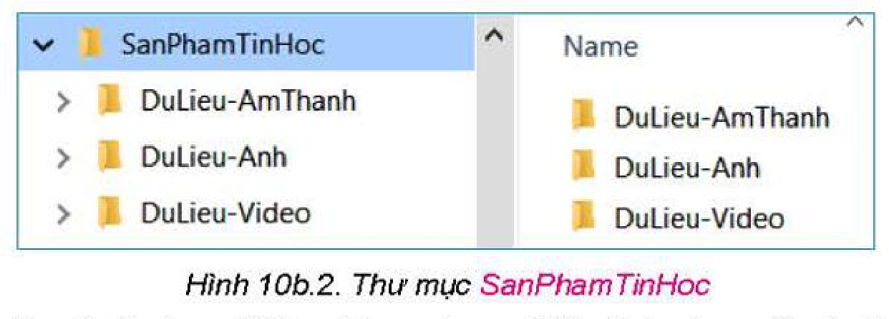
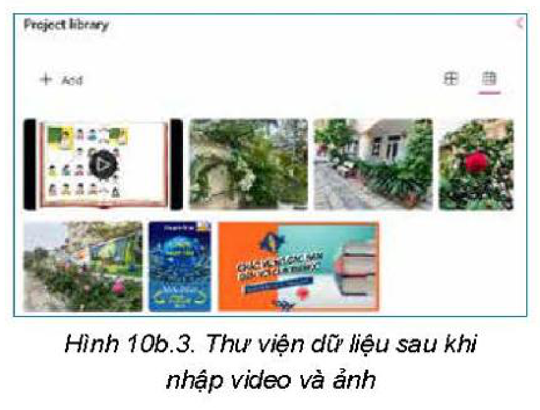
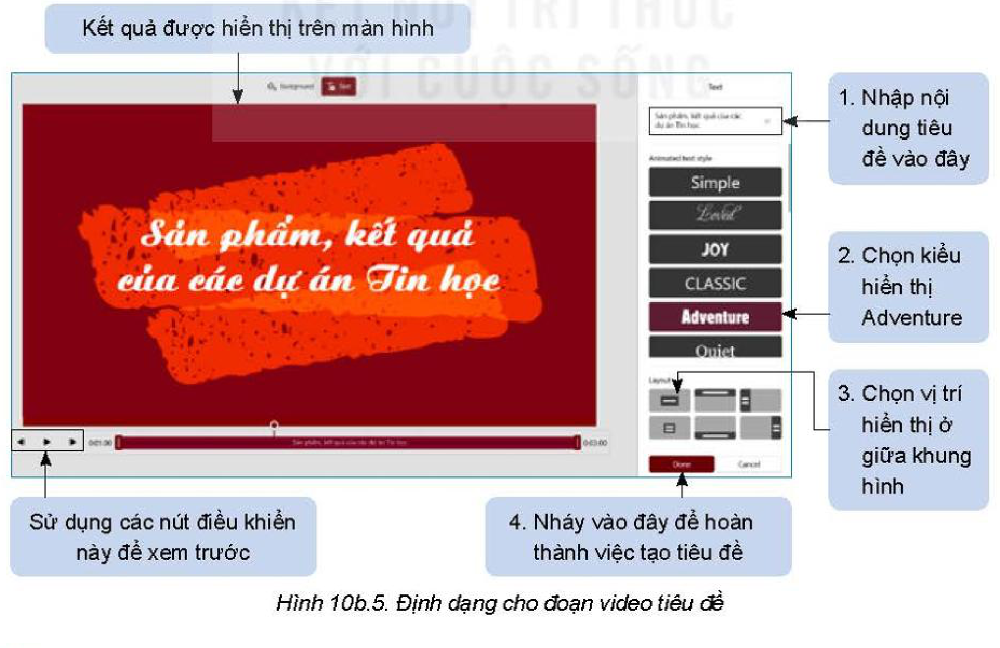
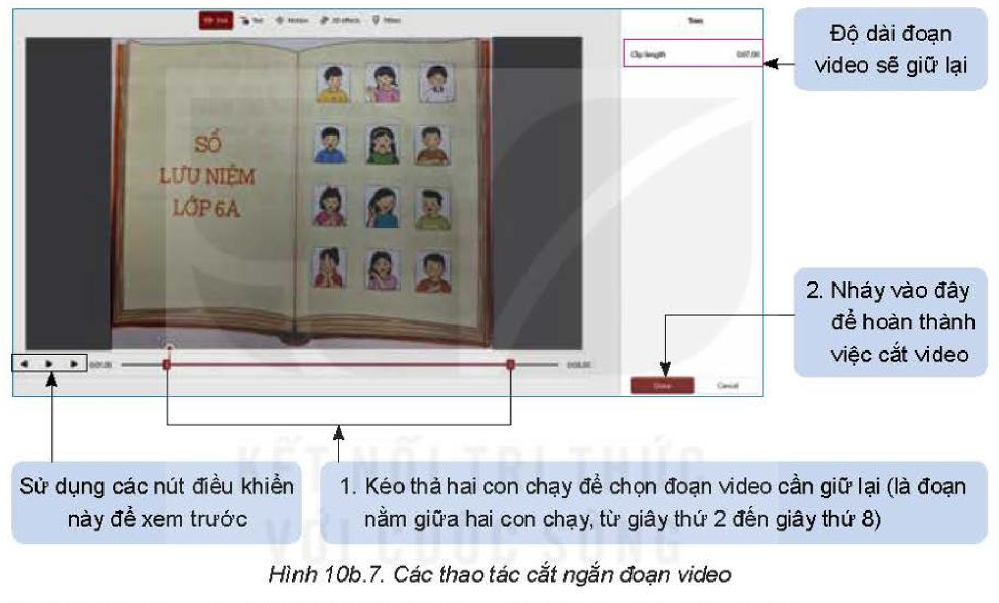
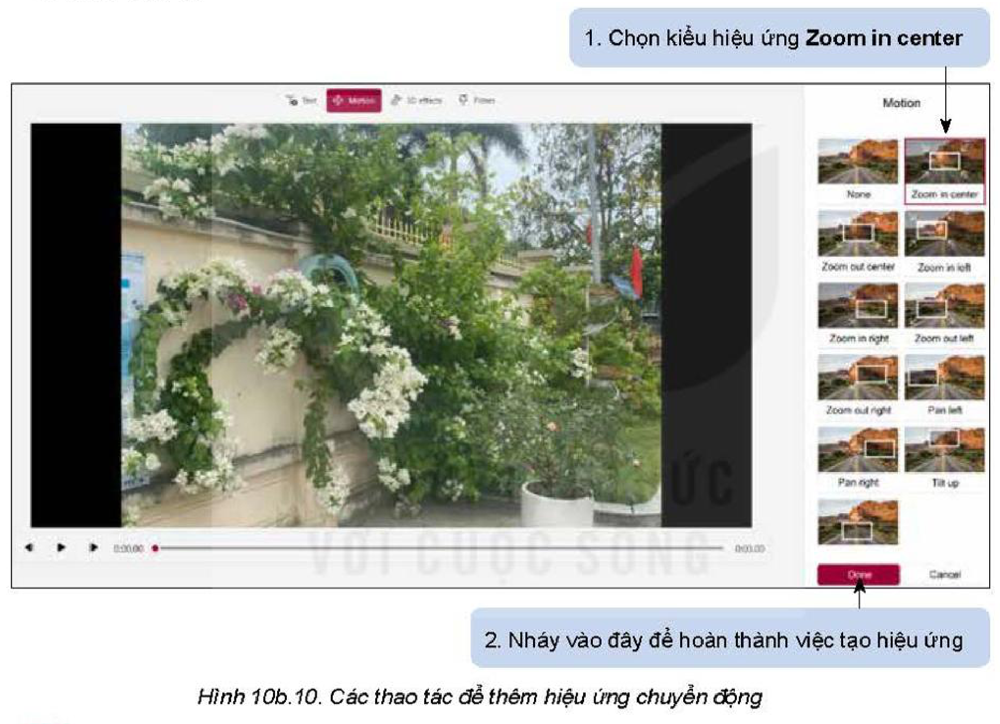

<!-- pdf:62 -->

# BÀI 10B: CHUẨN BỊ DỮ LIỆU VÀ DỰNG VIDEO

## 🎯 Sau bài học này em sẽ:

- Biết được các bước để làm một video.
- Chuẩn bị được dữ liệu và dựng được video theo kịch bản.

## 🔴 Khởi động

> Để làm một bộ phim cần có cả một đoàn làm phim với đủ các thành phần như: đạo diễn, quay phim, trợ lí, biên kịch, diễn viên, dựng phim,... và trải qua rất nhiều giai đoạn như: viết **kịch bản**, quay phim, dựng phim, hậu kì,...
>
> Để làm video giới thiệu các sản phẩm tin học, có cần cả một đoàn làm phim (Hình 10b.1) không? Có cần thực hiện nhiều công đoạn không?

*Hình 10b.1. Đoàn làm phim*

## 1. CÁC BƯỚC ĐỂ LÀM MỘT VIDEO

> **Hoạt động 1: Cần làm gì trước khi dựng video?**
>
> Trong khi dựng video, An thấy thiếu hình ảnh chụp các buổi hoạt động của **CLB Tin học**. Vậy là An lại phải dừng lại để đi thu thập hình ảnh từ các bạn trong lớp. Có đủ dữ liệu rồi nhưng An lại loay hoay không biết nên sắp xếp thứ tự các đoạn video và hình ảnh thế nào cho hợp lí, nên thêm hiệu ứng gì để làm cho video hay hơn.
>
> Theo em, An cần làm gì trước khi bắt tay vào dựng video bằng phần mềm?

<!-- term: Các bước để làm một video -->
Tương tự như việc thực hiện một bộ phim, tuy không cần đến cả một đoàn làm phim với các bước thực hiện chuyên nghiệp, nhưng để làm được một video nhanh chóng, hiệu quả, theo đúng mục tiêu đặt ra em cần thực hiện những bước sau:

<!-- term: Kịch bản -->
Bước 1. **Đưa ra ý tưởng, xây dựng kịch bản:** Xuất phát từ mục tiêu ban đầu, phác thảo ra một bản sắp xếp các dữ liệu theo một tiến trình và thời lượng cụ thể.

Bước 2. **Chuẩn bị dữ liệu:** Thu thập tất cả các dữ liệu cần thiết theo **kịch bản** đã xây dựng. Quay video, chụp ảnh, thu âm thanh bằng máy quay, điện thoại thông minh, webcam; viết phụ đề; tập hợp các tệp dữ liệu vào một thư mục trong máy tính.

Bước 3. **Nhập dữ liệu, dựng video:** Đưa dữ liệu vào phần mềm làm video. Sắp xếp dữ liệu, chỉnh sửa, thêm hiệu ứng, thêm phụ đề,... theo kịch bản đã xây dựng bằng phần mềm làm video.

Bước 4. **Biên tập video:** Xem lại video; Kiểm tra âm thanh, hình ảnh, phụ đề đã đúng theo kịch bản chưa? Có cần thêm hiệu ứng không? Có cần cắt bỏ hay điều chỉnh lại nội dung không?

Bước 5. **Xuất video:** Xuất video đã dựng sang định dạng có thể chia sẻ với người khác.

<!-- pdf:63 -->

<!-- term: Các bước để làm một video -->
> Để làm được một video nhanh chóng và hiệu quả theo đúng ý tưởng ban đầu, em nên thực hiện theo các bước: lên ý tưởng, xây dựng kịch bản; chuẩn bị dữ liệu; nhập dữ liệu, dựng video; biên tập video; xuất video.

> ❓ **Câu hỏi**
>
> Em hãy sắp xếp lại các bước tạo video sau đây theo đúng thứ tự:
>
> a) Nhập dữ liệu, dựng video.
>
> b) Chuẩn bị dữ liệu.
>
> c) Lên ý tưởng, xây dựng kịch bản.
>
> d) Xuất video.
>
> e) Biên tập video.

## 2. THỰC HÀNH: LÀM VIDEO GIỚI THIỆU CÁC SẢN PHẨM ĐÃ THỰC HIỆN TRONG QUÁ TRÌNH HỌC MÔN TIN HỌC

**Nhiệm vụ 1:** Đưa ra ý tưởng, xây dựng kịch bản và chuẩn bị dữ liệu.

**Hướng dẫn**

### a) Lên ý tưởng, xây dựng kịch bản

– **Ý tưởng:** Video sẽ giới thiệu về những sản phẩm, kết quả của những dự án mà các bạn đã thực hiện trong quá trình học môn Tin học: cuốn sổ lưu niệm; những hàng cây xanh và hoa ở cổng trường, sân trường, vườn trường; tờ rơi, tài liệu, kết quả hoạt động của CLB Tin học,...

– **Xây dựng kịch bản:** Video dài khoảng 28 giây, bao gồm các nội dung sau đây:

+ Tiêu đề video có nội dung: `Sản phẩm, kết quả của các dự án Tin học` (3 giây).

+ Đoạn video quay cuốn sổ lưu niệm của dự án **Sổ lưu niệm** (7 giây).

+ Đoạn hoạt hình tạo từ những hình ảnh chụp cây và hoa ở cổng trường, sân trường, vườn trường,... của dự án **Trường học xanh** (8 giây).

+ Đoạn hoạt hình tạo từ những hình ảnh chụp tờ rơi, tài liệu của dự án **Thành lập CLB Tin học** (10 giây).

+ Giữa các đoạn video có hiệu ứng chuyển động.

+ Thêm hiệu ứng ba chiều, bộ lọc vào các vị trí thích hợp.

+ Toàn bộ video có nhạc nền nhẹ nhàng.

+ Thêm phụ đề (tên dự án) vào đầu mỗi đoạn giới thiệu sản phẩm.

+ Thêm lời thuyết minh về quá trình thực hiện mỗi dự án.

### b) Chuẩn bị dữ liệu

– Tạo một thư mục có tên `SanPhamTinHoc`. Thư mục chứa các thư mục con có tên `DuLieu-AmThanh`, `DuLieu-Anh`, `DuLieu-Video` (Hình 10b.2).

*Hình 10b.2. Thư mục SanPhamTinHoc*

– Sao chép các tệp sẽ sử dụng để làm video mà em đã thu thập được (ở câu 2, phần Luyện tập, Bài 9b) vào các thư mục tương ứng.

<!-- pdf:64 -->

**Nhiệm vụ 2:** Nhập dữ liệu và dựng video.

**Hướng dẫn**

### a) Nhập dữ liệu

– Khởi động phần mềm Video Editor.

– Mở dự án `SanPhamTinHoc` đã tạo ở phần thực hành Bài 9b.

– Nhập dữ liệu vào thư viện theo thứ tự trong kịch bản. Vào thư mục `SanPhamTinhoc/Dulieu-Video` để nhập dữ liệu video. Vào thư mục `SanPhamTinhoc/Dulieu-Anh` để nhập các tệp hình ảnh. Em được kết quả tương tự như Hình 10b.3.

*Hình 10b.3. Thư viện dữ liệu sau khi nhập video và ảnh*
<!-- ocr-ok: đối chiếu ảnh trang PDF 64; OCR đọc lỗi chú thích Hình 10b.3 -->

### b) Dựng video theo kịch bản

*Bước 1. Tạo tiêu đề cho video*

<!-- term: Tạo tiêu đề cho video -->
– Nháy chuột chọn **Add title card** ở phía trên, bên phải bàn dựng. Một đoạn video dài 3 giây xuất hiện ở vị trí đầu tiên. Số 3.0 trên khung hình chính là độ dài đoạn video tính theo giây (Hình 10b.4).

*Hình 10b.4. Khung hình của tiêu đề trên bàn dựng*
<!-- ocr-ok: đối chiếu ảnh trang PDF 64; OCR tách rời hai dòng chú thích Hình 10b.4 -->

<!-- term: Tạo tiêu đề cho video -->
– Nháy chuột chọn **Text** để nhập nội dung tiêu đề. Một cửa sổ mới mở ra cho phép em thực hiện một số thao tác định dạng cho đoạn video tiêu đề. Em thực hiện theo các hướng dẫn ở Hình 10b.5.

*Hình 10b.5. Định dạng cho đoạn video tiêu đề*

<!-- pdf:65 -->

*Bước 2. Cắt ngắn đoạn video quay cuốn sổ lưu niệm*

– Kéo thả đoạn video quay cuốn sổ lưu niệm vào bàn dựng ở vị trí tiếp theo đoạn tiêu đề. Đoạn video này có độ dài 9.05 giây (Hình 10b.6). Theo kịch bản, em cần cắt bớt để đoạn này chỉ còn 7 giây.

*Hình 10b.6. Đoạn video dài 9.05 giây*

<!-- term: Cắt ngắn đoạn video -->
– Nháy chuột chọn **Trim** để cắt đoạn video. Một cửa sổ mới mở ra cho phép em thực hiện một số thao tác để cắt ngắn đoạn video. Em thực hiện theo các hướng dẫn ở Hình 10b.7

*Hình 10b.7. Các thao tác cắt ngắn đoạn video*

*Bước 3. Tạo đoạn hoạt hình từ hình ảnh, thay đổi thời gian hiển thị của ảnh*

<!-- term: Thay đổi thời gian hiển thị của ảnh -->
– Kéo thả bốn ảnh chụp cây xanh và hoa vào bàn dựng ở vị trí tiếp theo đoạn video quay cuốn sổ lưu niệm. Mỗi ảnh được phần mềm mặc định hiển thị trong 3 giây (Hình 10b.8).

*Hình 10b.8. Mỗi ảnh thêm vào bàn dựng được mặc định hiển thị trong 3 giây*

<!-- term: Thay đổi thời gian hiển thị của ảnh -->
– Theo kịch bản, đoạn hoạt hình tạo bởi các ảnh cây và hoa sẽ dài 8 giây. Hiện tại trong bàn dựng có 4 ảnh, mỗi ảnh hiển thị 3 giây. Em có thể thay đổi để thời gian hiển thị của mỗi ảnh là 2 giây.

<!-- term: Thay đổi thời gian hiển thị của ảnh -->
– Nháy chuột chọn ảnh thứ nhất. Chọn **Duration** chọn 2 giây trong danh sách hiển thị số giây. Thực hiện tương tự với các ảnh tiếp theo. Kết quả như Hình 10b.9.

<!-- pdf:66 -->

*Hình 10b.9. Thời gian hiển thị của mỗi ảnh đã thay đổi*

*Bước 4. Thêm hiệu ứng chuyển động*

<!-- term: Hiệu ứng chuyển động -->
– Nháy chuột vào ảnh ở ngay sau đoạn video để chọn. Nháy chuột vào **Motion** để thêm **hiệu ứng chuyển động** vào ảnh đang chọn. Một cửa sổ mới mở ra cho phép em thực hiện một số thao tác để thêm hiệu ứng chuyển động. Em thực hiện theo các hướng dẫn ở Hình 10b.10.

*Hình 10b.10. Các thao tác để thêm hiệu ứng chuyển động*

## ✏️ Luyện tập

1. Em hãy tạo đoạn hoạt hình dài 3 giây từ những hình ảnh chụp tờ rơi, tài liệu của dự án **Thành lập CLB Tin học**.
2. Em hãy thêm hiệu ứng chuyển động vào ảnh đầu của đoạn hoạt hình đã tạo ở câu 1.

## 🚀 Vận dụng

Em hãy thực hiện các nhiệm vụ tương tự trong phần Thực hành với dự án `MyVideo` (em đã tạo ở phần Vận dụng, Bài 9b) với các dữ liệu đã thu thập được lưu trong thư mục `DuLieuMyVideo`.

## 📷 Danh sách hình trong bài

| Mã hình | Trang PDF | Trang sách | Chú thích |
| --- | --- | --- | --- |
| H9-tin_hoc-b10b-01 | 62 | 60 | Hình 10b.1. Đoàn làm phim |
| H9-tin_hoc-b10b-02 | 63 | 61 | Hình 10b.2. Thư mục SanPhamTinHoc |
| H9-tin_hoc-b10b-03 | 64 | 62 | Hình 10b.3. Thư viện dữ liệu sau khi nhập video và ảnh |
| H9-tin_hoc-b10b-04 | 64 | 62 | Hình 10b.4. Khung hình của tiêu đề trên bàn dựng |
| H9-tin_hoc-b10b-05 | 64 | 62 | Hình 10b.5. Định dạng cho đoạn video tiêu đề |
| H9-tin_hoc-b10b-06 | 65 | 63 | Hình 10b.6. Đoạn video dài 9.05 giây |
| H9-tin_hoc-b10b-07 | 65 | 63 | Hình 10b.7. Các thao tác cắt ngắn đoạn video |
| H9-tin_hoc-b10b-08 | 65 | 63 | Hình 10b.8. Mỗi ảnh thêm vào bàn dựng được mặc định hiển thị trong 3 giây |
| H9-tin_hoc-b10b-09 | 66 | 64 | Hình 10b.9. Thời gian hiển thị của mỗi ảnh đã thay đổi |
| H9-tin_hoc-b10b-10 | 66 | 64 | Hình 10b.10. Các thao tác để thêm hiệu ứng chuyển động |
