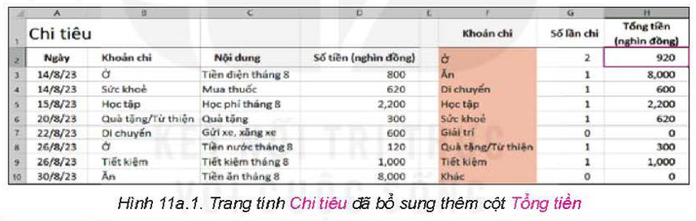
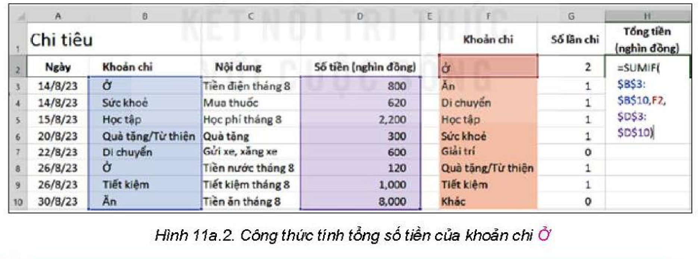
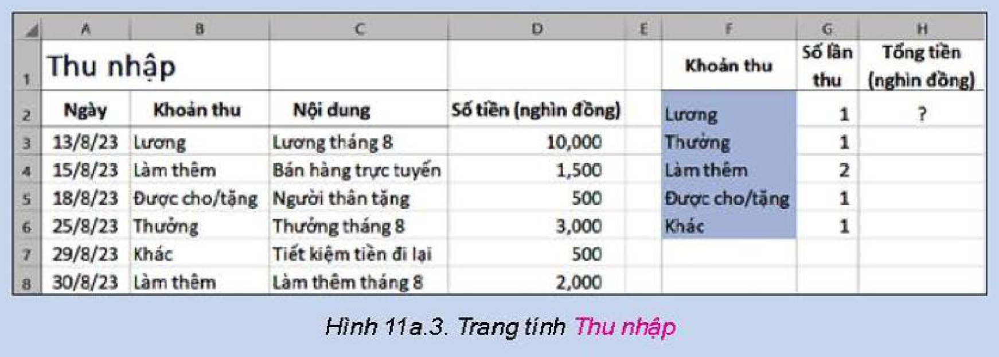

<!-- pdf:47 -->

# BÀI 11A: SỬ DỤNG HÀM SUMIF

## 🎯 Sau bài học này em sẽ:

- Biết sử dụng hàm tính tổng theo điều kiện SUMIF để giải quyết bài toán quản lí tài chính gia đình.

## 🔴 Khởi động

> Trong bài học trước, em đã sử dụng hàm đếm theo điều kiện để biết được số lần thu, chi theo từng khoản mục. Bài học này sẽ hướng dẫn em tính tổng theo các khoản chi tiêu, giúp quản lí tài chính gia đình hiệu quả.

## 1. HÀM SUMIF

> **Hoạt động 1: Tổng hợp chi tiêu theo từng khoản**
>
> Hình 11a.1 là trang tính `Chi tiêu` đã được bổ sung thêm cột `Tổng tiền`. Theo em, con số 920 ở ô H2 mang ý nghĩa gì? Công thức ở ô H2 liên quan đến những dữ liệu nào trong vùng dữ liệu A3:D10?

*Hình 11a.1. Trang tính Chi tiêu đã bổ sung thêm cột Tổng tiền*

Trong bài toán quản lí tài chính gia đình, em cần biết tổng số tiền thu, chi theo từng khoản để cân đối sao cho hợp lí. Ví dụ: Với việc chi tiêu, nhìn vào dữ liệu tổng hợp, em có thể tránh được việc chi quá nhiều cho những nhu cầu không thiết yếu. Để tính tổng số tiền theo từng khoản mục, em sử dụng **hàm tính tổng theo điều kiện** **SUMIF**.

Có hai dạng sử dụng hàm SUMIF như ví dụ trong Bảng 11a.1.

Công thức chung của hàm SUMIF là:

`=SUMIF(range, criteria, [sum_range])`
<!-- ocr-ok: đối chiếu ảnh trang PDF 47; công thức hàm SUMIF -->

Trong đó, ý nghĩa của các tham số như sau:
<!-- ocr-ok: đối chiếu ảnh trang PDF 47; OCR bị nhiễu bởi chữ chìm nền sách -->

- **range:** là phạm vi chứa các giá trị cần kiểm tra.
- **criteria:** là điều kiện kiểm tra các giá trị trong phạm vi range.
- **sum_range** *(tuỳ chọn, có thể có hoặc không)*: là phạm vi chứa các giá trị cần tính tổng.

<!-- pdf:48 -->

**Bảng 11a.1. Ví dụ sử dụng hàm SUMIF**

| Công thức tính | Ý nghĩa |
| --- | --- |
| `=SUMIF(A1:A5,">5")` | Giả sử vùng dữ liệu `A1:A5` chứa các số, công thức sẽ tính tổng các giá trị lớn hơn 5 trong vùng `A1:A5`. |
| `=SUMIF(A2:A5,"Khoa",B2:B5)` | Tính tổng các giá trị trong vùng `B2:B5` với các ô tương ứng trong vùng `A2:A5` có giá trị là `"Khoa"`. Kết quả trả lại là tổng tiền mà Khoa đã chi. |

Trong Hình 11a.1, tại ô H2, em dùng hàm SUMIF để tính tổng tiền của khoản chi `Ở`. Trong đó, phạm vi chứa giá trị cần kiểm tra ở cột `Khoản chi` là `B3:B10`, điều kiện kiểm tra là tên của khoản chi `Ở`, phạm vi chứa các giá trị cần tính tổng ở cột `Số tiền` là `D3:D10`. Do đó, công thức tại ô H2 là `=SUMIF(B3:B10,"Ở",D3:D10)`. Nhưng vì tên khoản chi `Ở` đã được lưu ở ô F2 nên để dữ liệu đảm bảo chính xác khi sao chép sang các ô khác, điều kiện kiểm tra cần thay đổi thành F2 và các địa chỉ trong công thức phải là địa chỉ tuyệt đối. Khi đó, công thức tại ô H2 là `=SUMIF($B$3:$B$10,F2,$D$3:$D$10)` như minh hoạ trong Hình 11a.2.

*Hình 11a.2. Công thức tính tổng số tiền của khoản chi Ở*

<!-- term: Hàm SUMIF -->
> - **Hàm SUMIF** tính tổng giá trị của những ô thoả mãn một điều kiện nào đó.
> - Công thức: `=SUMIF(range, criteria, [sum_range])`
>   – **range:** phạm vi chứa các giá trị cần kiểm tra hoặc tính tổng các giá trị nếu không có tham số **sum_range**.
>   – **criteria:** điều kiện kiểm tra.
>   – **sum_range** (tuỳ chọn): phạm vi chứa các giá trị cần tính tổng, nếu **sum_range** bị bỏ qua thì tính tổng các ô trong tham số **range** thoả mãn điều kiện.

<!-- pdf:49 -->

> ❓ **Câu hỏi**
>
> Hình 11a.3 minh hoạ dữ liệu của trang tính `Thu nhập`. Em hãy cho biết công thức cần nhập vào ô H2 là gì? Giá trị của ô H2 có ý nghĩa gì?

*Hình 11a.3. Trang tính Thu nhập*

## 2. THỰC HÀNH: SỬ DỤNG HÀM SUMIF

**Nhiệm vụ:** Sử dụng hàm SUMIF để tính tổng số tiền của mỗi khoản chi tiêu.

**Hướng dẫn**

### a) Tính tổng số tiền của mỗi khoản chi trong trang tính Chi tiêu

– Mở tệp bảng tính `TaiChinhGiaDinh.xlsx`, chọn trang tính `Chi tiêu`.

– Tại ô H2, nhập công thức `=SUMIF($B$3:$B$10,F2,$D$3:$D$10)` để tính tổng số tiền của khoản chi `Ở` (Hình 11a.2).
<!-- ocr-ok: đối chiếu ảnh trang PDF 49; OCR đọc nhầm các kí hiệu $ trong công thức địa chỉ tuyệt đối -->

– Sao chép công thức trong ô H2 sang các ô từ H3 đến H10 để tính tổng số tiền của mỗi khoản chi còn lại.

– Lưu tệp.

### b) Tính tổng số tiền của mỗi khoản thu trong trang tính Thu nhập

– Chọn trang tính `Thu nhập` (Hình 11a.3).

– Tại ô H2, nhập công thức `=SUMIF($B$3:$B$8,F2,$D$3:$D$8)` để tính tổng tiền của khoản thu từ `Lương`.

– Sao chép công thức trong ô H2 sang các ô từ H3 đến H6 để tính tổng tiền cho các khoản thu còn lại.

– Lưu tệp.

## ✏️ Luyện tập

Em hãy bổ sung thêm một số dòng dữ liệu thu, chi vào cuối phần dữ liệu của cả hai trang tính `Thu nhập` và `Chi tiêu`. Hãy điều chỉnh công thức SUMIF ở cột H để kết quả tổng tiền của mỗi khoản thu, chi được chính xác.

## 🚀 Vận dụng

Em hãy mở bảng tính `KinhPhiTrienLam.xlsx` đã lưu ở phần Vận dụng, Bài 10a và sử dụng hàm SUMIF để tính tổng các khoản thu, chi của dự án **Triển lãm tin học**. Lưu tệp sau khi hoàn thành công việc.

## 📷 Danh sách hình trong bài

| Mã hình | Trang PDF | Trang sách | Chú thích |
| --- | --- | --- | --- |
| H9-tin_hoc-b11a-01 | 47 | 45 | Hình 11a.1. Trang tính Chi tiêu đã bổ sung thêm cột Tổng tiền |
| H9-tin_hoc-b11a-02 | 48 | 46 | Hình 11a.2. Công thức tính tổng số tiền của khoản chi Ở |
| H9-tin_hoc-b11a-03 | 49 | 47 | Hình 11a.3. Trang tính Thu nhập |
