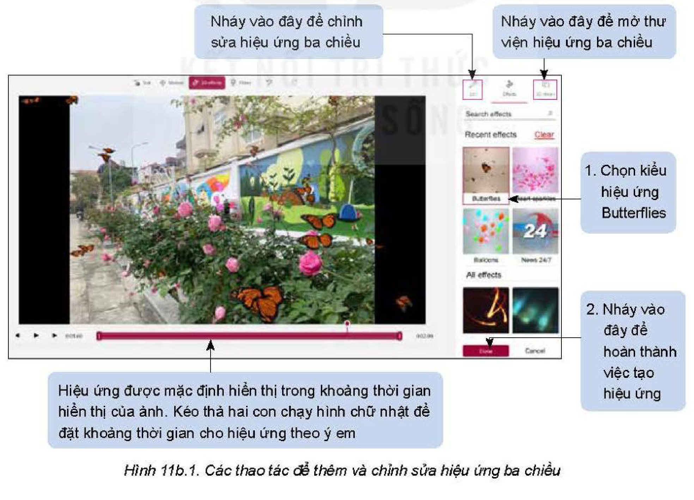
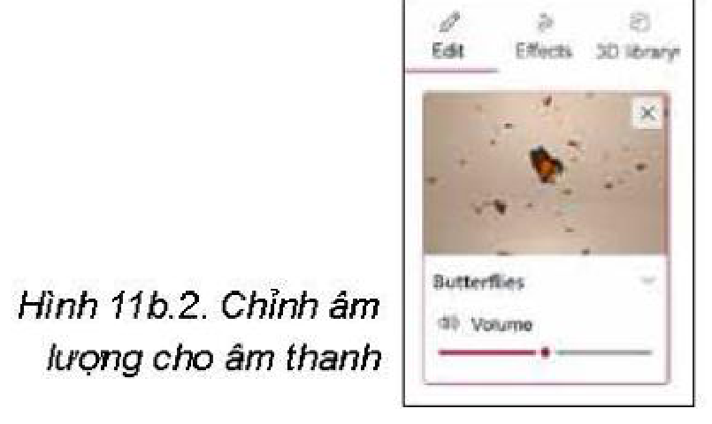
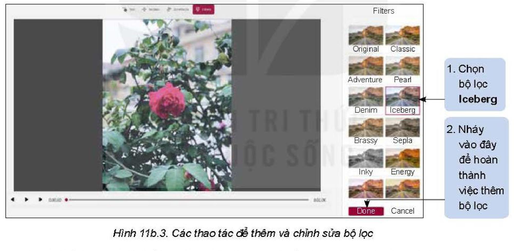
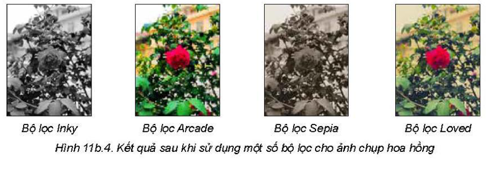
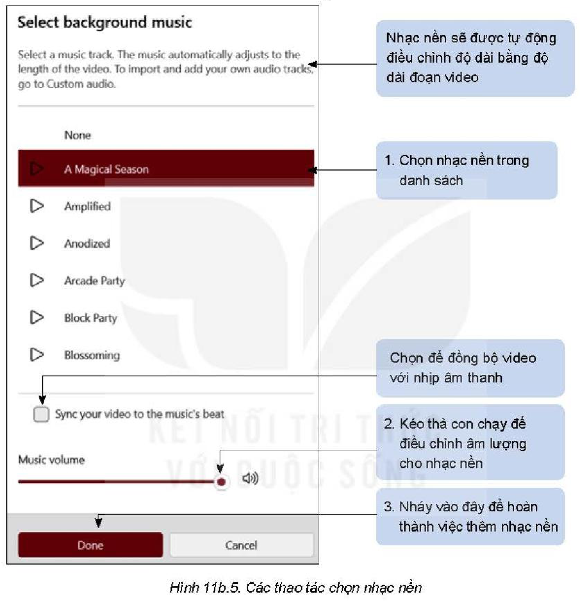
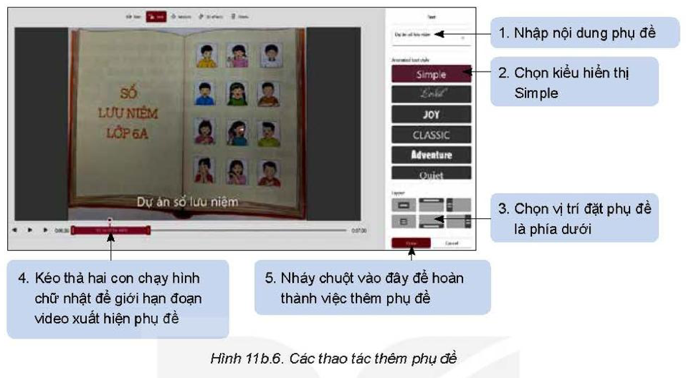

<!-- pdf:67 -->

# BÀI 11B: THỰC HÀNH: DỰNG VIDEO THEO KỊCH BẢN

## 🎯 Sau bài học này em sẽ:

- Dựng được video theo kịch bản.

## 🔴 Khởi động

> Ở Bài 10b em đã dựng được một phần video theo kịch bản. Trong bài này em tiếp tục dựng các phần tiếp theo của video `SanPhamTinHoc`.

## Nhiệm vụ 1: THÊM HIỆU ỨNG BA CHIỀU VÀO VIDEO

**Hướng dẫn**

<!-- term: Hiệu ứng ba chiều -->
Phần mềm Video Editor cung cấp một số **hiệu ứng ba chiều** (**3D effects**) để em có thể thêm vào video, làm cho video thêm ấn tượng và thú vị. Ví dụ, với ảnh chụp vườn hoa hồng trong dự án **Trường học xanh**, em có thể thêm vào ảnh một đàn bướm bay. Cách thực hiện như sau:

– Chọn ảnh vườn hồng trong bàn dựng, chọn **3D effects**. Một cửa sổ mới mở ra cho phép em thực hiện một số thao tác để thêm hiệu ứng ba chiều. Em thực hiện theo các hướng dẫn ở Hình 11b.1.

*Hình 11b.1. Các thao tác để thêm và chỉnh sửa hiệu ứng ba chiều*

<!-- pdf:68 -->

*Lưu ý:* Hiệu ứng ba chiều bao gồm cả hiệu ứng hình ảnh và âm thanh. Em nháy chuột chọn **Edit** trong Hình 11b.1 để chỉnh sửa âm lượng của hiệu ứng âm thanh (Hình 11b.2).

*Hình 11b.2. Chỉnh âm lượng cho âm thanh*

## Nhiệm vụ 2: THÊM BỘ LỌC VÀO VIDEO

**Hướng dẫn**

**Bộ lọc** (trong lĩnh vực quay phim, chụp ảnh) là những thiết bị được gắn thêm vào ống kính máy ảnh, máy quay để thu được những hiệu ứng cụ thể cho ảnh như: giảm độ loá, tạo tông màu ảnh ấm hơn hoặc lạnh hơn, tăng cường màu sắc,... Phần mềm Video Editor cung cấp một số **bộ lọc** (**Filters**) để em có thể thêm vào ảnh, video trong bàn dựng. Ví dụ, với ảnh chụp bông hoa hồng trong dự án **Trường học xanh**, em có thể sử dụng bộ lọc để thay đổi **gam màu** theo ý thích. Cách thực hiện như sau:

– Chọn ảnh bông hoa hồng trong bàn dựng, chọn **Filters**. Một cửa sổ mới mở ra cho phép em thực hiện một số thao tác để thêm bộ lọc. Em thực hiện theo các hướng dẫn ở Hình 11b.3.

*Hình 11b.3. Các thao tác để thêm và chỉnh sửa bộ lọc*

– Em có thể tham khảo kết quả khi áp dụng một số bộ lọc trong Hình 11b.4.

*Hình 11b.4. Kết quả sau khi sử dụng một số bộ lọc cho ảnh chụp hoa hồng*

<!-- pdf:69 -->

## Nhiệm vụ 3: THÊM NHẠC NỀN CÓ SẴN TRONG PHẦN MỀM VÀO VIDEO

**Hướng dẫn**

<!-- term: Thêm nhạc nền vào video -->
– Nháy chuột chọn **Background music** ở phía trên, bên phải của giao diện phần mềm. Cửa sổ **Select background music** mở ra cho phép em thực hiện một số thao tác để thêm nhạc nền. Em thực hiện theo các hướng dẫn ở Hình 11b.5.

*Hình 11b.5. Các thao tác chọn nhạc nền*

## Nhiệm vụ 4: THÊM PHỤ ĐỀ VÀO VIDEO

**Hướng dẫn**

<!-- term: Thêm phụ đề vào video -->
Theo kịch bản, em cần thêm phụ đề là tên dự án vào đầu mỗi đoạn video giới thiệu sản phẩm. Việc tạo phụ đề tương tự như việc thêm nội dung tiêu đề video mà em đã thực hiện ở Bài 10b. Em thực hiện như sau:

<!-- term: Thêm phụ đề vào video -->
– Chọn đoạn video quay cuốn sổ lưu niệm, chọn **Text** rồi định dạng cho phụ đề như hướng dẫn trong Hình 11b.6.

<!-- pdf:70 -->

*Hình 11b.6. Các thao tác thêm phụ đề*

## ✏️ Luyện tập

1. Em hãy thêm hiệu ứng ba chiều **Heart Sparkles** vào hình ảnh buổi ra mắt CLB Tin học như Hình 11b.7.

*Hình 11b.7. Hình ảnh được thêm hiệu ứng Heart Sparkles*

2. Em hãy thêm các bộ lọc trong Hình 11b.4 cho các hình ảnh trong video.
3. Em hãy thêm hai dòng phụ đề `Dự án Trường học xanh` và `Dự án Thành lập CLB Tin học` vào đầu hai đoạn video tương ứng giới thiệu hai dự án.

## 🚀 Vận dụng

Em hãy thực hiện các nhiệm vụ tương tự trong phần Thực hành với dự án `MyVideo`.

## 📷 Danh sách hình trong bài

| Mã hình | Trang PDF | Trang sách | Chú thích |
| --- | --- | --- | --- |
| H9-tin_hoc-b11b-01 | 67 | 65 | Hình 11b.1. Các thao tác để thêm và chỉnh sửa hiệu ứng ba chiều |
| H9-tin_hoc-b11b-02 | 68 | 66 | Hình 11b.2. Chỉnh âm lượng cho âm thanh |
| H9-tin_hoc-b11b-03 | 68 | 66 | Hình 11b.3. Các thao tác để thêm và chỉnh sửa bộ lọc |
| H9-tin_hoc-b11b-04 | 68 | 66 | Hình 11b.4. Kết quả sau khi sử dụng một số bộ lọc cho ảnh chụp hoa hồng |
| H9-tin_hoc-b11b-05 | 69 | 67 | Hình 11b.5. Các thao tác chọn nhạc nền |
| H9-tin_hoc-b11b-06 | 70 | 68 | Hình 11b.6. Các thao tác thêm phụ đề |
| H9-tin_hoc-b11b-07 | 70 | 68 | Hình 11b.7. Hình ảnh được thêm hiệu ứng Heart Sparkles |
