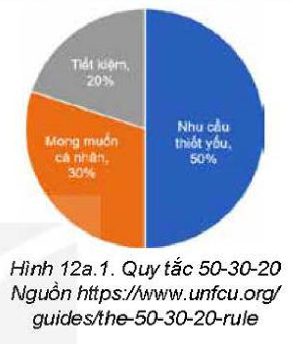
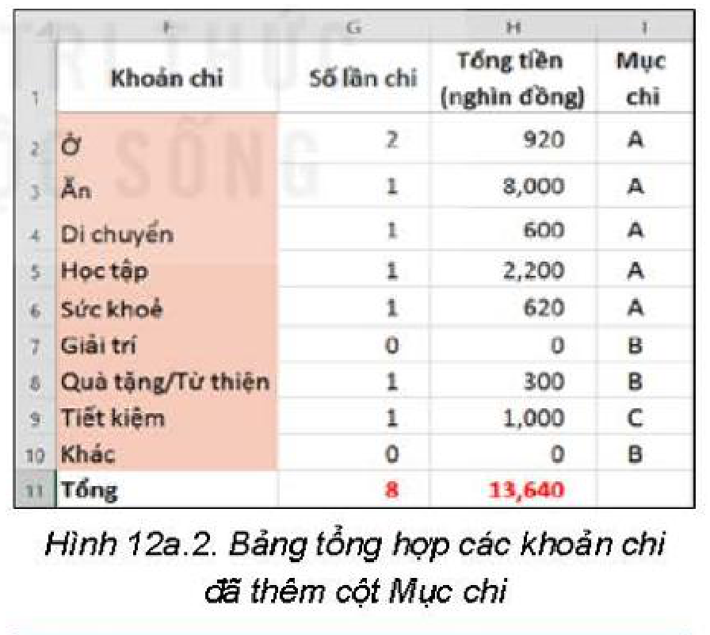
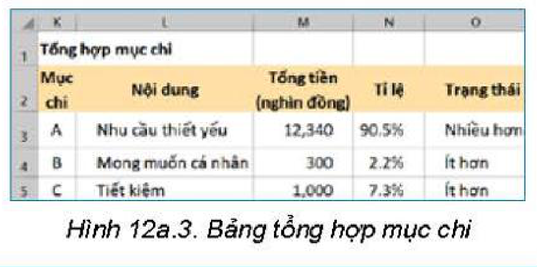
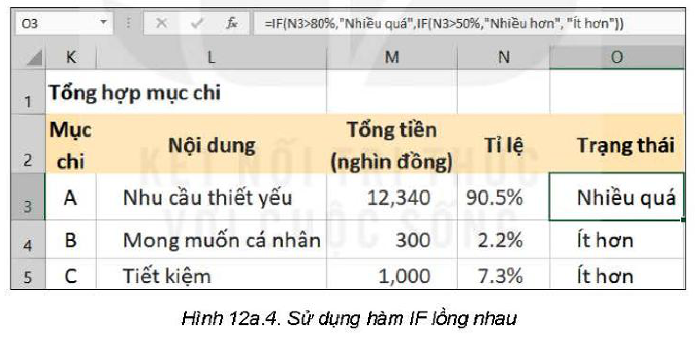
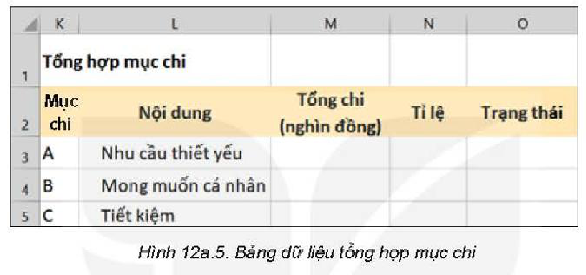
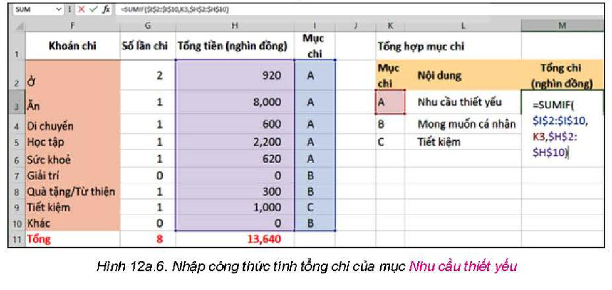
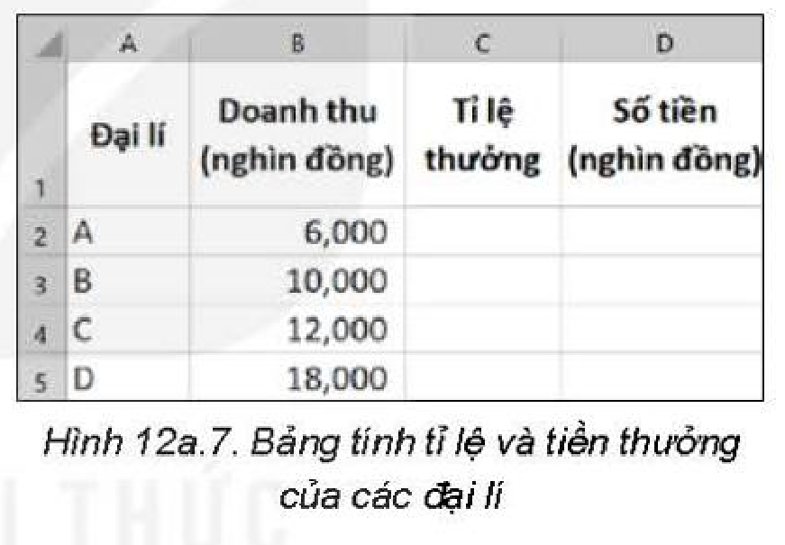

<!-- pdf:50 -->

# BÀI 12A: SỬ DỤNG HÀM IF

## 🎯 Sau bài học này em sẽ:

- Sử dụng được hàm điều kiện IF trong giải quyết bài toán thực tiễn về quản lí tài chính.

## 🔴 Khởi động

<!-- term: Quy tắc 50-30-20 -->
> Trong những bài học trước, em đã sử dụng hàm đếm theo điều kiện COUNTIF và hàm tính tổng theo điều kiện SUMIF để tổng hợp số liệu chi tiêu. Dựa trên số liệu tổng hợp, để biết việc chi tiêu đã cân đối, hợp lí hay chưa, em có thể sử dụng một số quy tắc quản lí tài chính, ví dụ **quy tắc 50-30-20**.
>
> **Quy tắc 50-30-20** khuyên chúng ta nên dành 50% số tiền của mình cho nhu cầu thiết yếu (ăn, ở, sức khoẻ,...), 30% cho mong muốn cá nhân (giải trí, thời trang,...) và 20% cho tiết kiệm. Dĩ nhiên tỉ lệ 50-30-20 có thể linh hoạt điều chỉnh sao cho phù hợp tình hình thực tiễn.
>
> Bài học này sẽ hướng dẫn em sử dụng hàm điều kiện IF để quản lí việc chi tiêu dựa trên quy tắc tài chính, nhằm giúp việc chi tiêu được kiểm soát hiệu quả.

*Hình 12a.1. Quy tắc 50-30-20 (Nguồn https://www.unfcu.org/guides/the-50-30-20-rule)*
<!-- ocr-ok: đối chiếu ảnh trang PDF 50; OCR đọc lỗi đường dẫn URL nguồn của Hình 12a.1 -->

## 1. HÀM IF

> **Hoạt động 1: Tổng hợp các khoản chi theo quy tắc 50-30-20**
>
> Giả sử các mục chi được chia thành ba loại A, B và C. Trong đó, mục A là `Nhu cầu thiết yếu`, mục B là `Mong muốn cá nhân`, mục C là `Tiết kiệm`. Bảng tổng hợp các khoản chi đã được thêm dữ liệu `Mục chi` ở cột I như minh hoạ trong Hình 12a.2.
>
> Để đánh giá chi tiêu theo quy tắc 50-30-20, chúng ta tạo bảng dữ liệu để tính tổng số tiền của mỗi mục chi như minh hoạ ở Hình 12a.3. Trong bảng này, tổng tiền của mỗi mục chi ở cột M được tổng hợp từ dữ liệu các khoản chi trong bảng ở Hình 12a.2; dữ liệu tỉ lệ ở cột N là tổng tiền của mỗi mục chi so với tổng tiền của tất cả các khoản (ô H11 trong Hình 12a.2).
>
> 1. Em hãy nêu công thức ở các ô của cột M và cột N trong bảng dữ liệu Hình 12a.3.
> 2. Em hãy viết quy tắc để đưa ra nhận xét tình trạng chi tiêu như minh hoạ ở cột O trong Hình 12a.3 dựa trên quy tắc quản lí tài chính 50-30-20.

*Hình 12a.2. Bảng tổng hợp các khoản chi đã thêm cột Mục chi*

*Hình 12a.3. Bảng tổng hợp mục chi*

<!-- pdf:51 -->

Dựa trên quy tắc quản lí tài chính 50-30-20, em có thể đưa ra nhận xét về tình trạng chi tiêu của mỗi mục chi. Ví dụ, với mục chi `Nhu cầu thiết yếu` thì nhận xét là: *Nếu tỉ lệ chi lớn hơn 50% thì nhận xét là "Nhiều hơn", còn không thì nhận xét là "Ít hơn"*.

Để điền nhận xét như minh hoạ ở các ô từ O3 đến O5 trong Hình 12a.3, em sử dụng **hàm điều kiện** **IF**. Công thức chung của hàm IF là:

`=IF(logical_test,[value_if_true],[value_if_false]).`

Trong đó, ý nghĩa của các tham số như sau:

- **logical_test:** điều kiện kiểm tra.
- **value_if_true:** giá trị trả về nếu điều kiện là đúng.
- **value_if_false:** giá trị trả về nếu điều kiện là sai.

Ví dụ, trong Hình 12a.3, tỉ lệ chi của mục `Nhu cầu thiết yếu` được lưu tại ô N3. Do đó, nhận xét ở trên về tình trạng của mục chi này được thực hiện bằng công thức tại ô O3 là `=IF(N3>50%,"Nhiều hơn","Ít hơn")`.

Trên thực tế, nhận xét về tình trạng chi tiêu có thể cần chi tiết hơn. Ví dụ với mục chi `Nhu cầu thiết yếu` có thể nhận xét theo hai mức: *Nếu tỉ lệ chi lớn hơn 80% thì nhận xét "Nhiều quá", nếu tỉ lệ chi lớn hơn 50% thì nhận xét "Nhiều hơn", còn không thì nhận xét là "Ít hơn"*.

<!-- term: Hàm IF lồng nhau -->
Trong trường hợp tiêu chí kiểm tra cần thoả mãn nhiều mức hơn, em sử dụng các **hàm IF lồng nhau**. Ví dụ sử dụng hai hàm IF lồng nhau cho nhận xét trên như minh hoạ trong Hình 12a.4 là `=IF(N3>80%,"Nhiều quá",IF(N3>50%,"Nhiều hơn","Ít hơn"))`.

*Hình 12a.4. Sử dụng hàm IF lồng nhau*

<!-- term: Hàm IF -->
> - **Hàm IF** kiểm tra điều kiện và trả về một giá trị khi điều kiện đó đúng và một giá trị khác nếu điều kiện đó sai.
> - Công thức: `=IF(logical_test,[value_if_true],[value_if_false])`
>   – **logical_test:** điều kiện kiểm tra.
>   – **value_if_true:** giá trị trả về nếu điều kiện là đúng.
>   – **value_if_false:** giá trị trả về nếu điều kiện là sai.

> ❓ **Câu hỏi**
>
> Em hãy viết công thức trong các ô O4 và O5 ở Hình 12a.3 để nhận xét về tình trạng của mục `Mong muốn cá nhân` và `Tiết kiệm` dựa trên quy tắc 50-30-20.

<!-- pdf:52 -->

## 2. THỰC HÀNH SỬ DỤNG HÀM IF

**Nhiệm vụ 1:** Bổ sung cột mục chi cho bảng tổng hợp khoản chi (như Hình 12a.2) và tạo bảng dữ liệu tổng hợp các mục chi (như Hình 12a.3).

**Hướng dẫn**

### a) Tạo bảng dữ liệu

– Mở bảng tính `TaiChinhGiaDinh.xlsx`, nháy chuột chọn trang tính `Chi tiêu`.
<!-- ocr-ok: đối chiếu ảnh trang PDF 52; OCR đọc nhầm xlsx và Chi tiêu -->

– Tại cột I, bổ sung tiêu đề cột `Mục chi` và nhập dữ liệu cho cột này như minh hoạ ở Hình 12a.2.

– Trong vùng dữ liệu `K1:O5`, tạo bảng dữ liệu tổng hợp mục chi như minh hoạ ở Hình 12a.5.

*Hình 12a.5. Bảng dữ liệu tổng hợp mục chi*

– Lưu bảng tính.

### b) Tính Tổng chi và Tỉ lệ của mỗi mục chi

Ta có tổng chi của mỗi mục chi ở cột M được lấy từ dữ liệu các khoản chi trong bảng ở Hình 12a.2, vì vậy cần sử dụng hàm SUMIF để tính tổng theo từng mục.

– Tại ô M3, nhập công thức `=SUMIF($I$2:$I$10,K3,$H$2:$H$10)` để tổng hợp số tiền của mục `Nhu cầu thiết yếu` như minh hoạ ở Hình 12a.6.

*Hình 12a.6. Nhập công thức tính tổng chi của mục Nhu cầu thiết yếu*

<!-- pdf:53 -->

– Sao chép công thức của ô M3 sang các ô M4 và M5 để tính tổng chi của các mục chi còn lại.

– Tỉ lệ ở cột N là tổng chi của mỗi mục chi so với tổng tiền của tất cả các khoản (lưu tại ô H11). Vì vậy, em nhập công thức tại ô N3 là `=M3/$H$11*100%`.

– Sao chép công thức của ô N3 sang các ô N4 và N5 để tính tỉ lệ của các mục chi còn lại.

### c) Điền nhận xét vào cột Trạng thái của từng mục chi

– Tại ô O3, nhập công thức `=IF(N3>50%,"Nhiều hơn","Ít hơn")` để điền nhận xét của mục `Nhu cầu thiết yếu`.

– Tại ô O4, nhập công thức `=IF(N4>30%,"Nhiều hơn","Ít hơn")` để điền nhận xét của mục `Mong muốn cá nhân`.

– Tại ô O5, nhập công thức `=IF(N5>20%,"Nhiều hơn","Ít hơn")` để điền nhận xét của mục `Tiết kiệm`.

– Lưu bảng tính.

## ✏️ Luyện tập

Hình 12a.7 là bảng dữ liệu tính số tiền thưởng cho các đại lí của một nhãn hàng. Em hãy tạo bảng dữ liệu và thực hiện các yêu cầu sau:

a) Tính tỉ lệ thưởng (cột C), biết nếu doanh thu đạt trên 10 triệu thì tỉ lệ thưởng là 5%, còn không thì tỉ lệ thưởng là 0%.

b) Tính số tiền thưởng (cột D) mà các đại lí nhận được biết `Số tiền = Doanh thu x Tỉ lệ`.

*Hình 12a.7. Bảng tính tỉ lệ và tiền thưởng của các đại lí*

c) Nhãn hàng thay đổi cách tính tỉ lệ thưởng cho đại lí theo quy tắc sau:

– Nếu doanh thu trên 20 triệu thì tỉ lệ thưởng là 6%.

– Nếu doanh thu trên 15 triệu thì tỉ lệ thưởng là 4%.

– Nếu doanh thu trên 10 triệu thì tỉ lệ thưởng là 2%.

– Còn không thì tỉ lệ thưởng là 0%.

Hãy chỉnh sửa công thức ở câu a) theo quy tắc tính tỉ lệ thưởng ở trên.

## 🚀 Vận dụng

1. Với bảng `Tổng hợp mục chi` đã thực hiện ở phần Thực hành, em hãy chỉnh sửa công thức tại ô O3 để có thể nhận xét tình trạng của mục chi `Nhu cầu thiết yếu` theo hai mức: *Nếu tỉ lệ chi lớn hơn 80% thì nhận xét "Nhiều quá", nếu tỉ lệ chi lớn hơn 50% thì nhận xét "Nhiều hơn", còn không thì nhận xét là "Ít hơn"*.
2. Tương tự câu 1, em hãy sử dụng hàm IF lồng nhau tại ô O4 và O5 để có thể nhận xét chi tiết hơn tình trạng của mục chi `Mong muốn cá nhân` và `Tiết kiệm`. Dựa trên quy tắc tài chính 50-30-20, em hãy điều chỉnh sao cho các mục chi được cân đối và tài chính gia đình được kiểm soát hiệu quả.

## 📷 Danh sách hình trong bài

| Mã hình | Trang PDF | Trang sách | Chú thích |
| --- | --- | --- | --- |
| H9-tin_hoc-b12a-01 | 50 | 48 | Hình 12a.1. Quy tắc 50-30-20 (Nguồn https://www.unfcu.org/guides/the-50-30-20-rule) |
| H9-tin_hoc-b12a-02 | 50 | 48 | Hình 12a.2. Bảng tổng hợp các khoản chi đã thêm cột Mục chi |
| H9-tin_hoc-b12a-03 | 50 | 48 | Hình 12a.3. Bảng tổng hợp mục chi |
| H9-tin_hoc-b12a-04 | 51 | 49 | Hình 12a.4. Sử dụng hàm IF lồng nhau |
| H9-tin_hoc-b12a-05 | 52 | 50 | Hình 12a.5. Bảng dữ liệu tổng hợp mục chi |
| H9-tin_hoc-b12a-06 | 52 | 50 | Hình 12a.6. Nhập công thức tính tổng chi của mục Nhu cầu thiết yếu |
| H9-tin_hoc-b12a-07 | 53 | 51 | Hình 12a.7. Bảng tính tỉ lệ và tiền thưởng của các đại lí |
