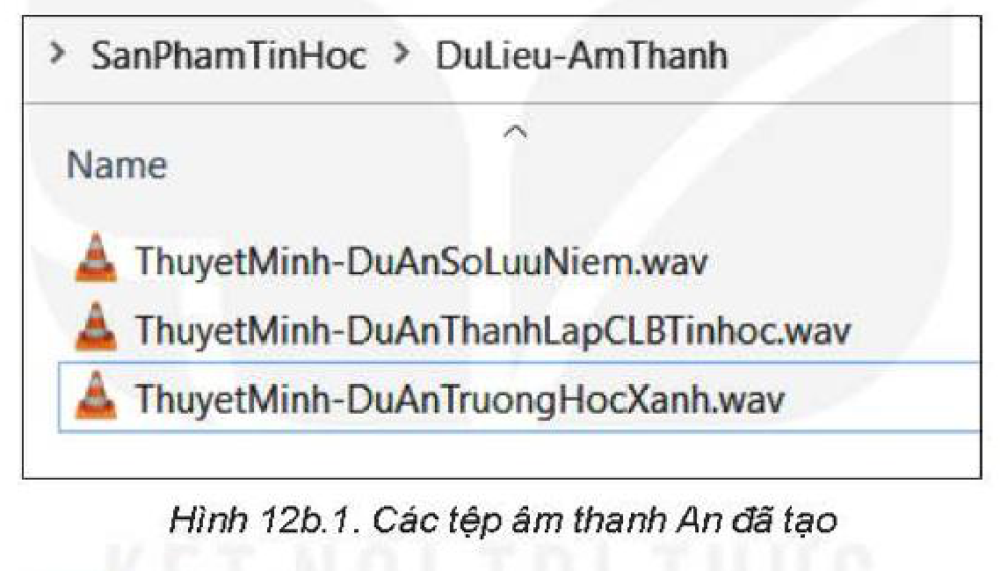
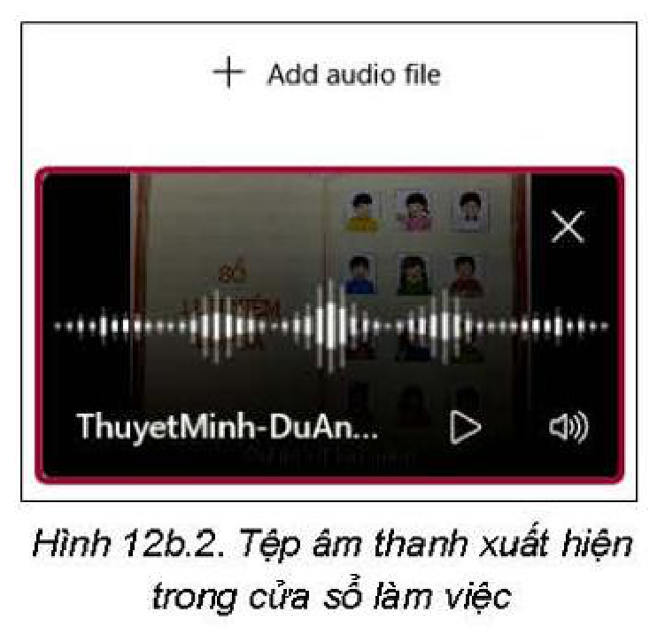
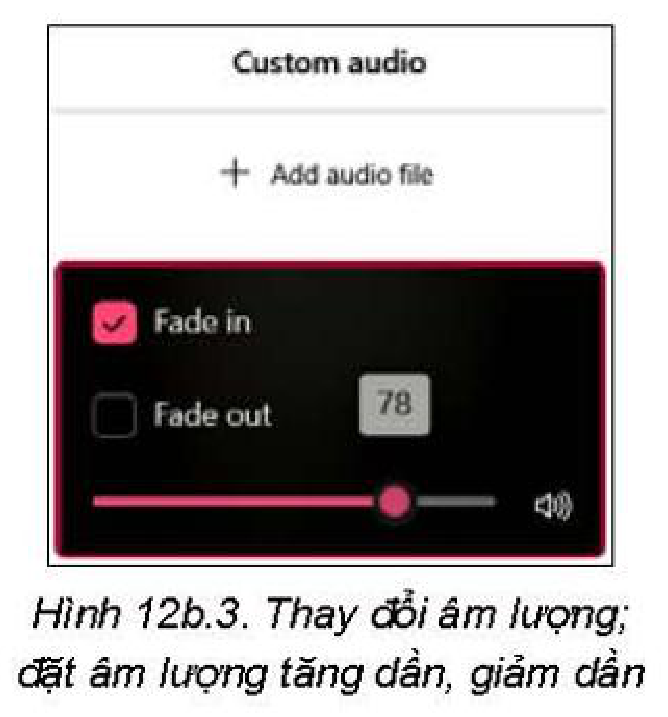
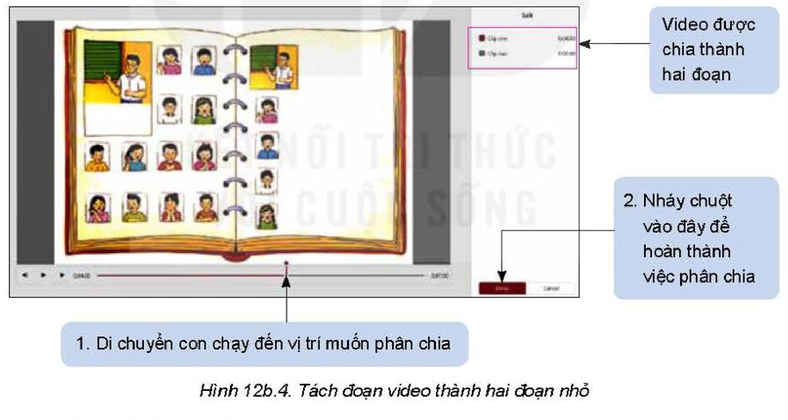
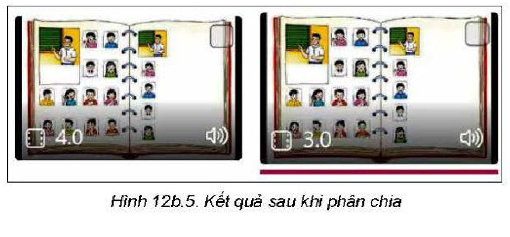
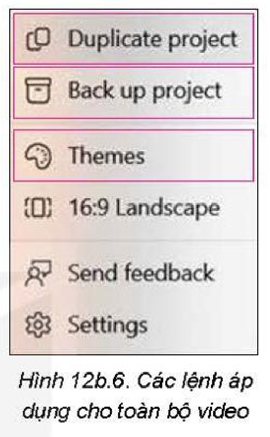

<!-- pdf:71 -->

# BÀI 12B: HOÀN THÀNH VIỆC DỰNG VIDEO

## 🎯 Sau bài học này em sẽ:

- Đưa được âm thanh từ tệp trên máy tính vào video.
- Thực hiện được một số thao tác nâng cao để dựng video.

## 🔴 Khởi động

> Bạn An muốn bổ sung vào video lời thuyết minh quá trình thực hiện các dự án. An đã dùng chức năng thu âm của điện thoại thông minh để thu lời thuyết minh của mình và ghi thành ba tệp âm thanh tương ứng với ba dự án sau đó lưu vào máy tính. Theo em, An làm thế nào để đưa các tệp âm thanh đó vào video?

## 1. MỘT SỐ VIỆC CẦN THỰC HIỆN ĐỂ HOÀN THIỆN VIỆC DỰNG VIDEO

> **Hoạt động 1: Đưa âm thanh vào video như thế nào?**
>
> Theo em, có thể nhập dữ liệu âm thanh vào thư viện dữ liệu theo cách em đã nhập dữ liệu ảnh và video được không?

<!-- term: Thêm âm thanh từ tệp -->
Không thể nhập dữ liệu âm thanh vào thư viện dữ liệu theo cách em đã nhập dữ liệu ảnh và video. Thư viện dữ liệu chỉ chứa dữ liệu dạng hình ảnh và video. Muốn đưa âm thanh vào video em cần sử dụng chức năng **Custom audio** của phần mềm làm video.

Ngoài các chức năng cơ bản, phổ biến giúp em làm video, phần mềm làm video còn cung cấp các chức năng cần thiết khác để em xử lí các vấn đề có thể gặp phải trong quá trình dựng video. Ví dụ, em có thể gặp trường hợp dữ liệu video có hướng bị lệch 90 độ so với bình thường do khi quay bằng điện thoại di động người quay đã xoay ngang điện thoại. Khi đó, em cần sử dụng chức năng **xoay hướng video** (**Rotate**) của phần mềm. Hay khi em cần chèn thêm hình ảnh vào giữa một đoạn video, em có thể dùng chức năng **phân chia** (**Split**) để tách video thành hai đoạn,... Bên cạnh đó, cũng giống như các phần mềm ứng dụng khác, phần mềm làm video còn cung cấp cho em các **mẫu định dạng video** (**Themes**) để em có thể nhanh chóng làm được các đoạn video chuyên nghiệp.

> Phần mềm làm video cung cấp các chức năng giúp em: thêm âm thanh; xoay hướng video, hình ảnh; phân chia video thành các đoạn nhỏ và cung cấp các mẫu định dạng video;...

<!-- pdf:72 -->

> ❓ **Câu hỏi**
>
> Em hãy chọn phương án **sai**.
>
> A. Không thể nhập dữ liệu âm thanh vào thư viện dữ liệu giống như hình ảnh và video.
>
> B. Hình ảnh, video và âm thanh đều là dữ liệu để làm video, do đó cách nhập là giống nhau.
>
> C. Thư viện dữ liệu chỉ chứa dữ liệu dạng hình ảnh và video.
>
> D. Dữ liệu âm thanh (ghi trong tệp) được nhập vào dự án làm video bằng chức năng Custom audio.

## 2. THỰC HÀNH: HOÀN THIỆN VIỆC DỰNG VIDEO

### Nhiệm vụ 1: Thêm âm thanh (Custom audio)

**Hướng dẫn**

Ba tệp âm thanh An thu âm lời thuyết minh được lưu trong thư mục `DuLieu-AmThanh` như Hình 12b.1.

*Hình 12b.1. Các tệp âm thanh An đã tạo*

Để đưa tệp `ThuyetMinh-DuAnSoLuuNiem.wav` vào đoạn video quay cuốn sổ lưu niệm em thực hiện các bước như sau:

– Chọn khung hình của đoạn video trong bàn dựng, chọn **Custom audio** ở góc trên, bên phải màn hình. Một cửa sổ mới mở ra cho phép em thực hiện một số thao tác để thêm âm thanh từ tệp vào video.

– Nháy chuột chọn **+ Add audio file**. Cửa sổ **Open** được hiển thị. Chọn tệp `ThuyetMinh-DuAnSoLuuNiem.wav` trong thư mục `DuLieu-AmThanh`.

*Lưu ý:*

+ Tệp âm thanh được đưa vào cửa sổ thao tác với âm thanh như Hình 12b.2. Nháy chuột vào biểu tượng chiếc loa ở phía dưới, bên phải để mở phần thiết lập âm lượng cho âm thanh (Hình 12b.3).

+ Kéo con chạy trên thanh điều khiển để tăng hoặc giảm âm lượng (được quy định bằng con số từ 0 đến 100).

<!-- term: Âm lượng tăng dần và giảm dần -->
+ Em cũng có thể đặt cho âm thanh tăng dần hoặc giảm dần bằng cách nháy chuột chọn **Fade in** hoặc **Fade out** để tránh sự thay đổi đột ngột của âm thanh, tạo ra trải nghiệm không tốt cho người xem (Hình 12b.3).

<!-- pdf:73 -->

*Hình 12b.2. Tệp âm thanh xuất hiện trong cửa sổ làm việc*

*Hình 12b.3. Thay đổi âm lượng; đặt âm lượng tăng dần, giảm dần*
<!-- ocr-ok: đối chiếu ảnh trang PDF 73; OCR đọc nhầm dấu thanh trong chú thích Hình 12b.3 -->

### Nhiệm vụ 2: Phân chia video (Split)

**Hướng dẫn**

An muốn phân chia đoạn video quay cuốn sổ lưu niệm thành hai đoạn nhỏ và thêm vào giữa hai đoạn nhỏ một hình ảnh chụp sơ đồ tư duy trình bày nội dung cuốn sổ lưu niệm. Cách làm như sau:

– Chọn đoạn video quay cuốn sổ lưu niệm, chọn **Split**. Một cửa sổ mở ra cho phép em thực hiện một số thao tác để phân chia đoạn video thành hai đoạn nhỏ. Em thực hiện theo các hướng dẫn ở Hình 12b.4.

*Hình 12b.4. Tách đoạn video thành hai đoạn nhỏ*

– Đoạn video dài 7 giây đã được phân chia thành hai đoạn nhỏ hơn, một đoạn dài 4 giây, một đoạn dài 3 giây (Hình 12b.5).

– Kéo ảnh chụp sơ đồ tư duy từ thư viện dữ liệu vào vị trí giữa hai đoạn video.

*Hình 12b.5. Kết quả sau khi phân chia*

<!-- pdf:74 -->

### Nhiệm vụ 3: Xoay hướng video (Rotate)

**Hướng dẫn**

Em có thể xoay hướng cho video bằng lệnh **Rotate**. Chọn video muốn xoay, chọn [biểu tượng Rotate]. Video được chọn sẽ xoay 90 độ theo chiều kim đồng hồ. Em có thể thực hiện nhiều lần lệnh **Rotate** để xoay video theo đúng hướng em muốn.

### Nhiệm vụ 4: Sử dụng mẫu định dạng được thiết kế sẵn (Themes)

**Hướng dẫn**

<!-- term: Mẫu định dạng video -->
Tương tự phần mềm trình chiếu, em có thể sử dụng các mẫu định dạng được thiết kế sẵn một cách chuyên nghiệp cho dự án làm video của mình. Mẫu định dạng cung cấp âm thanh nền, một số bộ lọc và kiểu phụ đề được thiết kế sẵn. Cách sử dụng một mẫu định dạng cho video như sau:

– Nháy chuột chọn `...` ở góc trên, bên phải màn hình làm việc. Một danh sách các lệnh được mở ra như Hình 12b.6.

– Chọn **Themes** để mở cửa sổ cho phép em lựa chọn một mẫu có sẵn áp dụng cho video đang dựng.

*Hình 12b.6. Các lệnh áp dụng cho toàn bộ video*

### Nhiệm vụ 5: Tạo bản sao (copy) và bản sao dự phòng (backup) của dự án

**Hướng dẫn**

<!-- term: Bản sao của dự án -->
– Chọn **Duplicate project** (Hình 12b.6) để tạo một bản sao của dự án. Đặt tên cho bản sao này. Em có thể thử nghiệm các thao tác dựng khác nhau cho bản sao. Nếu không hài lòng với kết quả dựng, em có thể quay lại dự án ban đầu một cách dễ dàng và nhanh chóng.

<!-- term: Bản sao dự phòng của dự án -->
– Chọn **Back up project** (Hình 12b.6) để ghi lại dự án dưới dạng tệp vbp. Sau đó em có thể sao chép, chia sẻ tệp này đến các máy tính khác để sử dụng.

## ✏️ Luyện tập

1. Em hãy thực hành đưa tệp `ThuyetMinh-DuAnTruongHocXanh.wav` và tệp `ThuyetMinh-DuAnThanhLapCLBTinHoc.wav` trong thư mục `DuLieu-AmThanh` vào các đoạn video tương ứng trong dự án `SanPhamTinHoc`.
2. Em hãy thực hành tạo một bản sao và một bản dự phòng của dự án làm video `SanPhamTinHoc`.

## 🚀 Vận dụng

Em hãy thực hiện các nhiệm vụ tương tự trong phần Thực hành với dự án `MyVideo`.

## 📷 Danh sách hình trong bài

| Mã hình | Trang PDF | Trang sách | Chú thích |
| --- | --- | --- | --- |
| H9-tin_hoc-b12b-01 | 72 | 70 | Hình 12b.1. Các tệp âm thanh An đã tạo |
| H9-tin_hoc-b12b-02 | 73 | 71 | Hình 12b.2. Tệp âm thanh xuất hiện trong cửa sổ làm việc |
| H9-tin_hoc-b12b-03 | 73 | 71 | Hình 12b.3. Thay đổi âm lượng; đặt âm lượng tăng dần, giảm dần |
| H9-tin_hoc-b12b-04 | 73 | 71 | Hình 12b.4. Tách đoạn video thành hai đoạn nhỏ |
| H9-tin_hoc-b12b-05 | 73 | 71 | Hình 12b.5. Kết quả sau khi phân chia |
| H9-tin_hoc-b12b-06 | 74 | 72 | Hình 12b.6. Các lệnh áp dụng cho toàn bộ video |
