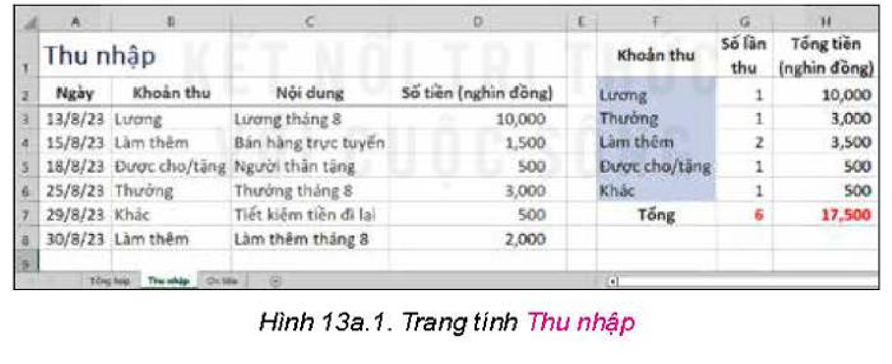
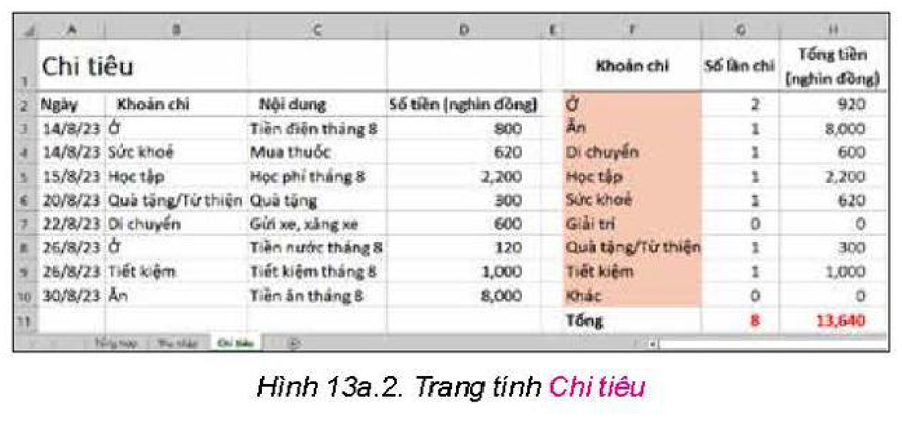
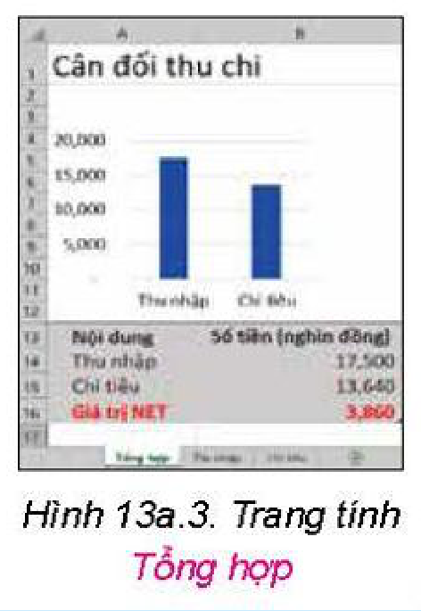
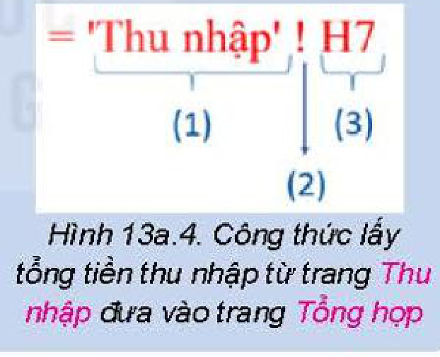
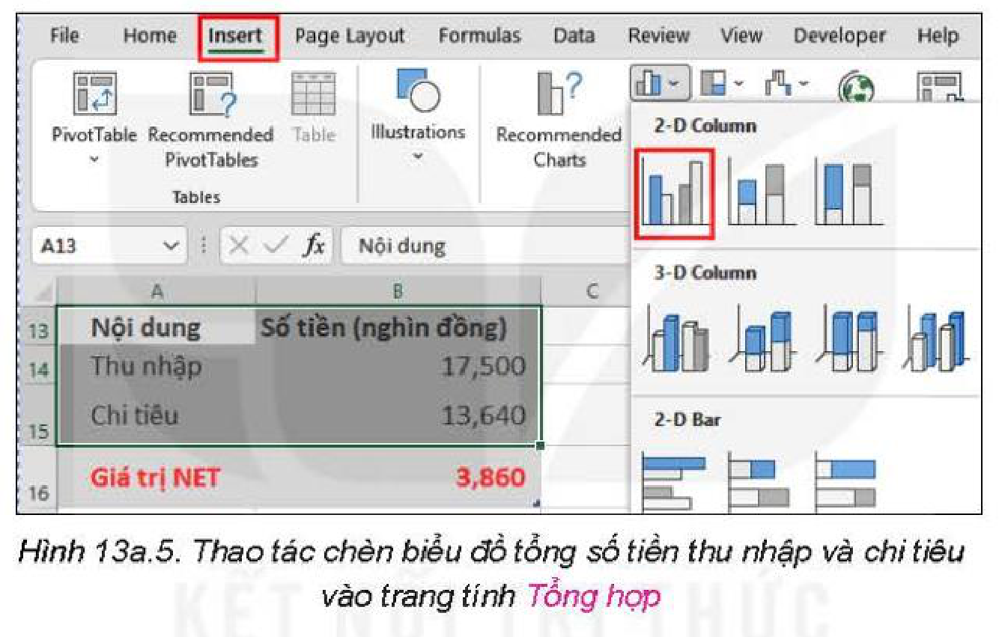

<!-- pdf:54 -->

# BÀI 13A: HOÀN THIỆN BẢNG TÍNH QUẢN LÍ TÀI CHÍNH GIA ĐÌNH

## 🎯 Sau bài học này em sẽ:

- Tạo được trang tính tổng hợp thông tin thu, chi gia đình.
- Hoàn thiện bảng tính quản lí tài chính gia đình.

## 🔴 Khởi động

> Dự án sử dụng bảng tính điện tử quản lí tài chính gia đình đã hoàn thành các trang tính `Thu nhập` và `Chi tiêu`. Theo em, để cân đối thu, chi, giúp kiểm soát chi tiêu gia đình hiệu quả, bảng tính cần bổ sung thông tin gì?

## 1. TRANG TÍNH TỔNG HỢP DỮ LIỆU TÀI CHÍNH GIA ĐÌNH

> **Hoạt động 1**
>
> Quan sát Hình 13a.1 và Hình 13a.2, em thấy các khoản thu và chi đã được tính tổng số tiền (tại ô H7 và H11). Để cân đối thu, chi, trang tính `Tổng hợp` được bổ sung vào bảng tính như Hình 13a.3.
>
> 1. Em hãy chỉ ra mối liên hệ về dữ liệu của trang tính `Tổng hợp` ở Hình 13a.3 với hai trang tính `Thu nhập` và `Chi tiêu` ở Hình 13a.1 và Hình 13a.2.
> 2. Trong trang tính `Tổng hợp`, công thức để tính tổng thu nhập ở ô B14 là gì? Công thức để tính tổng số tiền chi tiêu ở ô B15 là gì?

*Hình 13a.1. Trang tính Thu nhập*

*Hình 13a.2. Trang tính Chi tiêu*

*Hình 13a.3. Trang tính Tổng hợp*

<!-- pdf:55 -->

Từ hai nguồn dữ liệu trong hai trang tính `Thu nhập` và `Chi tiêu`, em có thể tổng hợp thông tin một cách trực quan để kịp thời điều chỉnh các khoản thu, chi.

<!-- term: Tham chiếu đến địa chỉ ô ở trang tính khác -->
Trong bảng tính quản lí tài chính gia đình, ở trang tính `Tổng hợp`, tổng tiền thu nhập ở ô B14 chính là giá trị ở ô H7 trong trang tính `Thu nhập`, tổng tiền chi tiêu ở ô B15 chính là giá trị ở ô H11 trong trang tính `Chi tiêu`. Công thức cho các ô B14, B15 trong trang tính `Tổng hợp` được trình bày chi tiết trong Bảng 13a.1.

**Bảng 13a.1. Công thức lấy tổng tiền thu nhập và chi tiêu từ các trang tính tương ứng đưa vào trang tính Tổng hợp**

<!-- term: Tham chiếu đến địa chỉ ô ở trang tính khác -->
| Vị trí | Công thức | Ý nghĩa |
| --- | --- | --- |
| B14 | `='Thu nhập'!H7` | Lấy giá trị của ô H7 trong trang tính `Thu nhập` đưa vào ô B14 trong trang tính `Tổng hợp` để tổng số tiền thu nhập trong trang tính `Tổng hợp` được cập nhật tự động từ trang tính `Thu nhập`. |
| B15 | `='Chi tiêu'!H11` | Lấy giá trị của ô H11 trong trang tính `Chi tiêu` đưa vào ô B15 trong trang tính `Tổng hợp` để tổng số tiền chi tiêu trong trang tính `Tổng hợp` được cập nhật tự động từ trang tính `Chi tiêu`. |

<!-- term: Giá trị NET -->
Trong trang tính `Tổng hợp`, **Giá trị NET** là số tiền chênh lệch giữa thu và chi. `Giá trị NET` nhỏ sẽ cho thấy gia đình đang chi tiêu nhiều, cần được báo động để tất cả các thành viên thực hiện tiết kiệm. Bên cạnh đó, em có thể bổ sung biểu đồ để hiển thị số liệu thu và chi một cách trực quan, dễ so sánh, giúp cho việc quản lí tài chính gia đình được dễ dàng và hiệu quả.

> Khi sử dụng bảng tính điện tử quản lí tài chính gia đình, dữ liệu thu, chi được lưu trữ, cập nhật và hiển thị trực quan, sinh động, dễ so sánh,... giúp các gia đình kiểm soát chi tiêu hiệu quả.

> ❓ **Câu hỏi**
>
> 1. Hình 13a.4 là công thức lấy tổng tiền thu nhập từ trang tính `Thu nhập` đưa vào trang `Tổng hợp`. Hãy ghép mỗi cụm từ *Địa chỉ ô, Tên trang tính, Dấu chấm than* vào vị trí tương ứng sao cho phù hợp.
> 2. Trong một bảng tính có chứa nhiều trang tính, nếu công thức tham chiếu đến địa chỉ ô ở một trang tính khác, thì địa chỉ ô đó gồm những thành phần gì?

*Hình 13a.4. Công thức lấy tổng tiền thu nhập từ trang Thu nhập đưa vào trang Tổng hợp*

## 2. THỰC HÀNH: HOÀN THIỆN BẢNG TÍNH QUẢN LÍ TÀI CHÍNH GIA ĐÌNH

**Nhiệm vụ:** Tính tổng thu nhập và chi tiêu, bổ sung trang tính `Tổng hợp` để cân đối thu, chi như Hình 13a.1, Hình 13a.2 và Hình 13a.3.

**Hướng dẫn**

### a) Tính tổng số tiền trong trang tính Thu nhập và Chi tiêu

– Mở bảng tính `TaiChinhGiaDinh.xlsl`, chọn trang tính `Thu nhập` như Hình 13a.1.

– Tại ô H7, nhập công thức `=SUM(H2:H6)` để tính tổng số tiền thu nhập.

<!-- pdf:56 -->

– Nháy chuột chọn trang tính `Chi tiêu` như Hình 13a.2.

– Tại ô H11, nhập công thức `=SUM(H2:H10)` để tính tổng số tiền đã chi tiêu.

– Lưu tệp.

### b) Tạo trang tính Tổng hợp

– Tạo thêm một trang tính mới, đặt tên trang tính là `Tổng hợp`. Tại ô A1, nhập tiêu đề bảng tính là `Cân đối thu chi`.

– Tạo bảng dữ liệu trong vùng `A13:B16`, trong đó công thức tại ô B14 và B15 xem ở Bảng 13a.1. Công thức tại ô B16 là `=B14-B15`.

– Tạo biểu đồ cột hiển thị trực quan giá trị thu và chi:

+ Chọn vùng dữ liệu tạo biểu đồ là `A13:B15`.

+ Trong dải lệnh **Insert**, ở nhóm lệnh **Charts**, chọn dạng biểu đồ **Clustered Column** (Hình 13a.5).

*Hình 13a.5. Thao tác chèn biểu đồ tổng số tiền thu nhập và chi tiêu vào trang tính Tổng hợp*

– Đặt biểu đồ vào vị trí `A2:B12`, chỉnh sửa thông tin hiển thị trên biểu đồ như ở Hình 13a.3.

– Lưu tệp.

## ✏️ Luyện tập

Em hãy bổ sung một số dòng dữ liệu thu, chi của gia đình vào cả hai trang tính `Thu nhập` và `Chi tiêu`. Hãy sửa lại các công thức ở trang tính `Thu nhập` và `Chi tiêu` để công thức đúng với vùng dữ liệu mới sau khi bổ sung dữ liệu. Quan sát để thấy dữ liệu đã được cập nhật tự động vào trang tính `Tổng hợp`. Từ `Giá trị NET` trên trang tính `Tổng hợp`, em hãy đánh giá tình hình tài chính hiện tại của gia đình và đề xuất những điều chỉnh chi tiêu sao cho phù hợp.

## 🚀 Vận dụng

Em hãy tạo trang tính `Tổng hợp` tương tự như trong bảng tính quản lí tài chính gia đình để cân đối kinh phí cho dự án **Triển lãm tin học**, trong đó tiền thu được lấy từ trang tính lưu các khoản thu, tiền chi được lấy từ trang tính lưu các khoản chi của triển lãm. Dựa trên dữ liệu của trang `Tổng hợp`, hãy thảo luận với bạn để đánh giá tình hình kinh phí của dự án để có điều chỉnh phù hợp.

## 📷 Danh sách hình trong bài

| Mã hình | Trang PDF | Trang sách | Chú thích |
| --- | --- | --- | --- |
| H9-tin_hoc-b13a-01 | 54 | 52 | Hình 13a.1. Trang tính Thu nhập |
| H9-tin_hoc-b13a-02 | 54 | 52 | Hình 13a.2. Trang tính Chi tiêu |
| H9-tin_hoc-b13a-03 | 54 | 52 | Hình 13a.3. Trang tính Tổng hợp |
| H9-tin_hoc-b13a-04 | 55 | 53 | Hình 13a.4. Công thức lấy tổng tiền thu nhập từ trang Thu nhập đưa vào trang Tổng hợp |
| H9-tin_hoc-b13a-05 | 56 | 54 | Hình 13a.5. Thao tác chèn biểu đồ tổng số tiền thu nhập và chi tiêu vào trang tính Tổng hợp |
