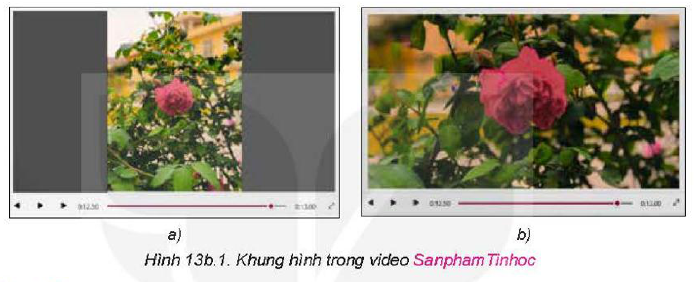
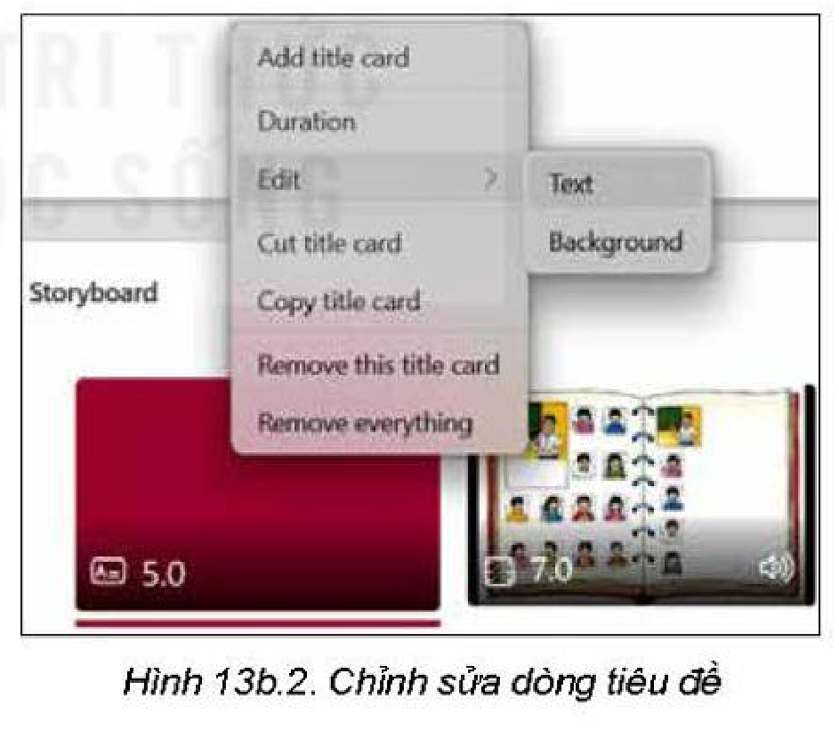
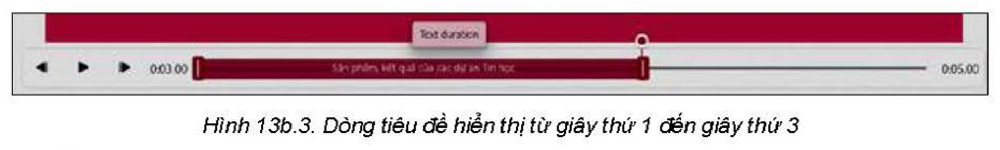
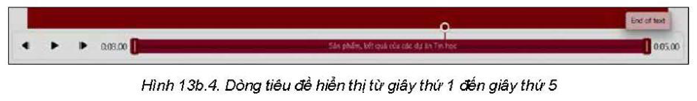
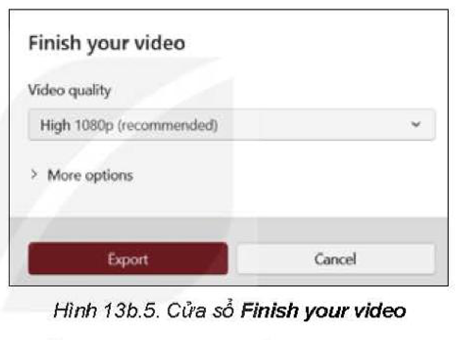

<!-- pdf:75 -->

# BÀI 13B: BIÊN TẬP VÀ XUẤT VIDEO

## 🎯 Sau bài học này em sẽ:

- Tạo được một vài đoạn video đáp ứng nhu cầu cuộc sống của cá nhân, gia đình, trường học, địa phương.

## 🔴 Khởi động

> Quan sát Hình 13b.1a và Hình 13b.1b, em có nhận xét gì?

*Hình 13b.1. Khung hình trong video SanphamTinhoc*

## 1. BIÊN TẬP VIDEO

> **Hoạt động 1: Thế nào là biên tập video?**
>
> 1. Sau khi đã hoàn thành việc dựng video, em cần làm việc gì tiếp theo?
>
>    A. Xuất video.
>
>    B. Biên tập video.
>
>    C. Xây dựng kịch bản.
>
>    D. Chuẩn bị dữ liệu.
>
> 2. Theo em, biên tập video là làm những việc gì?

Sau khi đã dựng xong video, em cần xem lại từ đầu đến cuối video trên màn hình xem trước để kiểm tra xem nội dung video có vấn đề gì không? Đã đúng theo kịch bản chưa? Âm thanh có bị to hay nhỏ quá không? Hình ảnh có bị mờ hay lỗi không? Phụ đề đã khớp với hình ảnh chưa? Có sai chính tả không? Phụ đề có to quá và che mất hình ảnh hay nhỏ quá làm người xem khó đọc không? Thời lượng video đã đúng theo kịch bản chưa?... Nếu phát hiện ra bất cứ vấn đề gì, em cần chỉnh sửa lại cho đúng trước khi xuất video.

Ví dụ: Quan sát Hình 13b.1a, em thấy trong khung hình xuất hiện hai **thanh màu đen** ở bên trái và phải. Các thanh màu đen gây mất thẩm mĩ và phân tán sự tập trung của người xem. Nguyên nhân xuất hiện các thanh màu đen là vì **tỉ lệ khung hình** các dữ liệu sử dụng để dựng video khác nhau và khác với khung hình của video đang dựng. Khi đó các phần thiếu sẽ được hiển thị bằng màu đen (**black bar**). Phần mềm làm video sẽ cung cấp cho người sử dụng chức năng loại bỏ các thanh màu đen để không làm ảnh hưởng đến chất lượng và thẩm mĩ của video.

<!-- pdf:76 -->

<!-- term: Biên tập video -->
> **Biên tập video** là việc tìm ra các vấn đề chưa đúng, chưa tốt còn tồn tại để chỉnh sửa sao cho sản phẩm video được hoàn chỉnh về cả mặt hình thức lẫn nội dung trước khi trình chiếu hay chia sẻ.

> ❓ **Câu hỏi**
>
> Em hãy chọn những công việc cần làm trong bước biên tập video:
>
> a) Thu thập dữ liệu.
>
> b) Kiểm tra nội dung video xem có đúng theo kịch bản không.
>
> c) Nhập dữ liệu.
>
> d) Kiểm tra phụ đề, âm thanh xem có khớp với hình ảnh không.
>
> e) Kiểm tra xem đã đủ dữ liệu chưa.

## 2. THỰC HÀNH: BIÊN TẬP VÀ XUẤT VIDEO

**Nhiệm vụ 1:** Biên tập video

**Hướng dẫn**

### a) Loại bỏ thanh màu đen

<!-- term: Loại bỏ thanh màu đen -->
Nháy chuột chọn ảnh bông hoa hồng trong bàn dựng, nháy chuột chọn [biểu tượng khung hình], một khung bao gồm hai lệnh là **Remove black bar** và **Shrink to fit** được hiển thị phía trên biểu tượng [biểu tượng khung hình]. Em chọn **Remove black bar** để loại bỏ thanh màu đen. Khi đó ảnh sẽ được tự động thay đổi kích thước để vừa với khung hình. Ngược lại, nếu không muốn loại bỏ thanh màu đen, em thực hiện tương tự và chọn **Shrink to fit**.

### b) Chỉnh lại thời gian hiển thị dữ liệu

Khi xem lại video, em thấy phần tiêu đề hiển thị trong 3 giây hơi nhanh, người xem chưa kịp nắm bắt nội dung thì đã chuyển sang phần giới thiệu dự án **Sổ lưu niệm**. Em muốn thay đổi thời gian hiển thị từ 3 giây thành 5 giây.

Tuy nhiên, sau khi chỉnh lại thời gian hiển thị, mặc dù đoạn video tiêu đề hiển thị trong 5 giây nhưng dòng tiêu đề lại vẫn chỉ hiển thị trong 3 giây. Em cần chỉnh lại thời gian hiển thị cho dòng tiêu đề bằng cách thực hiện:

*Hình 13b.2. Chỉnh sửa dòng tiêu đề*

– Nháy nút phải chuột vào khung hình của tiêu đề trong bàn dựng, chọn **Edit**, chọn **Text** (Hình 13b.2).

– Cửa sổ chỉnh sửa tiêu đề mở ra. Em sẽ thấy thời gian hiển thị dòng tiêu đề đang là từ giây thứ 1 đến giây thứ 3 (Hình 13b.3).

– Dùng chuột kéo thả con chạy bên phải đến vị trí giây thứ 5 để đặt thời gian hiển thị cho dòng tiêu đề là 5 giây (Hình 13b.4).

<!-- pdf:77 -->

*Hình 13b.3. Dòng tiêu đề hiển thị từ giây thứ 1 đến giây thứ 3*

*Hình 13b.4. Dòng tiêu đề hiển thị từ giây thứ 1 đến giây thứ 5*

– Nháy chuột chọn **Done** để hoàn thành công việc.

**Nhiệm vụ 2:** Xuất video

**Hướng dẫn**

<!-- term: Xuất video -->
– Sau khi biên tập xong video, em nháy chuột chọn lệnh **Finish video** ở góc trên, bên phải giao diện phần mềm để **xuất video** thành tệp có định dạng mp4.

– Cửa sổ **Finish your video** hiện ra (Hình 13b.5) cho phép em chọn chất lượng của tệp video (**High**, **Medium** hoặc **Low**).

– Nháy chuột chọn **Export** để mở cửa sổ **Save As** rồi nhập tên video là `SanPhamTinHoc.mp4` và chọn **Export**.

*Hình 13b.5. Cửa sổ Finish your video*

*Lưu ý:* Phần mềm sẽ cần một khoảng thời gian để hoàn thành việc xuất video. Thời gian dài hay ngắn phụ thuộc vào độ dài đoạn video em vừa dựng và phụ thuộc vào chất lượng (**High**, **Medium** hoặc **Low**) mà em đã chọn. Chất lượng em chọn cho đoạn video cũng sẽ liên quan đến độ lớn của tệp `SanPhamTinHoc.mp4`.

– Với tệp video vừa tạo ra, em có thể sao chép, chia sẻ với các bạn để sử dụng trong buổi triển lãm, em cũng có thể đưa lên mạng để giới thiệu với mọi người.

## ✏️ Luyện tập

Em hãy xem lại toàn bộ video trong màn hình xem trước và thực hiện các công việc sau:

a) Nếu thấy ảnh nào trong video còn thanh màu đen thì loại bỏ.

b) Điều chỉnh lại thời gian hiển thị các dữ liệu nếu thấy cần thiết.

c) Xuất lại video với tên `SanPhamTinHoc-Version2.mp4`.

d) Xem lại hai video kết quả ở hai tệp `SanPhamTinHoc.mp4` và `SanPhamTinHoc-Version2.mp4`, so sánh và chọn một bản phù hợp để trình chiếu trong buổi **Triển lãm tin học**.

## 🚀 Vận dụng

Em hãy thực hiện các nhiệm vụ tương tự trong phần Thực hành với dự án `MyVideo`.

## 📷 Danh sách hình trong bài

| Mã hình | Trang PDF | Trang sách | Chú thích |
| --- | --- | --- | --- |
| H9-tin_hoc-b13b-01 | 75 | 73 | Hình 13b.1. Khung hình trong video SanphamTinhoc |
| H9-tin_hoc-b13b-02 | 76 | 74 | Hình 13b.2. Chỉnh sửa dòng tiêu đề |
| H9-tin_hoc-b13b-03 | 77 | 75 | Hình 13b.3. Dòng tiêu đề hiển thị từ giây thứ 1 đến giây thứ 3 |
| H9-tin_hoc-b13b-04 | 77 | 75 | Hình 13b.4. Dòng tiêu đề hiển thị từ giây thứ 1 đến giây thứ 5 |
| H9-tin_hoc-b13b-05 | 77 | 75 | Hình 13b.5. Cửa sổ Finish your video |
