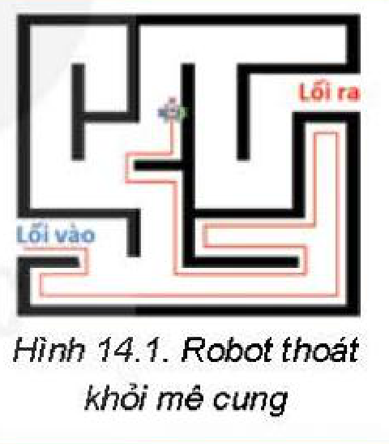
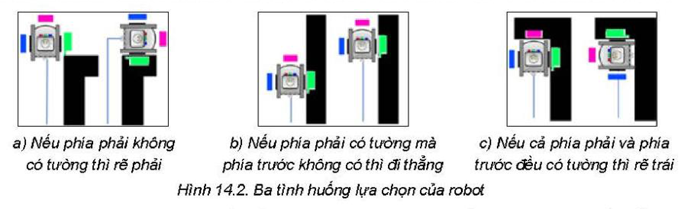
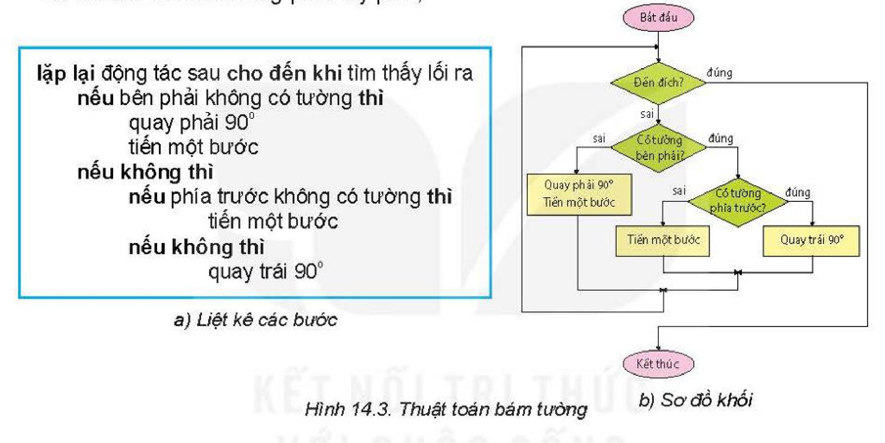

<!-- pdf:78 -->

# BÀI 14: GIẢI QUYẾT VẤN ĐỀ

## 🎯 Sau bài học này em sẽ:

- Trình bày được quá trình giải quyết vấn đề và mô tả được giải pháp dưới dạng thuật toán (hoặc bằng phương pháp liệt kê các bước hoặc bằng sơ đồ khối).

## 🔴 Khởi động

> *Minh:* Tớ đã từng vào mê cung trong một khu vui chơi. Tớ phải tìm đường thoát khỏi mê cung mà không được dùng bản đồ.
>
> *Khoa:* Thật là một trò chơi thú vị.
>
> *Minh:* Bạn có biết cách tìm đường thoát khỏi mê cung không?

## 1. GIẢI QUYẾT VẤN ĐỀ

> **Hoạt động 1: Tìm đường thoát khỏi mê cung**
>
> **Mê cung** được dùng để chỉ những công trình gồm nhiều hành lang, lối đi, được tạo thành từ những bức tường. Một robot xuất phát từ Lối vào, tìm đường tới Lối ra như Hình 14.1. Em hãy quan sát cách di chuyển của robot và trả lời các câu hỏi sau:
> 1. Robot di chuyển trong mê cung theo cách nào?
> 2. Tại sao cách di chuyển đó dẫn robot tới lối ra?



*Hình 14.1. Robot thoát khỏi mê cung*

Trong Hoạt động 1, robot đã di chuyển sao cho bức tường luôn ở bên phải nó. Bằng cách di chuyển như vậy, robot sẽ được bức tường dẫn qua mọi vị trí của mê cung cho đến khi tìm thấy Lối ra. Tìm Lối ra trong mê cung là một vấn đề. Vấn đề đó được giải quyết qua các bước như sau.

- **Tìm hiểu vấn đề** là xác định những yếu tố đã cho và kết quả cần đạt. Vấn đề ở đây là tìm thấy Lối ra khỏi mê cung mà không có người để hỏi đường và cũng không có sơ đồ của mê cung để di chuyển theo. Robot phải xác định một hướng di chuyển (rẽ phải, đi thẳng hoặc rẽ trái) tại mỗi vị trí mà nó đi qua.
- **Phân tích vấn đề** là phân chia vấn đề thành những vấn đề nhỏ hơn, dễ giải quyết hơn. Chẳng hạn, quyết định của robot có thể được chia thành ba trường hợp: rẽ phải, đi thẳng và rẽ trái. Vì không có bản đồ và không được hỏi đường nên robot chỉ được dựa vào vị trí của bức tường để quyết định.
- **Lựa chọn giải pháp** là lựa chọn cách giải quyết vấn đề. Để di chuyển sao cho bức tường luôn ở phía bên phải của mình, robot sẽ phải chọn hướng theo quy tắc ưu tiên từ phải sang trái. Ba tình huống đó được minh hoạ trong Hình 14.2.

<!-- pdf:79 -->

a) Nếu phía phải không có tường (nghĩa là có đường đi phía bên phải) thì rẽ phải.
b) Nếu phía phải có tường mà phía trước không có (đi thẳng được) thì đi thẳng.
c) Nếu cả phía phải và phía trước đều có tường thì quay sang trái để chọn hướng lại.



*Hình 14.2. Ba tình huống lựa chọn của robot*

- **Trình bày giải pháp** là mô tả giải pháp một cách rõ ràng để không gây ra nhầm lẫn khi thực hiện. Trong trò chơi, cách di chuyển phải được mô tả như một thuật toán, sao cho tại mỗi vị trí, robot phải xác định được đúng một hướng (rẽ phải, đi thẳng hay rẽ trái) để di chuyển, không gây ra nhầm lẫn.
- **Thực hiện giải pháp và đánh giá kết quả** là bước triển khai giải pháp đã chọn và xem xét hiệu quả đạt được để cải tiến hoặc phát hiện những giải pháp mới. Chẳng hạn, thuật toán bám tường có thể được thực hiện với nhiều mê cung có đặc điểm khác nhau để có thể cải tiến với những tình huống đặc biệt.

Tóm lại, quá trình giải quyết vấn đề bao gồm các bước sau:
1) Tìm hiểu vấn đề: xác định những yếu tố đã cho và kết quả cần đạt.
2) Phân tích vấn đề: xem xét từng khía cạnh của vấn đề, đưa ra nhận định để tìm cách giải quyết.
3) Lựa chọn giải pháp: dựa trên nhận định ở bước trên, tìm kiếm và lựa chọn cách giải quyết vấn đề.
4) Trình bày giải pháp: mô tả giải pháp một cách rõ ràng để không gây ra nhầm lẫn khi thực hiện.
5) Thực hiện giải pháp và đánh giá kết quả: triển khai giải pháp, xác định hiệu quả, phát hiện nhược điểm của giải pháp để cải tiến.

> **Giải quyết vấn đề** là quá trình, thường được thực hiện qua các bước: 1) Tìm hiểu vấn đề; 2) Phân tích vấn đề; 3) Lựa chọn giải pháp; 4) Trình bày giải pháp; 5) Thực hiện giải pháp và đánh giá kết quả.

> ❓ **Câu hỏi**
>
> Em hãy mô tả các bước giải quyết vấn đề chọn trường để tiếp tục học tập sau khi tốt nghiệp THCS.

## 2. TRÌNH BÀY GIẢI PHÁP

> **Hoạt động 2: Thuật toán bám tường**
>
> **Thuật toán bám tường** là một trong những giải pháp thoát khỏi mê cung. Trong thuật toán, robot di chuyển sao cho bức tường luôn ở một phía của nó (chẳng hạn phía bên phải). Em hãy mô tả thuật toán xác định hướng di chuyển của robot. Biết rằng robot chỉ thực hiện được những động tác sau:

<!-- pdf:80 -->

> 1. Phát hiện xung quanh (trái, phải, phía trước) có tường hay không.
> 2. Quay trái hoặc quay phải một góc $90^\circ$.
> 3. Tiến (đi thẳng) một bước về phía trước.

Robot là một máy tính. Giải pháp thoát khỏi mê cung cần phải được mô tả một cách rõ ràng sao cho tại mỗi bước đi của nó, robot biết được phải đi theo hướng nào mà không bị nhầm lẫn. Trong thuật toán bám tường (bên phải), robot sẽ ưu tiên đi con đường phía tay phải, nếu không có đường nó mới lần lượt chọn lối đi thẳng hoặc quay sang trái như được mô tả trong Hình 14.2. Thuật toán bám tường có thể được mô tả theo cách liệt kê các bước (Hình 14.3a) hoặc bằng sơ đồ khối (Hình 14.3b).



*Hình 14.3. Thuật toán bám tường*

```text
a) Liệt kê các bước:
lặp lại động tác sau cho đến khi tìm thấy lối ra
    nếu bên phải không có tường thì
        quay phải 90°
        tiến một bước
    nếu không thì
        nếu phía trước không có tường thì
            tiến một bước
        nếu không thì
            quay trái 90°

b) Sơ đồ khối:
Bắt đầu -> Kiểm tra [Đến đích?]
  - đúng -> Kết thúc
  - sai  -> Kiểm tra [Có tường bên phải?]
              - sai  -> [Quay phải 90°; Tiến một bước] -> quay lại kiểm tra [Đến đích?]
              - đúng -> Kiểm tra [Có tường phía trước?]
                          - sai  -> [Tiến một bước] -> quay lại kiểm tra [Đến đích?]
                          - đúng -> [Quay trái 90°] -> quay lại kiểm tra [Đến đích?]
```

<!-- term: Mô tả giải pháp dưới dạng thuật toán -->
> Phương pháp giải quyết vấn đề (hay giải pháp) có thể được mô tả dưới dạng thuật toán bằng phương pháp liệt kê các bước hoặc bằng sơ đồ khối.

> ❓ **Câu hỏi**
>
> Em hãy trình bày các bước giải quyết vấn đề chọn trường sau khi tốt nghiệp THCS dưới dạng liệt kê các bước hoặc sơ đồ khối.

## ✏️ Luyện tập

Em hãy mô tả thuật toán bám tường bên trái để tìm đường thoát khỏi mê cung.

## 🚀 Vận dụng

Em hãy lập chương trình trong ngôn ngữ Scratch mô phỏng thuật toán bám tường.

## 📷 Danh sách hình trong bài

| Mã hình | Trang PDF | Trang sách | Chú thích |
| --- | :---: | :---: | --- |
| H9-tin_hoc-b14-01 | 78 | 76 | Hình 14.1. Robot thoát khỏi mê cung |
| H9-tin_hoc-b14-02 | 79 | 77 | Hình 14.2. Ba tình huống lựa chọn của robot |
| H9-tin_hoc-b14-03 | 80 | 78 | Hình 14.3. Thuật toán bám tường (đỉnh khối Bắt đầu bên phải ngang hàng chân chữ dòng cuối cột trái) |
