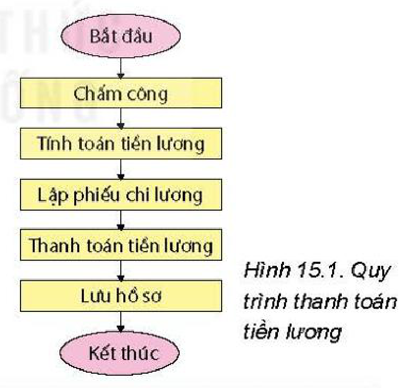
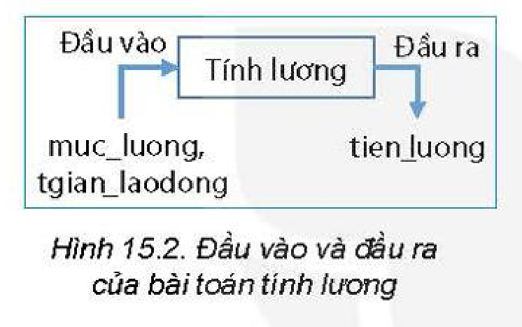
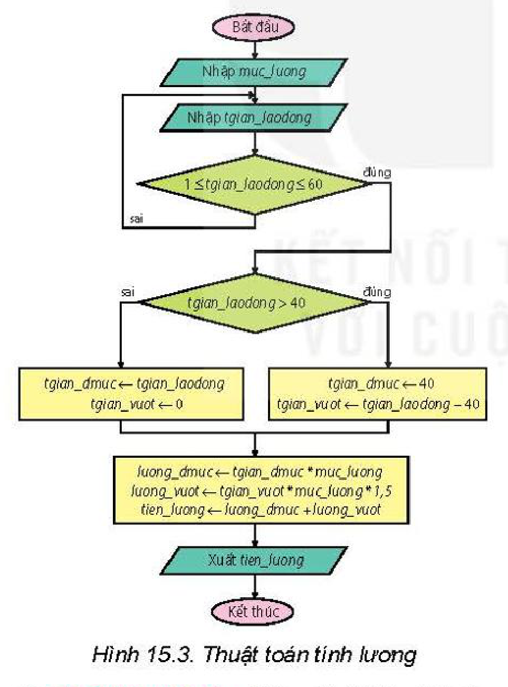
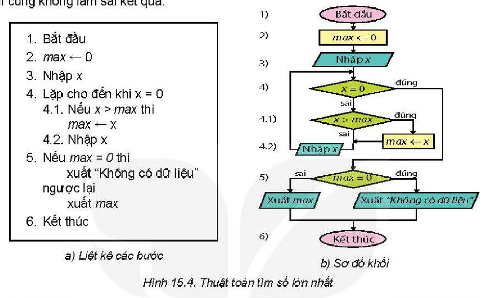

<!-- pdf:81 -->

# BÀI 15: BÀI TOÁN TIN HỌC

## 🎯 Sau bài học này em sẽ:

- Giải thích được trong quy trình giải quyết vấn đề có những bước (những vấn đề nhỏ hơn) có thể chuyển giao cho máy tính thực hiện, nêu được ví dụ minh hoạ.
- Giải thích được khái niệm bài toán trong tin học là một nhiệm vụ có thể giao cho máy tính thực hiện, nêu được ví dụ minh hoạ.
- Nêu được quy trình con người giao bài toán cho máy tính giải quyết.

## 🔴 Khởi động

> Tính lương là một phần của những vấn đề mà doanh nghiệp cần phải giải quyết. Việc trả lương thoả đáng và kịp thời thể hiện tính chuyên nghiệp và có trách nhiệm của doanh nghiệp, đem lại sự hài lòng cho nhân viên, động viên họ làm việc chăm chỉ, đạt hiệu quả cao. Qua ví dụ về bài toán tính lương, em sẽ biết cách chuyển nhiều nhiệm vụ trong thực tế thành một bài toán trong tin học và giao cho máy tính thực hiện.

## 1. BÀI TOÁN TIN HỌC

> **Hoạt động 1: Nhiệm vụ của máy tính**
>
> Với những doanh nghiệp lớn có nhiều loại hình lao động, việc thanh toán tiền lương cần phải tuân theo một quy trình chặt chẽ giữa các bộ phận. Hình 15.1 mô tả một quy trình thanh toán tiền lương. Theo em, bước nào trong quy trình đó có thể giao cho máy tính thực hiện?

Mỗi quy trình thanh toán tiền lương là một giải pháp để một doanh nghiệp giải quyết vấn đề trả lương cho người lao động, đồng thời lưu trữ đủ dữ liệu để tính toán hiệu quả kinh doanh và đối chiếu dữ liệu khi cần thiết.

Hình 15.1 mô tả một quy trình thanh toán tiền lương, trong đó bước tính toán tiền lương thường được giao cho máy tính thực hiện. Như vậy, em có thể thấy trong quy trình giải quyết vấn đề có những bước (những vấn đề nhỏ hơn) có thể chuyển giao cho máy tính thực hiện. Sau đây, ta xét một trường hợp cụ thể.



*Hình 15.1. Quy trình thanh toán tiền lương*

```text
Bắt đầu -> Chấm công -> Tính toán tiền lương -> Lập phiếu chi lương -> Thanh toán tiền lương -> Lưu hồ sơ -> Kết thúc
```

> **Hoạt động 2: Bài toán tính lương**
>
> Hằng tuần, một công ti phải tính lương cho các nhân viên của mình. Tiền lương của một nhân viên theo tuần phụ thuộc vào mức lương theo giờ và số giờ làm việc mỗi tuần. Số giờ lao động của một nhân viên tối thiểu là một giờ và tối đa là 60 giờ mỗi tuần. Định mức làm việc của nhân viên là 40 giờ/tuần. Mỗi giờ vượt định mức nhân viên được trả gấp 1,5 lần mức lương của họ. Hãy trình bày các bước giải quyết vấn đề tính lương của công ti.

<!-- pdf:82 -->

Trong Hoạt động 2, quy trình tính lương cho nhân viên, sau khi lược bỏ những bước không cần sử dụng máy tính như chấm công hay xây dựng công thức tính toán,... chỉ còn lại bài toán tính toán. Bài toán tính toán đó có thể giao cho máy tính thực hiện nên còn được gọi là **bài toán tin học**.

Bài toán tin học được xác định bởi đầu vào và đầu ra như minh hoạ trong Hình 15.2.
- **Đầu vào** là những giá trị cho trước. Ví dụ: mức lương và số giờ làm việc trong tuần của một nhân viên.
- **Đầu ra** là giá trị phải tìm hoặc kết quả của hành động. Ví dụ: tiền lương theo tuần của nhân viên đó.



*Hình 15.2. Đầu vào và đầu ra của bài toán tính lương*

Ví dụ về một số bài toán tin học:
1) Giải phương trình $ax^2 + bx + c = 0$. Đầu vào là các hệ số $a, b, c$. Giá trị đầu ra là nghiệm của phương trình (nếu có) hoặc thông báo “phương trình vô nghiệm”, nếu phương trình không có nghiệm.
2) Tính ước số chung lớn nhất của hai số nguyên. Đầu vào là hai số nguyên $a$ và $b$. Giá trị đầu ra là ước số chung lớn nhất của $a$ và $b$ (nếu chúng không đồng thời bằng 0) hoặc thông báo “không có ước chung lớn nhất” (nếu $a = b = 0$).

Tuy nhiên, máy tính không chỉ tính toán với những giá trị số mà còn có thể xử lí cả những dữ liệu khác như văn bản, hình ảnh, âm thanh,... Vì vậy, đầu vào và đầu ra của bài toán tin học không chỉ là các số. Chẳng hạn: dịch từ tiếng Việt sang tiếng Anh. Đầu vào là văn bản (câu) tiếng Việt. Đầu ra là văn bản (câu) tiếng Anh tương ứng dưới dạng văn bản hoặc âm thanh.

> **Bài toán trong tin học** là một nhiệm vụ có thể giao cho máy tính thực hiện. Bài toán đó được xác định bởi dữ liệu đã biết (đầu vào), dữ liệu cần tìm (đầu ra).

> ❓ **Câu hỏi**
>
> Hãy mô tả đầu vào và đầu ra của bài toán xác định một số nguyên dương có phải số nguyên tố hay không.

## 2. GIẢI BÀI TOÁN TIN HỌC

> **Hoạt động 3: Tính lương bằng máy tính**
>
> Em hãy nêu các bước để chuyển bài toán tính lương (trong Hoạt động 2) cho máy tính thực hiện bằng cách lập chương trình.

Việc giải một bài toán tin học cũng trải qua những bước tương tự quá trình giải quyết vấn đề được nêu trong Bài 14. Với bài toán tính lương bằng máy tính, em cần thực hiện các việc sau:

1) **Xác định bài toán**: Xác định đầu vào, đầu ra. Chẳng hạn, đầu vào là hai giá trị mức lương (`muc_luong`) và số giờ làm việc trong tuần (`tgian_laodong`) của nhân viên. Đầu ra là tiền lương (`tien_luong`) của nhân viên.

2) **Xây dựng thuật toán**: Chia bài toán thành những bài toán nhỏ bằng cách trả lời hai câu hỏi: (1) Để giải bài toán, cần phải qua những bước nào? (2) Các bước đó cần được thực hiện theo thứ tự nào? Chẳng hạn, ban đầu, bài toán tính lương có thể chia thành ba bước và được thực hiện tuần tự như sau:

<!-- pdf:83 -->

*Bước 1.* Nhập dữ liệu đã cho (đầu vào): `muc_luong` và `tgian_laodong`.

*Bước 2.* Xử lí dữ liệu đã cho để tính giá trị cần biết (đầu ra) `tien_luong`.

*Bước 3.* Xuất giá trị đầu ra tìm được: `tien_luong`.

Việc chia nhỏ cần được tiếp tục cho đến khi mỗi bước có thể chuyển thành một câu lệnh máy tính thực hiện được.

Thuật toán cần được mô tả bằng cách chỉ sử dụng những cấu trúc điều khiển cơ bản (tuần tự, rẽ nhánh và lặp). Chẳng hạn, thuật toán tính lương có thể được mô tả như Hình 15.3.



*Hình 15.3. Thuật toán tính lương*

```text
Bắt đầu
  -> Nhập muc_luong
  -> [Lặp] Nhập tgian_laodong -> Kiểm tra [1 <= tgian_laodong <= 60]
       - sai  -> quay lại Nhập tgian_laodong
       - đúng -> Kiểm tra [tgian_laodong > 40]
                   - sai  -> tgian_dmuc <- tgian_laodong; tgian_vuot <- 0
                   - đúng -> tgian_dmuc <- 40; tgian_vuot <- tgian_laodong - 40
                 -> luong_dmuc <- tgian_dmuc * muc_luong
                    luong_vuot <- tgian_vuot * muc_luong * 1,5
                    tien_luong <- luong_dmuc + luong_vuot
                 -> Xuất tien_luong
                 -> Kết thúc
```

3) **Cài đặt thuật toán**: Việc cài đặt thuật toán thành chương trình máy tính là bước thực hiện giải pháp. Có những cách cài đặt khác nhau của cùng một thuật toán. Em cũng có thể bổ sung biến để giảm bớt thời gian tính toán. Trong bài toán tính lương, các biến `luong_dmuc` và `luong_vuot` được sử dụng để lưu trữ các giá trị trung gian trong quá trình tính toán.

4) **Gỡ lỗi và hiệu chỉnh chương trình**: Sau khi chương trình được cài đặt, em cần chạy chương trình với những dữ liệu khác nhau, gỡ lỗi và hiệu chỉnh để có một chương trình chạy tốt. Gỡ lỗi là một trong những bước cần thiết của việc lập trình.

Chúng ta hãy cùng giải một bài toán tin học khác: Tìm và hiển thị giá trị lớn nhất của những số nguyên dương được nhập vào từ bàn phím. Số lượng các số trong dãy không được biết trước khi nhập dữ liệu, chỉ biết rằng quá trình nhập các số của dãy sẽ kết thúc khi nhập vào số 0. Yêu cầu chỉ sử dụng một biến số nguyên để nhập dữ liệu đầu vào.

1) Xác định bài toán
- Đầu vào: $x$ là số nguyên dương được nhập nhiều lần từ bàn phím, kết thúc bởi số 0.
- Đầu ra: $max$ là số lớn nhất trong các giá trị đã nhập.

2) Xây dựng thuật toán

Bài toán chỉ sử dụng một biến $x$ để nhập dữ liệu nhiều lần. Vì vậy, $x$ được xử lí ngay sau khi nhập, sau đó được dành để tiếp tục nhập giá trị tiếp theo.

Khi đó thuật toán có thể mô tả thành ba bước thực hiện tuần tự:
1. Gán cho $max$ giá trị bằng 0.
2. Lặp nhiều lần thao tác: nhập $x$ và gán lại $max$ theo giá trị $x$ nhận được.
3. In kết quả.

Thao tác nhập giá trị của $x$ và xử lí giá trị đó được đặt trong một vòng lặp. Trong vòng lặp đó:
- **Điều kiện kết thúc vòng lặp**: ($x = 0$).
- **Thân lặp**: nhập $x$ và so sánh nó với $max$ để thay thế $max$ nếu ($x > max$).
- **Giá trị khởi đầu vòng lặp**: $max = 0$ để có thể thay đổi khi số nguyên dương đầu tiên được nhập.

*Lưu ý:*

Các số $x$ nhập vào là số nguyên dương nên số lớn nhất $max$ tìm được cũng là một số nguyên dương.

<!-- pdf:84 -->

Trường hợp không có số nguyên dương nào được nhập, $max$ không có dữ liệu để so sánh nên không thay đổi. Vì vậy, nếu sau vòng lặp $max = 0$ thì hiển thị “Không có dữ liệu!”.

Trường hợp các số âm được nhập vào sẽ không được tính nhưng dù có đem so sánh thì cũng không làm sai kết quả.

Thuật toán tính số lớn nhất $max$ được mô tả bằng cách liệt kê các bước như trong Hình 15.4a và bằng sơ đồ khối như trong Hình 15.4b.

(Việc cài đặt thuật toán và gỡ lỗi sẽ được thực hiện ở phần Nhiệm vụ 2 trong Bài 16.)



*Hình 15.4. Thuật toán tìm số lớn nhất*

```text
a) Liệt kê các bước:
1. Bắt đầu
2. max <- 0
3. Nhập x
4. Lặp cho đến khi x = 0
   4.1. Nếu x > max thì
        max <- x
   4.2. Nhập x
5. Nếu max = 0 thì
        xuất “Không có dữ liệu”
   ngược lại
        xuất max
6. Kết thúc

b) Sơ đồ khối:
1) Bắt đầu -> 2) [max <- 0] -> 3) [Nhập x]
  -> 4) Kiểm tra [x = 0]
       - sai  -> 4.1) Kiểm tra [x > max]
                   - đúng -> [max <- x] -> 4.2) [Nhập x] -> quay lại bước 4)
                   - sai  -> 4.2) [Nhập x] -> quay lại bước 4)
       - đúng -> 5) Kiểm tra [max = 0]
                   - sai  -> [Xuất max] -> 6) Kết thúc
                   - đúng -> [Xuất “Không có dữ liệu”] -> 6) Kết thúc
```

> **Quy trình giải một bài toán tin học** gồm các bước: 1) Xác định bài toán; 2) Xây dựng thuật toán; 3) Cài đặt thuật toán; 4) Gỡ lỗi và hiệu chỉnh chương trình.

> ❓ **Câu hỏi**
>
> Một bài toán tin học được xác định bởi những yếu tố nào?
> A. Những bài toán nhỏ hơn.
> B. Đầu vào và đầu ra.
> C. Các cấu trúc điều khiển.
> D. Chương trình máy tính.

## ✏️ Luyện tập

Vẽ sơ đồ của thuật toán giải bài toán xác định một số có phải số nguyên tố hay không bằng cách chỉ sử dụng những cấu trúc điều khiển cơ bản.

## 🚀 Vận dụng

1. Hãy mô tả đầu vào, đầu ra của bài toán sắp xếp một dãy số theo thứ tự tăng dần.
2. Vẽ sơ đồ khối của giải thuật sắp xếp nổi bọt để sắp xếp một dãy số theo thứ tự tăng dần.

## 📷 Danh sách hình trong bài

| Mã hình | Trang PDF | Trang sách | Chú thích |
| --- | :---: | :---: | --- |
| H9-tin_hoc-b15-01 | 81 | 79 | Hình 15.1. Quy trình thanh toán tiền lương |
| H9-tin_hoc-b15-02 | 82 | 80 | Hình 15.2. Đầu vào và đầu ra của bài toán tính lương |
| H9-tin_hoc-b15-03 | 83 | 81 | Hình 15.3. Thuật toán tính lương |
| H9-tin_hoc-b15-04 | 84 | 82 | Hình 15.4. Thuật toán tìm số lớn nhất (cạnh khung trên giao dòng chữ cuối cột trái do bố cục trang in ngang hàng đỉnh khối Bắt đầu) |
