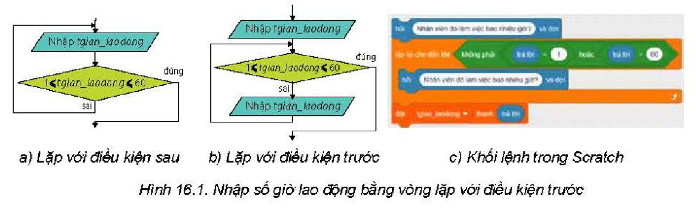

<!-- pdf:85 -->

# BÀI 16: THỰC HÀNH: LẬP CHƯƠNG TRÌNH MÁY TÍNH

## 🎯 Sau bài học này em sẽ:

- Sử dụng được cấu trúc tuần tự, rẽ nhánh, lặp trong mô tả thuật toán.
- Giải thích được chương trình là bản mô tả thuật toán bằng ngôn ngữ mà máy tính có thể “hiểu” và thực hiện.

## 🔴 Khởi động

> Mỗi nhiệm vụ trong bài học này là giải một bài toán tin học mà sản phẩm là một chương trình máy tính. Các ngôn ngữ lập trình đều được trang bị những cấu trúc điều khiển cơ bản (tuần tự, rẽ nhánh và lặp). Vì vậy, việc mô tả thuật toán bằng cách chỉ sử dụng những cấu trúc điều khiển đó sẽ giúp em dễ dàng tạo ra những chương trình máy tính.

## Nhiệm vụ 1. TÍNH LƯƠNG

**Yêu cầu**

Theo thuật toán được mô tả ở Bài 15, em hãy lập chương trình tính và hiển thị tiền lương của một nhân viên khi biết mức lương (tiền lương trong một giờ làm việc) và số giờ làm việc trong tuần của họ bằng ngôn ngữ lập trình Scratch.

**Hướng dẫn**

### a) Cài đặt thuật toán

*Bước 1.* Tạo các biến nhớ
- Biến đầu vào: *muc_luong*, *tgian_laodong*.
- Biến đầu ra: *tien_luong*.
- Biến trung gian: *tgian_dmuc*, *tgian_vuot*, *luong_dmuc*, *luong_vuot*.
<!-- ocr-ok: đã đối chiếu trực tiếp ảnh trang PDF 85, OCR đọc nhầm tên các biến có dấu gạch dưới tien_luong, tgian_dmuc -->

*Bước 2.* Mô tả lại thuật toán theo ngôn ngữ lập trình

Vì **chương trình** là bản mô tả thuật toán theo quy tắc của ngôn ngữ lập trình nên đôi khi em phải hiệu chỉnh cách mô tả thuật toán để có thể cài đặt được bằng những công cụ của ngôn ngữ lập trình.

Bước nhập dữ liệu `tgian_laodong` sử dụng cấu trúc **lặp với điều kiện sau** (Hình 16.1a) cần phải chuyển thành những câu lệnh sử dụng vòng **lặp với điều kiện trước** (Hình 16.1b) để phù hợp với cấu trúc lặp có sẵn trong ngôn ngữ lập trình trực quan (Hình 16.1c).



*Hình 16.1. Nhập số giờ lao động bằng vòng lặp với điều kiện trước*

```text
a) Lặp với điều kiện sau:
   [Nhập tgian_laodong] -> Kiểm tra [1 <= tgian_laodong <= 60] (sai -> quay lại Nhập tgian_laodong; đúng -> tiếp tục)

b) Lặp với điều kiện trước:
   [Nhập tgian_laodong] -> Kiểm tra [1 <= tgian_laodong <= 60] (sai -> [Nhập tgian_laodong] rồi quay lại kiểm tra; đúng -> tiếp tục)

c) Khối lệnh trong Scratch:
   hỏi [Nhân viên đó làm việc bao nhiêu giờ?] và đợi
   lặp lại cho đến khi <không phải <<(trả lời) < (1)> hoặc <(trả lời) > (60)>>>
       hỏi [Nhân viên đó làm việc bao nhiêu giờ?] và đợi
   đặt [tgian_laodong v] thành (trả lời)
```

<!-- pdf:86 -->

*Bước 3.* Tạo chương trình

Nhận dạng các khối lệnh trong Hình 16.2 tương ứng với từng phần của sơ đồ khối đã được trình bày trong Bài 15 (Hình 15.2) và lắp ghép chúng lại theo đúng thứ tự. Lưu ý: Hệ số 1,5 trong sơ đồ thuật toán cần phải thay bằng 1.5 (sử dụng dấu chấm thay cho dấu phẩy ngăn cách phần nguyên và phần thập phân) trong chương trình.


*Hình 16.2. Các khối lệnh thành phần của chương trình tính lương*

```text
- Khối khởi đầu & nhập mức lương:
  Khi bấm vào [Cờ xanh]
  hỏi [Mức lương của nhân viên (theo giờ)?] và đợi
  đặt [muc_luong v] thành (trả lời)

- Khối nhập số giờ lao động:
  hỏi [Nhân viên đó làm việc bao nhiêu giờ?] và đợi
  lặp lại cho đến khi <không phải <<(trả lời) < (1)> hoặc <(trả lời) > (60)>>>
      hỏi [Nhân viên đó làm việc bao nhiêu giờ?] và đợi
  đặt [tgian_laodong v] thành (trả lời)

- Khối rẽ nhánh tính thời gian định mức và vượt định mức:
  nếu <(tgian_laodong) > (40)> thì
      đặt [tgian_dmuc v] thành [40]
      đặt [tgian_vuot v] thành ((tgian_laodong) - (40))
  nếu không thì
      đặt [tgian_dmuc v] thành (tgian_laodong)
      đặt [tgian_vuot v] thành [0]

- Khối tính tiền lương:
  đặt [luong_dmuc v] thành ((muc_luong) * (tgian_dmuc))
  đặt [luong_vuot v] thành (((muc_luong) * (tgian_vuot)) * (1.5))
  đặt [tien_luong v] thành ((luong_dmuc) + (luong_vuot))

- Khối xuất kết quả & kết thúc:
  nói (kết hợp [Tiền lương theo tuần = ] (tien_luong)) trong (5) giây
  dừng lại [tất cả v]
```

### b) Gỡ lỗi

<!-- term: Bộ dữ liệu kiểm thử chương trình -->
Lập các bộ dữ liệu kiểm thử chương trình (Bảng 16.1). Mỗi bộ đại diện cho một tình huống dữ liệu để kiểm tra hoạt động của chương trình. Nếu chương trình hoạt động không đúng yêu cầu, chương trình đã gặp lỗi, cần phải sửa.
- Với mỗi bộ giá trị đầu vào (từ tình huống 1 đến tình huống 4), chương trình cần trả lại đúng giá trị đầu ra.
- Bộ giá trị ở tình huống 5 đại diện cho trường hợp cần nhập lại dữ liệu như đã được mô tả trong thuật toán.
- Bộ giá trị ở tình huống 6 cho thấy có những giá trị đầu vào chưa hợp lí. Em cần chỉnh sửa chương trình để có một chương trình hoạt động tốt.

*Bảng 16.1. Dữ liệu kiểm thử bài toán tính lương*

| Tình huống | Đầu vào: `muc_luong` | Đầu vào: `tgian_laodong` | Đầu ra: `tien_luong` | Ghi chú |
| :---: | :---: | :---: | :---: | --- |
| 1 | 100 | 30 | 3000 | tgian_laodong dưới định mức |
| 2 | 100 | 40 | 4000 | tgian_laodong vừa đủ định mức |
| 3 | 100 | 50 | 5500 | tgian_laodong vượt định mức |
| 4 | 100 | 60 | 7000 | tgian_laodong vừa đạt mức tối đa |
| 5 | 100 | 70 | Nhân viên đó làm việc bao nhiêu giờ? | Cần phải nhập lại tgian_laodong |
| 6 | -100 | 50 | Mức lương của nhân viên (theo giờ) | Cần phải nhập lại muc_luong |
<!-- ocr-ok: đã đối chiếu trực tiếp ảnh trang PDF 86, OCR đọc nhầm số 4000/5500/7000 trong Bảng 16.1 -->

(Ghi chú: đơn vị tiền là nghìn đồng, đơn vị thời gian là giờ.)

<!-- pdf:87 -->

## Nhiệm vụ 2. TÌM GIÁ TRỊ LỚN NHẤT

**Yêu cầu**

Tìm và hiển thị giá trị lớn nhất của một dãy số nguyên dương được nhập vào từ bàn phím. Số lượng các số trong dãy không được biết trước khi nhập dữ liệu, chỉ biết rằng quá trình nhập các số của dãy sẽ kết thúc khi nhập vào số 0.

**Hướng dẫn**

### a) Cài đặt thuật toán

*Bước 1.* Tạo các biến
- Biến đầu vào: *x*.
- Biến đầu ra: *max*.

*Bước 2.* Tạo chương trình

Nhận dạng các khối lệnh trong Hình 16.3 tương ứng với từng phần của sơ đồ khối đã được trình bày trong bài trước và lắp ghép chúng lại theo đúng thứ tự.


*Hình 16.3. Các khối lệnh thành phần của chương trình tìm giá trị lớn nhất*

```text
- Khối khởi đầu:
  Khi bấm vào [Cờ xanh]
  đặt [max v] thành [0]

- Khối nhập giá trị đầu tiên:
  hỏi [Nhập một số nguyên dương!] và đợi
  đặt [x v] thành (trả lời)

- Khối lặp kiểm tra điều kiện kết thúc:
  lặp lại cho đến khi <(x) = [0]>

- Khối cập nhật giá trị lớn nhất (trong thân lặp):
  nếu <(x) > (max)> thì
      đặt [max v] thành (x)

- Khối nhập số tiếp theo (trong thân lặp):
  hỏi [Nhập số nguyên dương tiếp theo!] và đợi
  đặt [x v] thành (trả lời)

- Khối xuất kết quả & kết thúc:
  nếu <(max) = [0]> thì
      nói [Không có dữ liệu!] trong (5) giây
  nếu không thì
      nói (kết hợp [Số lớn nhất là ] (max)) trong (5) giây
  dừng lại [tất cả v]
```

### b) Gỡ lỗi

Khi chạy chương trình, lần lượt nhập các số trong bộ dữ liệu kiểm thử (Bảng 16.2). Cần nhập từng số và nhấn phím **Enter** trước khi nhập số tiếp theo cho đến khi kết thúc bằng số 0.

<!-- pdf:88 -->

Mặc dù bài toán yêu cầu đầu vào là những số nguyên dương nhưng chương trình sẽ tốt hơn nếu phát hiện được và loại bỏ những dữ liệu không đúng yêu cầu.
- Với mỗi bộ giá trị đầu vào (từ tình huống 1 đến tình huống 4), chương trình cần trả lại đúng giá trị đầu ra.
- Bộ giá trị ở tình huống 5 đại diện trường hợp không có số nguyên dương nào được nhập.
- Tình huống 6, 7 có những giá trị đầu vào không hợp lệ nhưng chương trình vẫn xử lí đúng.
- Bộ giá trị ở tình huống 8 cho thấy có những giá trị đầu vào không hợp lệ, dẫn đến kết quả sai. Việc chỉnh sửa chương trình để có một chương trình hoạt động tốt trong tình huống này là bài tập vận dụng.

*Bảng 16.2. Dữ liệu kiểm thử bài toán tìm số lớn nhất*

| Tình huống | Đầu vào | Đầu ra | Ghi chú |
| :---: | :---: | :---: | --- |
| 1 | 1 2 3 0 | 3 | Dãy số tự nhiên tăng |
| 2 | 8 3 10 6 0 | 10 | Dãy số ngẫu nhiên |
| 3 | 12 8 3 0 | 12 | Dãy số giảm |
| 4 | 5 0 | 5 | Dãy chỉ có một giá trị |
| 5 | 0 | Không có dữ liệu! | Dãy không có dữ liệu |
| 6 | 8 -5 3 9 6 0 | 9 | Dãy có số âm |
| 7 | -8 -6 0 | Không có dữ liệu! | Dãy không có số nguyên dương |
| 8 | 7 data 12 0 | 12 | Dãy có dữ liệu chữ |
<!-- ocr-ok: đã đối chiếu trực tiếp ảnh trang PDF 88, OCR ghép liền các số cách nhau dấu cách trong Bảng 16.2 -->

## ✏️ Luyện tập

Bộ giá trị ở tình huống 6 (Bảng 16.2) cho thấy có những giá trị đầu vào chưa hợp lí. Em hãy chỉnh sửa chương trình để có một chương trình hoạt động tốt.

## 🚀 Vận dụng

Ngôn ngữ lập trình trực quan không phân biệt dữ liệu đầu vào là dạng số hay dạng chữ. Vì vậy, chương trình được lập trong Nhiệm vụ 2 cho kết quả sai khi thực hiện với bộ dữ liệu ở tình huống 8 (Bảng 16.2). Em hãy sửa chương trình để có thể xác thực dữ liệu và bỏ qua dữ liệu dạng chữ trong bộ dữ liệu đầu vào.

## 📷 Danh sách hình trong bài

| Mã hình | Trang PDF | Trang sách | Chú thích |
| --- | :---: | :---: | --- |
| H9-tin_hoc-b16-01 | 85 | 83 | Hình 16.1. Nhập số giờ lao động bằng vòng lặp với điều kiện trước |
| H9-tin_hoc-b16-02 | 86 | 84 | Hình 16.2. Các khối lệnh thành phần của chương trình tính lương |
| H9-tin_hoc-b16-03 | 87 | 85 | Hình 16.3. Các khối lệnh thành phần của chương trình tìm giá trị lớn nhất |
