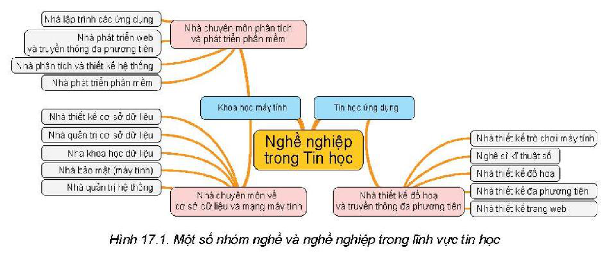

<!-- pdf:89 -->

# BÀI 17: TIN HỌC VÀ THẾ GIỚI NGHỀ NGHIỆP

## 🎯 Sau bài học này em sẽ:

- Trình bày được công việc đặc thù và sản phẩm chính của người làm tin học trong ít nhất ba nhóm nghề.
- Nêu và giải thích được ý kiến cá nhân (thích hay không thích,...) về một nhóm nghề nào đó.
- Nhận biết được đặc trưng cơ bản của nhóm nghề thuộc hướng Tin học ứng dụng và nhóm nghề thuộc hướng Khoa học máy tính.
- Tìm hiểu được (thông qua Internet và những kênh thông tin khác) công việc ở một số doanh nghiệp, công ti có sử dụng nhân lực thuộc các nhóm ngành đã được giới thiệu.
- Giải thích được cả nam và nữ đều có thể thích hợp với các ngành nghề trong lĩnh vực tin học.

## 🔴 Khởi động

> An, Minh và Khoa trao đổi về một dự án mà các bạn dự định thực hiện.
>
> *Khoa:* Tớ sẽ phác thảo một kịch bản để các bạn góp ý và chuyển kịch bản đó thành một phần mềm trò chơi trên máy tính.
>
> *Minh:* Làm thế nào để tạo nhân vật, trang phục, phong cảnh cho trò chơi?
>
> *An:* Bạn chỉ cần mô tả nhân vật, trang phục, phong cảnh, còn việc tạo ra các hình ảnh đó trên máy tính thì yên tâm, đã có tớ.
>
> *Minh:* Thật là tuyệt. Tớ sẽ đưa trò chơi lên Internet, duy trì sự hoạt động của nó và tập hợp các ý kiến phản hồi để cải tiến.
>
> Chúng ta hãy cùng tìm hiểu xem sở trường của mỗi bạn có thể phát triển để trở thành một nghề trong tương lai được hay không nhé.

## 1. NGHỀ NGHIỆP TRONG TIN HỌC

> **Hoạt động 1: Công việc đặc thù của người làm tin học**
>
> Đoạn hội thoại ở hoạt động Khởi động cho biết ba bạn An, Minh, Khoa đang dự định cùng nhau làm một trò chơi trên máy tính. Mỗi bạn đều có sở thích và khả năng riêng. Em hãy trả lời các câu hỏi sau:
> 1. Ba người bạn của chúng ta, sau này có thể làm những nghề nghiệp gì trong lĩnh vực tin học?
> 2. Đặc thù công việc và sản phẩm chính của những nghề nghiệp đó là gì?

<!-- pdf:90 -->

Trong dự án làm phần mềm trò chơi, ba bạn An, Minh và Khoa, mỗi bạn nhận một việc. Khoa tạo ra kịch bản và chuyển kịch bản đó thành phần mềm trò chơi trên máy tính. Hình ảnh các nhân vật và phong cảnh trong trò chơi được An tạo ra bằng phần mềm đồ hoạ. Minh sẽ đưa trò chơi lên Internet, theo dõi và thống kê ý kiến của người chơi. Khả năng và sở thích của các bạn An, Minh, Khoa đều có thể phát triển để được xã hội chấp nhận, tạo ra thu nhập cho mỗi bạn, trở thành nghề nghiệp. Chẳng hạn:

- Khoa có thể làm một nghề thuộc nhóm các **nhà chuyên môn về phân tích và phát triển phần mềm**. Những người làm việc trong lĩnh vực này nghiên cứu, phân tích các thành phần của hệ thống thông tin; thiết lập mục tiêu và các đặc điểm kĩ thuật của phần mềm; thiết kế, phát triển, thử nghiệm và bảo trì phần mềm; kiểm tra và tư vấn cải thiện hệ thống thông tin nhằm đáp ứng các yêu cầu cụ thể.
- An có thể trở thành **nhà thiết kế đồ hoạ**, một nghề thuộc nhóm các **nhà thiết kế đồ họa và truyền thông đa phương tiện**. Công việc của nhóm nghề này là thiết kế nội dung để truyền đạt thông tin dưới hình thức hình ảnh, âm thanh, hoạt hình, video và các phương tiện nghe nhìn khác để sử dụng trong các trò chơi máy tính, phim ảnh, video âm nhạc, phương tiện in ấn và quảng cáo,...
- Minh có thể trở thành một **nhà quản trị hệ thống**, một nghề thuộc nhóm các **nhà chuyên môn về cơ sở dữ liệu và mạng máy tính**. Nhóm nghề này có nhiệm vụ thiết kế, xây dựng, tích hợp và triển khai các hệ thống cơ sở dữ liệu; thiết lập chính sách và triển khai các kế hoạch bảo mật dữ liệu; thiết kế, xây dựng, cấu hình và quản trị mạng máy tính;...

Trong những nhóm nghề trên, có những công việc đòi hỏi nghiên cứu khoa học về hệ thống máy tính, về thuật toán và cách biểu diễn thuật toán trong máy tính; sử dụng các mô hình toán học tạo ra những cách mới để biểu diễn, xử lí và trao đổi thông tin trong môi trường số. Đó là những **nhóm nghề thuộc hướng Khoa học máy tính** như nhà chuyên môn về phân tích và phát triển phần mềm và nhà chuyên môn về cơ sở dữ liệu và mạng máy tính.

Những nhóm nghề không đòi hỏi nghiên cứu chuyên sâu về lí thuyết khoa học máy tính mà công việc chủ yếu là sử dụng phương tiện và công cụ công nghệ thông tin để giải quyết các vấn đề thực tế trong các lĩnh vực khác như y tế, giáo dục, thương mại, truyền thông,... là những **nhóm nghề thuộc hướng Tin học ứng dụng** như nhà thiết kế đồ hoạ và truyền thông đa phương tiện. Sơ đồ trong Hình 17.1 mô tả một số nhóm nghề và định hướng của những nhóm nghề đó.



*Hình 17.1. Một số nhóm nghề và nghề nghiệp trong lĩnh vực tin học*

```text
Nghề nghiệp trong Tin học:
1. Hướng Khoa học máy tính:
   - Nhà chuyên môn phân tích và phát triển phần mềm:
     + Nhà lập trình các ứng dụng
     + Nhà phát triển web và truyền thông đa phương tiện
     + Nhà phân tích và thiết kế hệ thống
     + Nhà phát triển phần mềm
   - Nhà chuyên môn về cơ sở dữ liệu và mạng máy tính:
     + Nhà thiết kế cơ sở dữ liệu
     + Nhà quản trị cơ sở dữ liệu
     + Nhà khoa học dữ liệu
     + Nhà bảo mật (máy tính)
     + Nhà quản trị hệ thống
2. Hướng Tin học ứng dụng:
   - Nhà thiết kế đồ hoạ và truyền thông đa phương tiện:
     + Nhà thiết kế trò chơi máy tính
     + Nghệ sĩ kĩ thuật số
     + Nhà thiết kế đồ hoạ
     + Nhà thiết kế đa phương tiện
     + Nhà thiết kế trang web
```

<!-- pdf:91 -->

> - Những nhóm nghề thuộc hướng Khoa học máy tính có đặc điểm chung là nghiên cứu lí thuyết về thông tin và thuật toán, tạo ra những cách mới để biểu diễn, xử lí và trao đổi thông tin trong môi trường số.
> - Những nhóm nghề thuộc hướng Tin học ứng dụng không đòi hỏi nghiên cứu chuyên sâu về lí thuyết khoa học máy tính mà chủ yếu là sử dụng phương tiện và công cụ công nghệ thông tin để giải quyết các vấn đề thực tế trong các lĩnh vực khác.

> ❓ **Câu hỏi**
>
> Sau khi tìm hiểu về nghề nghiệp trong lĩnh vực Tin học, em nhận thấy ý thích và khả năng của mình phù hợp với nhóm nghề nào? Tại sao?

## 2. TIN HỌC VÀ THẾ GIỚI NGHỀ NGHIỆP

> **Hoạt động 2: Tìm việc**
>
> Em hãy sử dụng những công cụ trên Internet như máy tìm kiếm, hội thoại thông minh, website của tổ chức, doanh nghiệp,... để tìm hiểu công việc ở một số doanh nghiệp và thực hiện các yêu cầu sau:
> 1. Nêu tên một doanh nghiệp hoạt động trong lĩnh vực tin học. Những công việc tin học nào phù hợp nhất với doanh nghiệp đó?
> 2. Nêu tên một doanh nghiệp sử dụng lao động tin học nhưng hoạt động trong lĩnh vực khác. Những công việc tin học được sử dụng trong doanh nghiệp đó là gì?

Tin học xuất hiện trong nhiều cơ quan, tổ chức, doanh nghiệp,... bao gồm cả những doanh nghiệp hoạt động trong lĩnh vực tin học và những doanh nghiệp hoạt động trong lĩnh vực khác.

<!-- term: Công việc theo hướng Khoa học máy tính ở doanh nghiệp -->
Những công việc theo hướng Khoa học máy tính tập trung nhiều hơn ở các doanh nghiệp, công ti hoạt động trong lĩnh vực tin học, với các công việc như: phân tích, thiết kế hệ thống thông tin; xây dựng giải pháp kĩ thuật và công nghệ xử lí thông tin; phát triển các ứng dụng trí tuệ nhân tạo; nghiên cứu an ninh mạng và bảo mật thông tin;...

<!-- term: Công việc theo hướng Tin học ứng dụng ở cơ quan, doanh nghiệp -->
Những công việc theo hướng Tin học ứng dụng xuất hiện ở hầu hết các cơ quan, tổ chức, doanh nghiệp với mức độ khác nhau, nhưng tập trung cao hơn ở những doanh nghiệp khai thác công nghệ thông tin, tạo ra giá trị mới trong kinh doanh như: quản lí thông tin và giao dịch khách hàng; thương mại điện tử; cung cấp dịch vụ phát thanh, truyền hình và báo điện tử; cung ứng dịch vụ đa phương tiện phục vụ quảng cáo, giải trí, truyền thông;...

> **Hoạt động 3: Nữ giới và tin học**
>
> Bạn An đặt câu hỏi: “Những nghề liên quan đến tin học có phù hợp với nữ giới không?”. Em hãy giúp bạn An trả lời câu hỏi đó.

<!-- pdf:92 -->

Có những định kiến cho rằng nữ giới gặp nhiều khó khăn khi làm việc trong lĩnh vực tin học do bị kì thị giới tính, không nhận được những lợi ích tương xứng với công sức. Ngoài ra, họ còn phải đối mặt với áp lực gia đình và xã hội khi làm việc trong một ngành nghề đầy cạnh tranh và thay đổi.

<!-- term: Nữ giới trong lĩnh vực tin học -->
Tuy nhiên, trên thực tế, nữ giới đóng vai trò quan trọng trong phát triển công nghệ. Đó là do họ có những ưu thế như khả năng ghi nhớ tốt, cẩn thận, chu đáo, giao tiếp tốt và chịu được áp lực lớn. Nữ giới cũng giúp gia tăng tính đa dạng và sáng kiến cho công việc.

<!-- term: Nữ giới trong lĩnh vực tin học -->
Ở Việt Nam, nữ giới làm việc trong lĩnh vực tin học cũng có cơ hội phát triển bản thân nhanh chóng và có mức lương cao, được tôn trọng và khuyến khích phát huy năng lực như nam giới. Những công việc tin học phù hợp với nữ giới có thể kể đến là: thiết kế đồ hoạ, truyền thông đa phương tiện, quản trị web, kiểm thử phần mềm, phân tích dữ liệu,...

> - Không chỉ những doanh nghiệp tin học mà nhiều doanh nghiệp khác cũng cần lao động tin học, theo cả hai hướng Khoa học máy tính và Tin học ứng dụng.
> - Mọi người, không phân biệt giới tính đều có cơ hội tiếp cận các nghề nghiệp trong lĩnh vực tin học theo sở thích, năng lực và nhu cầu của mình.

> ❓ **Câu hỏi**
>
> Em hãy chọn phát biểu đúng.
> A. Nam giới làm những nghề như lập trình ứng dụng hay phân tích thiết kế hệ thống tốt hơn nữ giới do họ có tư duy lôgic tốt hơn.
> B. Nữ giới làm những nghề như quản trị hệ thống hay quản trị cơ sở dữ liệu tốt hơn nam giới do họ cẩn thận hơn.
> C. Lựa chọn nghề nghiệp trong lĩnh vực tin học phù hợp với giới tính sẽ đem lại hiệu quả lao động cao hơn.
> D. Cả nam và nữ đều có thể chọn nghề trong lĩnh vực tin học phù hợp với năng lực và nhu cầu của mình.

## ✏️ Luyện tập

1. Hãy kể tên hai công việc liên quan đến nghề nghiệp tin học trong lĩnh vực khác như y tế, giáo dục, nông nghiệp, xây dựng, giao thông,...
2. Em hãy nêu ví dụ về một nghề tin học mà theo em, lao động nữ có ưu thế. Giải thích cho câu trả lời của mình.

## 🚀 Vận dụng

1. Hãy kể về một nghề tin học mà em quan tâm. Nghề nghiệp đó theo định hướng Khoa học máy tính hay Tin học ứng dụng?
2. Em cần bổ sung những kiến thức hay kĩ năng nào để có thể trở thành người lao động trong nghề nghiệp mà em quan tâm ở câu 1?

## 📷 Danh sách hình trong bài

| Mã hình | Trang PDF | Trang sách | Chú thích |
| --- | :---: | :---: | --- |
| H9-tin_hoc-b17-01 | 90 | 88 | Hình 17.1. Một số nhóm nghề và nghề nghiệp trong lĩnh vực tin học |
