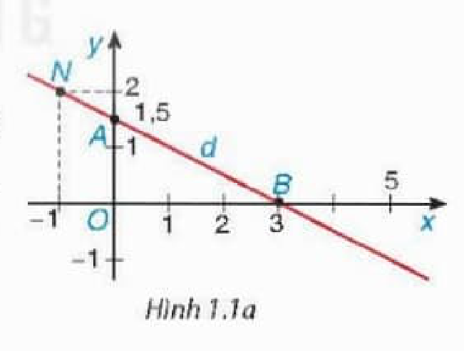
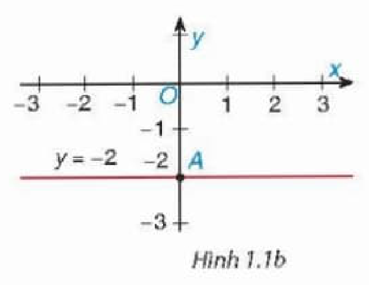
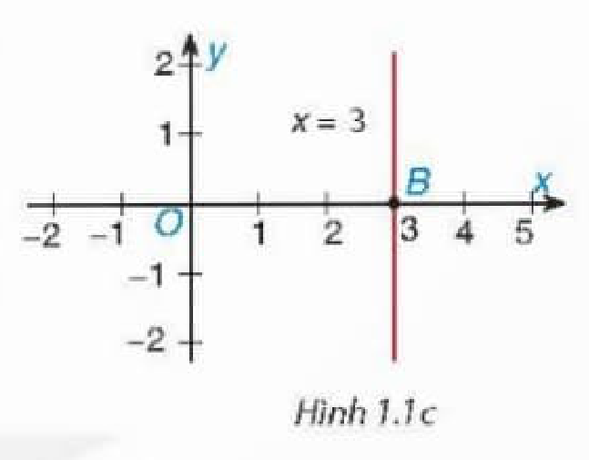
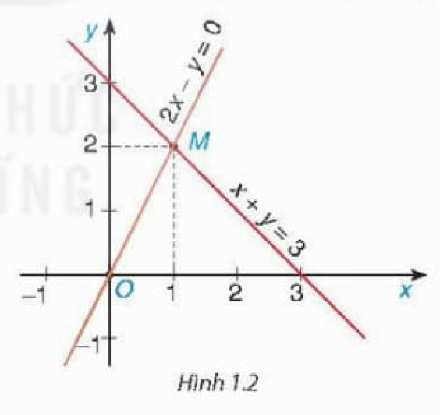

<!-- pdf:7 -->
<!-- Phần giới thiệu đầu Chương I (nửa trên trang PDF 7): ĐẠI SỐ — CHƯƠNG I: PHƯƠNG TRÌNH VÀ HỆ HAI PHƯƠNG TRÌNH BẬC NHẤT HAI ẨN -->

Khi giải bài toán bằng cách lập phương trình, chúng ta dùng một chữ cái (thường là $x$) để thay thế cho một đại lượng chưa biết và thiết lập phương trình một ẩn. Tuy nhiên, có những bài toán có nhiều hơn một đại lượng chưa biết. Khi đó ta cũng có thể làm tương tự. Chẳng hạn, chọn hai chữ cái ($x$ và $y$) thay thế cho hai đại lượng chưa biết. Nhưng khi đó ta cần thiết lập cái gì và làm như thế nào?

Chương này sẽ giúp các em hiểu được những nội dung cơ bản nhất liên quan đến vấn đề đó.

# BÀI 1: KHÁI NIỆM PHƯƠNG TRÌNH VÀ HỆ HAI PHƯƠNG TRÌNH BẬC NHẤT HAI ẨN

## 🔤 Khái niệm, thuật ngữ

- Phương trình và hệ hai phương trình bậc nhất hai ẩn
- Nghiệm của phương trình, hệ hai phương trình bậc nhất hai ẩn

## 🎯 Kiến thức, kĩ năng

- Nhận biết phương trình, hệ hai phương trình bậc nhất hai ẩn.
- Nhận biết nghiệm của phương trình và hệ hai phương trình bậc nhất hai ẩn.

## 🔴 Mở đầu

Xét bài toán cổ sau:

Quýt, cam mười bảy quả tươi
Đem chia cho một trăm người cùng vui.
Chia ba mỗi quả quýt rồi,
Còn cam, mỗi quả chia mười vừa xinh.
Trăm người, trăm miếng ngọt lành.
Quýt, cam mỗi loại tính rành là bao?

Trong bài toán này có hai đại lượng chưa biết (số cam và số quýt). Vậy ta có thể giải bài toán đó tương tự “giải bài toán bằng cách lập phương trình” được hay không? Để trả lời câu hỏi này, trước hết chúng ta cần tìm hiểu về phương trình và hệ hai phương trình bậc nhất hai ẩn.

<!-- pdf:8 -->

## 1. PHƯƠNG TRÌNH BẬC NHẤT HAI ẨN

**Khái niệm phương trình bậc nhất hai ẩn**

Gọi $x$ là số cam, $y$ là số quýt (với $x, y$ nguyên dương).

**HĐ1:** Câu “Quýt, cam mười bảy quả tươi” có nghĩa là tổng số cam và số quýt là $17$. Hãy viết hệ thức với hai biến $x$ và $y$ biểu thị giả thiết này.

**HĐ2:** Tương tự, hãy viết hệ thức với hai biến $x$ và $y$ biểu thị giả thiết cho bởi các câu thơ thứ ba, thứ tư và thứ năm.

Các hệ thức nhận được trong HĐ1, HĐ2 là những ví dụ về phương trình bậc nhất hai ẩn.

> - **Phương trình bậc nhất hai ẩn** $x$ và $y$ là hệ thức dạng
>   $ax + by = c, \quad (1)$
>   trong đó $a, b$ và $c$ là các số đã biết ($a \ne 0$ hoặc $b \ne 0$).
> - Nếu tại $x = x_0$ và $y = y_0$ ta có $ax_0 + by_0 = c$ là một khẳng định đúng thì cặp số $(x_0; y_0)$ được gọi là một **nghiệm** của phương trình $(1)$.

**Ví dụ 1**

a) Trong các hệ thức $4x + 3y = 5$; $0x + y = -1$; $0x + 0y = 3$, hệ thức nào là phương trình bậc nhất hai ẩn? Hệ thức nào không là phương trình bậc nhất hai ẩn?

b) Trong các cặp số $(2; -1)$ và $(1; 0)$, cặp số nào là nghiệm của phương trình $4x + 3y = 5$?

**Giải**

a) Cả ba hệ thức đều có dạng $ax + by = c$. Nhưng chỉ có hai hệ thức $4x + 3y = 5$ và $0x + y = -1$ thoả mãn điều kiện $a \ne 0$ hoặc $b \ne 0$ nên là phương trình bậc nhất hai ẩn.

Hệ thức $0x + 0y = 3$ có $a = b = 0$, không thoả mãn điều kiện trên nên hệ thức đó không phải là phương trình bậc nhất hai ẩn.

b) Cặp số $(2; -1)$ là một nghiệm của phương trình $4x + 3y = 5$, vì

$4 \cdot 2 + 3 \cdot (-1) = 5.$

Cặp số $(1; 0)$ *không* là nghiệm của phương trình $4x + 3y = 5$, vì

$4 \cdot 1 + 3 \cdot 0 = 4 \ne 5.$

**Luyện tập 1**

Hãy viết một phương trình bậc nhất hai ẩn và chỉ ra một nghiệm của nó.

<!-- pdf:9 -->

**Ví dụ 2:** Giả sử $(x; y)$ là nghiệm của phương trình bậc nhất hai ẩn $x + 2y = 5$.

a) Hoàn thành bảng sau đây:

| $x$ | $-2$ | $-1$ | $0$ | $?$ | $?$ |
| --- | :---: | :---: | :---: | :---: | :---: |
| $y$ | $?$ | $?$ | $?$ | $1$ | $2$ |

Từ đó suy ra $5$ nghiệm của phương trình đã cho.

b) Tính $y$ theo $x$. Từ đó cho biết phương trình đã cho có bao nhiêu nghiệm?

**Giải**

a) Ta có:

| $x$ | $-2$ | $-1$ | $0$ | $3$ | $1$ |
| --- | :---: | :---: | :---: | :---: | :---: |
| $y$ | $\dfrac{7}{2}$ | $3$ | $\dfrac{5}{2}$ | $1$ | $2$ |

Vậy $5$ nghiệm của phương trình đã cho là: $\left(-2; \dfrac{7}{2}\right)$, $(-1; 3)$, $\left(0; \dfrac{5}{2}\right)$, $(3; 1)$, $(1; 2)$.

b) Ta có $y = \dfrac{5 - x}{2}$. Với mỗi giá trị $x$ tuỳ ý cho trước, ta luôn tìm được một giá trị $y$ tương ứng. Do đó phương trình đã cho có vô số nghiệm.

> **Chú ý.** Mỗi phương trình bậc nhất hai ẩn đều có vô số nghiệm. Ví dụ dưới đây trình bày cách viết các nghiệm và biểu diễn hình học tất cả các nghiệm của một phương trình bậc nhất hai ẩn.

**Ví dụ 3:** Viết nghiệm và biểu diễn hình học tất cả các nghiệm của mỗi phương trình bậc nhất hai ẩn sau:

a) $x + 2y = 3$; $\qquad$ b) $0x + y = -2$; $\qquad$ c) $x + 0y = 3$.

**Giải**

a) Xét phương trình $x + 2y = 3$. $\quad (1)$

Ta viết $(1)$ dưới dạng $y = -0,5x + 1,5$. Mỗi cặp số $(x; -0,5x + 1,5)$ với $x \in \mathbb{R}$ tuỳ ý, là một nghiệm của $(1)$. Khi đó ta nói phương trình $(1)$ có **nghiệm (tổng quát)** là:

$(x; -0,5x + 1,5)$ với $x \in \mathbb{R}$ tuỳ ý.

*Hình 1.1a*

Mỗi nghiệm này là toạ độ của một điểm thuộc đường thẳng $y = -0,5x + 1,5$. Ta cũng gọi đường thẳng này là đường thẳng $d\colon x + 2y = 3$.

Để vẽ đường thẳng $d$, ta chỉ cần xác định hai điểm tuỳ ý của nó, chẳng hạn $A(0; 1,5)$ và $B(3; 0)$ rồi vẽ đường thẳng đi qua hai điểm đó (H.1.1a).

b) Xét phương trình $0x + y = -2$. $\quad (2)$

Ta viết gọn $(2)$ thành $y = -2$. Phương trình $(2)$ có nghiệm là $(x; -2)$ với $x \in \mathbb{R}$ tuỳ ý.
<!-- ocr-ok: đã đối chiếu ảnh trang PDF 9, câu ngắn chứa nhiều kí hiệu toán học trong LaTeX -->

<!-- pdf:10 -->

Mỗi nghiệm này là toạ độ của một điểm thuộc đường thẳng song song với trục hoành và cắt trục tung tại điểm $(0; -2)$. Ta gọi đó là *đường thẳng* $y = -2$ (H.1.1b).

*Hình 1.1b*

c) Xét phương trình $x + 0y = 3$. $\quad (3)$

Ta viết gọn $(3)$ thành $x = 3$. Phương trình $(3)$ có nghiệm là $(3; y)$ với $y \in \mathbb{R}$ tuỳ ý.
<!-- ocr-ok: đã đối chiếu ảnh ảnh trang PDF 10, câu ngắn chứa nhiều kí hiệu toán học trong LaTeX -->

Mỗi nghiệm này là toạ độ của một điểm thuộc đường thẳng song song với trục tung và cắt trục hoành tại điểm $(3; 0)$. Ta gọi đó là *đường thẳng* $x = 3$ (H.1.1c).

*Hình 1.1c*

> **Nhận xét.** Trong mặt phẳng toạ độ, tập hợp các điểm có toạ độ $(x; y)$ thoả mãn phương trình bậc nhất hai ẩn $ax + by = c$ là một đường thẳng. Đường thẳng đó gọi là **đường thẳng $ax + by = c$**.

**Luyện tập 2**

Viết nghiệm và biểu diễn hình học tất cả các nghiệm của mỗi phương trình bậc nhất hai ẩn sau:

a) $2x - 3y = 5$; $\qquad$ b) $0x + y = 3$; $\qquad$ c) $x + 0y = -2$.

## 2. HỆ HAI PHƯƠNG TRÌNH BẬC NHẤT HAI ẨN

**Khái niệm hệ hai phương trình bậc nhất hai ẩn và nghiệm của nó**

Trong HĐ1 và HĐ2, bài toán mở đầu dẫn đến hai phương trình bậc nhất hai ẩn là $x + y = 17$ và $3x + 10y = 100$. Để giải bài toán, ta cần tìm các giá trị của $x$ và $y$ đồng thời thoả mãn cả hai phương trình này. Khi đó ta có hệ phương trình $\begin{cases} x + y = 17 \\ 3x + 10y = 100. \end{cases}$

Một cách tổng quát ta có khái niệm sau:

> 1. Một cặp gồm hai phương trình bậc nhất hai ẩn $ax + by = c$ và $a'x + b'y = c'$ được gọi là một **hệ hai phương trình bậc nhất hai ẩn**. Ta thường viết hệ phương trình đó dưới dạng:
>    $\begin{cases} ax + by = c \\ a'x + b'y = c'. \end{cases} \quad (*)$
> 2. Mỗi cặp số $(x_0; y_0)$ được gọi là một **nghiệm của hệ** $(*)$ nếu nó đồng thời là nghiệm của cả hai phương trình của hệ $(*)$.

> **Pi:** Mỗi nghiệm của hệ $(*)$ chính là một **nghiệm chung** của hai phương trình của hệ $(*)$.

<!-- pdf:11 -->

**Ví dụ 4**

Trong các hệ phương trình sau, hệ nào *không* phải là hệ hai phương trình bậc nhất hai ẩn, vì sao?

a) $\begin{cases} 2x = -6 \\ 5x + 4y = 1; \end{cases} \qquad$ b) $\begin{cases} x + 2y = -3 \\ 0x + 0y = 1; \end{cases} \qquad$ c) $\begin{cases} 3x - y = 1 \\ x + y = 3. \end{cases}$

**Giải**

Hệ phương trình b) không phải là hệ hai phương trình bậc nhất hai ẩn, vì phương trình thứ hai của hệ là $0x + 0y = 1$ không phải là phương trình bậc nhất hai ẩn.

**Ví dụ 5**

Giải thích tại sao cặp số $(1; 2)$ là một nghiệm của hệ phương trình $\begin{cases} 2x - y = 0 \\ x + y = 3. \end{cases}$

**Giải**

Ta thấy khi $x = 1$ và $y = 2$ thì:
<!-- ocr-ok: đã đối chiếu ảnh trang PDF 11, OCR dính chữ "x= 1và" -->

- $2x - y = 2 \cdot 1 - 2 = 0$ nên $(1; 2)$ là nghiệm của phương trình thứ nhất;
- $x + y = 1 + 2 = 3$ nên $(1; 2)$ là nghiệm của phương trình thứ hai.

Vậy $(1; 2)$ là nghiệm chung của hai phương trình, nghĩa là $(1; 2)$ là một nghiệm của hệ phương trình đã cho.

> **Chú ý**
>
> Trong Ví dụ 5, cặp số $(1; 2)$ là nghiệm của hệ phương trình đã cho có nghĩa là điểm $M(1; 2)$ vừa thuộc đường thẳng $d_1\colon 2x - y = 0$, vừa thuộc đường thẳng $d_2\colon x + y = 3$. Vậy $M$ là giao điểm của hai đường thẳng $d_1$ và $d_2$ (H.1.2).

*Hình 1.2*

**Luyện tập 3**

Trong hai cặp số $(0; -2)$ và $(2; -1)$, cặp số nào là nghiệm của hệ phương trình

$\begin{cases} x - 2y = 4 \\ 4x + 3y = 5 \end{cases}$ ?

**Vận dụng**

Xét bài toán cổ trong *Tình huống mở đầu*. Gọi $x$ là số cam, $y$ là số quýt cần tính ($x, y \in \mathbb{N}^*$), ta có hệ phương trình bậc nhất hai ẩn sau:

$\begin{cases} x + y = 17 \\ 10x + 3y = 100. \end{cases}$

<!-- pdf:12 -->

Trong hai cặp số $(10; 7)$ và $(7; 10)$, cặp số nào là nghiệm của hệ phương trình trên? Từ đó cho biết một phương án về số cam và số quýt thoả mãn yêu cầu của bài toán cổ.

## BÀI TẬP

1.1. Phương trình nào sau đây là phương trình bậc nhất hai ẩn, vì sao?

a) $5x - 8y = 0$; $\qquad$ b) $4x + 0y = -2$; $\qquad$ c) $0x + 0y = 1$; $\qquad$ d) $0x - 3y = 9$.

1.2. a) Tìm giá trị thích hợp thay cho dấu "$?$" trong bảng sau rồi cho biết $6$ nghiệm của phương trình $2x - y = 1$:

| $x$ | $-1$ | $-0,5$ | $0$ | $0,5$ | $1$ | $2$ |
| --- | :---: | :---: | :---: | :---: | :---: | :---: |
| $y = 2x - 1$ | $?$ | $?$ | $?$ | $?$ | $?$ | $?$ |

b) Viết nghiệm tổng quát của phương trình đã cho.

1.3. Viết nghiệm và biểu diễn hình học tất cả các nghiệm của mỗi phương trình bậc nhất hai ẩn sau:

a) $2x - y = 3$; $\qquad$ b) $0x + 2y = -4$; $\qquad$ c) $3x + 0y = 5$.

1.4. a) Hệ phương trình $\begin{cases} 2x = -6 \\ 5x + 4y = 1 \end{cases}$ có là một hệ hai phương trình bậc nhất hai ẩn không, vì sao?

b) Cặp số $(-3; 4)$ có là một nghiệm của hệ phương trình đó hay không, vì sao?

1.5. Cho các cặp số $(-2; 1)$, $(0; 2)$, $(1; 0)$, $(1,5; 3)$, $(4; -3)$ và hai phương trình

$5x + 4y = 8, \quad (1)$

$3x + 5y = -3. \quad (2)$

Trong các cặp số đã cho:

a) Những cặp số nào là nghiệm của phương trình $(1)$?

b) Cặp số nào là nghiệm của hệ hai phương trình gồm $(1)$ và $(2)$?

c) Vẽ hai đường thẳng $5x + 4y = 8$ và $3x + 5y = -3$ trên cùng một mặt phẳng toạ độ để minh hoạ kết luận ở câu b.

## 📷 Danh sách hình trong bài

| Mã hình | Trang PDF | Vị trí trong bài | Chú thích gốc |
| --- | :---: | --- | --- |
| H9-toan-b01-01 | 9 | Mục 1, Ví dụ 3 | Hình 1.1a |
| H9-toan-b01-02 | 10 | Mục 1, Ví dụ 3 | Hình 1.1b |
| H9-toan-b01-03 | 10 | Mục 1, Ví dụ 3 | Hình 1.1c |
| H9-toan-b01-04 | 11 | Mục 2, Chú ý | Hình 1.2 |
