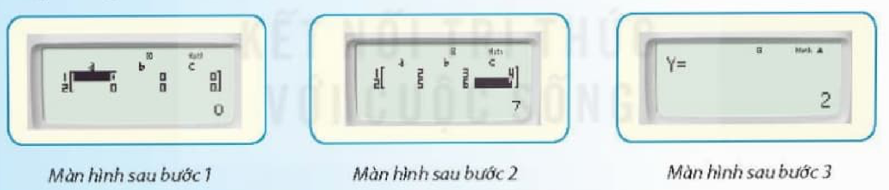
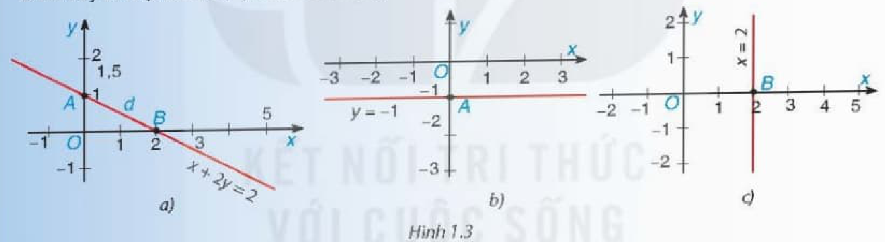
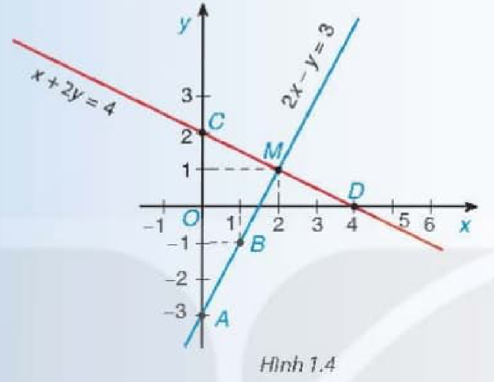
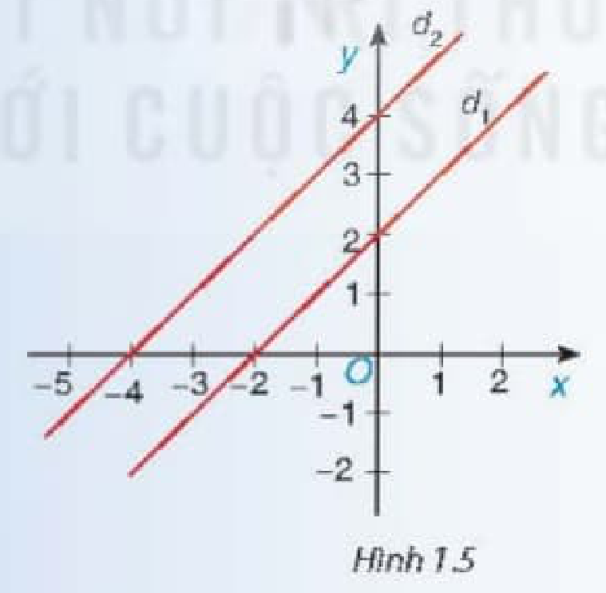

<!-- pdf:13 -->

# BÀI 2: GIẢI HỆ HAI PHƯƠNG TRÌNH BẬC NHẤT HAI ẨN

## 🔤 Khái niệm, thuật ngữ

- Phương pháp thế
- Phương pháp cộng đại số

## 🎯 Kiến thức, kĩ năng

Giải hệ hai phương trình bậc nhất hai ẩn bằng phương pháp thế, phương pháp cộng đại số hoặc sử dụng máy tính cầm tay.

## 🔴 Mở đầu

Một mảnh vườn được đánh thành nhiều luống, mỗi luống trồng cùng một số cây cải bắp. Hãy tính số cây cải bắp được trồng trên mảnh vườn đó, biết rằng:

- Nếu tăng thêm $8$ luống, nhưng mỗi luống trồng ít đi $3$ cây cải bắp thì số cải bắp của cả vườn sẽ ít đi $108$ cây;
- Nếu giảm đi $4$ luống, nhưng mỗi luống trồng tăng thêm $2$ cây thì số cải bắp cả vườn sẽ tăng thêm $64$ cây.

## 1. PHƯƠNG PHÁP THẾ

**Làm quen với phương pháp thế**

**HĐ1:** Cho hệ phương trình $\begin{cases} x + y = 3 \\ 2x - 3y = 1. \end{cases}$ Giải hệ phương trình theo hướng dẫn sau:

1. Từ phương trình thứ nhất, biểu diễn $y$ theo $x$ rồi thế vào phương trình thứ hai để được một phương trình với một ẩn $x$. Giải phương trình một ẩn đó để tìm giá trị của $x$.

2. Sử dụng giá trị tìm được của $x$ để tìm giá trị của $y$ rồi viết nghiệm của hệ phương trình đã cho.

<!-- term: Phương pháp thế -->
> **Cách giải hệ phương trình bằng phương pháp thế:**
>
> *Bước 1.* Từ một phương trình của hệ, biểu diễn một ẩn theo ẩn kia rồi thế vào phương trình còn lại của hệ để được phương trình chỉ còn chứa một ẩn.
>
> *Bước 2.* Giải phương trình một ẩn vừa nhận được, từ đó suy ra nghiệm của hệ đã cho.

**Ví dụ 1:** Giải hệ phương trình $\begin{cases} 2x - y = 3 \\ x + 2y = 4 \end{cases}$ bằng phương pháp thế.

**Giải**

Từ phương trình thứ nhất của hệ ta có $y = 2x - 3$. Thế vào phương trình thứ hai của hệ, ta được $x + 2(2x - 3) = 4$ hay $5x - 6 = 4$, suy ra $x = 2$.

Từ đó $y = 2 \cdot 2 - 3 = 1$. Vậy hệ phương trình đã cho có nghiệm là $(2; 1)$.

<!-- pdf:14 -->

**Luyện tập 1**

Giải các hệ phương trình sau bằng phương pháp thế:

a) $\begin{cases} x - 3y = 2 \\ -2x + 5y = 1; \end{cases} \qquad$ b) $\begin{cases} 4x + y = -1 \\ 7x + 2y = -3. \end{cases}$

> **Pi:** Tuỳ theo hệ phương trình, ta có thể lựa chọn cách biểu diễn $x$ theo $y$ hoặc biểu diễn $y$ theo $x$.
<!-- ocr-ok: đã đối chiếu ảnh trang PDF 14, hộp bóng thoại của Pi ở lề phải -->

**Ví dụ 2**

Giải hệ phương trình $\begin{cases} x - y = -2 \\ 2x - 2y = 8 \end{cases}$ bằng phương pháp thế.

**Giải**

Từ phương trình thứ nhất ta có $x = y - 2$. Thế vào phương trình thứ hai, ta được

$2(y - 2) - 2y = 8$ hay $0y - 4 = 8$. $\quad (1)$

Do không có giá trị nào của $y$ thoả mãn hệ thức $(1)$ nên hệ phương trình đã cho vô nghiệm.

**Luyện tập 2**

Giải hệ phương trình $\begin{cases} -2x + y = 3 \\ 4x - 2y = -4 \end{cases}$ bằng phương pháp thế.

**Ví dụ 3**

Giải hệ phương trình $\begin{cases} -x + y = -2 \\ 3x - 3y = 6 \end{cases}$ bằng phương pháp thế.

**Giải**

Từ phương trình thứ nhất ta có $y = x - 2$. $\quad (2)$

Thế vào phương trình thứ hai, ta được $3x - 3(x - 2) = 6$ hay $0x = 0$. $\quad (3)$

Ta thấy mọi giá trị của $x$ đều thoả mãn $(3)$.

Với giá trị tuỳ ý của $x$, giá trị tương ứng của $y$ được tính bởi $(2)$.

Vậy hệ phương trình đã cho có nghiệm là $(x; x - 2)$ với $x \in \mathbb{R}$ tuỳ ý.

**Luyện tập 3**

Giải hệ phương trình $\begin{cases} x + 3y = -1 \\ 3x + 9y = -3 \end{cases}$ bằng phương pháp thế.

**Vận dụng 1**

Xét bài toán trong *tình huống mở đầu*. Gọi $x$ là số luống trong vườn, $y$ là số cây cải bắp trồng ở mỗi luống ($x, y \in \mathbb{N}^*$).

a) Lập hệ phương trình đối với hai ẩn $x, y$.

b) Giải hệ phương trình nhận được ở câu a để tìm câu trả lời cho bài toán.

<!-- pdf:15 -->

## 2. PHƯƠNG PHÁP CỘNG ĐẠI SỐ

**Làm quen với phương pháp cộng đại số**

**HĐ2:** Cho hệ phương trình $(\text{II}) \begin{cases} 2x + 2y = 3 \\ x - 2y = 6 \end{cases}$. Ta thấy hệ số của $y$ trong hai phương trình là hai số đối nhau (tổng của chúng bằng $0$). Từ đặc điểm đó, hãy giải hệ phương trình đã cho theo hướng dẫn sau:

1. Cộng từng vế của hai phương trình trong hệ để được phương trình một ẩn $x$. Giải phương trình này để tìm $x$.

2. Sử dụng giá trị $x$ tìm được, thay vào một trong hai phương trình của hệ để tìm giá trị của $y$ rồi viết nghiệm của hệ phương trình đã cho.

<!-- term: Phương pháp cộng đại số -->
> **Cách giải hệ phương trình bằng phương pháp cộng đại số:**
>
> Để giải một hệ hai phương trình bậc nhất hai ẩn *có hệ số của cùng một ẩn nào đó trong hai phương trình bằng nhau hoặc đối nhau*, ta có thể làm như sau:
>
> *Bước 1.* Cộng hay trừ từng vế của hai phương trình trong hệ để được phương trình chỉ còn chứa một ẩn.
>
> *Bước 2.* Giải phương trình một ẩn vừa nhận được, từ đó suy ra nghiệm của hệ phương trình đã cho.

**Ví dụ 4**

Giải hệ phương trình $\begin{cases} -2x + 5y = 12 \\ 2x + 3y = 4 \end{cases}$ bằng phương pháp cộng đại số.

**Giải**

Cộng từng vế hai phương trình ta được $8y = 16$, suy ra $y = 2$.

Thế $y = 2$ vào phương trình thứ hai ta được $2x + 3 \cdot 2 = 4$, hay $2x = -2$, suy ra $x = -1$.

Vậy hệ phương trình đã cho có nghiệm là $(-1; 2)$.

**Ví dụ 5**

Giải hệ phương trình $\begin{cases} 5x - 7y = 9 \\ 5x - 3y = 1 \end{cases}$ bằng phương pháp cộng đại số.

**Giải**

Trừ từng vế của hai phương trình, ta được $(5x - 5x) + (-7y + 3y) = 9 - 1$ hay $-4y = 8$, suy ra $y = -2$.

Thế $y = -2$ vào phương trình thứ nhất, ta được $5x - 7 \cdot (-2) = 9$ hay $5x + 14 = 9$, suy ra $x = -1$.

Vậy hệ phương trình đã cho có nghiệm là $(-1; -2)$.

<!-- pdf:16 -->

**Luyện tập 4**

Giải các hệ phương trình sau bằng phương pháp cộng đại số:

a) $\begin{cases} -4x + 3y = 0 \\ 4x - 5y = -8; \end{cases} \qquad$ b) $\begin{cases} 4x + 3y = 0 \\ x + 3y = 9. \end{cases}$

> **Chú ý.** Trường hợp trong hệ phương trình đã cho không có hai hệ số của cùng một ẩn bằng nhau hay đối nhau, ta có thể đưa về trường hợp đã xét bằng cách nhân hai vế của mỗi phương trình với một số thích hợp (khác $0$).

**Ví dụ 6**

Giải hệ phương trình $\begin{cases} 3x + 2y = 7 \\ 2x - 3y = -4 \end{cases}$ bằng phương pháp cộng đại số.

**Giải**

Nhân hai vế của phương trình thứ nhất với $3$ và nhân hai vế của phương trình thứ hai với $2$, ta được:

$\begin{cases} 9x + 6y = 21 \\ 4x - 6y = -8. \end{cases}$

Cộng từng vế hai phương trình của hệ mới, ta được $13x = 13$ hay $x = 1$.

Thế $x = 1$ vào phương trình thứ nhất của hệ đã cho, ta có $3 \cdot 1 + 2y = 7$, suy ra $y = 2$.

Vậy hệ phương trình đã cho có nghiệm là $(1; 2)$.

**Luyện tập 5**

Giải hệ phương trình $\begin{cases} 4x + 3y = 6 \\ -5x + 2y = 4 \end{cases}$ bằng phương pháp cộng đại số.

**Ví dụ 7**

Giải hệ phương trình $\begin{cases} 3x - 5y = 2 \\ -6x + 10y = -4 \end{cases}$ bằng phương pháp cộng đại số.

**Giải**

Chia hai vế của phương trình thứ hai cho $2$, ta được hệ $\begin{cases} 3x - 5y = 2 \\ -3x + 5y = -2. \end{cases}$

Cộng từng vế hai phương trình của hệ mới ta có $0x + 0y = 0$. Hệ thức này luôn thoả mãn với các giá trị tuỳ ý của $x$ và $y$.

Với giá trị tuỳ ý của $x$, giá trị của $y$ được tính nhờ hệ thức $3x - 5y = 2$, suy ra $y = \dfrac{3}{5}x - \dfrac{2}{5}$.

Vậy hệ phương trình đã cho có nghiệm là $\left(x; \dfrac{3}{5}x - \dfrac{2}{5}\right)$ với $x \in \mathbb{R}$.

**Luyện tập 6**

Bằng phương pháp cộng đại số, giải hệ phương trình $\begin{cases} -0,5x + 0,5y = 1 \\ -2x + 2y = 8. \end{cases}$

<!-- pdf:17 -->

## 3. SỬ DỤNG MÁY TÍNH CẦM TAY ĐỂ TÌM NGHIỆM CỦA HỆ HAI PHƯƠNG TRÌNH BẬC NHẤT HAI ẨN

**Cách tìm nghiệm của hệ hai phương trình bậc nhất hai ẩn bằng máy tính cầm tay**

<!-- term: Tìm nghiệm của hệ hai phương trình bậc nhất hai ẩn bằng máy tính cầm tay -->
Muốn tìm nghiệm của hệ hai phương trình bậc nhất hai ẩn bằng máy tính cầm tay (MTCT), chúng ta cần sử dụng loại máy có chức năng này (thường có phím MODE). Trước hết ta phải viết hệ phương trình cần tìm nghiệm dưới dạng:

$\begin{cases} a_1x + b_1y = c_1 \\ a_2x + b_2y = c_2. \end{cases}$

Chẳng hạn để tìm nghiệm của hệ $\begin{cases} 2x + 3y - 4 = 0 \\ 5x + 6y - 7 = 0 \end{cases}$, ta viết nó dưới dạng $\begin{cases} 2x + 3y = 4 \\ 5x + 6y = 7 \end{cases}$.

Khi đó, ta có $a_1 = 2, b_1 = 3, c_1 = 4; a_2 = 5, b_2 = 6$ và $c_2 = 7$. Lần lượt thực hiện các bước sau (với máy tính thích hợp):

*Bước 1.* Vào chức năng giải hệ hai phương trình bậc nhất hai ẩn bằng cách nhấn các phím `MODE` `5` `1` (xem *màn hình sau bước 1*, con trỏ ở vị trí $a_1$).

*Bước 2.* Nhập các số $a_1 = 2, b_1 = 3, c_1 = 4; a_2 = 5, b_2 = 6$ và $c_2 = 7$ bằng cách nhấn:

`2` `=` `3` `=` `4` `=` `5` `=` `6` `=` `7` `=` (xem *màn hình sau bước 2*).
<!-- ocr-ok: đã đối chiếu ảnh trang PDF 17, dãy biểu tượng phím bấm máy tính cầm tay -->

*Bước 3.* Đọc kết quả: Sau khi kết thúc bước 2, nhấn `=`, màn hình cho $x = -1$; nhấn tiếp phím `=`), màn hình cho $y = 2$ (xem *màn hình sau bước 3*). Ta hiểu nghiệm của hệ phương trình là $(-1; 2)$.

*Màn hình sau bước 1 — Màn hình sau bước 2 — Màn hình sau bước 3*

> **Chú ý**
>
> 1. Muốn xoá số vừa mới nhập thì nhấn phím `AC`; muốn thay đổi số đã nhập ở một vị trí nào đó thì di chuyển con trỏ đến vị trí đó rồi nhập số mới.
>
> 2. Nhấn phím `▲` hay `▼` để chuyển đổi hiển thị các giá trị của $x$ và $y$ trong kết quả.
>
> 3. Nếu máy báo “Infinite Sol” thì hệ phương trình đã cho có vô số nghiệm. Nếu máy báo “No-Solution” thì hệ phương trình đã cho vô nghiệm.

**Thực hành:** Dùng MTCT thích hợp để tìm nghiệm của các hệ phương trình sau:

a) $\begin{cases} 2x + 3y = -4 \\ -3x - 7y = 13; \end{cases} \qquad$ b) $\begin{cases} 2x + 3y = 1 \\ -x - 1,5y = 1; \end{cases} \qquad$ c) $\begin{cases} 8x - 2y - 6 = 0 \\ 4x - y - 3 = 0. \end{cases}$

<!-- pdf:18 -->

**Vận dụng 2**

Thực hiện lần lượt các yêu cầu sau để tính số mililít dung dịch acid HCl nồng độ $20\%$ và số mililít dung dịch acid HCl nồng độ $5\%$ cần dùng để pha chế $2$ lít dung dịch acid HCl nồng độ $10\%$.

a) Gọi $x$ là số mililít dung dịch acid HCl nồng độ $20\%$, $y$ là số mililít dung dịch acid HCl nồng độ $5\%$ cần lấy. Hãy biểu thị qua $x$ và $y$:

- Thể tích của dung dịch acid HCl $10\%$ nhận được sau khi trộn lẫn hai dung dịch acid ban đầu.
- Tổng số gam acid HCl nguyên chất có trong hai dung dịch acid này.

b) Sử dụng kết quả ở câu a, hãy lập một hệ hai phương trình bậc nhất với hai ẩn là $x, y$. Giải hệ phương trình này để tính số mililít cần lấy của mỗi dung dịch acid HCl ở trên.

## BÀI TẬP

1.6. Giải các hệ phương trình sau bằng phương pháp thế:

a) $\begin{cases} x - y = 3 \\ 3x - 4y = 2; \end{cases} \qquad$ b) $\begin{cases} 7x - 3y = 13 \\ 4x + y = 2; \end{cases} \qquad$ c) $\begin{cases} 0,5x - 1,5y = 1 \\ -x + 3y = 2. \end{cases}$

1.7. Giải các hệ phương trình sau bằng phương pháp cộng đại số:

a) $\begin{cases} 3x + 2y = 6 \\ 2x - 2y = 14; \end{cases} \qquad$ b) $\begin{cases} 0,3x + 0,5y = 3 \\ 1,5x - 2y = 1,5; \end{cases} \qquad$ c) $\begin{cases} -2x + 6y = 8 \\ 3x - 9y = -12. \end{cases}$

1.8. Cho hệ phương trình $\begin{cases} 2x - y = -3 \\ -2m^2x + 9y = 3(m + 3) \end{cases}$, trong đó $m$ là số đã cho. Giải hệ phương trình trong mỗi trường hợp sau:

a) $m = -2$; $\qquad$ b) $m = -3$; $\qquad$ c) $m = 3$.

1.9. Dùng MTCT thích hợp để tìm nghiệm của các hệ phương trình sau:

a) $\begin{cases} 12x - 5y + 24 = 0 \\ -5x - 3y - 10 = 0; \end{cases} \qquad$ b) $\begin{cases} \dfrac{1}{3}x - y = \dfrac{2}{3} \\ x - 3y = 2; \end{cases}$

c) $\begin{cases} 3x - 2y = 1 \\ -x + \dfrac{2}{3}y = 0; \end{cases} \qquad$ d) $\begin{cases} \dfrac{4}{9}x - \dfrac{3}{5}y = 11 \\ \dfrac{2}{9}x + \dfrac{1}{5}y = -2. \end{cases}$

<!-- pdf:19 -->

## 💡 Em có biết?

*(Đọc thêm)*

**Giải hệ hai phương trình bậc nhất hai ẩn bằng phương pháp hình học**

**1. Đường thẳng $ax + by = c$**

Ta đã biết một phương trình bậc nhất hai ẩn luôn có vô số nghiệm; mỗi nghiệm là một cặp số $(x_0; y_0)$; mỗi cặp số lại có thể xem là toạ độ của một điểm trên mặt phẳng toạ độ $Oxy$. Vậy trên mặt phẳng toạ độ, các điểm mà toạ độ của chúng là các nghiệm của một phương trình bậc nhất hai ẩn có quan hệ với nhau như thế nào?

**Người ta đã chứng minh được rằng:** Trong mặt phẳng toạ độ $Oxy$, tập hợp tất cả các điểm có toạ độ thoả mãn phương trình bậc nhất hai ẩn $ax + by = c$ tạo nên một đường thẳng. Đường thẳng đó gọi là đường thẳng $ax + by = c$. Nếu kí hiệu đường thẳng đó là $\Delta$ thì ta viết $\Delta\colon ax + by = c$.

- Khi $a \ne 0$ và $b \ne 0$, đường thẳng $\Delta$ trùng với đồ thị hàm số $y = -\dfrac{a}{b}x + \dfrac{c}{b}$;
- Khi $a = 0$ và $b \ne 0$, phương trình $ax + by = c$ có thể đưa về dạng $y = m$ $\left(\text{với } m = \dfrac{c}{b}\right)$; $\Delta$ là đường thẳng song song với trục hoành và cắt trục tung tại điểm $(0; m)$;
- Khi $a \ne 0$ và $b = 0$, phương trình $ax + by = c$ có thể đưa về dạng $x = n$ $\left(\text{với } n = \dfrac{c}{a}\right)$; $\Delta$ là đường thẳng song song với trục tung và cắt trục hoành tại điểm $(n; 0)$.

Dưới đây là một số ví dụ (Hình 1.3a, b, c):
<!-- ocr-ok: đã đối chiếu ảnh trang PDF 19, OCR đọc sai chữ Hình 1.3a, b, c -->

*Hình 1.3*

**2. Giải hệ hai phương trình bậc nhất hai ẩn bằng hình học**

Ta đã biết, mỗi nghiệm của hệ phương trình bậc nhất hai ẩn

$\begin{cases} ax + by = c \\ a'x + b'y = c'. \end{cases} \quad (*)$

là một nghiệm chung của hai phương trình trong $(*)$. Nghiệm chung ấy tương ứng với điểm chung của hai đường thẳng $\Delta\colon ax + by = c$ và $\Delta'\colon a'x + b'y = c'$, tức là giao điểm của $\Delta$ và $\Delta'$. Do đó ta có thể giải hệ $(*)$ bằng cách vẽ hai đường thẳng $\Delta$ và $\Delta'$ rồi tìm toạ độ điểm chung của chúng.

Từ đó, ta thấy chỉ có thể xảy ra $3$ trường hợp:

1) $\Delta$ và $\Delta'$ cắt nhau (có một điểm chung). Hệ $(*)$ có một nghiệm duy nhất.

2) $\Delta$ và $\Delta'$ song song với nhau (không có điểm chung). Hệ $(*)$ vô nghiệm.

3) $\Delta$ và $\Delta'$ trùng nhau (mỗi điểm của $\Delta$ đều là điểm chung). Hệ $(*)$ có vô số nghiệm.

<!-- pdf:20 -->

**Ví dụ 1**

Để giải hệ phương trình $\begin{cases} 2x - y = 3 \\ x + 2y = 4 \end{cases}$, ta làm như sau (H.1.4):

- Vẽ đường thẳng $2x - y = 3$ qua hai điểm $A(0; -3)$ và $B(1; -1)$.
- Vẽ đường thẳng $x + 2y = 4$ qua hai điểm $C(0; 2)$ và $D(4; 0)$.
<!-- ocr-ok: đã đối chiếu ảnh trang PDF 20, câu chứa toạ độ các điểm trong LaTeX -->

Hai đường thẳng cắt nhau tại $M(2; 1)$ nên $(2; 1)$ là nghiệm duy nhất của hệ đã cho.

*Hình 1.4*

**Ví dụ 2**

Xét hệ phương trình $\begin{cases} -x + y = 2 \\ -2x + 2y = 8 \end{cases}$ ta thấy đường thẳng $d_1\colon -x + y = 2$ là đồ thị của hàm số $y = x + 2$; đường thẳng $d_2\colon -2x + 2y = 8$ là đồ thị của hàm số $y = x + 4$ (H.1.5).

Hai đường thẳng $d_1$ và $d_2$ phân biệt và có cùng hệ số góc là $1$ nên chúng song song với nhau.

Do đó, hệ phương trình đã cho vô nghiệm.

*Hình 1.5*

**Ví dụ 3**

Xét hệ phương trình $\begin{cases} -x + y = 2 \\ -2x + 2y = 4 \end{cases}$ ta thấy hai đường thẳng $-x + y = 2$ và $-2x + 2y = 4$ cùng là đồ thị của hàm số $y = x + 2$ nên chúng trùng nhau. Vậy hệ phương trình đã cho có vô số nghiệm.

## 📷 Danh sách hình trong bài

| Mã hình | Trang PDF | Vị trí trong bài | Chú thích gốc |
| --- | :---: | --- | --- |
| H9-toan-b02-01 | 17 | Mục 3 | Màn hình sau bước 1 — Màn hình sau bước 2 — Màn hình sau bước 3 |
| H9-toan-b02-02 | 19 | Em có biết? (allow_edge_ink: Hình 1.3a nằm trên nền màu xanh đậm của khung Em có biết?) | Hình 1.3 |
| H9-toan-b02-03 | 20 | Em có biết?, Ví dụ 1 | Hình 1.4 |
| H9-toan-b02-04 | 20 | Em có biết?, Ví dụ 2 | Hình 1.5 |
