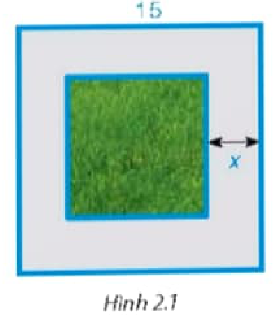
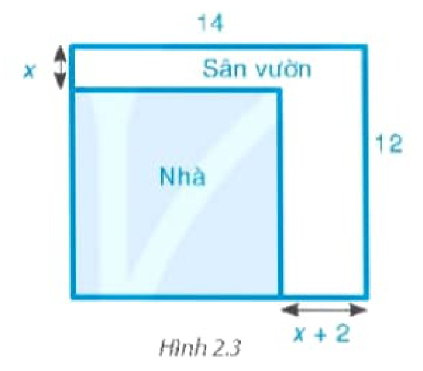

<!-- pdf:28 -->
<!-- Phần giới thiệu đầu Chương II (nửa trên trang PDF 28): ĐẠI SỐ — CHƯƠNG II: PHƯƠNG TRÌNH VÀ BẤT PHƯƠNG TRÌNH BẬC NHẤT MỘT ẨN -->

Phương trình, bất phương trình xảy ra trong các tình huống hằng ngày liên quan đến vận tốc, tỉ số, công thức hình học, các ứng dụng tài chính,... Dùng phương trình hoặc bất phương trình để giải quyết những bài toán thực tế là một mục tiêu quan trọng của chương này.

# BÀI 4: PHƯƠNG TRÌNH QUY VỀ PHƯƠNG TRÌNH BẬC NHẤT MỘT ẨN

## 🔤 Khái niệm, thuật ngữ

- Phương trình tích
- Phương trình chứa ẩn ở mẫu
<!-- ocr-ok: đã đối chiếu ảnh trang PDF 28, OCR đọc sai "ẩn ở mẫu" thành "ấn ở máu" -->

## 🎯 Kiến thức, kĩ năng

- Giải phương trình tích có dạng $(ax + b)(cx + d) = 0$.
- Giải phương trình chứa ẩn ở mẫu quy về phương trình bậc nhất.

## 🔴 Mở đầu

Trong một khu vườn hình vuông có cạnh bằng $15\text{ m}$ người ta làm một lối đi xung quanh vườn có bề rộng là $x\text{ (m)}$ (H.2.1). Để diện tích phần đất còn lại là $169\text{ m}^2$ thì bề rộng $x$ của lối đi là bao nhiêu?

*Hình 2.1*

<!-- pdf:29 -->

## 1. PHƯƠNG TRÌNH TÍCH

**Phương trình tích**

**HĐ1:** Phân tích đa thức $P(x) = (x + 1)(2x - 1) + (x + 1)x$ thành nhân tử.

**HĐ2:** Giải phương trình $P(x) = 0$.

<!-- term: Cách giải phương trình tích -->
> Để giải phương trình tích $(ax + b)(cx + d) = 0$, ta giải hai phương trình $ax + b = 0$ và $cx + d = 0$. Sau đó lấy tất cả các nghiệm của chúng.

**Ví dụ 1**

Giải phương trình $(2x + 1)(3x - 1) = 0$.

**Giải**

Ta có $(2x + 1)(3x - 1) = 0$

nên $2x + 1 = 0$ hoặc $3x - 1 = 0$.

- $2x + 1 = 0$ hay $2x = -1$, suy ra $x = -\dfrac{1}{2}$.
- $3x - 1 = 0$ hay $3x = 1$, suy ra $x = \dfrac{1}{3}$.
<!-- ocr-ok: đã đối chiếu ảnh trang PDF 29, câu chứa nhiều phương trình trong LaTeX -->

Vậy phương trình đã cho có hai nghiệm là $x = -\dfrac{1}{2}$ và $x = \dfrac{1}{3}$.

**Ví dụ 2:** Giải phương trình $x^2 - x = -2x + 2$.

**Giải**

Biến đổi phương trình đã cho về phương trình tích như sau:

$x^2 - x = -2x + 2$

$x^2 - x + 2x - 2 = 0$

$x(x - 1) + 2(x - 1) = 0$

$(x + 2)(x - 1) = 0.$

Ta giải hai phương trình sau:

- $x + 2 = 0$ suy ra $x = -2$.
- $x - 1 = 0$ suy ra $x = 1$.

Vậy phương trình đã cho có hai nghiệm là $x = -2$ và $x = 1$.

<!-- pdf:30 -->

> **Nhận xét.** Trong Ví dụ 2, ta thực hiện việc giải phương trình theo hai bước:
>
> *Bước 1.* Đưa phương trình về phương trình tích $(ax + b)(cx + d) = 0$;
>
> *Bước 2.* Giải phương trình tích tìm được.

**Luyện tập 1:** Giải các phương trình sau:
<!-- ocr-ok: đã đối chiếu ảnh trang PDF 30, OCR bỏ sót nhãn Luyện tập 1 nền xanh -->

a) $(3x + 1)(2 - 4x) = 0$; $\qquad$ b) $x^2 - 3x = 2x - 6$.

**Vận dụng:** Giải bài toán ở *tình huống mở đầu*.

## 2. PHƯƠNG TRÌNH CHỨA ẨN Ở MẪU

**Điều kiện xác định của một phương trình**

Xét phương trình $x + \dfrac{1}{x + 1} = -1 + \dfrac{1}{x + 1}$.

**HĐ3:** Chuyển các biểu thức chứa ẩn từ vế phải sang vế trái, rồi thu gọn vế trái.

**HĐ4:** Giá trị $x = -1$ có là nghiệm của phương trình đã cho hay không? Vì sao?

<!-- term: Phương trình chứa ẩn ở mẫu -->
Khi giải phương trình chứa ẩn ở mẫu, ta phải chú ý đến điều kiện xác định của một phương trình. Chẳng hạn, đối với phương trình trên, để phương trình xác định thì $x + 1 \ne 0$ hay $x \ne -1$.

> Đối với phương trình chứa ẩn ở mẫu, ta thường đặt điều kiện cho ẩn để tất cả các mẫu thức trong phương trình đều khác $0$ và gọi đó là **điều kiện xác định** (viết tắt là ĐKXĐ) của phương trình.

**Ví dụ 3:** Tìm điều kiện xác định của mỗi phương trình sau:

a) $\dfrac{5x + 2}{x - 1} = 0$; $\qquad$ b) $\dfrac{1}{x + 1} = 1 + \dfrac{1}{x - 2}$.

**Giải**

a) Vì $x - 1 \ne 0$ khi $x \ne 1$ nên ĐKXĐ của phương trình $\dfrac{5x + 2}{x - 1} = 0$ là $x \ne 1$.
<!-- ocr-ok: đã đối chiếu ảnh trang PDF 30, câu chứa phân thức và kí hiệu khác 0 trong LaTeX -->

b) Vì $x + 1 \ne 0$ khi $x \ne -1$ và $x - 2 \ne 0$ khi $x \ne 2$ nên ĐKXĐ của phương trình $\dfrac{1}{x + 1} = 1 + \dfrac{1}{x - 2}$ là $x \ne -1$ và $x \ne 2$.
<!-- ocr-ok: đã đối chiếu ảnh trang PDF 30, OCR dính chữ "khixz" -->

**Luyện tập 2:** Tìm điều kiện xác định của mỗi phương trình sau:

a) $\dfrac{3x + 1}{2x - 1} = 1$; $\qquad$ b) $\dfrac{x}{x - 1} + \dfrac{x + 1}{x} = 2$.

<!-- pdf:31 -->

**Cách giải phương trình chứa ẩn ở mẫu**

**HĐ5:** Xét phương trình $\dfrac{x + 3}{x} = \dfrac{x + 9}{x - 3}$. $\quad (2)$

Hãy thực hiện các yêu cầu sau để giải phương trình $(2)$:

a) Tìm điều kiện xác định của phương trình $(2)$;

b) Quy đồng mẫu hai vế của phương trình $(2)$, rồi khử mẫu;

c) Giải phương trình vừa tìm được;

d) Kết luận nghiệm của phương trình $(2)$.

<!-- term: Các bước giải phương trình chứa ẩn ở mẫu -->
Để giải phương trình chứa ẩn ở mẫu ta thường thực hiện các bước như sau:

<!-- term: Các bước giải phương trình chứa ẩn ở mẫu -->
> *Bước 1.* Tìm điều kiện xác định của phương trình.
>
> *Bước 2.* Quy đồng mẫu hai vế của phương trình rồi khử mẫu.
>
> *Bước 3.* Giải phương trình vừa tìm được.
>
> *Bước 4 (Kết luận).* Trong các giá trị tìm được của ẩn ở Bước 3, giá trị nào thoả mãn điều kiện xác định chính là nghiệm của phương trình đã cho.

**Ví dụ 4:** Giải phương trình $\dfrac{2}{x + 1} + \dfrac{1}{x - 2} = \dfrac{3}{(x + 1)(x - 2)}$. $\quad (3)$
<!-- ocr-ok: đã đối chiếu ảnh trang PDF 31, OCR đọc sai nhãn Ví dụ 4 nền xanh -->

**Giải.** Điều kiện xác định $x \ne -1$ và $x \ne 2$.

Quy đồng mẫu và khử mẫu, ta được $\dfrac{2(x - 2) + (x + 1)}{(x + 1)(x - 2)} = \dfrac{3}{(x + 1)(x - 2)}$,

suy ra $2(x - 2) + (x + 1) = 3$. $\quad (3\text{a})$

Giải phương trình $(3\text{a})$:

$2(x - 2) + (x + 1) = 3$

$2x - 4 + x + 1 = 3$

$3x - 3 = 3$

$3x = 6$

$x = 2.$

Giá trị $x = 2$ không thoả mãn ĐKXĐ. Vậy phương trình $(3)$ vô nghiệm.
<!-- ocr-ok: đã đối chiếu ảnh trang PDF 31, OCR đọc sai ĐKXĐ thành ĐKXD và vô thành võ -->

**Luyện tập 3:** Giải phương trình $\dfrac{1}{x - 1} - \dfrac{4x}{x^3 - 1} = \dfrac{x}{x^2 + x + 1}$.
<!-- ocr-ok: đã đối chiếu ảnh trang PDF 31, OCR bỏ sót nhãn Luyện tập 3 nền xanh -->

<!-- pdf:32 -->

## BÀI TẬP

2.1. Giải các phương trình sau:

a) $x(x - 2) = 0$; $\qquad$ b) $(2x + 1)(3x - 2) = 0$.

2.2. Giải các phương trình sau:

a) $(x^2 - 4) + x(x - 2) = 0$; $\qquad$ b) $(2x + 1)^2 - 9x^2 = 0$.

2.3. Giải các phương trình sau:

a) $\dfrac{2}{2x + 1} + \dfrac{1}{x + 1} = \dfrac{3}{(2x + 1)(x + 1)}$; $\qquad$ b) $\dfrac{1}{x + 1} - \dfrac{x}{x^2 - x + 1} = \dfrac{3x}{x^3 + 1}$.

2.4. Bác An có một mảnh đất hình chữ nhật với chiều dài $14\text{ m}$ và chiều rộng $12\text{ m}$. Bác dự định xây nhà trên mảnh đất đó và dành một phần diện tích đất để làm sân vườn như Hình 2.3. Biết diện tích đất làm nhà là $100\text{ m}^2$. Hỏi $x$ bằng bao nhiêu mét?

*Hình 2.3*

2.5. Hai người cùng làm chung một công việc thì xong trong $8$ giờ. Hai người cùng làm được $4$ giờ thì người thứ nhất bị điều đi làm công việc khác. Người thứ hai tiếp tục làm việc trong $12$ giờ nữa thì xong công việc. Gọi $x$ là thời gian người thứ nhất làm một mình xong công việc (đơn vị tính là giờ, $x > 0$).

a) Hãy biểu thị theo $x$:

- Khối lượng công việc mà người thứ nhất làm được trong $1$ giờ;
- Khối lượng công việc mà người thứ hai làm được trong $1$ giờ.

b) Hãy lập phương trình theo $x$ và giải phương trình đó. Sau đó cho biết, nếu làm một mình thì mỗi người phải làm trong bao lâu mới xong công việc đó.

## 📷 Danh sách hình trong bài

| Mã hình | Trang PDF | Vị trí trong bài | Chú thích gốc |
| --- | :---: | --- | --- |
| H9-toan-b04-01 | 28 | Mở đầu | Hình 2.1 |
| H9-toan-b04-02 | 32 | Bài tập 2.4 | Hình 2.3 |
