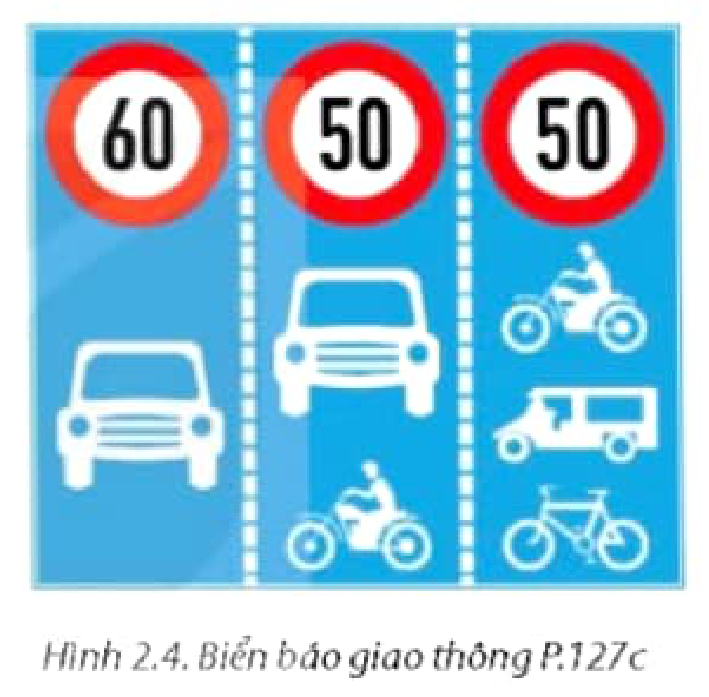
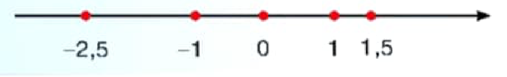
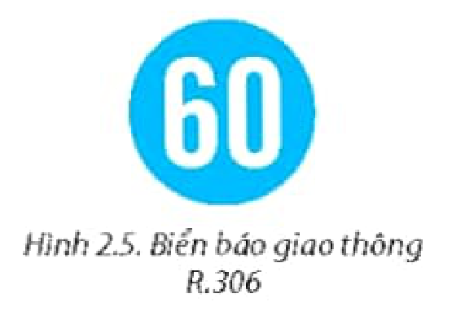
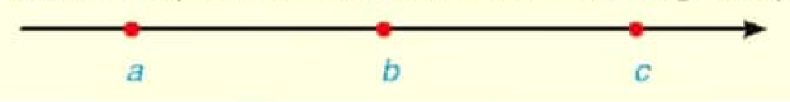

<!-- pdf:33 -->

# BÀI 5: BẤT ĐẲNG THỨC VÀ TÍNH CHẤT

## 🔤 Khái niệm, thuật ngữ

- Bất đẳng thức
- Hai bất đẳng thức cùng chiều (ngược chiều)
- Tính chất bắc cầu

## 🎯 Kiến thức, kĩ năng

- Nhắc lại thứ tự trên tập số thực (các kí hiệu $>, \ge, <, \le$).
- Nhận biết bất đẳng thức.
- Tính chất bắc cầu của bất đẳng thức.
- Tính chất của bất đẳng thức liên quan đến phép cộng.
- Tính chất của bất đẳng thức liên quan đến phép nhân.

## 🔴 Mở đầu

Khi đi đường, chúng ta có thể thấy các biển báo giao thông báo hiệu giới hạn tốc độ mà xe cơ giới được phép đi.

Em có biết ý nghĩa của biển báo giao thông ở Hình 2.4 (biển báo giới hạn tốc độ tối đa cho phép theo xe, trên từng làn đường) không?

*Hình 2.4. Biển báo giao thông P.127c*

## 1. BẤT ĐẲNG THỨC

**Nhắc lại thứ tự trên tập số thực**

Trên tập số thực, với hai số $a$ và $b$ có ba trường hợp sau:

a) Số $a$ bằng số $b$, kí hiệu $a = b$;
<!-- ocr-ok: đã đối chiếu ảnh trang PDF 33, câu ngắn chứa kí hiệu toán học -->

b) Số $a$ lớn hơn số $b$, kí hiệu $a > b$;

c) Số $a$ nhỏ hơn số $b$, kí hiệu $a < b$.
<!-- ocr-ok: đã đối chiếu ảnh trang PDF 33, OCR đọc sai c) thành eo -->

> ❓ Thay $\boxed{?}$ trong các biểu thức sau bằng dấu thích hợp ($=, >, <$).
>
> a) $-34,2 \ \boxed{?} \ -27$; $\qquad$ b) $\dfrac{6}{-8} \ \boxed{?} \ -\dfrac{3}{4}$; $\qquad$ c) $2\,024 \ \boxed{?} \ 1\,954$.

Khi biểu diễn số thực trên trục số, điểm biểu diễn số bé hơn nằm trước điểm biểu diễn số lớn hơn. Chẳng hạn, $-2,5 < -1 < 1 < 1,5$.

<!-- pdf:34 -->

Số $a$ lớn hơn hoặc bằng số $b$, tức là $a > b$ hoặc $a = b$, kí hiệu là $a \ge b$.
<!-- ocr-ok: đã đối chiếu ảnh trang PDF 34, OCR dính chữ "bhoặc" -->

Số $a$ nhỏ hơn hoặc bằng số $b$, tức là $a < b$ hoặc $a = b$, kí hiệu là $a \le b$.
<!-- ocr-ok: đã đối chiếu ảnh trang PDF 34, câu chứa nhiều kí hiệu toán học trong LaTeX -->

**Luyện tập 1**

Biển báo giao thông R.306 (H.2.5) báo tốc độ tối thiểu cho các xe cơ giới. Biển có hiệu lực bắt buộc các loại xe cơ giới vận hành với tốc độ không nhỏ hơn trị số ghi trên biển trong điều kiện giao thông thuận lợi và an toàn. Nếu một ô tô đi trên đường đó với tốc độ $a\text{ (km/h)}$ thì $a$ phải thoả mãn điều kiện nào trong các điều kiện sau?

A. $a < 60$. $\qquad$ B. $a > 60$. $\qquad$ C. $a \ge 60$. $\qquad$ D. $a \le 60$.

*Hình 2.5. Biển báo giao thông R.306*

**Khái niệm bất đẳng thức**

> Ta gọi hệ thức dạng $a > b$ (hay $a < b, a \ge b, a \le b$) là **bất đẳng thức** và gọi $a$ là **vế trái**, $b$ là **vế phải** của bất đẳng thức.

> **Chú ý**
>
> Hai bất đẳng thức $1 < 2$ và $-3 < -2$ (hay $6 > 3$ và $8 > 5$) được gọi là **hai bất đẳng thức cùng chiều**. Hai bất đẳng thức $1 < 2$ và $-2 > -3$ (hay $6 > 3$ và $5 < 8$) được gọi là **hai bất đẳng thức ngược chiều**.

**Ví dụ 1:** Xác định vế trái và vế phải của các bất đẳng thức sau:

a) $-2 > -7$; $\qquad$ b) $a^2 + 1 > 0$.

**Giải**

a) Vế trái là $-2$, vế phải là $-7$.

b) Vế trái là $a^2 + 1$, vế phải là $0$.

**Ví dụ 2:** Viết bất đẳng thức để mô tả mỗi tình huống sau:
<!-- ocr-ok: đã đối chiếu ảnh trang PDF 34, OCR bỏ sót nhãn Ví dụ 2 nền xanh và đọc sai "để", "mỗi" -->

a) Tuần tới, nhiệt độ $t\ (^\circ\text{C})$ tại Tokyo là trên $-5^\circ\text{C}$.

b) Nhiệt độ $t\ (^\circ\text{C})$ bảo quản của một loại sữa là dưới $4^\circ\text{C}$.

c) Để được điều khiển xe máy điện thì số tuổi $x$ của một người phải ít nhất là $16$ tuổi.

**Giải**

a) $t > -5$; $\qquad$ b) $t < 4$; $\qquad$ c) $x \ge 16$.

<!-- pdf:35 -->

Bất đẳng thức có tính chất quan trọng sau:

> Nếu $a < b$ và $b < c$ thì $a < c$ (**tính chất bắc cầu** của bất đẳng thức).

> **Chú ý.** Tương tự, các thứ tự lớn hơn ($>$), lớn hơn hoặc bằng ($\ge$), nhỏ hơn hoặc bằng ($\le$) cũng có tính chất bắc cầu.

**Ví dụ 3:** Chứng minh $\dfrac{2\,024}{2\,023} > \dfrac{2\,021}{2\,022}$.
<!-- ocr-ok: đã đối chiếu ảnh trang PDF 35, OCR đọc sai nhãn Ví dụ 3 và chữ Chứng minh -->

**Giải**

Ta có $\dfrac{2\,024}{2\,023} = 1 + \dfrac{1}{2\,023} > 1$ và $\dfrac{2\,021}{2\,022} = 1 - \dfrac{1}{2\,022} < 1$ nên $\dfrac{2\,024}{2\,023} > \dfrac{2\,021}{2\,022}$.

**Luyện tập 2:** Chứng minh rằng:
<!-- ocr-ok: đã đối chiếu ảnh trang PDF 35, OCR bỏ sót nhãn Luyện tập 2 nền xanh -->

a) $\dfrac{2\,024}{1\,000} > 1,9$; $\qquad$ b) $-\dfrac{2\,022}{2\,023} > -1,1$.

**Vận dụng 1:** Viết các bất đẳng thức để mô tả tốc độ cho phép trong *tình huống mở đầu*.

a) Ô tô ở làn giữa; $\qquad$ b) Xe máy ở làn bên phải.

## 2. LIÊN HỆ GIỮA THỨ TỰ VÀ PHÉP CỘNG

**Liên hệ giữa thứ tự và phép cộng**

Xét bất đẳng thức $-1 < 2$. $\quad (1)$

a) Cộng $2$ vào hai vế của bất đẳng thức $(1)$ rồi so sánh kết quả thì ta được bất đẳng thức nào?

b) Cộng $-2$ vào hai vế của bất đẳng thức $(1)$ rồi so sánh kết quả thì ta được bất đẳng thức nào?

c) Cộng vào hai vế của bất đẳng thức $(1)$ với cùng một số $c$ thì ta sẽ được bất đẳng thức nào?

<!-- term: Tính chất của bất đẳng thức liên quan đến phép cộng -->
> **Pi:** Với ba số $a, b, c$, ta có:
> - Nếu $a < b$ thì $a + c < b + c$;
> - Nếu $a \le b$ thì $a + c \le b + c$;
> - Nếu $a > b$ thì $a + c > b + c$;
> - Nếu $a \ge b$ thì $a + c \ge b + c$.
<!-- ocr-ok: đã đối chiếu ảnh trang PDF 35, hộp bóng thoại của Pi bên lề phải -->

<!-- term: Tính chất của bất đẳng thức liên quan đến phép cộng -->
> Khi cộng cùng một số vào hai vế của một bất đẳng thức ta được bất đẳng thức mới cùng chiều với bất đẳng thức đã cho.

**Ví dụ 4:** Không thực hiện phép tính, hãy so sánh $2\,023 + (-19)$ và $2\,024 + (-19)$.
<!-- ocr-ok: đã đối chiếu ảnh trang PDF 35, OCR bỏ sót nhãn Ví dụ 4 và đọc sai "thực" thành "thục" -->

**Giải.** Vì $2\,023 < 2\,024$ nên

$2\,023 + (-19) < 2\,024 + (-19) \quad \leftarrow \text{cộng vào hai vế với cùng một số } -19.$

<!-- pdf:36 -->

**Luyện tập 3:** Không thực hiện phép tính, hãy so sánh:

a) $19 + 2\,023$ và $-31 + 2\,023$;

b) $\sqrt{2} + 2$ và $4$.

## 3. LIÊN HỆ GIỮA THỨ TỰ VÀ PHÉP NHÂN

**Liên hệ giữa thứ tự và phép nhân**

Cho bất đẳng thức $-2 < 5$.

a) Nhân hai vế của bất đẳng thức với $7$ rồi so sánh kết quả thì ta được bất đẳng thức nào?

b) Nhân hai vế của bất đẳng thức với $-7$ rồi so sánh kết quả thì ta được bất đẳng thức nào?

<!-- term: Tính chất của bất đẳng thức liên quan đến phép nhân -->
> - Khi nhân cả hai vế của một bất đẳng thức với cùng một *số dương* ta được bất đẳng thức mới *cùng chiều* với bất đẳng thức đã cho.
> - Khi nhân cả hai vế của một bất đẳng thức với cùng một *số âm* ta được bất đẳng thức mới *ngược chiều* với bất đẳng thức đã cho.

<!-- term: Tính chất của bất đẳng thức liên quan đến phép nhân -->
> **Pi:**
> - Với ba số $a, b, c$ và $c > 0$, ta có:
>   Nếu $a < b$ thì $ac < bc$;
>   Nếu $a \le b$ thì $ac \le bc$;
>   Nếu $a > b$ thì $ac > bc$;
>   Nếu $a \ge b$ thì $ac \ge bc$.
> - Với ba số $a, b, c$ và $c < 0$, ta có:
>   Nếu $a < b$ thì $ac > bc$;
>   Nếu $a \le b$ thì $ac \ge bc$;
>   Nếu $a > b$ thì $ac < bc$;
>   Nếu $a \ge b$ thì $ac \le bc$.
<!-- ocr-ok: đã đối chiếu ảnh trang PDF 36, hai hộp bóng thoại của Pi chứa nhiều bất đẳng thức -->

**Ví dụ 5:** Thay $\boxed{?}$ trong các biểu thức sau bởi dấu thích hợp ($<, >$) để được khẳng định đúng.

a) $3 \cdot (-7) \ \boxed{?} \ 3 \cdot (-5)$; $\qquad$ b) $(-3) \cdot (-7) \ \boxed{?} \ (-3) \cdot (-5)$.

**Giải**

a) Vì $-7 < -5$ và $3 > 0$ nên $3 \cdot (-7) < 3 \cdot (-5)$. $\quad \leftarrow \text{nhân cả hai vế của bất đẳng thức với số dương.}$

b) Vì $-7 < -5$ và $-3 < 0$ nên $(-3) \cdot (-7) > (-3) \cdot (-5)$. $\quad \leftarrow \text{nhân cả hai vế của bất đẳng thức với số âm.}$

<!-- pdf:37 -->

**Luyện tập 4:** Thay $\boxed{?}$ trong các biểu thức sau bởi dấu thích hợp ($<, >$) để được khẳng định đúng.

a) $13 \cdot (-10,5) \ \boxed{?} \ 13 \cdot 11,2$; $\qquad$ b) $(-13) \cdot (-10,5) \ \boxed{?} \ (-13) \cdot 11,2$.

**Vận dụng 2:** Một nhà tài trợ dự kiến tổ chức một buổi đi dã ngoại tập thể nhằm giúp các bạn học sinh vùng cao trải nghiệm thực tế tại một trang trại trong $1$ ngày (từ 14h00 ngày hôm trước đến 12h00 ngày hôm sau). Cho biết số tiền tài trợ dự kiến là $30$ triệu đồng và giá thuê các dịch vụ và phòng nghỉ là $17$ triệu đồng $1$ ngày, giá mỗi suất ăn trưa, ăn tối là $60\,000$ đồng và mỗi suất ăn sáng là $30\,000$ đồng. Hỏi có thể tổ chức cho nhiều nhất bao nhiêu bạn tham gia được?

## BÀI TẬP

2.6. Dùng kí hiệu để viết bất đẳng thức tương ứng với mỗi trường hợp sau:

a) $x$ nhỏ hơn hoặc bằng $-2$;

b) $m$ là số âm;

c) $y$ là số dương;

d) $p$ lớn hơn hoặc bằng $2\,024$.

2.7. Viết một bất đẳng thức phù hợp trong mỗi trường hợp sau:

a) Bạn phải ít nhất $18$ tuổi mới được phép lái ô tô;

b) Xe buýt chở được tối đa $45$ người;

c) Mức lương tối thiểu cho một giờ làm việc của người lao động là $20\,000$ đồng.

2.8. Không thực hiện phép tính, hãy chứng minh:

a) $2 \cdot (-7) + 2\,023 < 2 \cdot (-1) + 2\,023$;

b) $(-3) \cdot (-8) + 1\,975 > (-3) \cdot (-7) + 1\,975$.

2.9. Cho $a < b$, hãy so sánh:

a) $5a + 7$ và $5b + 7$; $\qquad$ b) $-3a - 9$ và $-3b - 9$.

2.10. So sánh hai số $a$ và $b$, nếu:

a) $a + 1\,954 < b + 1\,954$; $\qquad$ b) $-2a > -2b$.

2.11. Chứng minh rằng:

a) $-\dfrac{2\,023}{2\,024} > -\dfrac{2\,024}{2\,023}$; $\qquad$ b) $\dfrac{34}{11} > \dfrac{26}{9}$.

## 📷 Danh sách hình trong bài

| Mã hình | Trang PDF | Vị trí trong bài | Chú thích gốc |
| --- | :---: | --- | --- |
| H9-toan-b05-01 | 33 | Mở đầu | Hình 2.4. Biển báo giao thông P.127c |
| H9-toan-b05-02 | 33 | Mục 1 | (sách không đánh số, trục số biểu diễn $-2,5 < -1 < 1 < 1,5$) |
| H9-toan-b05-03 | 34 | Mục 1, Luyện tập 1 | Hình 2.5. Biển báo giao thông R.306 |
| H9-toan-b05-04 | 35 | Mục 1 | (sách không đánh số, trục số minh hoạ tính chất bắc cầu $a < b < c$) |
