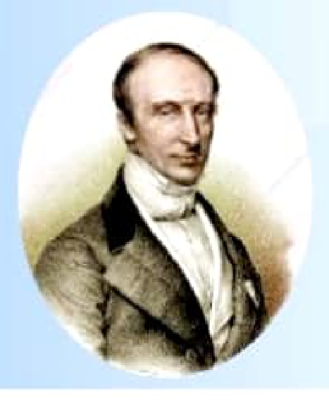

<!-- pdf:44 -->

# BÀI TẬP CUỐI CHƯƠNG II

## ✏️ A. TRẮC NGHIỆM

2.21. Nghiệm của bất phương trình $-2x + 1 < 0$ là

A. $x < \dfrac{1}{2}$. $\qquad$ B. $x > \dfrac{1}{2}$. $\qquad$ C. $x \le \dfrac{1}{2}$. $\qquad$ D. $x \ge \dfrac{1}{2}$.

2.22. Điều kiện xác định của phương trình $\dfrac{x}{2x + 1} + \dfrac{3}{x - 5} = \dfrac{x}{(2x + 1)(x - 5)}$ là

A. $x \ne -\dfrac{1}{2}$. $\qquad$ B. $x \ne -\dfrac{1}{2}$ và $x \ne -5$. $\qquad$ C. $x \ne 5$. $\qquad$ D. $x \ne -\dfrac{1}{2}$ và $x \ne 5$.
<!-- ocr-ok: đã đối chiếu ảnh trang PDF 44, các phương án trắc nghiệm chứa kí hiệu toán học trong LaTeX -->

2.23. Phương trình $x - 1 = m + 4$ có nghiệm lớn hơn $1$ với

A. $m \ge -4$. $\qquad$ B. $m \le 4$. $\qquad$ C. $m > -4$. $\qquad$ D. $m < -4$.

2.24. Nghiệm của bất phương trình $1 - 2x \ge 2 - x$ là

A. $x > \dfrac{1}{2}$. $\qquad$ B. $x < \dfrac{1}{2}$. $\qquad$ C. $x \le -1$. $\qquad$ D. $x \ge -1$.

2.25. Cho $a > b$. Khi đó ta có:

A. $2a > 3b$. $\qquad$ B. $2a > 2b + 1$. $\qquad$ C. $5a + 1 > 5b + 1$. $\qquad$ D. $-3a < -3b - 3$.

## ✏️ B. TỰ LUẬN

2.26. Giải các phương trình sau:

a) $(3x - 1)^2 - (x + 2)^2 = 0$; $\qquad$ b) $x(x + 1) = 2(x^2 - 1)$.

2.27. Giải các phương trình sau:

a) $\dfrac{x}{x - 5} - \dfrac{2}{x + 5} = \dfrac{x^2}{x^2 - 25}$; $\qquad$ b) $\dfrac{1}{x + 1} - \dfrac{x}{x^2 - x + 1} = \dfrac{3}{x^3 + 1}$.

2.28. Cho $a < b$, hãy so sánh:

a) $a + b + 5$ với $2b + 5$; $\qquad$ b) $-2a - 3$ với $-(a + b) - 3$.

2.29. Giải các bất phương trình:

a) $2x + 3(x + 1) > 5x - (2x - 4)$; $\qquad$ b) $(x + 1)(2x - 1) < 2x^2 - 4x + 1$.

2.30. Một hãng viễn thông nước ngoài có hai gói cước như sau:

| Gói cước A | Gói cước B |
| --- | --- |
| Cước thuê bao hàng tháng $32\text{ USD}$ $45$ phút miễn phí $0,4\text{ USD}$ cho mỗi phút thêm | Cước thuê bao hàng tháng là $44\text{ USD}$ Không có phút miễn phí $0,25\text{ USD/phút}$ |

<!-- pdf:45 -->

a) Hãy viết một phương trình xác định thời gian gọi (phút) mà phí phải trả trong cùng một tháng của hai gói cước là như nhau và giải phương trình đó.

b) Nếu khách hàng chỉ gọi tối đa là $180$ phút trong $1$ tháng thì nên dùng gói cước nào? Nếu khách hàng gọi $500$ phút trong $1$ tháng thì nên dùng gói cước nào?

2.31. Thanh tham dự một kì kiểm tra năng lực tiếng Anh gồm $4$ bài kiểm tra nghe, nói, đọc và viết. Mỗi bài kiểm tra có điểm là số nguyên từ $0$ đến $10$. Điểm trung bình của ba bài kiểm tra nghe, nói, đọc của Thanh là $6,7$. Hỏi bài kiểm tra viết của Thanh cần được bao nhiêu điểm để điểm trung bình cả $4$ bài kiểm tra được từ $7,0$ trở lên? Biết điểm trung bình được tính gần đúng đến chữ số thập phân thứ nhất.

2.32. Để lập đội tuyển năng khiếu về bóng rổ của trường, thầy thể dục đưa ra quy định tuyển chọn như sau: mỗi bạn dự tuyển sẽ được ném $15$ quả bóng vào rổ, quả bóng vào rổ được cộng $2$ điểm; quả bóng ném ra ngoài bị trừ $1$ điểm. Nếu bạn nào có số điểm từ $15$ điểm trở lên thì sẽ được chọn vào đội tuyển. Hỏi một học sinh muốn được chọn vào đội tuyển thì phải ném ít nhất bao nhiêu quả vào rổ?

## 💡 Em có biết?

*(Đọc thêm)*

**BẤT ĐẲNG THỨC GIỮA TRUNG BÌNH CỘNG VÀ TRUNG BÌNH NHÂN**

Cho hai số $a, b \ge 0$. Trung bình cộng của hai số là $\dfrac{a + b}{2}$; Trung bình nhân của hai số là $\sqrt{ab}$. Khi đó, ta luôn có

$\dfrac{a + b}{2} \ge \sqrt{ab}. \quad (1)$

Bất đẳng thức $(1)$ được gọi là bất đẳng thức giữa trung bình cộng và trung bình nhân cho hai số không âm $a$ và $b$ (thường viết tắt là *AM-GM*). Ta cũng thường gọi bất đẳng thức trên là bất đẳng thức Cauchy.

*Cauchy (1789 – 1857) là một nhà toán học Pháp. Ông là giáo sư của Đại học Bách khoa Paris và Viện sĩ Viện hàn lâm khoa học Pháp. Ông có nhiều công trình nghiên cứu toán học có giá trị liên quan đến nhiều lĩnh vực nghiên cứu khác nhau trong Giải tích, Đại số, Số học, Hệ động lực,...*

*(Theo: Benis-Sinaceur, Hourya (1973), Cauchy et Bolzano, Revue d'Histoire des Sciences, 26 (2): 97–112)*
<!-- ocr-ok: đã đối chiếu ảnh trang PDF 45, chú thích tài liệu tiếng Pháp cỡ chữ nhỏ -->

## 📷 Danh sách hình trong bài

| Mã hình | Trang PDF | Vị trí trong bài | Chú thích gốc |
| --- | :---: | --- | --- |
| H9-toan-bt-c02-01 | 45 | Em có biết? (allow_edge_ink: chân dung Cauchy nằm trên nền màu xanh đậm của khung Em có biết?) | (sách không đánh số, chân dung nhà toán học Cauchy (1789 – 1857)) |
