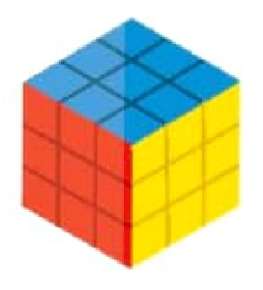

<!-- pdf:62 -->

# BÀI 10: CĂN BẬC BA VÀ CĂN THỨC BẬC BA

## 🔤 Khái niệm, thuật ngữ

- Căn bậc ba
- Căn thức bậc ba

## 🎯 Kiến thức, kĩ năng

- Nhận biết căn bậc ba của một số thực.
- Tính giá trị đúng, gần đúng của căn bậc ba của một số bằng máy tính cầm tay.
- Nhận biết căn thức bậc ba của một biểu thức đại số.

## 🔴 Mở đầu

Căn bậc hai của một số thực (dương) có một vai trò quan trọng trong đời sống và toán học. Căn bậc hai của số thực $a$ không âm là các số thực $x$ thoả mãn điều kiện $x^2 = a$. Trong bài học này, các em sẽ được làm quen với khái niệm căn bậc ba, một khái niệm tương tự khái niệm căn bậc hai.

## 1. CĂN BẬC BA

**Căn bậc ba của một số thực**

**HĐ1:** Kí hiệu $V$ là thể tích của hình lập phương với cạnh $x$. Hãy thay dấu “$?$” trong bảng sau bằng các giá trị thích hợp.

| $x$ | $V = x^3$ |
| :---: | :---: |
| $2$ | $8$ |
| $?$ | $27$ |
| $?$ | $64$ |

Tổng quát, ta định nghĩa:

> **Căn bậc ba** của số thực $a$ là số thực $x$ thoả mãn $x^3 = a$.

> **Chú ý.** Mỗi số $a$ đều có duy nhất một căn bậc ba. Căn bậc ba của số $a$ được kí hiệu là $\sqrt[3]{a}$. Trong kí hiệu $\sqrt[3]{a}$, số $3$ được gọi là **chỉ số** của căn. Phép tìm căn bậc ba của một số gọi là **phép khai căn bậc ba**.

**Ví dụ 1**

a) Chứng tỏ rằng $\sqrt[3]{64} = 4$. $\qquad$ b) Tính $\sqrt[3]{0}$ và $\sqrt[3]{-27}$.

**Giải.** a) Vì $4^3 = 64$ nên $\sqrt[3]{64} = 4$.

b) Vì $0^3 = 0$ nên $\sqrt[3]{0} = 0$. Vì $(-3)^3 = -27$ nên $\sqrt[3]{-27} = -3$.
<!-- ocr-ok: đã đối chiếu ảnh trang PDF 62, câu ngắn chứa căn bậc ba trong LaTeX -->

> **Nhận xét.** Từ định nghĩa căn bậc ba, ta có $\left(\sqrt[3]{a}\right)^3 = \sqrt[3]{a^3} = a$ với mọi số thực $a$. Do đó có thể giải Ví dụ 1 như sau: $\sqrt[3]{64} = \sqrt[3]{4^3} = 4$.

<!-- pdf:63 -->

**Luyện tập 1:** Tính: $\quad$ a) $\sqrt[3]{125}$; $\qquad$ b) $\sqrt[3]{0,008}$; $\qquad$ c) $\sqrt[3]{\dfrac{-8}{27}}$.
<!-- ocr-ok: đã đối chiếu ảnh trang PDF 63, OCR đọc sai đề Luyện tập 1 -->

**Tính căn bậc ba của một số bằng máy tính cầm tay**

Ta có thể sử dụng loại MTCT thích hợp để tính căn bậc ba của một số. Chẳng hạn, để tính $\sqrt[3]{12}$ và $\sqrt[3]{3375}$ ta làm như sau:

| Phép tính | Bấm các phím | Kết quả |
| :---: | :---: | :---: |
| $\sqrt[3]{343}$ | `SHIFT` `√■` `3` `4` `3` `=` | $7$ |
| $\sqrt[3]{12}$ | `SHIFT` `√■` `1` `2` `=` | $2,289428485$ |
<!-- ocr-ok: đã đối chiếu ảnh trang PDF 63, bảng chứa biểu tượng các phím bấm máy tính cầm tay -->

> **Chú ý.** Màn hình MTCT chỉ hiển thị được một số hữu hạn chữ số nên các kết quả là số thập phân vô hạn (tuần hoàn hay không tuần hoàn) đều được làm tròn, chẳng hạn: $\sqrt[3]{12} \approx 2,289428485$.

**Ví dụ 2**

Sử dụng MTCT, tính $\sqrt[3]{3,25}$ rồi làm tròn kết quả đến chữ số thập phân thứ hai.

**Giải.** Bấm các phím `SHIFT` `√■` `3` `.` `2` `5` `=`, màn hình hiện kết quả $1,481248034$. Làm tròn kết quả đến chữ số thập phân thứ hai ta được $\sqrt[3]{3,25} \approx 1,48$.

**Luyện tập 2**

Sử dụng MTCT, tính $\sqrt[3]{45}$ và làm tròn kết quả với độ chính xác $0,005$.

**Thử thách nhỏ**

> **Tròn:** Có thể xếp $125$ khối lập phương đơn vị (có cạnh bằng $1\text{ cm}$) thành một khối lập phương lớn được không nhỉ?

## 2. CĂN THỨC BẬC BA

**Nhận biết căn thức bậc ba**

Tương tự như căn thức bậc hai, ta có định nghĩa sau:

> **Căn thức bậc ba** là biểu thức có dạng $\sqrt[3]{A}$, trong đó $A$ là một biểu thức đại số.

<!-- pdf:64 -->

> **Chú ý**
>
> - Tương tự căn bậc ba của một số, ta cũng có $\left(\sqrt[3]{A}\right)^3 = \sqrt[3]{A^3} = A$ ($A$ là một biểu thức).
> - Để tính giá trị của $\sqrt[3]{A}$ tại những giá trị cho trước của biến, ta thay các giá trị cho trước của biến vào căn thức rồi tính giá trị của biểu thức số nhận được.

**Ví dụ 3:** Tính giá trị của căn thức $\sqrt[3]{2x + 5}$ tại:
<!-- ocr-ok: đã đối chiếu ảnh trang PDF 64, OCR đọc sai nhãn Ví dụ 3 nền xanh -->

a) $x = 60$; $\qquad$ b) $x = -6,5$.

**Giải**

a) Với $x = 60$ ta có $\sqrt[3]{2 \cdot 60 + 5} = \sqrt[3]{125} = \sqrt[3]{5^3} = 5$.

b) Với $x = -6,5$ ta có $\sqrt[3]{2 \cdot (-6,5) + 5} = \sqrt[3]{-8} = \sqrt[3]{(-2)^3} = -2$.

**Ví dụ 4:** Rút gọn biểu thức $-x + 5 + \sqrt[3]{x^3 + 3x^2 + 3x + 1}$.
<!-- ocr-ok: đã đối chiếu ảnh trang PDF 64, OCR đọc sai nhãn Ví dụ 4 nền xanh -->

**Giải**

Ta có $x^3 + 3x^2 + 3x + 1 = (x + 1)^3$. $\quad \leftarrow \text{hằng đẳng thức lập phương của một tổng}$

Do đó $-x + 5 + \sqrt[3]{x^3 + 3x^2 + 3x + 1} = -x + 5 + \sqrt[3]{(x + 1)^3} = -x + 5 + (x + 1) = 6$.

**Luyện tập 3**

a) Tính giá trị của căn thức $\sqrt[3]{5x - 1}$ tại $x = 0$ và tại $x = -1,4$.

b) Rút gọn biểu thức $\sqrt[3]{x^3 - 3x^2 + 3x - 1}$.

## BÀI TẬP

3.23. Tính:

a) $\sqrt[3]{216}$; $\qquad$ b) $\sqrt[3]{-512}$; $\qquad$ c) $\sqrt[3]{-0,001}$; $\qquad$ d) $\sqrt[3]{1,331}$.

3.24. Sử dụng MTCT, tính các căn bậc ba sau đây (làm tròn kết quả đến chữ số thập phân thứ hai):

a) $\sqrt[3]{2,1}$; $\qquad$ b) $\sqrt[3]{-18}$; $\qquad$ c) $\sqrt[3]{-28}$; $\qquad$ d) $\sqrt[3]{0,35}$.

3.25. Một người thợ muốn làm một thùng tôn hình lập phương có thể tích bằng $730\text{ dm}^3$. Em hãy ước lượng chiều dài cạnh thùng khoảng bao nhiêu $\text{dm}$?

3.26. Rút gọn các biểu thức sau:

a) $\sqrt[3]{\left(1 - \sqrt{2}\right)^3}$; $\qquad$ b) $\sqrt[3]{\left(2\sqrt{2} + 1\right)^3}$; $\qquad$ c) $\left(\sqrt[3]{\sqrt{2} + 1}\right)^3$.

3.27. Rút gọn rồi tính giá trị của biểu thức $\sqrt[3]{27x^3 - 27x^2 + 9x - 1}$ tại $x = 7$.

## 📷 Danh sách hình trong bài

| Mã hình | Trang PDF | Vị trí trong bài | Chú thích gốc |
| --- | :---: | --- | --- |
| H9-toan-b10-01 | 62 | Mục 1, HĐ1 | (sách không đánh số, hình khối lập phương ghép từ các khối nhỏ) |
