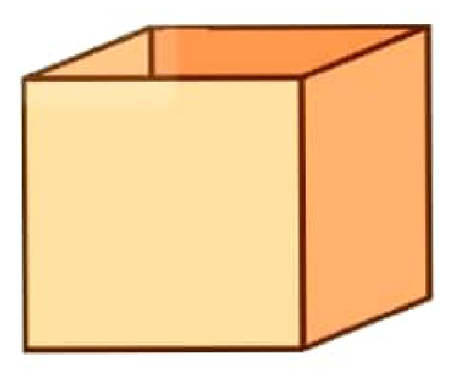

<!-- pdf:65 -->

# LUYỆN TẬP CHUNG (TRANG 63)

**Ví dụ 1**

Rút gọn biểu thức $A = \sqrt{\left(\sqrt{3} + 1\right)^2} - \sqrt{3\left(\sqrt{3} + 1\right)^2} + \sqrt{4}$.

**Giải**

Ta có $A = \sqrt{\left(\sqrt{3} + 1\right)^2} - \sqrt{3} \cdot \sqrt{\left(\sqrt{3} + 1\right)^2} + \sqrt{2^2} = \left(\sqrt{3} + 1\right) - \sqrt{3}\left(\sqrt{3} + 1\right) + 2 = 0$.

**Ví dụ 2**

Cho biểu thức $P = \dfrac{\sqrt{x}}{\sqrt{x} + 1} + \dfrac{\sqrt{x}}{\sqrt{x} - 1}$ với $x > 1$.

a) Rút gọn $P$.

b) Sử dụng kết quả câu a, tính giá trị của $P$ khi $x = 101$.
<!-- ocr-ok: đã đối chiếu ảnh trang PDF 65, OCR bỏ sót chữ P trong "của P khi" -->

**Giải**

a) $P = \dfrac{\sqrt{x}\left(\sqrt{x} - 1\right) + \sqrt{x}\left(\sqrt{x} + 1\right)}{\left(\sqrt{x} + 1\right)\left(\sqrt{x} - 1\right)} = \dfrac{x - \sqrt{x} + x + \sqrt{x}}{x - 1} = \dfrac{2x}{x - 1}$.

b) Khi $x = 101$ thì $P = \dfrac{2 \cdot 101}{101 - 1} = \dfrac{202}{100} = 2,02$.

**Ví dụ 3**

Người ta cần làm một thùng hình lập phương bằng bìa cứng không có nắp trên và có thể tích $216\text{ dm}^3$ để đựng đồ. Tính diện tích bìa cứng cần dùng để làm thùng đựng đó (coi diện tích các mép nối là không đáng kể).

**Giải**

Gọi $x\ (\text{dm}, x > 0)$ là độ dài cạnh của thùng hình lập phương cần làm.

Ta có: $x^3 = 216$, suy ra $x = \sqrt[3]{216} = 6\text{ (dm)}$.

Vì thùng đựng không có nắp nên thùng gồm $4$ mặt bên và $1$ mặt đáy, mỗi mặt là một hình vuông cạnh $6\text{ dm}$. Do đó diện tích bìa cứng cần dùng là

$S = 5 \cdot 6^2 = 180\ \left(\text{dm}^2\right).$

<!-- pdf:66 -->

## BÀI TẬP

3.28. Rút gọn các biểu thức sau:

a) $\dfrac{5 + 3\sqrt{5}}{\sqrt{5}} - \dfrac{1}{\sqrt{5} - 2}$; $\qquad$ b) $\sqrt{\left(\sqrt{7} - 2\right)^2} - \sqrt{63} + \dfrac{\sqrt{56}}{\sqrt{2}}$;

c) $\dfrac{\sqrt{\left(\sqrt{3} + \sqrt{2}\right)^2} + \sqrt{\left(\sqrt{3} - \sqrt{2}\right)^2}}{2\sqrt{12}}$; $\qquad$ d) $\dfrac{\sqrt[3]{\left(\sqrt{2} + 1\right)^3} - 1}{\sqrt{50}}$.

3.29. Tính giá trị của các biểu thức sau:

a) $3\sqrt{45} + \dfrac{5\sqrt{15}}{\sqrt{3}} - 2\sqrt{245}$; $\qquad$ b) $\dfrac{\sqrt{12} - \sqrt{4}}{\sqrt{3} - 1} - \dfrac{\sqrt{21} + \sqrt{7}}{\sqrt{3} + 1} + \sqrt{7}$;

c) $\dfrac{3 - \sqrt{3}}{1 - \sqrt{3}} + \sqrt{3}\left(2\sqrt{3} - 1\right) + \sqrt{12}$; $\qquad$ d) $\dfrac{\sqrt{3} - 1}{\sqrt{2}} + \dfrac{\sqrt{2}}{\sqrt{3} - 1} - \dfrac{6}{\sqrt{6}}$.

3.30. Giả sử lực $F$ của gió khi thổi theo phương vuông góc với bề mặt cánh buồm của một con thuyền tỉ lệ thuận với bình phương tốc độ của gió, hệ số tỉ lệ là $30$. Trong đó, lực $F$ được tính bằng $\text{N}$ (Newton) và tốc độ được tính bằng $\text{m/s}$.

a) Khi tốc độ của gió là $10\text{ m/s}$ thì lực $F$ là bao nhiêu Newton?

b) Nếu cánh buồm chỉ có thể chịu được một áp lực tối đa là $12\,000\text{ N}$ thì con thuyền đó có thể đi được trong gió với tốc độ gió tối đa là bao nhiêu?

3.31. Rút gọn các biểu thức sau:

a) $\sqrt[3]{(-x - 1)^3}$; $\qquad$ b) $\sqrt[3]{8x^3 - 12x^2 + 6x - 1}$.

## 📷 Danh sách hình trong bài

| Mã hình | Trang PDF | Vị trí trong bài | Chú thích gốc |
| --- | :---: | --- | --- |
| H9-toan-ltc-c03-02-01 | 65 | Ví dụ 3 | (sách không đánh số, hình thùng lập phương bằng bìa cứng không có nắp trên) |
