<!-- pdf:68 -->
<!-- Phần giới thiệu đầu Chương IV (nửa trên trang PDF 68): HÌNH HỌC PHẲNG — CHƯƠNG IV: HỆ THỨC LƯỢNG TRONG TAM GIÁC VUÔNG -->

Trong chương này ta xét các tỉ số hai độ dài hai cạnh của một tam giác vuông. Ta sẽ thấy các tỉ số này đặc trưng cho độ lớn của hai góc nhọn của tam giác vuông đó. Nói cách khác, nếu biết được mỗi tỉ số này, ta sẽ biết được độ lớn của hai góc nhọn.

# BÀI 11: TỈ SỐ LƯỢNG GIÁC CỦA GÓC NHỌN

## 🔤 Khái niệm, thuật ngữ

- Tỉ số lượng giác của góc nhọn
- Sin, côsin, tang, côtang

## 🎯 Kiến thức, kĩ năng

- Nhận biết sin, côsin, tang, côtang của góc nhọn.
- Giải thích bảng tỉ số lượng giác của các góc $30^\circ, 45^\circ, 60^\circ$.
- Giải thích quan hệ giữa tỉ số lượng giác của hai góc phụ nhau.
- Biết dùng máy tính cầm tay để tính sin, côsin, tang, côtang của một góc nhọn.

## 🔴 Mở đầu

Ta có thể xác định “góc dốc” $\alpha$ của một đoạn đường dốc khi biết độ dài của dốc là $a$ và độ cao của đỉnh dốc so với đường nằm ngang là $h$ không? (H.4.1). (Trong các toà chung cư, người ta thường thiết kế đoạn dốc cho người đi xe lăn với góc dốc bé hơn $6^\circ$).

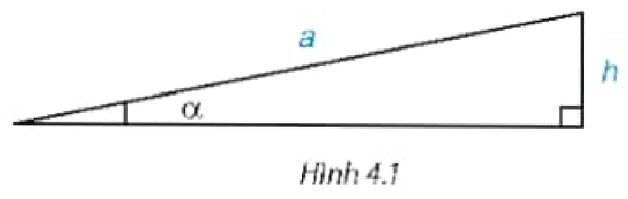
*Hình 4.1*

<!-- pdf:69 -->

## 1. KHÁI NIỆM TỈ SỐ LƯỢNG GIÁC CỦA MỘT GÓC NHỌN

Cho tam giác $ABC$ vuông tại $A$. Xét góc nhọn $B$. Cạnh $AC$ gọi là **cạnh đối** của góc $B$, cạnh $AB$ gọi là **cạnh kề** của góc $B$ (H.4.2).

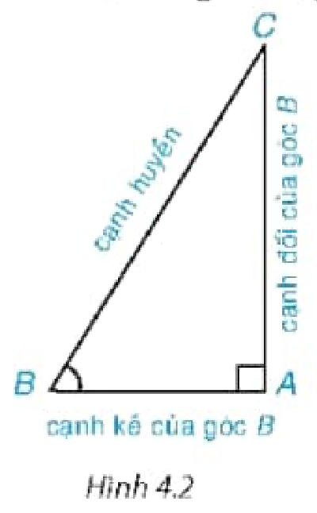
*Hình 4.2*

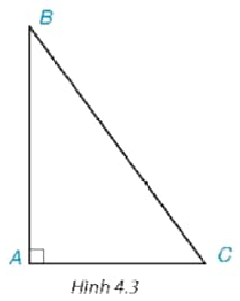
*Hình 4.3*

> ❓ Xét góc $C$ của tam giác $ABC$ vuông tại $A$ (H.4.3). Hãy chỉ ra cạnh đối và cạnh kề của góc $C$.

**Khái niệm sin, côsin, tang, côtang của góc nhọn $\alpha$**

**HĐ1:** Cho tam giác $ABC$ vuông tại $A$ và tam giác $A'B'C'$ vuông tại $A'$ có $\widehat{B} = \widehat{B'} = \alpha$. Chứng minh rằng:

a) $\Delta ABC \backsim \Delta A'B'C'$;

b) $\dfrac{AC}{BC} = \dfrac{A'C'}{B'C'}$; $\dfrac{AB}{BC} = \dfrac{A'B'}{B'C'}$; $\dfrac{AC}{AB} = \dfrac{A'C'}{A'B'}$; $\dfrac{AB}{AC} = \dfrac{A'B'}{A'C'}$.

**Nhận xét:** Trong Hình 4.4, các tam giác vuông có cùng một góc nhọn $\alpha$ là đồng dạng với nhau. Vì vậy các tỉ số giữa cạnh đối và cạnh huyền (cạnh kề và cạnh huyền), cạnh đối và cạnh kề (cạnh kề và cạnh đối) của góc nhọn $\alpha$ là như nhau, cho dù độ dài các cạnh đối (các cạnh kề) của góc $\alpha$ và các cạnh huyền có thể khác nhau với từng tam giác.

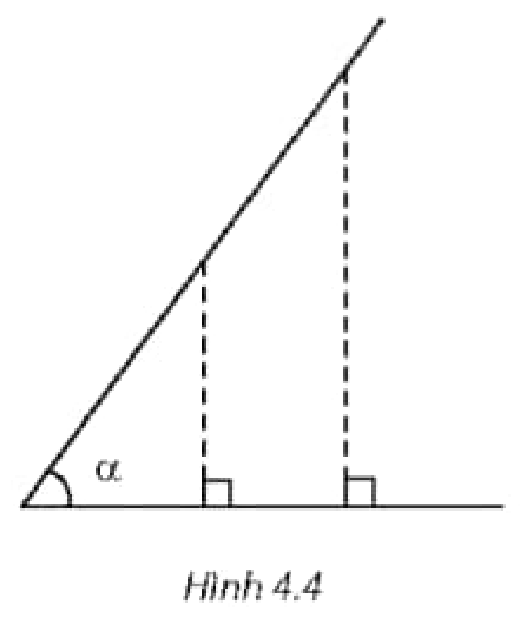
*Hình 4.4*

<!-- pdf:70 -->

Cho góc nhọn $\alpha$. Xét tam giác $ABC$ vuông tại $A$ có góc nhọn $B$ bằng $\alpha$. (H.4.5). Ta có:

> – Tỉ số giữa cạnh đối và cạnh huyền gọi là **sin** của $\alpha$, kí hiệu $\sin \alpha$.
> – Tỉ số giữa cạnh kề và cạnh huyền gọi là **côsin** của $\alpha$, kí hiệu $\cos \alpha$.
> – Tỉ số giữa cạnh đối và cạnh kề của góc $\alpha$ gọi là **tang** của $\alpha$, kí hiệu $\tan \alpha$.
> – Tỉ số giữa cạnh kề và cạnh đối của góc $\alpha$ gọi là **côtang** của $\alpha$, kí hiệu $\cot \alpha$.

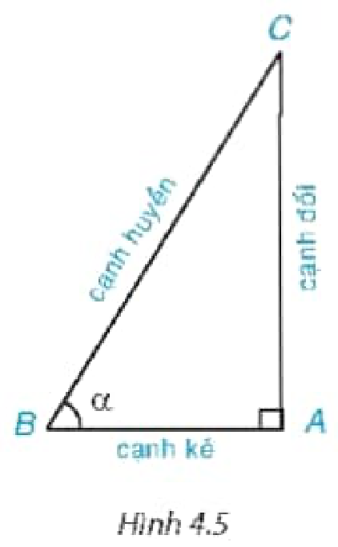
*Hình 4.5*

**Chú ý:** Ta có:

- $\sin \alpha = \dfrac{\text{cạnh đối}}{\text{cạnh huyền}}$; $\cos \alpha = \dfrac{\text{cạnh kề}}{\text{cạnh huyền}}$;

  $\tan \alpha = \dfrac{\text{cạnh đối}}{\text{cạnh kề}}$; $\cot \alpha = \dfrac{\text{cạnh kề}}{\text{cạnh đối}}$.

- $\cot \alpha = \dfrac{1}{\tan \alpha}$.
- $\sin \alpha, \cos \alpha, \tan \alpha, \cot \alpha$ gọi là các **tỉ số lượng giác của góc nhọn** $\alpha$.

> **Pi:** sin, côsin của góc nhọn luôn dương và bé hơn $1$ vì trong tam giác vuông, cạnh huyền dài nhất.
<!-- ocr-ok: đã đối chiếu trực tiếp ảnh trang PDF 70, OCR đọc sai bóng thoại của Pi ('vong', 'huyện') -->

**Ví dụ 1:** Cho tam giác $ABC$ vuông tại $A$, có $AB = 3\text{ cm}, AC = 4\text{ cm}$ (H.4.6).
<!-- ocr-ok: đã đối chiếu trực tiếp ảnh trang PDF 70, OCR bỏ sót nhãn hộp Ví dụ 1 -->

Hãy tính các tỉ số lượng giác $\sin \alpha, \cos \alpha, \tan \alpha$ với $\alpha = \widehat{B}$.

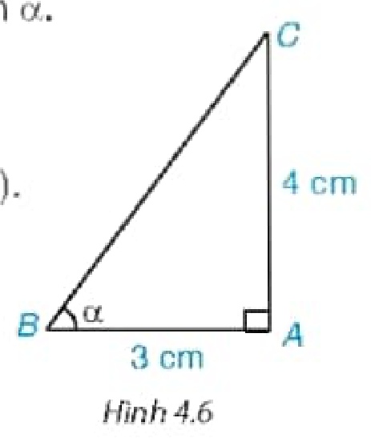
*Hình 4.6*

**Giải**

Xét $\Delta ABC$ vuông tại $A$, $\widehat{B} = \alpha$.

Theo Định lí Pythagore, ta có:

$BC^2 = AC^2 + AB^2 = 4^2 + 3^2 = 25$ nên $BC = 5\text{ (cm)}$.

Theo định nghĩa của tỉ số lượng giác sin, côsin, tang, ta có

$\sin \alpha = \dfrac{AC}{BC} = \dfrac{4}{5}, \cos \alpha = \dfrac{AB}{BC} = \dfrac{3}{5}, \tan \alpha = \dfrac{AC}{AB} = \dfrac{4}{3}$.

> **Tròn:** $\sin \alpha$ còn được viết là $\sin \widehat{B}$ hay $\sin B$. Tương tự cho $\cos \alpha, \tan \alpha$ và $\cot \alpha$.
<!-- ocr-ok: đã đối chiếu trực tiếp ảnh trang PDF 70, OCR đọc sai bóng thoại của Tròn -->

**Luyện tập 1:** Cho tam giác $ABC$ vuông tại $A$ có $AB = 5\text{ cm}, AC = 12\text{ cm}$. Hãy tính các tỉ số lượng giác của góc $B$.

<!-- pdf:71 -->

**Giá trị lượng giác sin, côsin, tang, côtang của các góc $30^\circ, 45^\circ, 60^\circ$**

**HĐ2:** Cho tam giác $ABC$ vuông cân tại $A$ và $AB = AC = a$ (H.4.7a).
<!-- ocr-ok: đã đối chiếu trực tiếp ảnh trang PDF 71, OCR đọc sai nhãn HĐ2 và H.4.7a -->

a) Hãy tính $BC$ và các tỉ số $\dfrac{AB}{BC}, \dfrac{AC}{BC}$. Từ đó suy ra $\sin 45^\circ, \cos 45^\circ$.

b) Hãy tính các tỉ số $\dfrac{AB}{AC}$ và $\dfrac{AC}{AB}$. Từ đó suy ra $\tan 45^\circ, \cot 45^\circ$.

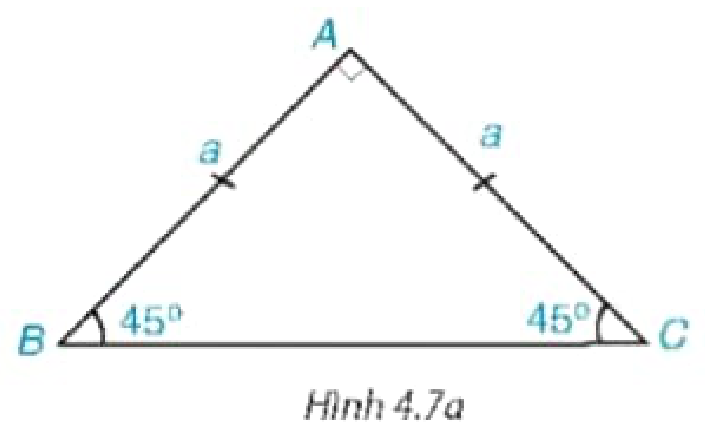
*Hình 4.7a*

**HĐ3:** Xét tam giác đều $ABC$ có cạnh bằng $2a$.

a) Tính đường cao $AH$ của tam giác $ABC$ (H.4.7b).

b) Tính $\sin 30^\circ, \cos 30^\circ, \sin 60^\circ$ và $\cos 60^\circ$.

c) Tính $\tan 30^\circ, \cot 30^\circ, \tan 60^\circ$ và $\cot 60^\circ$.

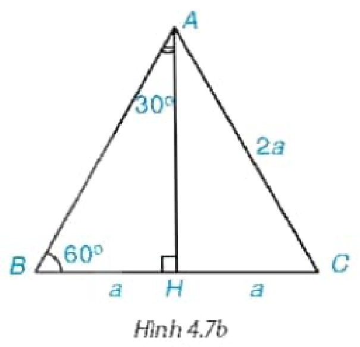
*Hình 4.7b*

Từ HĐ2 và HĐ3, ta có bảng sau:

| $\alpha$ | $30^\circ$ | $45^\circ$ | $60^\circ$ |
| --- | :---: | :---: | :---: |
| $\sin \alpha$ | $\dfrac{1}{2}$ | $\dfrac{\sqrt{2}}{2}$ | $\dfrac{\sqrt{3}}{2}$ |
| $\cos \alpha$ | $\dfrac{\sqrt{3}}{2}$ | $\dfrac{\sqrt{2}}{2}$ | $\dfrac{1}{2}$ |
| $\tan \alpha$ | $\dfrac{\sqrt{3}}{3}$ | $1$ | $\sqrt{3}$ |
| $\cot \alpha$ | $\sqrt{3}$ | $1$ | $\dfrac{\sqrt{3}}{3}$ |

**Ví dụ 2:** Cho tam giác $ABC$ vuông tại $A$ có $\widehat{C} = 30^\circ$ và $BC = a$ (H.4.8). Tính các cạnh $AB, AC$ theo $a$.
<!-- ocr-ok: đã đối chiếu trực tiếp ảnh trang PDF 71, OCR dính chữ nhãn Ví dụ 2 -->

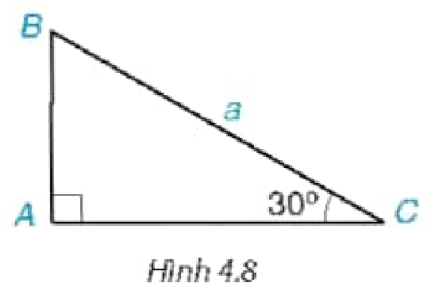
*Hình 4.8*

**Giải**

Ta có $\sin C = \dfrac{AB}{BC}$, suy ra $AB = BC \cdot \sin C = a \cdot \sin 30^\circ$.

Theo bảng trên, $\sin 30^\circ = \dfrac{1}{2}$ nên $AB = \dfrac{a}{2}$.

Tương tự, ta có $\cos C = \dfrac{AC}{BC}$, suy ra $AC = BC \cdot \cos C = a \cdot \cos 30^\circ = \dfrac{a\sqrt{3}}{2}$.

<!-- pdf:72 -->

**Luyện tập 2:** Cho tam giác $ABC$ vuông tại $A$ có $\widehat{C} = 45^\circ$ và $AB = c$. Tính $BC$ và $AC$ theo $c$.
<!-- ocr-ok: đã đối chiếu trực tiếp ảnh trang PDF 72, OCR bỏ sót nhãn hộp Luyện tập 2 -->

## 2. TỈ SỐ LƯỢNG GIÁC CỦA HAI GÓC PHỤ NHAU

**Tỉ số lượng giác của hai góc phụ nhau**

**HĐ4:** Cho tam giác $ABC$ vuông tại $C$, có $\widehat{A} = \alpha, \widehat{B} = \beta$ (H.4.9). Hãy viết các tỉ số lượng giác của góc $\alpha, \beta$ theo độ dài các cạnh của tam giác $ABC$. Trong các tỉ số đó, cho biết các cặp tỉ số bằng nhau.

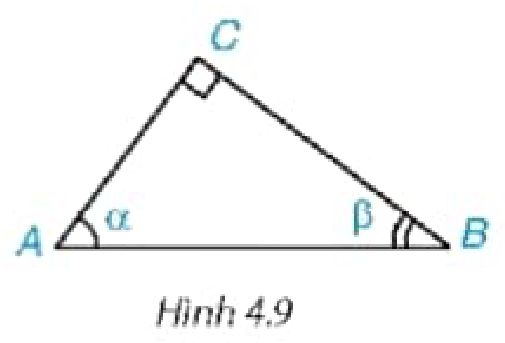
*Hình 4.9*

<!-- term: Định lí về tỉ số lượng giác của hai góc phụ nhau -->
> **Định lí:** Nếu hai góc phụ nhau thì sin góc này bằng côsin góc kia, tang góc này bằng côtang góc kia.

> **Vuông:** Về số đo, hai góc phụ nhau có thể coi là hai góc nhọn của một tam giác vuông.

**Chú ý:** Cho $\alpha$ và $\beta$ là hai góc phụ nhau (H.4.9), khi đó:

$\sin \alpha = \cos \beta, \cos \alpha = \sin \beta, \tan \alpha = \cot \beta, \cot \alpha = \tan \beta$.

**Ví dụ 3:** Hãy viết các tỉ số lượng giác sau thành tỉ số lượng giác của góc nhỏ hơn $45^\circ$:

$\sin 60^\circ, \cos 75^\circ, \sin 52^\circ 30', \tan 80^\circ, \cot 82^\circ$.

**Giải**

Ta có:

$\sin 60^\circ = \cos (90^\circ - 60^\circ) = \cos 30^\circ$;

$\cos 75^\circ = \sin (90^\circ - 75^\circ) = \sin 15^\circ$;

$\sin 52^\circ 30' = \cos (90^\circ - 52^\circ 30') = \cos 37^\circ 30'$;

$\tan 80^\circ = \cot (90^\circ - 80^\circ) = \cot 10^\circ$;

$\cot 82^\circ = \tan (90^\circ - 82^\circ) = \tan 8^\circ$.

**Luyện tập 3:** Hãy giải thích tại sao $\sin 35^\circ = \cos 55^\circ, \tan 35^\circ = \cot 55^\circ$.
<!-- ocr-ok: đã đối chiếu trực tiếp ảnh trang PDF 72, OCR bỏ sót nhãn hộp Luyện tập 3 -->

<!-- pdf:73 -->

## 3. SỬ DỤNG MÁY TÍNH CẦM TAY TÍNH TỈ SỐ LƯỢNG GIÁC CỦA MỘT GÓC NHỌN

> **Pi:** Về số đo góc, dưới đơn vị độ ($^\circ$) còn có các đơn vị phút ($'$) và giây ($''$) với $1^\circ = 60', 1' = 60''$.

**Ví dụ 4:** Dùng MTCT, tính $\sin 27^\circ, \cos 32^\circ 15', \tan 52^\circ 12'$ và $\cot 35^\circ 23'$ (làm tròn đến chữ số thập phân thứ ba).

**Giải**

| Để tính | Bấm phím | Kết quả |
| --- | --- | --- |
| $\sin 27^\circ$ | `sin` `2` `7` `° ' ''` `=` | $0,4539904997$ |
| $\cos 32^\circ 15'$ | `cos` `3` `2` `° ' ''` `1` `5` `° ' ''` `=` | $0,8457278217$ |
| $\tan 52^\circ 12'$ | `tan` `5` `2` `° ' ''` `1` `2` `° ' ''` `=` | $1,289192232$ |
| $\cot 35^\circ 23'$ | `tan` `3` `5` `° ' ''` `2` `3` `° ' ''` `=` `x⁻¹` `=` | $1,408003909$ |
<!-- ocr-ok: đã đối chiếu trực tiếp ảnh trang PDF 73, OCR không nhận diện được các biểu tượng phím bấm MTCT trong bảng -->

Làm tròn đến chữ số thập phân thứ ba ta được $\sin 27^\circ \approx 0,454; \cos 32^\circ 15' \approx 0,846; \tan 52^\circ 12' \approx 1,289; \cot 35^\circ 23' \approx 1,408$.

Lưu ý, $\cot 35^\circ 23' = \dfrac{1}{\tan 35^\circ 23'}$.

**Nhận xét:** Để tính $\cot 35^\circ 23'$, ta có thể tính trực tiếp như trên, hoặc có thể tìm góc phụ với góc $35^\circ 23'$ là $54^\circ 37'$ rồi dùng MTCT tính $\tan 54^\circ 37'$ và suy ra kết quả.

**Luyện tập 4:** Sử dụng MTCT tính các tỉ số lượng giác và làm tròn kết quả đến chữ số thập phân thứ ba:

a) $\sin 40^\circ 54'$;

b) $\cos 52^\circ 15'$;

c) $\tan 69^\circ 36'$;

d) $\cot 25^\circ 18'$.

**Chú ý:** Sử dụng MTCT, ta còn có thể tìm được góc khi biết một trong các tỉ số lượng giác của góc đó.

**Ví dụ 5:** Dùng MTCT, tìm các góc (làm tròn đến phút) biết $\sin \alpha_1 = 0,3214, \cos \alpha_2 = 0,4321, \tan \alpha_3 = 1,2742$ và $\cot \alpha_4 = 1,5384$.

<!-- pdf:74 -->

**Giải**

| Biết | Bấm phím | Kết quả | Bấm tiếp `° ' ''` |
| --- | --- | --- | --- |
| $\sin \alpha_1 = 0,3214$ | `SHIFT` `sin` `0` `.` `3` `2` `1` `4` `=` | $18,74761209$ | $18^\circ 44'\ 51,4''$ |
| $\cos \alpha_2 = 0,4321$ | `SHIFT` `cos` `0` `.` `4` `3` `2` `1` `=` | $64,39909458$ | $64^\circ 23'\ 56,74''$ |
| $\tan \alpha_3 = 1,2742$ | `SHIFT` `tan` `1` `.` `2` `7` `4` `2` `=` | $51,87495892$ | $51^\circ 52'\ 29,85''$ |
| $\cot \alpha_4 = 1,5384$ | `SHIFT` `tan` `1` `.` `5` `3` `8` `4` `x⁻¹` `=` | $33,02491482$ | $33^\circ 1'\ 29,69''$ |
<!-- ocr-ok: đã đối chiếu trực tiếp ảnh trang PDF 74, OCR không nhận diện được các biểu tượng phím bấm MTCT trong bảng -->

Làm tròn đến phút ta được $\alpha_1 \approx 18^\circ 45'; \alpha_2 \approx 64^\circ 24'; \alpha_3 \approx 51^\circ 52'; \alpha_4 \approx 33^\circ 1'$.

**Chú ý:** Để tìm góc $\alpha$ khi biết $\cot \alpha$, ta có thể tìm góc $(90^\circ - \alpha)$ (vì $\tan (90^\circ - \alpha) = \cot \alpha$) rồi suy ra $\alpha$.

**Luyện tập 5:** Dùng MTCT, tìm các góc $\alpha$ (làm tròn đến phút), biết:

a) $\sin \alpha = 0,3782$;

b) $\cos \alpha = 0,6251$;

c) $\tan \alpha = 2,154$;

d) $\cot \alpha = 3,253$.

**Vận dụng:** Trở lại bài toán ở *tình huống mở đầu*. Trong một toà chung cư, biết đoạn dốc vào sảnh toà nhà dài $4\text{ m}$, độ cao của đỉnh dốc bằng $0,4\text{ m}$.

a) Hãy tính góc dốc.

b) Hỏi góc đó có đúng tiêu chuẩn của dốc cho người đi xe lăn không?

**Tranh luận**

Để tính khoảng cách giữa hai địa điểm $A, B$ không đo trực tiếp được, chẳng hạn $A$ và $B$ là hai địa điểm ở hai bên sông, người ta lấy điểm $C$ về phía bờ sông có chứa $B$ sao cho tam giác $ABC$ vuông tại $B$. Ở bên bờ sông chứa $B$, người ta đo được $\widehat{ACB} = \alpha$ và $BC = a$ (H.4.10). Với các dữ liệu đó, đã tính được khoảng cách $AB$ chưa? Nếu được, hãy tính $AB$, biết $\alpha = 55^\circ, a = 70\text{ m}$.

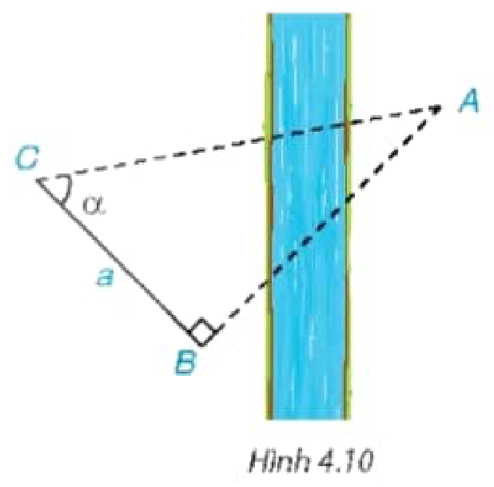
*Hình 4.10*

> **Vuông:** Không thể tính được $AB$ vì trong tam giác vuông $ABC$, theo định lí Pythagore, phải biết được hai cạnh mới tính được cạnh thứ ba.

> **Tròn:** Với các dữ liệu đã biết là có thể tính được khoảng cách $AB$ rồi.

Em hãy cho biết ý kiến của mình.

<!-- pdf:75 -->

## BÀI TẬP

4.1. Cho tam giác $ABC$ vuông tại $A$. Tính các tỉ số lượng giác sin, côsin, tang, côtang của các góc nhọn $B$ và $C$ khi biết:

a) $AB = 8\text{ cm}, BC = 17\text{ cm}$;

b) $AC = 0,9\text{ cm}, AB = 1,2\text{ cm}$.

4.2. Cho tam giác vuông có một góc nhọn $60^\circ$ và cạnh kề với góc $60^\circ$ bằng $3\text{ cm}$. Hãy tính cạnh đối của góc này.

4.3. Cho tam giác vuông có một góc nhọn bằng $30^\circ$ và cạnh đối với góc này bằng $5\text{ cm}$. Tính độ dài cạnh huyền của tam giác.

4.4. Cho hình chữ nhật có chiều dài và chiều rộng lần lượt là $3$ và $\sqrt{3}$. Tính góc giữa đường chéo và cạnh ngắn hơn của hình chữ nhật (sử dụng bảng giá trị lượng giác trang 69).

4.5. a) Viết các tỉ số lượng giác sau thành tỉ số lượng giác của các góc nhỏ hơn $45^\circ$:

$\sin 55^\circ, \cos 62^\circ, \tan 57^\circ, \cot 64^\circ$.

b) Tính $\dfrac{\tan 25^\circ}{\cot 65^\circ}$, $\tan 34^\circ - \cot 56^\circ$.

4.6. Dùng MTCT, tính (làm tròn đến chữ số thập phân thứ ba):

a) $\sin 40^\circ 12'$;

b) $\cos 52^\circ 54'$;

c) $\tan 63^\circ 36'$;

d) $\cot 25^\circ 18'$.

4.7. Dùng MTCT, tìm số đo của góc nhọn $x$ (làm tròn đến phút), biết rằng:

a) $\sin x = 0,2368$;

b) $\cos x = 0,6224$;

c) $\tan x = 1,236$;

d) $\cot x = 2,154$.

## 💡 Em có biết?

*(Đọc thêm)*

**LỊCH SỬ RA ĐỜI CÁC TỪ sin, côsin, tang, côtang**

Ở thế kỉ II, nhà thiên văn người Hy Lạp Ptolemy (85 – 165) đã nghiên cứu mối liên hệ giữa độ dài cung tròn và dây căng cung tròn đó. Sau đó, những nhà thiên văn người Hindu đã nghiên cứu mối liên hệ giữa bán cung và nửa dây, gọi dây căng cung là *jiva*. Nhà thiên văn người Ả Rập Al-Battani (850 – 929) đã phiên âm *jiva* thành *djiba* mà nghĩa đen là “nếp gấp”. Đến năm 1150, nhà phiên dịch người Ý Gerard de Cremone (1114 – 1187) dịch *djiba* sang tiếng Latinh thành *sinus* viết tắt là sin (trên hình: $(O)$ là đường tròn bán kính bằng $1$, $P$ là điểm chính giữa của cung nhỏ $MN$, $H$ là trung điểm của dây $MN$, khi đó $\sin \widehat{MOP} = HM$).

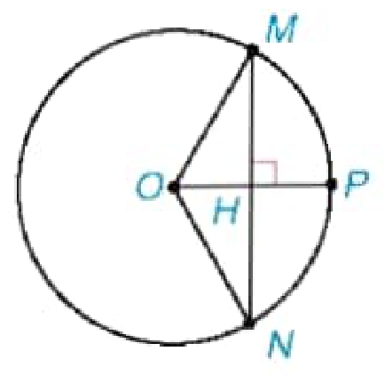

Năm 1583, nhà vật lí và toán học người Đức Thomas Finck đã đưa vào từ “tang” (trong từ ngữ khoa học Ả Rập, chữ *tang* có nghĩa là bóng của một vật) và các kí hiệu sin.com, tan.com (chữ com là viết tắt của chữ complemantary, ý nói góc phụ). Mãi 40 năm sau, người ta mới dùng kí hiệu *côsin*, *côtang* thay cho sin.com, tan.com.

(theo *Stella Baruk, Dictionnaire de mathématiques élémentaires, Seuil, Pháp, 1992*)
<!-- ocr-ok: đã đối chiếu trực tiếp ảnh trang PDF 75, OCR đọc sai tên tiếng Pháp -->

## 📷 Danh sách hình trong bài

| Mã hình | Trang PDF | Vị trí trong bài | Chú thích gốc |
| --- | :---: | --- | --- |
| H9-toan-b11-01 | 68 | Mở đầu | Hình 4.1 |
| H9-toan-b11-02 | 69 | Mục 1 | Hình 4.2 |
| H9-toan-b11-03 | 69 | Mục 1, Câu hỏi | Hình 4.3 |
| H9-toan-b11-04 | 69 | Mục 1, Nhận xét | Hình 4.4 |
| H9-toan-b11-05 | 70 | Mục 1, Khung kiến thức | Hình 4.5 |
| H9-toan-b11-06 | 70 | Mục 1, Ví dụ 1 (cạnh trái khung chữ nhật chạm dấu chấm cuối cụm '(H.4.6).') | Hình 4.6 |
| H9-toan-b11-07 | 71 | Mục 1, HĐ2 | Hình 4.7a |
| H9-toan-b11-08 | 71 | Mục 1, HĐ3 | Hình 4.7b |
| H9-toan-b11-09 | 71 | Mục 1, Ví dụ 2 | Hình 4.8 |
| H9-toan-b11-10 | 72 | Mục 2, HĐ4 | Hình 4.9 |
| H9-toan-b11-11 | 74 | Mục 3, Tranh luận | Hình 4.10 |
| H9-toan-b11-12 | 75 | Em có biết? | (sách không đánh số, hình đường tròn tâm O bán kính 1 minh hoạ $\sin \widehat{MOP} = HM$) |
