<!-- pdf:76 -->

# BÀI 12: MỘT SỐ HỆ THỨC GIỮA CẠNH, GÓC TRONG TAM GIÁC VUÔNG VÀ ỨNG DỤNG

## 🎯 Kiến thức, kĩ năng

- Giải thích một số hệ thức về cạnh và góc trong tam giác vuông.
- Giải tam giác vuông.
- Giải quyết một số vấn đề thực tiễn gắn với tỉ số lượng giác của góc nhọn.

## 🔴 Mở đầu

Để đo chiều cao của một toà lâu đài (H.4.11), người ta đặt giác kế thẳng đứng tại điểm $M$. Quay ống ngắm của giác kế sao cho nhìn thấy đỉnh $P'$ của toà lâu đài dưới góc nhọn $\alpha$. Sau đó, đặt giác kế thẳng đứng tại điểm $N$, $NM = 20\text{ m}$, thì nhìn thấy đỉnh $P'$ dưới góc nhọn $\beta$ ($\beta < \alpha$). Biết chiều cao giác kế là $1,6\text{ m}$, hãy tính chiều cao của toà lâu đài.

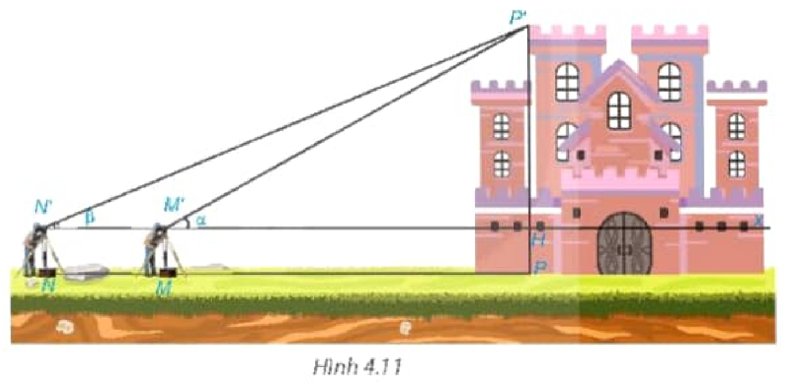
*Hình 4.11*

## 1. HỆ THỨC GIỮA CẠNH HUYỀN VÀ CẠNH GÓC VUÔNG

**Công thức tính cạnh góc vuông theo cạnh huyền và sin, côsin của các góc nhọn**

**HĐ1:** Cho tam giác $ABC$ vuông tại $A$, cạnh huyền $a$ và các cạnh góc vuông $b, c$ (H.4.12).

a) Viết các tỉ số lượng giác sin, côsin của góc $B$ và góc $C$ theo độ dài các cạnh của tam giác $ABC$.

b) Tính mỗi cạnh góc vuông $b$ và $c$ theo cạnh huyền $a$ và các tỉ số lượng giác trên của góc $B$ và góc $C$.

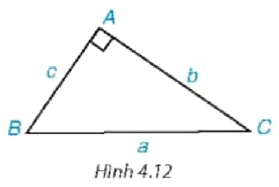
*Hình 4.12*

<!-- term: Hệ thức giữa cạnh huyền và cạnh góc vuông -->
> **Định lí 1:** Trong tam giác vuông, mỗi cạnh góc vuông bằng cạnh huyền nhân với sin góc đối hoặc nhân với côsin góc kề.

**Chú ý:** Trong tam giác $ABC$ vuông tại $A$ (H.4.12), ta có:

$b = a \cdot \sin B = a \cdot \cos C$; $c = a \cdot \sin C = a \cdot \cos B$.

<!-- pdf:77 -->

**Ví dụ 1:** Một chiếc máy bay bay lên với vận tốc $500\text{ km/h}$. Đường bay lên tạo với phương nằm ngang một góc $30^\circ$ (H.4.13). Hỏi sau $1,2$ phút, máy bay lên cao được bao nhiêu kilômét theo phương thẳng đứng?

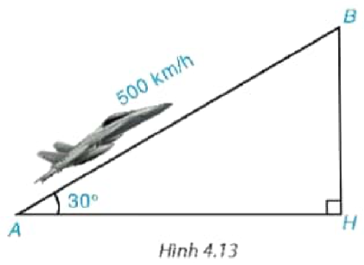
*Hình 4.13*

**Giải**

Giả sử trong Hình 4.13, $AB$ là đoạn đường máy bay bay lên trong $1,2$ phút thì $BH$ chính là độ cao máy bay đạt được sau $1,2$ phút đó.

Ta có $1,2\text{ phút} = \dfrac{1}{50}\text{ giờ}$ nên $AB = 500 \cdot \dfrac{1}{50} = 10\text{ (km)}$.

Tam giác $ABH$ vuông tại $H$, có $\widehat{A} = 30^\circ$. Theo Định lí 1, ta có

$BH = AB \cdot \sin A = 10 \cdot \sin 30^\circ = 10 \cdot \dfrac{1}{2} = 5\text{ (km)}$.

Vậy sau $1,2$ phút, máy bay lên cao được $5\text{ km}$.

**Luyện tập 1:**

1. Một chiếc thang dài $3\text{ m}$. Cần đặt chân thang cách chân tường một khoảng bằng bao nhiêu mét (làm tròn đến số thập phân thứ hai) để nó tạo được với mặt đất một góc “an toàn” $65^\circ$ (tức là đảm bảo thang chắc chắn khi sử dụng) (H.4.14)?

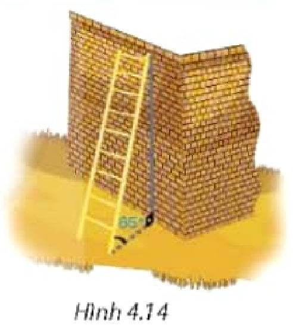
*Hình 4.14*

2. Một khúc sông rộng khoảng $250\text{ m}$. Một con đò chèo qua sông bị dòng nước đẩy xiên nên phải chèo khoảng $320\text{ m}$ mới sang được bờ bên kia. Hỏi dòng nước đã đẩy con đò đi lệch một góc $\alpha$ bằng bao nhiêu độ (làm tròn đến phút)? (H.4.15).

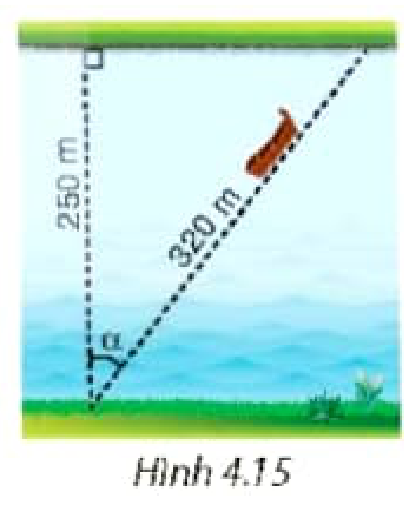
*Hình 4.15*

## 2. HỆ THỨC GIỮA HAI CẠNH GÓC VUÔNG

**Công thức tính cạnh góc vuông theo cạnh góc vuông kia và tang, côtang của các góc nhọn**

**HĐ2:** Xét tam giác $ABC$ trong Hình 4.16.

a) Viết các tỉ số lượng giác tang, côtang của góc $B$ và góc $C$ theo $b, c$.

b) Tính mỗi cạnh góc vuông $b$ và $c$ theo cạnh góc vuông kia và các tỉ số lượng giác trên của góc $B$ và góc $C$.

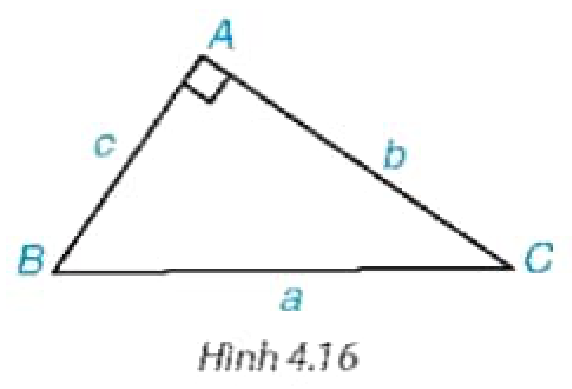
*Hình 4.16*

<!-- pdf:78 -->

<!-- term: Hệ thức giữa hai cạnh góc vuông -->
> **Định lí 2:** Trong tam giác vuông, mỗi cạnh góc vuông bằng cạnh góc vuông kia nhân với tang góc đối hoặc nhân với côtang góc kề.

**Chú ý:** Trong tam giác $ABC$ vuông tại $A$ (H.4.16), ta có:

$b = c \cdot \tan B = c \cdot \cot C$; $c = b \cdot \tan C = b \cdot \cot B$.

**Ví dụ 2:** Các tia nắng mặt trời tạo với mặt đất một góc xấp xỉ bằng $34^\circ$ và bóng của một toà tháp trên mặt đất dài $8,6\text{ m}$ (H.4.17). Tính chiều cao của toà tháp đó (làm tròn đến mét).

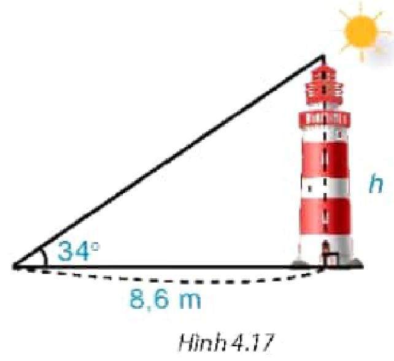
*Hình 4.17*

**Giải**

Ta nhận thấy đường cao của tháp đối diện với góc $34^\circ$ (góc tạo bởi tia nắng mặt trời và bóng của tháp trên mặt đất).

Theo Định lí 2, ta có $h = 8,6 \cdot \tan 34^\circ \approx 6\text{ (m)}$.

Vậy chiều cao của tháp là khoảng $6\text{ m}$.

**Luyện tập 2:** Bóng trên mặt đất của một cây dài $25\text{ m}$. Tính chiều cao của cây (làm tròn đến $\text{dm}$), biết rằng tia nắng mặt trời tạo với mặt đất góc $40^\circ$ (H.4.18).

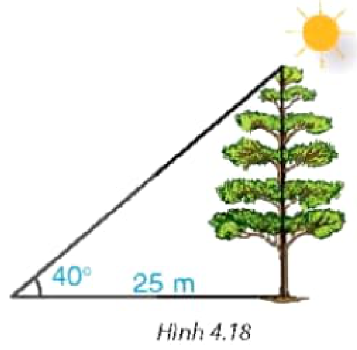
*Hình 4.18*

## 3. GIẢI TAM GIÁC VUÔNG

**Ví dụ 3:** Cho tam giác vuông $ABC$ với các cạnh góc vuông $AB = 5, AC = 8$ (H.4.19). Hãy tính cạnh $BC$ (làm tròn đến chữ số thập phân thứ nhất) và các góc $B, C$ (làm tròn đến độ).

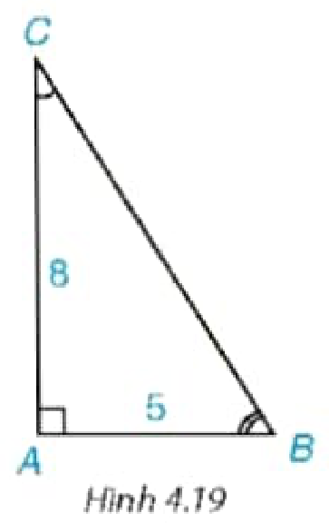
*Hình 4.19*

**Giải:** Xét $\Delta ABC$ vuông tại $A$.

*Cách 1.* Theo định lí Pythagore, ta có:

$BC = \sqrt{AB^2 + AC^2} = \sqrt{5^2 + 8^2} \approx 9,4$.

Ta có $\tan C = \dfrac{AB}{AC} = \dfrac{5}{8} = 0,625$. Từ đó tìm được $\widehat{C} \approx 32^\circ$,

suy ra $\widehat{B} = 90^\circ - \widehat{C} \approx 90^\circ - 32^\circ = 58^\circ$.

<!-- pdf:79 -->

*Cách 2.* Sau khi tìm được $\widehat{C} \approx 32^\circ$, ta tính cạnh $BC$.

Ta có $\sin 32^\circ \approx \sin C = \dfrac{AB}{BC} = \dfrac{5}{BC}$, suy ra $BC \approx \dfrac{5}{\sin 32^\circ} \approx 9,4$.

**Luyện tập 3:** Cho tam giác vuông $ABC$ có cạnh góc vuông $AB = 4$, cạnh huyền $BC = 8$. Tính cạnh $AC$ (làm tròn đến số thập phân thứ ba) và các góc $B, C$ (làm tròn đến độ).

**Ví dụ 4:** Cho tam giác $ABC$ vuông tại $A$ có $AB = 3, \widehat{B} = 42^\circ$ (H.4.20). Tính góc $C$ và các cạnh $AC, BC$ (làm tròn đến chữ số thập phân thứ ba).

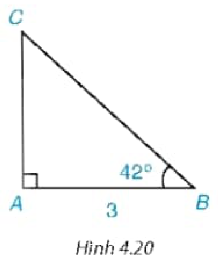
*Hình 4.20*

**Giải**

Xét $\Delta ABC$ vuông tại $A$.

Ta có: $\widehat{C} = 90^\circ - \widehat{B} = 90^\circ - 42^\circ = 48^\circ$;

$AC = AB \cdot \tan B = 3 \cdot \tan 42^\circ \approx 2,701$.

Theo định nghĩa các tỉ số lượng giác của góc nhọn, ta có:

$\cos B = \dfrac{AB}{BC}$, suy ra $BC = \dfrac{AB}{\cos B} = \dfrac{3}{\cos 42^\circ} \approx 4,037$.

**Giải tam giác vuông là gì?**

> Trong một tam giác vuông, nếu cho biết trước hai cạnh (hoặc một góc nhọn và một cạnh) thì ta sẽ tìm được tất cả các cạnh và các góc còn lại của tam giác vuông đó. Bài toán này gọi là bài toán **Giải tam giác vuông**.

> **Vuông:** Ví dụ 3, Luyện tập 3 và Ví dụ 4 là những bài toán Giải tam giác vuông.
<!-- ocr-ok: đã đối chiếu trực tiếp ảnh trang PDF 79, OCR đọc sai bóng thoại của Vuông -->

> ❓ 1. Hãy nêu cách giải tam giác $ABC$ vuông tại $A$ khi biết hai cạnh $AB = c, AC = b$ hoặc $AB = c, BC = a$ và không sử dụng định lí Pythagore (H.4.21).
>
> 2. Hãy nêu cách giải tam giác $ABC$ vuông tại $A$ khi biết cạnh góc vuông $AB$ (hoặc cạnh huyền $BC$) và góc $B$.

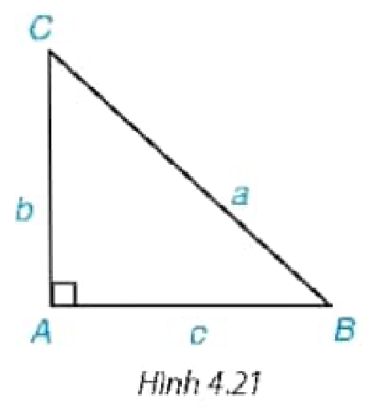
*Hình 4.21*

**Luyện tập 4:** Giải tam giác $ABC$ vuông tại $A$, biết $BC = 9, \widehat{C} = 53^\circ$.

**Vận dụng:** Giải bài toán ở *tình huống mở đầu* với $\alpha = 27^\circ$ và $\beta = 19^\circ$.

<!-- pdf:80 -->

## BÀI TẬP

4.8. Giải tam giác $ABC$ vuông tại $A$ có $BC = a, AC = b, AB = c$, trong các trường hợp:

a) $a = 21, b = 18$;

b) $b = 10, \widehat{C} = 30^\circ$;

c) $c = 5, b = 3$.

4.9. Tính góc nghiêng $\alpha$ của thùng xe chở rác trong Hình 4.22.

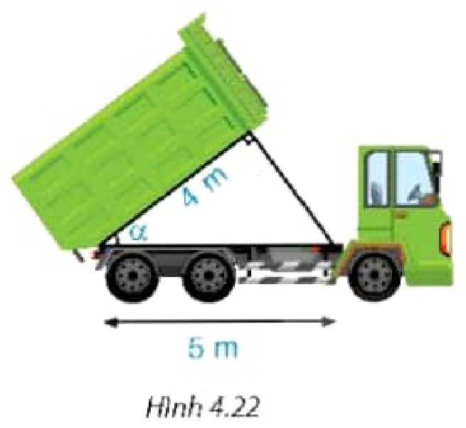
*Hình 4.22*

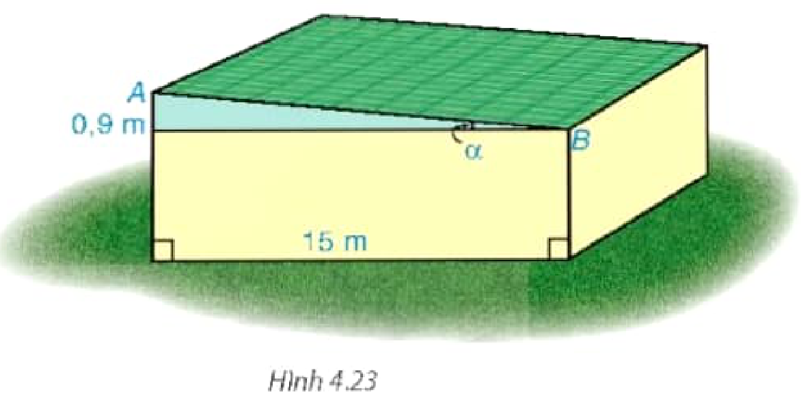
*Hình 4.23*

4.10. Tìm góc nghiêng $\alpha$ và chiều rộng $AB$ của mái nhà kho trong Hình 4.23.

4.11. Tính các góc của hình thoi có hai đường chéo dài $2\sqrt{3}$ và $2$.

4.12. Cho hình thang $ABCD$ ($AD \parallel BC$) có $AD = 16\text{ cm}, BC = 4\text{ cm}$ và $\widehat{A} = \widehat{B} = \widehat{ACD} = 90^\circ$.

a) Kẻ đường cao $CE$ của tam giác $ACD$. Chứng minh $\widehat{ADC} = \widehat{ACE}$. Tính sin của các góc $\widehat{ADC}, \widehat{ACE}$ và suy ra $AC^2 = AE \cdot AD$. Từ đó tính $AC$.

b) Tính góc $D$ của hình thang.

4.13. Một người đứng tại điểm $A$, cách gương phẳng đặt nằm trên mặt đất tại điểm $B$ là $1,2\text{ m}$, nhìn thấy hình phản chiếu qua gương $B$ của ngọn cây (cây có gốc ở tại điểm $C$ cách $B$ là $4,8\text{ m}$, $B$ nằm giữa $A$ và $C$). Biết khoảng cách từ mặt đất đến mắt người đó là $1,65\text{ m}$. Tính chiều cao của cây (H.4.24).

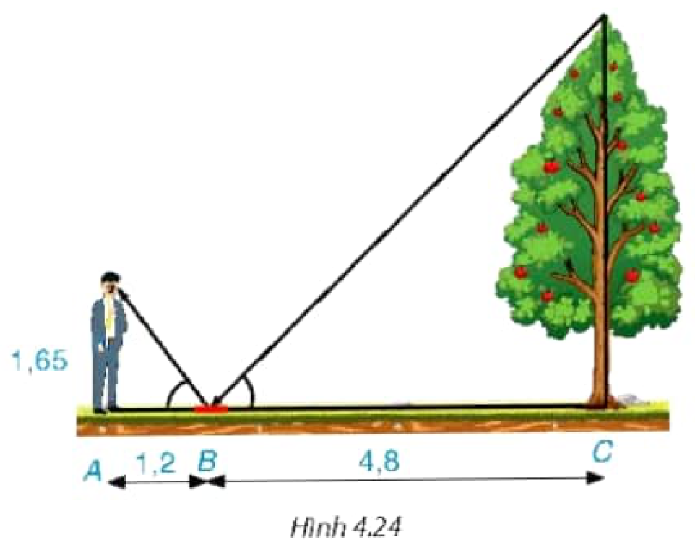
*Hình 4.24*

## 📷 Danh sách hình trong bài

| Mã hình | Trang PDF | Vị trí trong bài | Chú thích gốc |
| --- | :---: | --- | --- |
| H9-toan-b12-01 | 76 | Mở đầu | Hình 4.11 |
| H9-toan-b12-02 | 76 | Mục 1, HĐ1 | Hình 4.12 |
| H9-toan-b12-03 | 77 | Mục 1, Ví dụ 1 | Hình 4.13 |
| H9-toan-b12-04 | 77 | Mục 1, Luyện tập 1 (câu 1) | Hình 4.14 |
| H9-toan-b12-05 | 77 | Mục 1, Luyện tập 1 (câu 2) | Hình 4.15 |
| H9-toan-b12-06 | 77 | Mục 2, HĐ2 | Hình 4.16 |
| H9-toan-b12-07 | 78 | Mục 2, Ví dụ 2 | Hình 4.17 |
| H9-toan-b12-08 | 78 | Mục 2, Luyện tập 2 | Hình 4.18 |
| H9-toan-b12-09 | 78 | Mục 3, Ví dụ 3 | Hình 4.19 |
| H9-toan-b12-10 | 79 | Mục 3, Ví dụ 4 | Hình 4.20 |
| H9-toan-b12-11 | 79 | Mục 3, Câu hỏi | Hình 4.21 |
| H9-toan-b12-12 | 80 | Bài tập 4.9 | Hình 4.22 |
| H9-toan-b12-13 | 80 | Bài tập 4.10 | Hình 4.23 |
| H9-toan-b12-14 | 80 | Bài tập 4.13 | Hình 4.24 |
