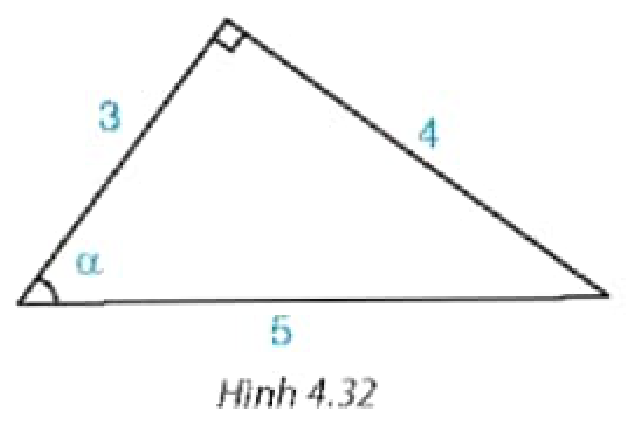
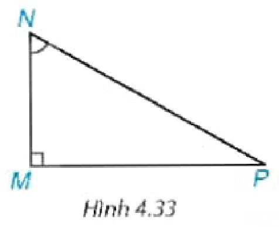
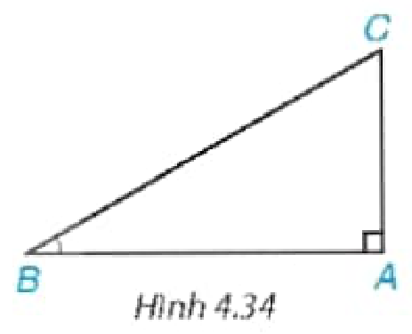
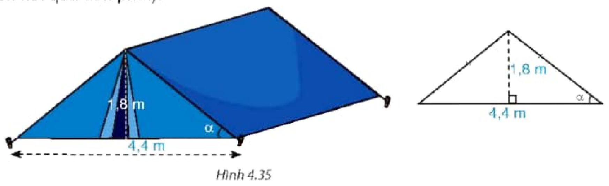
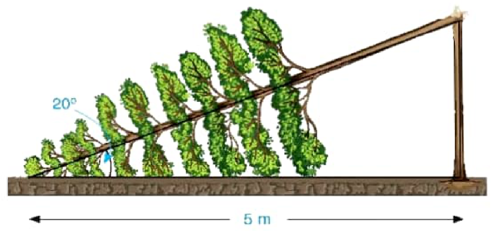
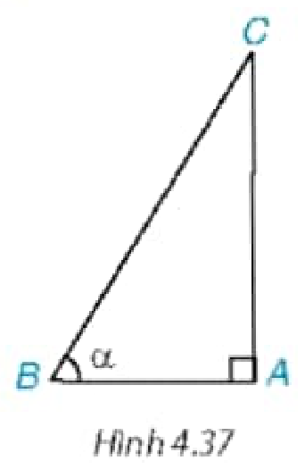
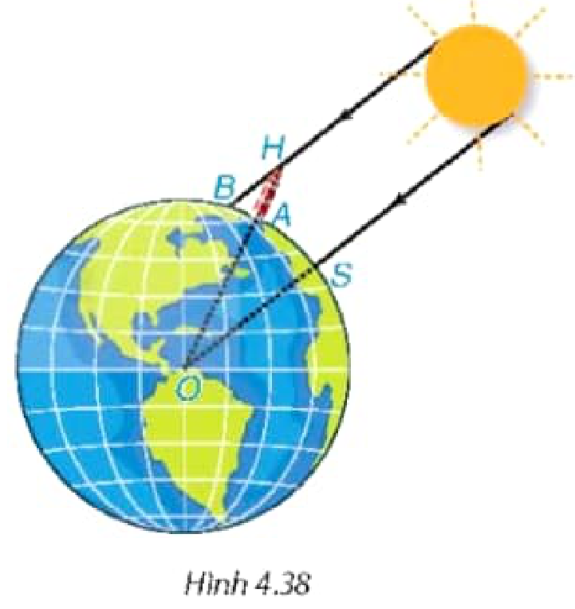

<!-- pdf:83 -->

# BÀI TẬP CUỐI CHƯƠNG IV

**A. TRẮC NGHIỆM**

4.21. Trong Hình 4.32, $\cos \alpha$ bằng

A. $\dfrac{5}{3}$.

B. $\dfrac{3}{4}$.

C. $\dfrac{3}{5}$.

D. $\dfrac{4}{5}$.

*Hình 4.32*

4.22. Trong tam giác $MNP$ vuông tại $M$ (H.4.33), $\sin \widehat{MNP}$ bằng

A. $\dfrac{PN}{NM}$.

B. $\dfrac{MP}{PN}$.

C. $\dfrac{MN}{PN}$.

D. $\dfrac{MN}{MP}$.

*Hình 4.33*

4.23. Trong tam giác $ABC$ vuông tại $A$ (H.4.34), $\tan B$ bằng

A. $\dfrac{AB}{AC}$.

B. $\dfrac{AC}{AB}$.

C. $\dfrac{AB}{BC}$.

D. $\dfrac{BC}{AC}$.

*Hình 4.34*

4.24. Với mọi góc nhọn $\alpha$, ta có

A. $\sin (90^\circ - \alpha) = \cos \alpha$.

B. $\tan (90^\circ - \alpha) = \cos \alpha$.

C. $\cot (90^\circ - \alpha) = 1 - \tan \alpha$.

D. $\cot (90^\circ - \alpha) = \sin \alpha$.

4.25. Giá trị $\tan 30^\circ$ bằng

A. $\sqrt{3}$.

B. $\dfrac{\sqrt{3}}{2}$.

C. $\dfrac{1}{\sqrt{3}}$.

D. $1$.

**B. TỰ LUẬN**

4.26. Xét các tam giác vuông có một góc nhọn bằng hai lần góc nhọn còn lại. Hỏi các tam giác đó có đồng dạng với nhau không? Tính sin và côsin của góc nhọn lớn hơn.

4.27. Hình 4.35 là mô hình của một túp lều. Tìm góc $\alpha$ giữa cạnh mái lều và mặt đất (làm tròn kết quả đến phút).

*Hình 4.35*

<!-- pdf:84 -->

4.28. Một cây cao bị gãy, ngọn cây đổ xuống mặt đất. Ba điểm: gốc cây, điểm gãy, ngọn cây tạo thành một tam giác vuông. Đoạn cây gãy tạo với mặt đất góc $20^\circ$ và chắn ngang lối đi một đoạn $5\text{ m}$ (H.4.36). Hỏi trước khi bị gãy, cây cao khoảng bao nhiêu mét (làm tròn kết quả đến hàng phần mười)?

4.29. Cho tam giác $ABC$ vuông tại $A$, có $\widehat{B} = \alpha$ (H.4.37).

a) Hãy viết các tỉ số lượng giác $\sin \alpha, \cos \alpha$.

b) Sử dụng định lí Pythagore, chứng minh rằng $\sin^2 \alpha + \cos^2 \alpha = 1$.

*Hình 4.37*

4.30. **ĐỐ VUI.** **Chu vi Trái Đất bằng bao nhiêu?**

Vào khoảng năm $200$ trước Công nguyên, Eratosthenes (Ơ-ra-tô-xten), một nhà toán học và thiên văn học người Hy Lạp, đã ước lượng được “chu vi” của Trái Đất (chu vi của đường Xích Đạo) nhờ hai quan sát sau:

1. Hồi đó, hằng năm cứ vào trưa ngày Hạ chí (21/6), người ta thấy tia sáng mặt trời chiếu thẳng xuống đáy một cái giếng sâu nổi tiếng ở thành phố Syene (Xy-en), tức là tia sáng chiếu thẳng đứng.

2. Cũng vào trưa một ngày Hạ chí, ở thành phố Alexandria (A-lếch-xăng-đri-a) cách Syene $800\text{ km}$, Eratosthenes thấy một tháp cao $25\text{ m}$ có bóng trên mặt đất dài $3,1\text{ m}$.

Từ hai quan sát trên, ông có thể tính xấp xỉ “chu vi” của Trái Đất như thế nào? (trên Hình 4.38, điểm $O$ là tâm Trái Đất, điểm $S$ tượng trưng cho thành phố Syene, điểm $A$ tượng trưng cho thành phố Alexandria, điểm $H$ là đỉnh của tháp, bóng của tháp trên mặt đất được coi là đoạn thẳng $AB$).

*Hình 4.38*

## 📷 Danh sách hình trong bài

| Mã hình | Trang PDF | Vị trí trong bài | Chú thích gốc |
| --- | :---: | --- | --- |
| H9-toan-bt-c04-01 | 83 | Bài tập 4.21 | Hình 4.32 |
| H9-toan-bt-c04-02 | 83 | Bài tập 4.22 | Hình 4.33 |
| H9-toan-bt-c04-03 | 83 | Bài tập 4.23 | Hình 4.34 |
| H9-toan-bt-c04-04 | 83 | Bài tập 4.27 (cạnh trên bên trái đi qua chân chữ dòng cuối đề bài 4.27 do đỉnh lều nhô cao) | Hình 4.35 |
| H9-toan-bt-c04-05 | 84 | Bài tập 4.28 | (sách gọi là H.4.36 trong đề bài, không in dòng chú thích dưới hình) |
| H9-toan-bt-c04-06 | 84 | Bài tập 4.29 | Hình 4.37 |
| H9-toan-bt-c04-07 | 84 | Bài tập 4.30 | Hình 4.38 |
