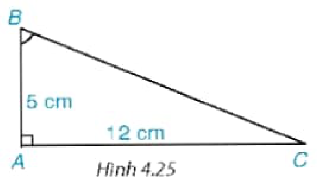
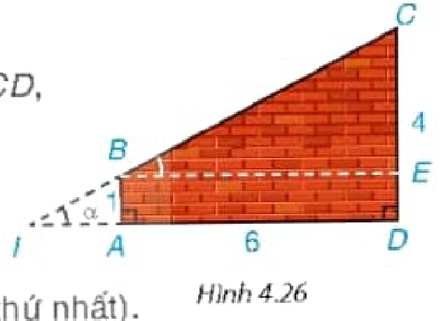
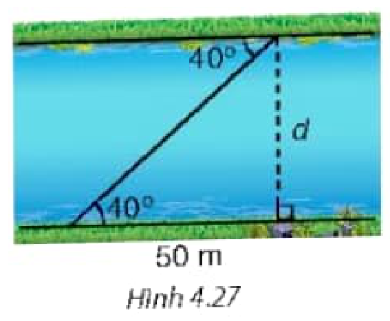
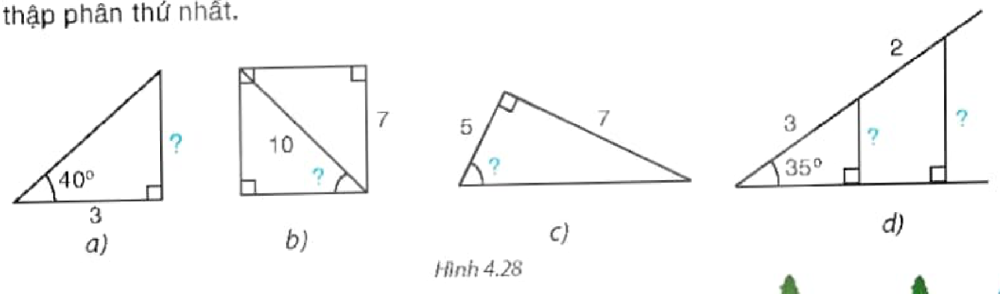
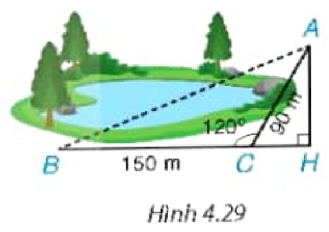
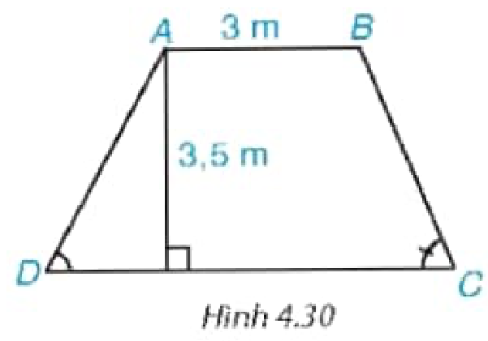
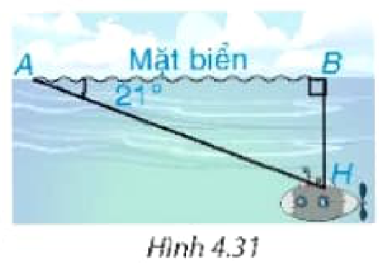

<!-- pdf:81 -->

# LUYỆN TẬP CHUNG (TRANG 79)

**Ví dụ 1:** Cho tam giác $ABC$ vuông tại $A$, $AB = 5\text{ cm}, AC = 12\text{ cm}$.
<!-- ocr-ok: đã đối chiếu trực tiếp ảnh trang PDF 81, OCR bỏ sót nhãn hộp Ví dụ 1 -->

a) Tính các tỉ số lượng giác của góc $B$.

b) Từ kết quả câu a) suy ra các tỉ số lượng giác của góc $C$.

*Hình 4.25*

**Giải** (H.4.25)

a) Xét tam giác $ABC$ vuông tại $A$. Theo định lí Pythagore, ta có

$BC^2 = AB^2 + AC^2 = 5^2 + 12^2 = 169$, suy ra $BC = 13\text{ cm}$.

Ta có: $\sin B = \dfrac{AC}{BC} = \dfrac{12}{13}, \cos B = \dfrac{AB}{BC} = \dfrac{5}{13}, \tan B = \dfrac{AC}{AB} = \dfrac{12}{5}, \cot B = \dfrac{AB}{AC} = \dfrac{5}{12}$.

b) Do $\widehat{B} + \widehat{C} = 90^\circ$ nên $\sin C = \cos B = \dfrac{5}{13}, \cos C = \sin B = \dfrac{12}{13}, \tan C = \cot B = \dfrac{5}{12}, \cot C = \tan B = \dfrac{12}{5}$.

**Ví dụ 2:** Một bức tường đang xây dở có dạng hình thang vuông $ABCD$, vuông góc ở $A$ và $D$, $AB = 1\text{ m}, CD = 4\text{ m}, AD = 6\text{ m}$.
<!-- ocr-ok: đã đối chiếu trực tiếp ảnh trang PDF 81, OCR bỏ sót nhãn hộp Ví dụ 2 và đọc sai dấu -->

a) Hỏi góc $\alpha$ tạo bởi đường thẳng $BC$ và mặt đất $AD$ có số đo xấp xỉ bằng bao nhiêu (làm tròn đến phút)? (H.4.26)

b) Tính độ dài cạnh $BC$ (làm tròn đến chữ số thập phân thứ nhất).

*Hình 4.26*

**Giải**

a) Gọi $I$ là giao điểm của hai đường thẳng $AD$ và $BC$. Qua $B$ kẻ đường thẳng song song với $AD$ (mặt đất) cắt $CD$ ở $E$ thì khi đó $\widehat{EBC} = \widehat{DIC} = \alpha$ (hai góc đồng vị).

Tứ giác $ABED$ có $BE \parallel AD, AB \parallel DE, \widehat{A} = 90^\circ$ nên $ABED$ là hình chữ nhật.
<!-- ocr-ok: đã đối chiếu trực tiếp ảnh trang PDF 81, câu ngắn nhiều kí hiệu toán học -->

Do đó $BE = AD = 6\text{ m}, EC = CD - ED = 4 - 1 = 3\text{ (m)}$.

Xét $\Delta BCE$ vuông tại $E$, ta có $\tan \alpha = \tan \widehat{EBC} = \dfrac{EC}{BE} = \dfrac{3}{6} = \dfrac{1}{2}$.
<!-- ocr-ok: đã đối chiếu trực tiếp ảnh trang PDF 81, câu ngắn nhiều công thức LaTeX -->

Từ đó tính được $\alpha \approx 26^\circ 34'$.

b) **Cách 1.** Áp dụng định lí Pythagore vào tam giác $BEC$ vuông tại $E$, ta có:

$BC^2 = BE^2 + EC^2 = 6^2 + 3^2 = 45$. Suy ra $BC = \sqrt{45} = 3\sqrt{5} \approx 6,7\text{ (m)}$.

**Cách 2.** Tam giác $BEC$ vuông tại $E$ nên $EC = BC \cdot \sin \alpha$,

suy ra $BC = \dfrac{EC}{\sin \alpha} = \dfrac{3}{\sin 26^\circ 34'} \approx 6,7\text{ (m)}$.

<!-- pdf:82 -->

## BÀI TẬP

4.14. Một cuốn sách khổ $17 \times 24\text{ cm}$, tức là chiều rộng $17\text{ cm}$, chiều dài $24\text{ cm}$. Gọi $\alpha$ là góc giữa đường chéo và cạnh $17\text{ cm}$. Tính $\sin \alpha, \cos \alpha$ (làm tròn đến chữ số thập phân thứ hai) và tính số đo $\alpha$ (làm tròn đến độ).

4.15. Cho tam giác $ABC$ có chân đường cao $AH$ nằm giữa $B$ và $C$. Biết $HB = 3\text{ cm}, HC = 6\text{ cm}, \widehat{HAC} = 60^\circ$. Hãy tính độ dài các cạnh (làm tròn đến $\text{cm}$), số đo các góc của tam giác $ABC$ (làm tròn đến độ).

4.16. Tìm chiều rộng $d$ của dòng sông trong Hình 4.27 (làm tròn đến $\text{m}$).

*Hình 4.27*

4.17. Tính các số liệu còn thiếu (dấu “?”) ở Hình 4.28 với góc làm tròn đến độ, với độ dài làm tròn đến chữ số thập phân thứ nhất.

*Hình 4.28*

4.18. Một bạn muốn tính khoảng cách giữa hai địa điểm $A, B$ ở hai bên hồ nước. Biết rằng các khoảng cách từ một điểm $C$ đến $A$ và đến $B$ là $CA = 90\text{ m}, CB = 150\text{ m}$ và $\widehat{ACB} = 120^\circ$ (H.4.29). Hãy tính $AB$ giúp bạn.

*Hình 4.29*

4.19. Mặt cắt ngang của một đập ngăn nước có dạng hình thang $ABCD$ (H.4.30). Chiều rộng của mặt trên $AB$ của đập là $3\text{ m}$. Độ dốc của sườn $AD$, tức là $\tan D = 1,25$. Độ dốc của sườn $BC$, tức là $\tan C = 1,5$. Chiều cao của đập là $3,5\text{ m}$. Hãy tính chiều rộng $CD$ của chân đập, chiều dài của các sườn $AD$ và $BC$ (làm tròn đến $\text{dm}$).

*Hình 4.30*

4.20. Trong một buổi tập trận, một tàu ngầm đang ở trên mặt biển bắt đầu di chuyển theo đường thẳng tạo với mặt nước biển một góc $21^\circ$ để lặn xuống (H.4.31).

a) Khi tàu chuyển động theo hướng đó và đi được $200\text{ m}$ thì tàu ở độ sâu bao nhiêu so với mặt nước biển? (làm tròn đến $\text{m}$).

b) Giả sử tốc độ của tàu là $9\text{ km/h}$ thì sau bao lâu (tính từ lúc bắt đầu lặn) tàu ở độ sâu $200\text{ m}$ (tức là cách mặt nước biển $200\text{ m}$)?

*Hình 4.31*

## 📷 Danh sách hình trong bài

| Mã hình | Trang PDF | Vị trí trong bài | Chú thích gốc |
| --- | :---: | --- | --- |
| H9-toan-ltc-c04-01-01 | 81 | Ví dụ 1 | Hình 4.25 |
| H9-toan-ltc-c04-01-02 | 81 | Ví dụ 2 (góc dưới bên trái khung chữ nhật chạm chữ cuối câu b Ví dụ 2) | Hình 4.26 |
| H9-toan-ltc-c04-01-03 | 82 | Bài tập 4.16 | Hình 4.27 |
| H9-toan-ltc-c04-01-04 | 82 | Bài tập 4.17 (cạnh trên bên trái đi qua dòng cuối đề bài 4.17, cạnh dưới bên phải chạm ngọn cây Hình 4.29) | Hình 4.28 |
| H9-toan-ltc-c04-01-05 | 82 | Bài tập 4.18 | Hình 4.29 |
| H9-toan-ltc-c04-01-06 | 82 | Bài tập 4.19 | Hình 4.30 |
| H9-toan-ltc-c04-01-07 | 82 | Bài tập 4.20 | Hình 4.31 |
