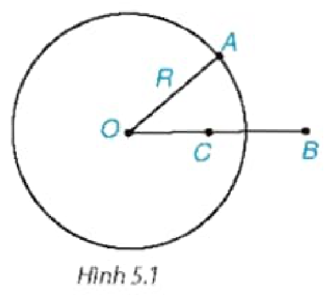
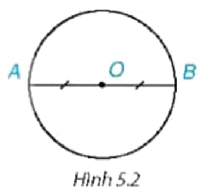
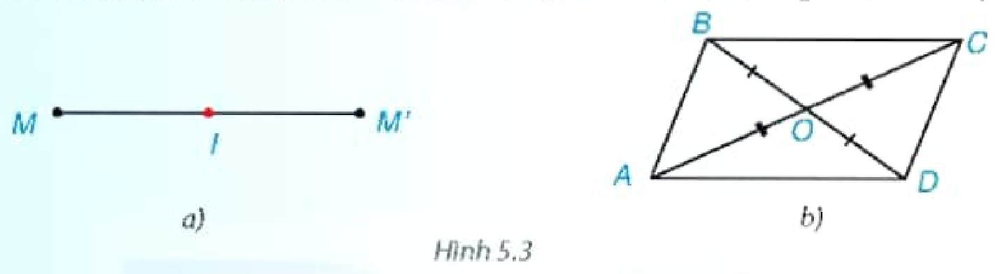
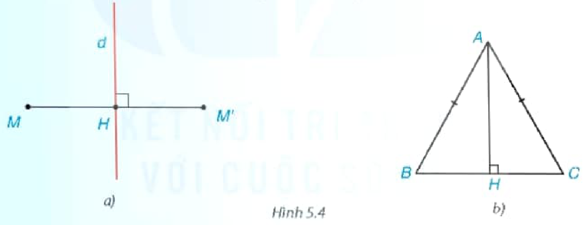
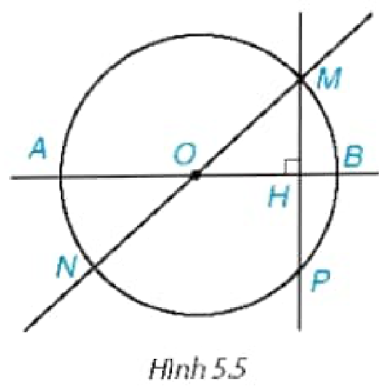

<!-- pdf:85 -->
<!-- Phần giới thiệu đầu Chương V (nửa trên trang PDF 85): HÌNH HỌC PHẲNG — CHƯƠNG V: ĐƯỜNG TRÒN -->

Trong đời sống thực tế, chúng ta thấy có rất nhiều hình ảnh của đường tròn hay hình tròn như: bánh xe, vành nón, mặt trống, biển báo giao thông, ... Vậy đường tròn là gì? Đường tròn có những tính chất gì? Chương này sẽ giúp các em khám phá những điều lí thú về đường tròn.

# BÀI 13: MỞ ĐẦU VỀ ĐƯỜNG TRÒN

## 🔤 Khái niệm, thuật ngữ

- Đường tròn, tâm, bán kính
- Tâm đối xứng
- Trục đối xứng

## 🎯 Kiến thức, kĩ năng

- Nhận biết một điểm thuộc hay không thuộc một đường tròn.
- Nhận biết hai điểm đối xứng nhau qua một tâm, qua một trục.
- Nhận biết tâm đối xứng và trục đối xứng của đường tròn.

## 🔴 Mở đầu

Bạn Oanh có một mảnh giấy hình tròn nhưng không còn dấu vết của tâm. Theo em, Oanh làm thế nào để tìm lại được tâm của hình tròn đó.

## 1. ĐƯỜNG TRÒN

**Đường tròn, điểm thuộc đường tròn**

Ở lớp dưới các em đã biết cách dùng compa để vẽ đường tròn. Vậy đường tròn là gì? Ta định nghĩa:

> **Đường tròn** tâm $O$ bán kính $R$ ($R > 0$), kí hiệu là $(O; R)$, là hình gồm tất cả các điểm cách điểm $O$ một khoảng bằng $R$.

<!-- pdf:86 -->

- Khi không cần để ý đến bán kính ta kí hiệu đường tròn tâm $O$ là $(O)$.
- Nếu $A$ là một điểm của đường tròn $(O)$ thì ta viết $A \in (O)$. Khi đó, ta còn nói đường tròn $(O)$ *đi qua* điểm $A$, hay điểm $A$ *nằm trên* đường tròn $(O)$.

**Nhận xét**

<!-- term: Vị trí tương đối của điểm và đường tròn -->
1) Trên Hình 5.1, ta thấy điểm $A$ nằm trên, điểm $C$ nằm trong và điểm $B$ nằm ngoài đường tròn $(O)$. Một cách tổng quát, ta có:

<!-- term: Vị trí tương đối của điểm và đường tròn -->
- Điểm $M$ *nằm trên* đường tròn $(O; R)$ nếu $OM = R$;
- Điểm $M$ *nằm trong* đường tròn $(O; R)$ nếu $OM < R$;
- Điểm $M$ *nằm ngoài* đường tròn $(O; R)$ nếu $OM > R$.

*Hình 5.1*

2) **Hình tròn** tâm $O$ bán kính $R$ là hình gồm các điểm nằm trên và nằm trong đường tròn $(O; R)$.

**Ví dụ 1:** Gọi $O$ là trung điểm của đoạn thẳng $AB$. Chứng minh rằng đường tròn $(O; OA)$ đi qua $B$.

*Hình 5.2*

**Giải** (H.5.2)

Vì $O$ là trung điểm của đoạn $AB$ nên $OB = OA$. Do đó $B \in (O; OA)$, nói cách khác, đường tròn $(O; OA)$ đi qua $B$.

**Chú ý:** Ở lớp dưới, ta đã biết đoạn $AB$ trong Ví dụ 1 là một đường kính của đường tròn $(O)$. Do đó $(O)$ còn gọi là **đường tròn đường kính $AB$**.

**Luyện tập 1:** Cho tam giác $ABC$ vuông tại $A$. Chứng minh rằng điểm $A$ thuộc đường tròn đường kính $BC$.

**Vận dụng 1:** Trong mặt phẳng toạ độ $Oxy$, cho các điểm $A(3; 0), B(-2; 0), C(0; 4)$. Vẽ hình và cho biết trong các điểm đã cho, điểm nào nằm trên, điểm nào nằm trong, điểm nào nằm ngoài đường tròn $(O; 3)$?

<!-- pdf:87 -->

## 2. TÍNH ĐỐI XỨNG CỦA ĐƯỜNG TRÒN

**Đối xứng tâm và đối xứng trục**

1) Đối xứng tâm (H.5.3)

Hai điểm $M$ và $M'$ gọi là **đối xứng với nhau qua điểm $I$** (hay *qua tâm $I$*) nếu $I$ là *trung điểm* của đoạn $MM'$.

Chẳng hạn, nếu $O$ là giao điểm hai đường chéo của hình bình hành $ABCD$ thì $OA = OC$ nên $A$ và $C$ đối xứng với nhau qua $O$. Tương tự, $B$ và $D$ đối xứng với nhau qua $O$.

*Hình 5.3*

2) Đối xứng trục (H.5.4)

Hai điểm $M$ và $M'$ gọi là **đối xứng với nhau qua đường thẳng $d$** (hay *qua trục $d$*) nếu $d$ là *đường trung trực* của đoạn thẳng $MM'$.

Chẳng hạn, nếu $AH$ là đường cao trong tam giác $ABC$ cân tại $A$ thì $AH$ cũng là đường trung trực của $BC$, nên $B$ và $C$ đối xứng với nhau qua $AH$.

*Hình 5.4*

**Tâm và trục đối xứng của đường tròn**

**HĐ:** Chứng minh rằng nếu một điểm thuộc đường tròn $(O)$ thì:

a) Điểm đối xứng với nó qua tâm $O$ cũng thuộc $(O)$.

b) Điểm đối xứng với nó qua một đường thẳng $d$ tuỳ ý đi qua $O$ cũng thuộc $(O)$.

Khi đó ta nói $O$ là tâm đối xứng của đường tròn $(O)$; $d$ là trục đối xứng của đường tròn $(O)$, ta có:

> - Đường tròn là hình có tâm đối xứng; tâm của đường tròn là **tâm đối xứng** của nó.
> - Đường tròn là hình có trục đối xứng; mỗi đường thẳng qua tâm của đường tròn là một **trục đối xứng** của nó.

> **Tròn:** Đường tròn có một tâm đối xứng, nhưng có vô số trục đối xứng.

<!-- pdf:88 -->

**Ví dụ 2:** Cho điểm $M$ nằm trên đường tròn $(O)$ đường kính $AB$. Sử dụng tính đối xứng của $(O)$, hãy nêu cách tìm:

a) Điểm $N$ đối xứng với điểm $M$ qua tâm $O$;

b) Điểm $P$ đối xứng với điểm $M$ qua đường thẳng $AB$.

*Hình 5.5*

**Giải** (H.5.5)

a) Do $O$ là tâm đối xứng của $(O)$ nên điểm $N$ đối xứng với điểm $M$ qua tâm $O$ phải vừa thuộc $(O)$, vừa thuộc $OM$. Vậy $N$ là giao điểm của $(O)$ với đường thẳng $OM$.

b) Do $AB$ là trục đối xứng của $(O)$ nên điểm $P$ đối xứng với điểm $M$ qua $AB$ phải vừa thuộc $(O)$, vừa thuộc đường vuông góc hạ từ $M$ xuống $AB$. Vậy $P$ là giao điểm của $(O)$ với đường thẳng đi qua $M$ và vuông góc với $AB$.

**Luyện tập 2:** Cho đường tròn tâm $O$ và hai điểm $A, B$ thuộc $(O)$. Gọi $d$ là đường trung trực của đoạn $AB$. Chứng minh rằng $d$ là một trục đối xứng của $(O)$.

**Vận dụng 2:** Trở lại *tình huống mở đầu*, bằng cách gấp đôi mảnh giấy hình tròn theo hai cách khác nhau, Oanh có thể tìm lại được tâm của hình tròn. Em hãy làm thử xem.

## BÀI TẬP

5.1. Trong mặt phẳng toạ độ $Oxy$, cho các điểm $M(0; 2), N(0; -3)$ và $P(2; -1)$. Vẽ hình và cho biết trong các điểm đã cho, điểm nào nằm trên, điểm nào nằm trong, điểm nào nằm ngoài đường tròn $(O; \sqrt{5})$? Vì sao?

5.2. Cho tam giác $ABC$ vuông tại $A$ có $AB = 3\text{ cm}, AC = 4\text{ cm}$. Chứng minh rằng các điểm $A, B, C$ thuộc cùng một đường tròn. Tính bán kính của đường tròn đó.

5.3. Cho đường tròn $(O)$, đường thẳng $d$ đi qua $O$ và điểm $A$ thuộc $(O)$ nhưng không thuộc $d$. Gọi $B$ là điểm đối xứng với $A$ qua $d$; $C$ và $D$ lần lượt là điểm đối xứng với $A$ và $B$ qua $O$.

a) Ba điểm $B, C$ và $D$ có thuộc $(O)$ không? Vì sao?
<!-- ocr-ok: đã đối chiếu trực tiếp ảnh trang PDF 88, OCR đọc sai B thành 8Ð -->

b) Chứng minh tứ giác $ABCD$ là hình chữ nhật.

c) Chứng minh rằng $C$ và $D$ đối xứng với nhau qua $d$.

5.4. Cho hình vuông $ABCD$ có $E$ là giao điểm của hai đường chéo.

a) Chứng minh rằng có một đường tròn đi qua bốn điểm $A, B, C$ và $D$. Xác định tâm đối xứng và chỉ ra hai trục đối xứng của đường tròn đó.

b) Tính bán kính của đường tròn ở câu a, biết rằng hình vuông có cạnh bằng $3\text{ cm}$.

## 📷 Danh sách hình trong bài

| Mã hình | Trang PDF | Vị trí trong bài | Chú thích gốc |
| --- | :---: | --- | --- |
| H9-toan-b13-01 | 85 | Mục 1 | (sách không đánh số, minh hoạ dùng compa vẽ đường tròn) |
| H9-toan-b13-02 | 86 | Mục 1, Nhận xét | Hình 5.1 |
| H9-toan-b13-03 | 86 | Mục 1, Ví dụ 1 | Hình 5.2 |
| H9-toan-b13-04 | 87 | Mục 2, Đối xứng tâm | Hình 5.3 |
| H9-toan-b13-05 | 87 | Mục 2, Đối xứng trục | Hình 5.4 |
| H9-toan-b13-06 | 88 | Mục 2, Ví dụ 2 | Hình 5.5 |
