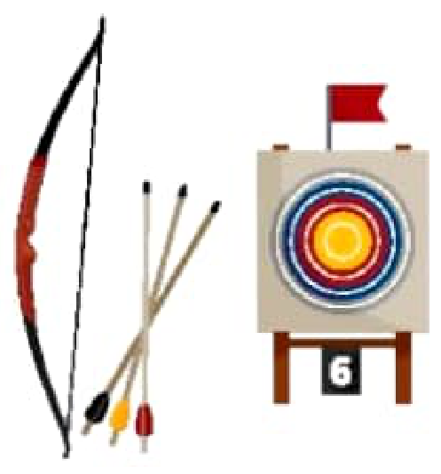
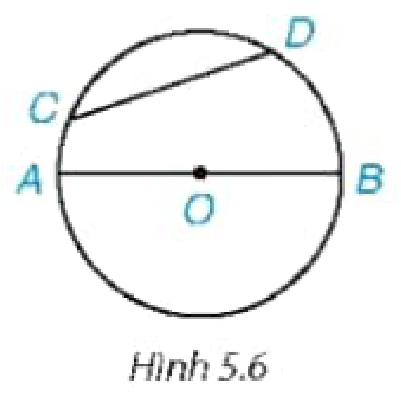
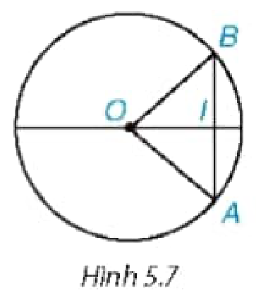
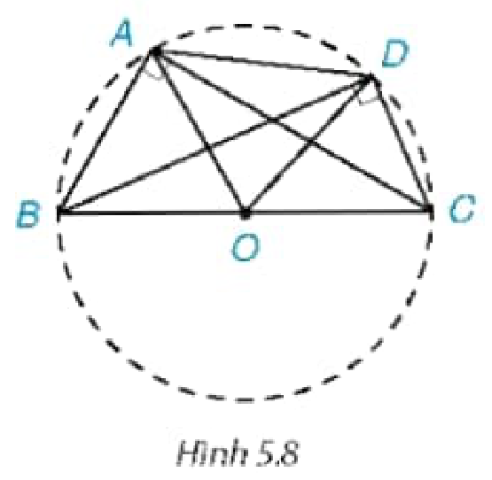
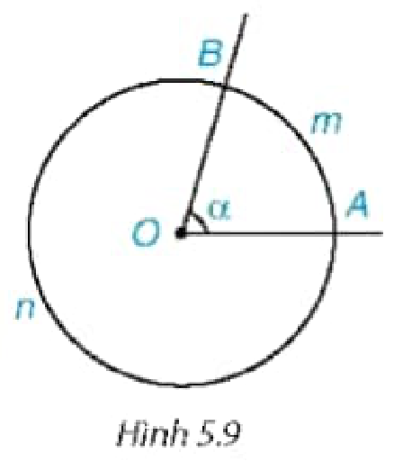
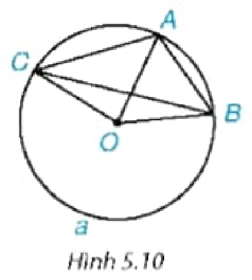
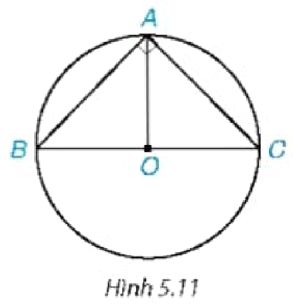
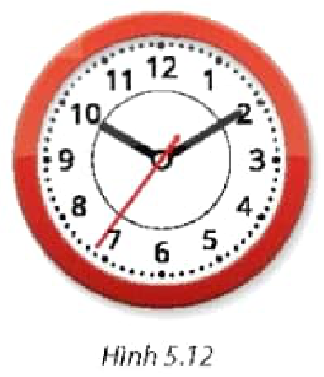

<!-- pdf:89 -->

# BÀI 14: CUNG VÀ DÂY CỦA MỘT ĐƯỜNG TRÒN

## 🔤 Khái niệm, thuật ngữ

- Cung, dây cung
- Đường kính, nửa đường tròn
- Góc ở tâm, cung bị chắn
- Số đo cung

## 🎯 Kiến thức, kĩ năng

- Nhận biết cung, dây cung, đường kính của đường tròn và quan hệ giữa độ dài dây và đường kính.
- Nhận biết góc ở tâm, cung bị chắn.
- Nhận biết và xác định số đo của một cung.

## 🔴 Mở đầu

Trong các cuộc thi đấu thể thao, người ta thường tổ chức thi bắn cung. Thuở xưa, cây cung được làm ra bằng cách buộc một sợi dây (gọi là dây cung) vào hai đầu của một đoạn tre (hoặc gỗ) có tính đàn hồi cao. Đoạn tre bị kéo căng, cong lại tạo nên hình ảnh của một phần đường tròn, đó cũng chính là hình ảnh của “cung” trong Toán học. Trong bài này chúng ta sẽ tìm hiểu về những vấn đề liên quan đến khái niệm này.

## 1. DÂY VÀ ĐƯỜNG KÍNH CỦA ĐƯỜNG TRÒN

**Khái niệm dây và đường kính của đường tròn**

> - Đoạn thẳng nối hai điểm tuỳ ý của một đường tròn gọi là một **dây** (hay **dây cung**) của đường tròn.
> - Mỗi dây đi qua tâm là một **đường kính** của đường tròn. Dễ thấy đường kính của đường tròn bán kính $R$ có độ dài bằng $2R$.
>
> Trên Hình 5.6, $CD$ là một dây, $AB$ là một đường kính của $(O)$.

*Hình 5.6*

**Quan hệ giữa dây và đường kính**

**HĐ:** Xét dây $AB$ tuỳ ý không đi qua tâm của đường tròn $(O; R)$ (H.5.7).

Dựa vào quan hệ giữa các cạnh của tam giác $AOB$, chứng minh $AB < 2R$.

*Hình 5.7*

<!-- term: Định lí về quan hệ giữa dây và đường kính -->
> **Định lí:** Trong một đường tròn, đường kính là dây cung lớn nhất.

<!-- pdf:90 -->

**Ví dụ 1:** Tứ giác lồi $ABCD$ có $\widehat{BAC} = \widehat{BDC} = 90^\circ$. Chứng minh bốn điểm $A, B, C, D$ cùng nằm trên một đường tròn và $AD < BC$.
<!-- ocr-ok: đã đối chiếu trực tiếp ảnh trang PDF 90, OCR bỏ sót nhãn hộp Ví dụ 1 -->

*Hình 5.8*

**Giải** (H.5.8)

Gọi $O$ là trung điểm của đoạn $BC$. Tam giác $ABC$ vuông tại $A$ ($\widehat{BAC} = 90^\circ$) nên đường trung tuyến $AO$ bằng nửa cạnh huyền, nghĩa là $OA = OB = OC = \dfrac{BC}{2}$. Do đó điểm $A$ nằm trên đường tròn $(O)$ đường kính $BC$.

Tương tự, bằng cách xét tam giác $DBC$ ta cũng suy ra điểm $D$ thuộc đường tròn $(O)$. Vậy $AD$ là một dây (không đi qua tâm) của đường tròn $(O)$. Áp dụng định lí trên ta có $AD < BC$.

**Luyện tập 1:** Cho đường tròn đường kính $BC$. Chứng minh rằng với điểm $A$ bất kì (khác $B$ và $C$) nằm trên đường tròn, ta đều có $BC < AB + AC < 2BC$.

## 2. GÓC Ở TÂM, CUNG VÀ SỐ ĐO CỦA MỘT CUNG

**Khái niệm góc ở tâm và cung tròn**

Cho hai điểm $A$ và $B$ cùng thuộc một đường tròn. Hai điểm ấy chia đường tròn thành hai phần, mỗi phần gọi là một **cung tròn** (hay **cung**). Hai điểm $A$ và $B$ gọi là **hai mút** (hay **đầu mút**) của mỗi cung đó.

> **Góc ở tâm** là góc có đỉnh trùng với tâm của đường tròn.

Trên Hình 5.9 ta có hai cung, kí hiệu là $\overset{\frown}{AmB}$ và $\overset{\frown}{AnB}$ nhưng chỉ có một góc ở tâm là $\widehat{AOB}$.

*Hình 5.9*

**Chú ý**

- Khi góc $AOB$ không bẹt thì cung nằm trong góc $AOB$ gọi là **cung nhỏ** (trên Hình 5.9, $\overset{\frown}{AmB}$ là cung nhỏ). Khi đó $\overset{\frown}{AmB}$ còn có thể kí hiệu gọn là $\overset{\frown}{AB}$. Cung còn lại, $\overset{\frown}{AnB}$ gọi là **cung lớn**. Khi góc $AOB$ bẹt thì mỗi cung $AB$ được gọi là một **nửa đường tròn**.
<!-- term: Cung bị chắn -->
- Ta còn nói góc $AOB$ chắn cung $AB$ hay *cung $AB$ bị chắn* bởi góc $AOB$.

<!-- pdf:91 -->

**Ví dụ 2:** Cho ba điểm $A, B$ và $C$ thuộc đường tròn $(O)$ như Hình 5.10.
<!-- ocr-ok: đã đối chiếu trực tiếp ảnh trang PDF 91, OCR bỏ sót nhãn hộp Ví dụ 2 -->

a) Tìm các góc ở tâm có hai cạnh đi qua hai trong ba điểm $A, B, C$.

b) Tìm các cung có hai mút là hai trong ba điểm $A, B, C$.

*Hình 5.10*

**Giải**

a) Các góc ở tâm cần tìm là $\widehat{AOB}, \widehat{BOC}$ và $\widehat{COA}$.

b) - Các cung có hai mút $A, B$ là $\overset{\frown}{AB}, \overset{\frown}{ACB}$.
   - Các cung có hai mút $A, C$ là $\overset{\frown}{AC}, \overset{\frown}{ABC}$.
   - Các cung có hai mút $B, C$ là $\overset{\frown}{BAC}, \overset{\frown}{BaC}$.

**Cách xác định số đo của một cung**

> 1) **Số đo của một cung** được xác định như sau:
>
> - Số đo của nửa đường tròn bằng $180^\circ$.
> - Số đo của cung nhỏ bằng số đo của góc ở tâm chắn cung đó.
> - Số đo của cung lớn bằng hiệu giữa $360^\circ$ và số đo của cung nhỏ có chung hai mút.
>
> 2) Số đo của cung $AB$ được kí hiệu là $\text{sđ}\overset{\frown}{AB}$. Trên Hình 5.9, ta có:
>
> $\text{sđ}\overset{\frown}{AmB} = \widehat{AOB} = \alpha$; $\text{sđ}\overset{\frown}{AnB} = 360^\circ - \alpha$.

**Chú ý**

- Cung có số đo $n^\circ$ còn gọi là **cung $n^\circ$**. Cả đường tròn được coi là cung $360^\circ$. Đôi khi ta cũng coi một điểm là cung $0^\circ$.

<!-- term: Hai cung bằng nhau -->
- Hai cung trên một đường tròn gọi là *bằng nhau* nếu chúng có cùng số đo.

> ❓ Tại sao số đo cung lớn của một đường tròn luôn lớn hơn $180^\circ$?

**Nhận xét**

Nếu $A$ là một điểm thuộc cung $BAC$ thì $\text{sđ}\overset{\frown}{BAC} = \text{sđ}\overset{\frown}{BA} + \text{sđ}\overset{\frown}{AC}$ (H.5.10).

**Ví dụ 3:** Tính số đo của các cung có các đầu mút là hai trong các điểm $A, B, C$ trong Hình 5.11, biết rằng $ABC$ là tam giác vuông cân tại đỉnh $A$.

*Hình 5.11*

<!-- pdf:92 -->

**Giải**

- Trên Hình 5.11, ta thấy $\overset{\frown}{AB}$ và $\overset{\frown}{AC}$ là các cung nhỏ bị chắn bởi các góc ở tâm thứ tự là $\widehat{AOB}$ và $\widehat{AOC}$. Do tam giác $ABC$ vuông cân tại $A$ nên đường trung tuyến $AO$ cũng là đường cao, tức là $AO \perp BC$. Do đó $\widehat{AOB} = \widehat{AOC} = 90^\circ$, suy ra $\text{sđ}\overset{\frown}{AB} = \text{sđ}\overset{\frown}{AC} = 90^\circ$.
- $\overset{\frown}{ACB}$ là cung lớn có chung hai mút $A, B$ với cung nhỏ $AB$ nên

  $\text{sđ}\overset{\frown}{ACB} = 360^\circ - \text{sđ}\overset{\frown}{AB} = 360^\circ - 90^\circ = 270^\circ$.

  Tương tự, ta có: $\text{sđ}\overset{\frown}{ABC} = 360^\circ - \text{sđ}\overset{\frown}{AC} = 360^\circ - 90^\circ = 270^\circ$.

  Ngoài ra còn có hai nửa đường tròn có chung hai mút $A$ và $B$, có số đo bằng $180^\circ$.

**Luyện tập 2:** Cho điểm $C$ nằm trên đường tròn $(O)$. Đường trung trực của đoạn $OC$ cắt $(O)$ tại $A$ và $B$. Tính số đo của các cung $\overset{\frown}{ACB}$ và $\overset{\frown}{ABC}$.
<!-- ocr-ok: đã đối chiếu trực tiếp ảnh trang PDF 92, OCR bỏ sót nhãn hộp Luyện tập 2 -->

## BÀI TẬP

5.5. Cho nửa đường tròn đường kính $AB$ và một điểm $M$ tuỳ ý thuộc nửa đường tròn đó. Chứng minh rằng khoảng cách từ $M$ đến $AB$ không lớn hơn $\dfrac{AB}{2}$.

5.6. Cho đường tròn $(O; 5\text{ cm})$ và $AB$ là một dây bất kì của đường tròn đó. Biết $AB = 6\text{ cm}$.

a) Tính khoảng cách từ $O$ đến đường thẳng $AB$.

b) Tính $\tan \alpha$ nếu góc ở tâm chắn cung $AB$ bằng $2\alpha$.

5.7. Tâm $O$ của một đường tròn cách dây $AB$ của nó một khoảng $3\text{ cm}$. Tính bán kính của đường tròn $(O)$, biết rằng cung nhỏ $AB$ có số đo bằng $100^\circ$ (làm tròn kết quả đến hàng phần mười).

5.8. Trên mặt một chiếc đồng hồ có các vạch chia như Hình 5.12. Hỏi cứ sau mỗi khoảng thời gian $36$ phút:

a) Đầu kim phút vạch nên một cung có số đo bằng bao nhiêu độ?

b) Đầu kim giờ vạch nên một cung có số đo bằng bao nhiêu độ?

*Hình 5.12*

## 📷 Danh sách hình trong bài

| Mã hình | Trang PDF | Vị trí trong bài | Chú thích gốc |
| --- | :---: | --- | --- |
| H9-toan-b14-01 | 89 | Mở đầu | (sách không đánh số, minh hoạ cung tên và bia bắn cung) |
| H9-toan-b14-02 | 89 | Mục 1 | Hình 5.6 |
| H9-toan-b14-03 | 89 | Mục 1, HĐ | Hình 5.7 |
| H9-toan-b14-04 | 90 | Mục 1, Ví dụ 1 | Hình 5.8 |
| H9-toan-b14-05 | 90 | Mục 2 | Hình 5.9 |
| H9-toan-b14-06 | 91 | Mục 2, Ví dụ 2 | Hình 5.10 |
| H9-toan-b14-07 | 91 | Mục 2, Ví dụ 3 | Hình 5.11 |
| H9-toan-b14-08 | 92 | Bài tập 5.8 | Hình 5.12 |
