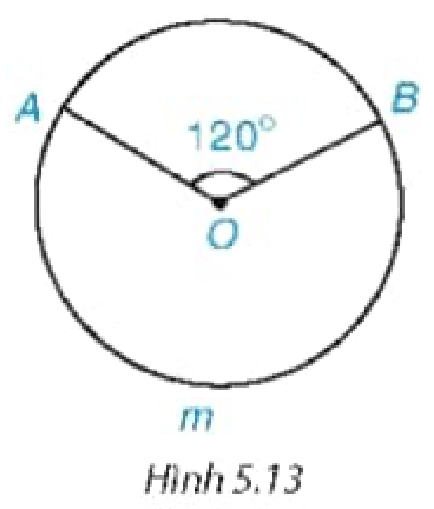
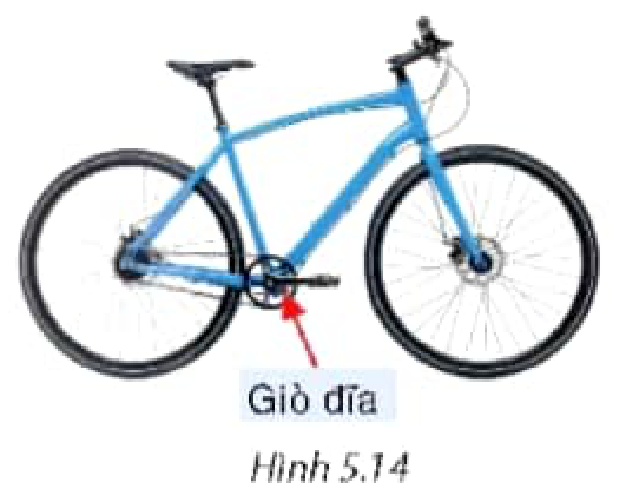
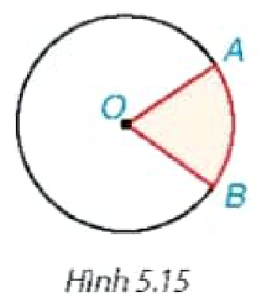
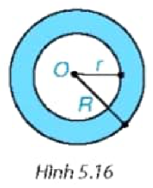
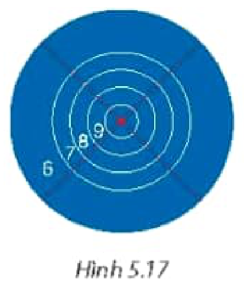
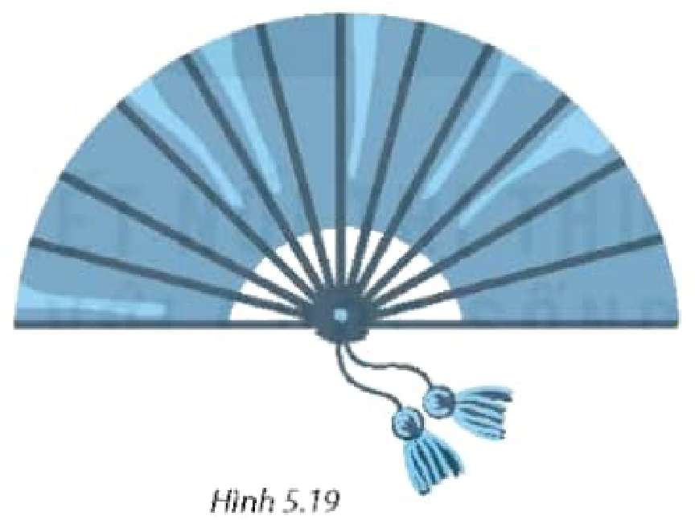

<!-- pdf:93 -->

# BÀI 15: ĐỘ DÀI CỦA CUNG TRÒN. DIỆN TÍCH HÌNH QUẠT TRÒN VÀ HÌNH VÀNH KHUYÊN

## 🔤 Khái niệm, thuật ngữ

- Hình quạt tròn
- Hình vành khuyên

## 🎯 Kiến thức, kĩ năng

- Tính độ dài cung tròn.
- Tính diện tích hình quạt tròn và hình vành khuyên.

## 🔴 Mở đầu

Số người trên một địa bàn đã được tiêm mũi $4$ phòng dịch Covid-19 đạt $40\%$ trong tổng số các đối tượng cần được tiêm. Để hoàn thành một biểu đồ hình quạt tròn, Trang cần vẽ hình quạt tròn biểu thị số liệu $40\%$. Em có thể giúp bạn Trang được không?

## 1. ĐỘ DÀI CỦA CUNG TRÒN

**Công thức tính độ dài của cung tròn**

Người ta chứng minh được rằng tỉ số giữa chu vi và đường kính của một đường tròn luôn bằng một số vô tỉ không đổi gọi là **số $\pi$** (đọc là pi). Ta có thể tìm được giá trị gần đúng của $\pi$ nhờ máy tính cầm tay. Trong đời sống, ta thường lấy $\pi \approx 3,14$.

<!-- term: Độ dài đường tròn -->
Do đó, ta có công thức tính độ dài $C$ của đường tròn $(O; R)$, đường kính $d = 2R$ là:

$C = \pi d = 2\pi R$. (1)

**HĐ1:** Biết rằng trên một đường tròn, hai cung bằng nhau thì có cùng độ dài và độ dài của cung tỉ lệ với số đo của nó. Từ đó hãy lập công thức tính độ dài cung $n^\circ$ của đường tròn bán kính $R$ bằng cách thực hiện các bước sau:

a) Từ (1), tính độ dài của cung $1^\circ$.

b) Tính độ dài $l$ của cung $n^\circ$.

<!-- term: Độ dài cung tròn -->
Ta có công thức tính độ dài $l$ của cung $n^\circ$ trên đường tròn $(O; R)$:

> $l = \dfrac{n}{180}\pi R$. (2)

**Nhận xét:** Từ hai công thức (1) và (2), ta được $l = \dfrac{n}{360}\pi d = \dfrac{n}{360}C$ hay $\dfrac{l}{C} = \dfrac{n}{360}$, nghĩa là:

Tỉ số giữa độ dài cung $n^\circ$ và độ dài đường tròn (cùng bán kính) đúng bằng $\dfrac{n}{360}$.

**Ví dụ 1:** Cho $A$ và $B$ là hai điểm trên đường tròn $(O; 3\text{ cm})$ sao cho $\widehat{AOB} = 120^\circ$. Tính số đo và độ dài các cung có hai mút $A, B$.

<!-- pdf:94 -->

**Giải** (H.5.13)

*Hình 5.13*

Ta có hai cung:

- Cung nhỏ $AB$ bị chắn bởi góc ở tâm $AOB$.

  Do đó $\text{sđ}\overset{\frown}{AB} = \widehat{AOB} = 120^\circ$;

  Độ dài $l_1$ của cung $AB$ là:

  $l_1 = \dfrac{120}{180}\pi \cdot 3 = 2\pi\text{ (cm)}$.

- Cung lớn $AmB$ có số đo là:

  $\text{sđ}\overset{\frown}{AmB} = 360^\circ - 120^\circ = 240^\circ$.

  Độ dài $l_2$ của cung $AmB$ là:

  $l_2 = \dfrac{240}{180}\pi \cdot 3 = 4\pi\text{ (cm)}$.

**Luyện tập 1:** Tính độ dài cung $40^\circ$ của đường tròn bán kính $9\text{ cm}$.

**Vận dụng 1:** Bánh xe (khi bơm căng) của một chiếc xe đạp có đường kính $650\text{ mm}$. Biết rằng khi giò đĩa quay một vòng thì bánh xe quay được khoảng $3,3$ vòng (H.5.14). Hỏi chiếc xe đạp di chuyển được quãng đường dài bao nhiêu mét sau khi người đi xe đạp $10$ vòng liên tục?

*Hướng dẫn:* Khi bánh xe quay $3,3$ vòng thì mỗi điểm trên bánh xe di chuyển được một độ dài bằng $3,3$ lần chu vi đường tròn.

*Hình 5.14*

## 2. HÌNH QUẠT TRÒN VÀ HÌNH VÀNH KHUYÊN

**Hình tròn, hình quạt tròn và hình vành khuyên**

> 1) **Hình quạt tròn** là phần hình tròn giới hạn bởi một cung tròn và hai bán kính đi qua hai đầu mút của cung đó (H.5.15).
>
> 2) **Hình vành khuyên** (còn gọi là **hình vành khăn**) (H.5.16) là phần nằm giữa hai đường tròn có cùng tâm và bán kính khác nhau (còn gọi là **hai đường tròn đồng tâm**).

*Hình 5.15*

*Hình 5.16*

<!-- pdf:95 -->

> ❓ Em hãy tìm một số hình ảnh của hình quạt tròn và hình vành khuyên trong thực tế.

**Diện tích hình quạt tròn và hình vành khuyên**

Ta đã biết, diện tích hình tròn bán kính $R$ được tính theo công thức $S = \pi R^2$. Hãy thực hiện các hoạt động sau để tìm công thức tính diện tích của hình quạt tròn và hình vành khuyên.

**HĐ2:** Biết rằng hai hình quạt tròn ứng với hai cung bằng nhau trên một đường tròn thì có diện tích bằng nhau và diện tích hình quạt tròn tỉ lệ với số đo của cung tương ứng với nó. Hãy thiết lập công thức tính diện tích hình quạt tròn bán kính $R$ ứng với cung $n^\circ$ bằng cách thực hiện từng bước sau:

a) Tính diện tích hình quạt tròn ứng với cung $1^\circ$;

b) Tính diện tích hình quạt tròn ứng với cung $n^\circ$.

**HĐ3:** Thiết lập công thức tính diện tích hình vành khuyên nằm giữa hai đường tròn đồng tâm có bán kính là $R$ và $r$ ($R > r$).

<!-- term: Diện tích hình quạt tròn -->
> - *Diện tích $S_q$ của hình quạt tròn* bán kính $R$ ứng với cung $n^\circ$:
>
>   $S_q = \dfrac{n}{360}\pi R^2 = \dfrac{l \cdot R}{2}$. (3)

<!-- term: Diện tích hình vành khuyên -->
> - *Diện tích $S_v$ của hình vành khuyên* tạo bởi hai đường tròn đồng tâm có bán kính $R$ và $r$.
>
>   $S_v = \pi(R^2 - r^2)$ (với $R > r$). (4)

**Nhận xét**

Công thức (3) có thể viết là $S_q = \dfrac{n}{360}S$ hay $\dfrac{S_q}{S} = \dfrac{n}{360} = \dfrac{l}{C}$, nghĩa là:

Tỉ số giữa diện tích hình quạt tròn ứng với cung $n^\circ$ và diện tích hình tròn (cùng bán kính) đúng bằng $\dfrac{n}{360}$ và bằng tỉ số giữa độ dài cung $n^\circ$ và độ dài đường tròn.

**Ví dụ 2:** Tính diện tích của hình vành khuyên nằm giữa hai đường tròn đồng tâm có bán kính là $3\text{ m}$ và $5\text{ m}$.

**Giải**

Gọi $S_v$ là diện tích cần tính.

Ta có $S_v = \pi(5^2 - 3^2) = 16\pi\text{ (m}^2\text{)}$.

<!-- pdf:96 -->

**Ví dụ 3:** Tính diện tích của hình quạt tròn bán kính $5\text{ cm}$ và có độ dài cung tương ứng với nó bằng $4\pi\text{ cm}$.

**Giải**

Theo đề bài, hình quạt tròn có độ dài cung tương ứng với nó là $l = 4\pi\text{ cm}$, bán kính là $R = 5\text{ cm}$. Do đó theo (3), diện tích $S$ của nó là:

$S = \dfrac{l \cdot R}{2} = \dfrac{4\pi \cdot 5}{2} = 10\pi\text{ (cm}^2\text{)}$.

**Thực hành:** Trở lại *tình huống mở đầu*. Hãy vẽ (tô màu) hình quạt tròn theo hướng dẫn sau:

- Vẽ đường tròn tâm $O$ (với bán kính tuỳ chọn).
- Hình quạt tròn cần vẽ ứng với cung có số đo bằng $40\%$ của $360^\circ$. Tính số đo của cung cần vẽ.
- Vẽ góc ở tâm có số đo tìm được và tô màu hình quạt tròn tương ứng.

**Luyện tập 2:** Tính diện tích của hình quạt tròn đã vẽ trong Thực hành trên nếu bán kính của nó bằng $4\text{ cm}$.

**Vận dụng 2:** Một tấm bia tạo bởi năm đường tròn đồng tâm lần lượt có bán kính là $5\text{ cm}, 10\text{ cm}, 15\text{ cm}, 20\text{ cm}$ và $30\text{ cm}$ (H.5.17). Giả thiết rằng người chơi ném phi tiêu một cách ngẫu nhiên và luôn trúng bia. Tính xác suất ném trúng vòng $8$ (hình vành khuyên nằm giữa đường tròn thứ hai và thứ ba), biết rằng xác suất cần tìm bằng tỉ số giữa diện tích của hình vành khuyên tương ứng với diện tích của hình tròn lớn nhất.

*Hình 5.17*

## BÀI TẬP

5.9. Cho đường tròn $(O; 4\text{ cm})$ và ba điểm $A, B, C$ trên đường tròn đó sao cho tam giác $ABC$ cân tại đỉnh $A$ và số đo của cung nhỏ $BC$ bằng $70^\circ$.

a) Giải thích tại sao hai cung nhỏ $AB$ và $AC$ bằng nhau.

b) Tính độ dài của các cung $BC, AB$ và $AC$ (làm tròn kết quả đến hàng phần mười).

<!-- pdf:97 -->

5.10. Tính diện tích của hình quạt tròn bán kính $4\text{ cm}$, ứng với cung $36^\circ$.

5.11. Tính diện tích hình vành khuyên nằm giữa hai đường tròn đồng tâm có bán kính là $6\text{ cm}$ và $4\text{ cm}$.

5.12. Có hai chiếc bánh pizza hình tròn (H.5.18). Chiếc bánh thứ nhất có đường kính $16\text{ cm}$ được cắt thành $6$ miếng đều nhau có dạng hình quạt tròn. Chiếc bánh thứ hai có đường kính $18\text{ cm}$ được cắt thành $8$ miếng đều nhau có dạng hình quạt tròn. Hãy so sánh diện tích bề mặt của hai miếng bánh cắt ra từ chiếc bánh thứ nhất và thứ hai.

*Hình 5.18*

5.13. Một chiếc quạt giấy khi xoè ra có dạng nửa hình tròn bán kính $2,2\text{ dm}$ như Hình 5.19. Tính diện tích phần giấy của chiếc quạt, biết rằng khi gấp lại, phần giấy có chiều dài khoảng $1,6\text{ dm}$ (làm tròn kết quả đến hàng phần trăm của $\text{dm}^2$).

*Hình 5.19*

## 📷 Danh sách hình trong bài

| Mã hình | Trang PDF | Vị trí trong bài | Chú thích gốc |
| --- | :---: | --- | --- |
| H9-toan-b15-01 | 94 | Mục 1, Ví dụ 1 | Hình 5.13 |
| H9-toan-b15-02 | 94 | Mục 1, Vận dụng 1 | Hình 5.14 |
| H9-toan-b15-03 | 94 | Mục 2 | Hình 5.15 |
| H9-toan-b15-04 | 94 | Mục 2 | Hình 5.16 |
| H9-toan-b15-05 | 96 | Mục 2, Vận dụng 2 | Hình 5.17 |
| H9-toan-b15-06 | 97 | Bài tập 5.12 | Hình 5.18 |
| H9-toan-b15-07 | 97 | Bài tập 5.13 | Hình 5.19 |
